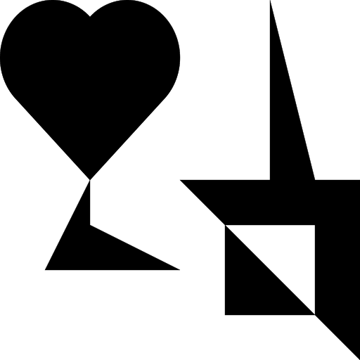
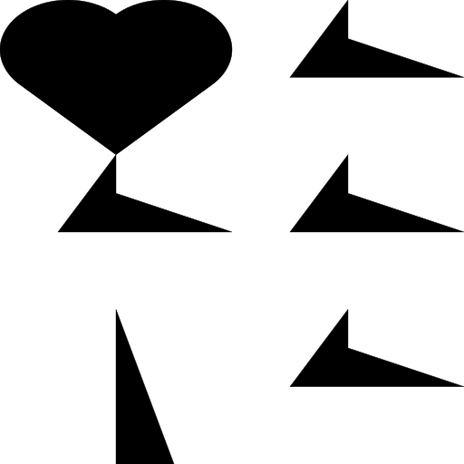
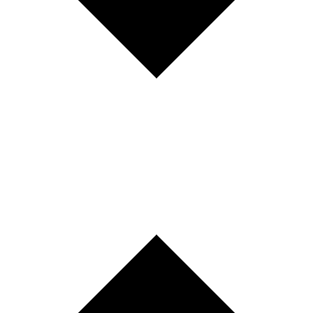
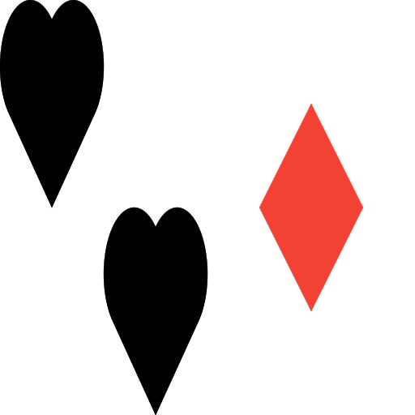
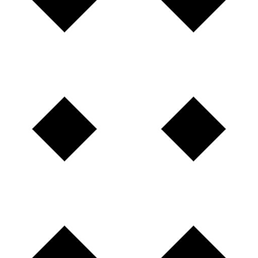

# 2. Functional abstraction with runes

<p class="chapter-goal">Build pictures from pictures, and learn to treat every function as a black box with a name.</p>

!!! abstract "The big idea, in plain words"
    You can drive a car without knowing how the engine works. You only need to know what the pedals
    do. A function is the same: if you know what goes in and what comes out, you can use it without
    looking inside. This chapter practises that habit with **runes**, small square pictures. You never
    learn how a rune is drawn, yet you will build quite rich pictures from a handful of primitives,
    by **combination**, **naming** and **functional abstraction**.

## Runes are values

A rune is a picture in a square. It is a value, like a number: you can give it a name, pass it to a
function, and get it back as a result. Rune names are not part of the language. A program must
**import** every name it uses from the `rune` module first:

```python title="§1 · figure 02-runes-gallery"
from rune import show, heart, sail, nova, rcross, stack, beside

show(stack(beside(heart, sail), beside(nova, rcross)))
```
??? note "Output (text preview)"
    ```text title="Output"
    ┌────────────────────────────────────────────────┐
    │   ▄▄█████▄  ▄█████▄▄                           │
    │ ▄████████████████████▄             █           │
    │▄██████████████████████▄            █           │
    │████████████████████████            ██          │
    │████████████████████████            ██          │
    │▀██████████████████████▀            ███         │
    │  ████████████████████              ███         │
    │   ▀████████████████▀               ████        │
    │     ▀████████████▀                 ████        │
    │       ▀████████▀                   █████       │
    │         ▀████▀                     █████       │
    │           ▀▀                       ██████      │
    │           ▄            ▀███████████████████████│
    │          ▄█              ▀█████████████████████│
    │         ▄██                ▀███████████████████│
    │        ▄████▄▄               █▄          ██████│
    │       ▄█████████▄▄           ███▄        ██████│
    │      ▄██████████████▄▄       █████▄      ██████│
    │                              ███████▄    ██████│
    │                              █████████▄  ██████│
    │                              ███████████▄██████│
    │                                          ▀█████│
    │                                            ▀███│
    │                                              ▀█│
    └────────────────────────────────────────────────┘
    ```

{ width="240" }

`heart`, `sail`, `nova` and `rcross` are **primitive runes**. Others are `corner`, `square` (a solid
box), `blank` (an empty box), `circle`, `triangle`, `pentagram` and `ribbon`. `show(rune)` displays a
rune. sicpfuf prints a rough text preview in the terminal and also saves a proper picture.

!!! note "Python §1 vs real Python"
    Only `from rune import a, b, c` is allowed. `import rune` and `rune.heart` are not part of any
    chapter, because there is no `x.y` syntax at all. In the course's own playground the imports work
    the same way.

## Combining runes

There are two basic **means of combination**. Both take runes and return a new rune that fills the
same square:

| Function | What it does |
|---|---|
| `stack(a, b)` | `a` on top, `b` below, each squashed to half the height |
| `beside(a, b)` | `a` on the left, `b` on the right, each squashed to half the width |
| `stack_frac(f, a, b)` | `a` gets the top fraction `f` of the height, `b` the rest |
| `stackn(n, a)` | `n` copies of `a` stacked, each `1/n` of the height |
| `quarter_turn_right(a)` | `a` turned 90° clockwise |

Because each function returns a rune, results can be fed into further combinations. Watch the sizes:
`stack(a, stack(b, c))` gives `a` half the height but `b` and `c` only a quarter each. To get three
equal rows, give the first rune one third and let the other two share the rest:

```python title="§1 · figure 02-runes-totem"
from rune import show, heart, nova, sail, stack, stack_frac, stackn, beside

totem = stack_frac(1 / 3, heart, stack(nova, sail))
show(beside(totem, stackn(3, nova)))
```
??? note "Output (text preview)"
    ```text title="Output"
    ┌────────────────────────────────────────────────┐
    │  ▄▄██████▄▄▄▄██████▄▄             ▄            │
    │▄██████████████████████▄         ▄██            │
    │████████████████████████        ▄█████▄▄▄       │
    │▀██████████████████████▀      ▄█████████████▄▄▄ │
    │  ▀██████████████████▀                          │
    │    ▀▀████████████▀▀                            │
    │       ▀▀██████▀▀                               │
    │          ▀██▀                                  │
    │           ▄                       ▄            │
    │         ▄██                     ▄██            │
    │        ▄█████▄▄▄               ▄█████▄▄▄       │
    │      ▄█████████████▄▄▄       ▄█████████████▄▄▄ │
    │                                                │
    │                                                │
    │                                                │
    │                                                │
    │            ▄                      ▄            │
    │            █                    ▄██            │
    │            ██                  ▄█████▄▄▄       │
    │            ██▄               ▄█████████████▄▄▄ │
    │            ███▄                                │
    │            ████                                │
    │            █████                               │
    │            █████▄                              │
    └────────────────────────────────────────────────┘
    ```

{ width="240" }

The left half is the `totem`; the right half is `stackn(3, nova)`. Both columns are cut in equal
thirds, built in two different ways.

## Your own transformations

A **rune transformation** is a function from a rune to a rune. `quarter_turn_right` is a primitive
one. With `def` you can make new ones by composing primitives, and then use them exactly like the
built-in ones. Nobody using `turn_upside_down` needs to know it is two quarter turns.

```python title="§1 · figure 02-runes-hourglass"
from rune import show, corner, stack, beside, quarter_turn_right, flip_horiz

def turn_upside_down(r):
    return quarter_turn_right(quarter_turn_right(r))

def mirror_row(r):
    return beside(r, flip_horiz(r))

def hourglass(r):
    return stack(mirror_row(r), turn_upside_down(mirror_row(r)))

show(hourglass(corner))
```
??? note "Output (text preview)"
    ```text title="Output"
    ┌────────────────────────────────────────────────┐
    │            ▀██████████████████████▀            │
    │              ▀██████████████████▀              │
    │                ▀██████████████▀                │
    │                  ▀██████████▀                  │
    │                    ▀██████▀                    │
    │                      ▀██▀                      │
    │                                                │
    │                                                │
    │                                                │
    │                                                │
    │                                                │
    │                                                │
    │                                                │
    │                                                │
    │                                                │
    │                                                │
    │                                                │
    │                                                │
    │                      ▄▄█▄                      │
    │                     ▄█████▄                    │
    │                   ▄█████████▄                  │
    │                 ▄█████████████▄                │
    │               ▄█████████████████▄              │
    │             ▄█████████████████████▄            │
    └────────────────────────────────────────────────┘
    ```

{ width="240" }

Read `hourglass` from the inside out: put `r` next to its mirror image, then stack that row on top
of the same row turned upside down. Three small definitions, each easy to check, give a picture that
would be hard to describe in one go.

!!! tip "Black box"
    `flip_horiz` is a primitive here, but you could define it from other runes too. A user of
    `mirror_row` cannot tell the difference: only the picture that comes out counts. This is
    **functional abstraction**: the name `mirror_row` hides how it is done.

## Abstracting over a pattern

`hourglass` works for any rune, because the rune is a parameter. The same idea gives patterns that
take two runes, such as a 2 by 2 `checker`. The module also has a ready-made pattern: `make_cross(r)`
puts four turned copies of `r` around the centre. Here are both, side by side:

```python title="§1 · figure 02-runes-checker"
from rune import show, heart, blank, corner, stack, beside, make_cross, red

def checker(a, b):
    return stack(beside(a, b), beside(b, a))

show(beside(checker(heart, blank), make_cross(red(corner))))
```
??? note "Output (text preview)"
    ```text title="Output"
    ┌────────────────────────────────────────────────┐
    │ ▄███▄▄███▄                                     │
    │ ██████████                                     │
    │████████████                                    │
    │████████████                                    │
    │████████████                                    │
    │████████████                                    │
    │ ██████████                        ▄▄           │
    │  ████████                        ▄██▄          │
    │   ██████                        ▄████▄         │
    │   ▀████▀                       ▄██████▄        │
    │    ▀██▀                       ▄████████▄       │
    │     ▀▀                       ▄██████████▄      │
    │             ▄███▄▄███▄       ▀██████████▀      │
    │             ██████████        ▀████████▀       │
    │            ████████████        ▀██████▀        │
    │            ████████████         ▀████▀         │
    │            ████████████          ▀██▀          │
    │            ████████████           ▀▀           │
    │             ██████████                         │
    │              ████████                          │
    │               ██████                           │
    │               ▀████▀                           │
    │                ▀██▀                            │
    │                 ▀▀                             │
    └────────────────────────────────────────────────┘
    ```

{ width="240" }

## Colours and overlay

Colour functions such as `red`, `pink`, `blue`, `green`, `yellow`, `white` and `black` take a rune and
return the same rune painted. `scale(f, r)` shrinks `r` around the centre, and `overlay(a, b)` puts
`a` in front of `b`. Together they cut a white heart into a blue square:

```python title="§1 · figure 02-runes-badge"
from rune import show, heart, square, overlay, scale, white, blue

show(overlay(scale(0.6, white(heart)), blue(square)))
```
??? note "Output (text preview)"
    ```text title="Output"
    ┌────────────────────────────────────────────────┐
    │████████████████████████████████████████████████│
    │████████████████████████████████████████████████│
    │████████████████████████████████████████████████│
    │████████████████████████████████████████████████│
    │████████████████████████████████████████████████│
    │█████████████▀        ▀██▀        ▀█████████████│
    │███████████▀                        ▀███████████│
    │██████████▀                          ▀██████████│
    │██████████                            ██████████│
    │██████████                            ██████████│
    │██████████                            ██████████│
    │██████████▄                          ▄██████████│
    │███████████▄                        ▄███████████│
    │█████████████▄                    ▄█████████████│
    │███████████████▄                ▄███████████████│
    │█████████████████▄            ▄█████████████████│
    │███████████████████▄        ▄███████████████████│
    │████████████████████▄      ▄████████████████████│
    │██████████████████████▄  ▄██████████████████████│
    │████████████████████████████████████████████████│
    │████████████████████████████████████████████████│
    │████████████████████████████████████████████████│
    │████████████████████████████████████████████████│
    │████████████████████████████████████████████████│
    └────────────────────────────────────────────────┘
    ```

{ width="240" }

(The text preview has no colours: it shows white as empty and every other colour as ink.)

## Repeating a transformation

`repeat_apply(f, n, x)` from the `repeat` module applies a one-argument function `f` to `x`, `n` times:
`repeat_apply(f, 3, x)` is `f(f(f(x)))`. Since `hourglass` is a rune transformation, you can repeat
it:

```python title="§1 · figure 02-runes-pattern"
from rune import show, corner, stack, beside, quarter_turn_right, flip_horiz
from repeat import repeat_apply

def turn_upside_down(r):
    return quarter_turn_right(quarter_turn_right(r))

def mirror_row(r):
    return beside(r, flip_horiz(r))

def hourglass(r):
    return stack(mirror_row(r), turn_upside_down(mirror_row(r)))

show(repeat_apply(hourglass, 2, corner))
```
??? note "Output (text preview)"
    ```text title="Output"
    ┌────────────────────────────────────────────────┐
    │      ▀██████████▀            ▀██████████▀      │
    │        ▀██████▀                ▀██████▀        │
    │          ▀██▀                    ▀██▀          │
    │                                                │
    │                                                │
    │                                                │
    │                                                │
    │                                                │
    │                                                │
    │           ██▄                    ▄██▄          │
    │         ▄█████▄                ▄██████▄        │
    │       ▄█████████▄            ▄██████████▄      │
    │      ▀█████████▀             ▀█████████▀       │
    │        ▀█████▀                 ▀█████▀         │
    │          ▀█▀                     ▀██           │
    │                                                │
    │                                                │
    │                                                │
    │                                                │
    │                                                │
    │                                                │
    │           ██▄                     ██▄          │
    │         ▄█████▄                 ▄█████▄        │
    │       ▄█████████▄             ▄█████████▄      │
    └────────────────────────────────────────────────┘
    ```

{ width="240" }

Notice that `hourglass` is passed to `repeat_apply` without parentheses: you hand over the function
itself, not a result. Chapter 3 writes `repeat_apply` yourself, and chapter 5 is all about functions
that take functions.

## Traps

!!! warning "Trap: forgetting to import"
    Every rune name must be imported, including `show`.

    ```python title="§1"
    from rune import heart
    show(heart)
    ```
    ```text title="Output"
    NameNotFoundError at line 2
        show(heart)
        ^
    NameNotFoundError: the name 'show' is not found in the current or enclosing environment(s)
    sicpfuf hint: every name must be declared somewhere: by `name = ...`, by `def name(...)`, as a parameter, or by `from module import name`.
    ```

!!! warning "Trap: the wrong number or kind of arguments"
    `stack` takes exactly two runes. A number where a rune should be is a type error.

    ```python title="§1"
    from rune import show, heart, beside
    show(beside(heart, 2))
    ```
    ```text title="Output"
    TypeError at line 2
        show(beside(heart, 2))
    TypeError: beside expects a rune as rune2, but got an int
    ```

!!! warning "Trap: equal sizes need fractions"
    `stack(a, stack(b, c))` is **not** three equal rows: `a` gets 1/2, `b` and `c` get 1/4 each. Use
    `stack_frac(1 / 3, a, stack(b, c))` or `stackn` for equal rows.

## Takeaways

- Runes are values: name them, pass them, return them.
- Import every name you use: `from rune import show, heart, stack, ...`.
- `stack` and `beside` halve; `stack_frac(f, a, b)` gives `a` the fraction `f`; `stackn(n, r)` makes
  `n` equal rows.
- A **rune transformation** is a function from rune to rune. Define new ones with `def` by composing
  primitives.
- A function is a **black box**: users only care what comes out, not how it is built.
- Parameters let one definition (`checker(a, b)`) describe a whole family of pictures.

## Check yourself

1. In `stack(stack(heart, sail), nova)`, what fraction of the height does each rune get?

    ??? success "Answer"
        `heart` 1/4, `sail` 1/4, `nova` 1/2. The inner `stack` is squashed into the top half.

2. Write `quarter_turn_left(r)` using only `quarter_turn_right`.

    ??? success "Answer"
        ```python title="§1"
        from rune import sail, quarter_turn_right

        def quarter_turn_left(r):
            return quarter_turn_right(quarter_turn_right(quarter_turn_right(r)))

        turned = quarter_turn_left(sail)
        ```
        Three right turns are 270° clockwise, which is the same as 90° anticlockwise.

3. Write `with_roof(r)`: the rune `r` with a solid `square` band on top that takes 1/5 of the height.

    ??? success "Answer"
        ```python title="§1"
        from rune import square, heart, stack_frac

        def with_roof(r):
            return stack_frac(1 / 5, square, r)

        house = with_roof(heart)
        ```

4. Write `four(a, b, c, d)`: `a` top left, `b` top right, `c` bottom left, `d` bottom right. Then
   express `checker(a, b)` with it.

    ??? success "Answer"
        ```python title="§1"
        from rune import heart, blank, stack, beside

        def four(a, b, c, d):
            return stack(beside(a, b), beside(c, d))

        def checker(a, b):
            return four(a, b, b, a)

        board = checker(heart, blank)
        ```

5. What is wrong with `show(hourglass)`?

    ??? success "Answer"
        `hourglass` is a function, not a rune. `show` needs a rune, so apply the function first:
        `show(hourglass(corner))`.

        ```python title="§1"
        from rune import show, corner, stack

        def hourglass(r):
            return stack(r, r)

        show(hourglass)
        ```
        ```text
        TypeError: show expects a rune as rune, but got a function
        ```

*In the course: L1B · SICPy 1.1 (functions as black boxes, 1.1.8).*
