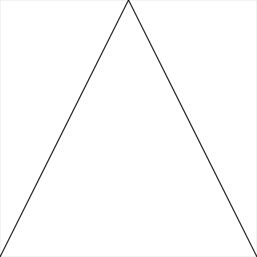
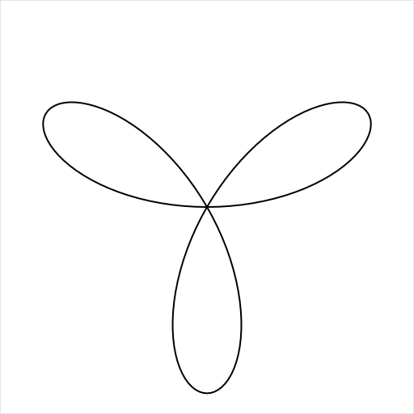
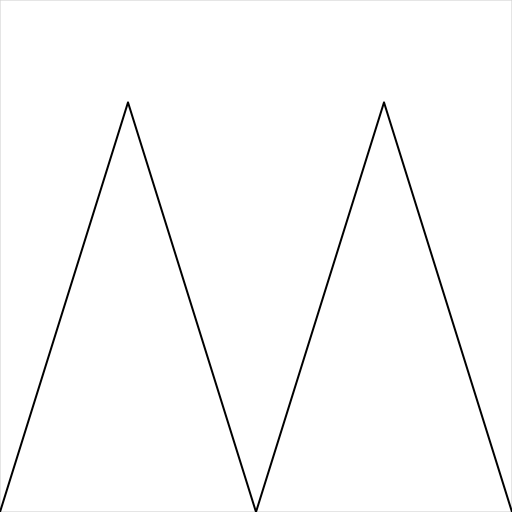
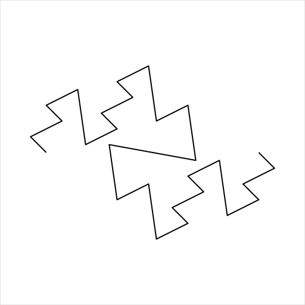

# 6. Curves, sounds and logical operators

<p class="chapter-goal">See `and` and `or` as shortcuts for conditional expressions, and build pictures and sounds out of nothing but functions.</p>

!!! abstract "The big idea, in plain words"
    Picture a drawing toy with one dial. As you turn the dial from 0 to 1, the pen moves across the
    page. Which point the pen is at depends only on the dial: that is a **function** from a number to
    a point, and that function *is* the curve. A loudspeaker is the same idea in time: at every moment
    it is pushed out by some amount, so a sound wave is a function from time to a number. Once
    curves and sounds are functions, everything from chapter 5 (passing them, returning them,
    transforming them) works on pictures and music too.

## `and`, `or` and `not`

`not p` flips a boolean. `p and q` is true when both are; `p or q` is true when at least one is.
But `and` and `or` are not ordinary operators. They are **syntactic forms** with their own rule:

| You write | It means |
|---|---|
| `p and q` | `q if p else False` |
| `p or q` | `True if p else q` |

So the right-hand side is evaluated **only when it is needed**. That makes this safe:

```python title="§1"
def is_big_ratio(a, b):
    return b != 0 and a / b > 2

print(is_big_ratio(10, 2), is_big_ratio(10, 0))
```
```text title="Output"
True False
```

??? example "X-ray: the division is never reached"
    ```python title="§1 · --subst"
    def is_big_ratio(a, b):
        return b != 0 and a / b > 2

    is_big_ratio(10, 0)
    ```
    ```text title="Output"
    is_big_ratio(10, 0)
    -> 0 != 0 and 10 / 0 > 2
    -> False and 10 / 0 > 2
    -> False
    ```
    Once the left side is `False`, the whole `and` is `False`, exactly like `... if False else
    False`. The `10 / 0` is dropped unevaluated.

A function cannot do this. Its arguments are evaluated first (applicative order, chapter 3), so a
home-made `both` crashes on the same input:

```python title="§1"
def both(p, q):
    return q if p else False

print(both(0 != 0, 10 / 0 > 2))
```
```text title="Output"
ZeroDivisionError at line 4
    print(both(0 != 0, 10 / 0 > 2))
ZeroDivisionError: division by zero
sicpfuf hint: check the divisor before dividing, for example with a base case `if n == 0`.
```

!!! warning "Trap: the left operand must be a boolean"
    The left operand of `and`/`or` and the operand of `not` must be `True` or `False`. Only the
    **last** operand may be anything, because it is simply the result: `True and 5` is `5`.

    ```python title="§1"
    print(True and 5, False or "plan B")
    print(1 and True)
    ```
    ```text
    5 plan B
    TypeError: left operand of 'and' must be bool, not int
    ```

!!! note "Python §1 vs real Python"
    Real Python accepts `1 and True` (it treats `1` as true) and `not 0`. Python §1 rejects both. The
    short-circuit rule itself is the same in both.

## Curves are functions

The `curve` module describes a curve as a function from a number `t` in the **unit interval**
[0, 1] to a **point**. `make_point(x, y)` builds a point; `x_of(p)` and `y_of(p)` take it apart. The
curve starts at C(0) and ends at C(1).

`draw_connected(n)` asks the curve for n + 1 points, at t = 0, 1/n, 2/n, …, 1, and joins them with
straight lines. You can watch the asking happen by printing inside the curve:

```python title="§1 · figure 06-curves-sound-tent"
from curve import make_point, draw_connected

def tent(t):
    print("asked for t =", t)
    return make_point(t, 1 - abs(2 * t - 1))

draw_connected(4)(tent)
```
??? note "Output (with text preview)"
    ```text title="Output"
    asked for t = 0.0
    asked for t = 0.25
    asked for t = 0.5
    asked for t = 0.75
    asked for t = 1.0
    ┌────────────────────────────────────────────────────────┐
    │                           ▄█                           │
    │                          ▄▀▀▄                          │
    │                         █▀  ▀█                         │
    │                        █▀    ▀█                        │
    │                       █▀      ▀█                       │
    │                      █▀        ▀█                      │
    │                     █▀          ▀█                     │
    │                    █              █                    │
    │                   ▄▀              ▀▄                   │
    │                  ▄▀                ▀▄                  │
    │                 █▀                  ▀█                 │
    │                █▀                    ▀█                │
    │               █▀                      ▀█               │
    │              █▀                        ▀█              │
    │             █▀                          ▀█             │
    │            █                              █            │
    │           ▄▀                              ▀▄           │
    │          ▄▀                                ▀▄          │
    │         █▀                                  ▀█         │
    │        █▀                                    ▀█        │
    │       █▀                                      ▀█       │
    │      █▀                                        ▀█      │
    │     █                                            █     │
    │    █                                              █    │
    │   ▄▀                                              ▀▄   │
    │  ▄▀                                                ▀▄  │
    │ █▀                                                  ▀█ │
    │█▀                                                    ▀█│
    └────────────────────────────────────────────────────────┘
    ```

{ width="240" }

Notice the odd-looking `draw_connected(4)(tent)`. `draw_connected(4)` **returns a function**, the
drawer, and that drawer is then applied to the curve. With more points the drawing gets smoother.

## Makers and transformations

A curve must take exactly **one** argument, `t`. So how do you write "a rose with k petals"? With a
**maker**: a function that takes the setting and **returns** a curve, just like `make_discount` in
chapter 5. `make_rose(3)` below is a curve; `make_rose(4)` would be another.

A **curve transformation** takes a curve and returns a curve: a function from functions to
functions. `shift` and `shrink` below are your own transformations, again made by makers so that
they can have settings. The rose lives around the origin, from −1 to 1, but the drawing window is the
unit square from 0 to 1, so the program shrinks it and moves it to the centre:

```python title="§1 · figure 06-curves-sound-moved"
from curve import make_point, x_of, y_of, draw_connected, rotate_around_origin

def make_rose(k):
    def rose(t):
        angle = 2 * math_pi * t
        r = math_cos(k * angle)
        return make_point(r * math_cos(angle), r * math_sin(angle))
    return rose

def shift(dx, dy):
    return lambda curve: lambda t: make_point(x_of(curve(t)) + dx, y_of(curve(t)) + dy)

def shrink(factor):
    return lambda curve: lambda t: make_point(factor * x_of(curve(t)), factor * y_of(curve(t)))

def compose(f, g):
    return lambda x: f(g(x))

to_centre = compose(shift(0.5, 0.5), shrink(0.45))
draw_connected(300)(to_centre(rotate_around_origin(math_pi / 6)(make_rose(3))))
```
??? note "Output (text preview)"
    ```text title="Output"
    ┌────────────────────────────────────────────────────────┐
    │                                                        │
    │                                                        │
    │                                                        │
    │                                                        │
    │                                                        │
    │                                                        │
    │                                                        │
    │      ▄▀▀▀▀▀▀▀█▄▄                      ▄▄█▀▀▀▀▀▀▀▄      │
    │      █         ▀▀▄▄                ▄▄▀▀         █      │
    │      █▄           ▀█▄            ▄█▀           ▄█      │
    │       ▀▄            ▀█▄        ▄█▀            ▄▀       │
    │         ▀█▄           ▀█      █▀           ▄█▀         │
    │            ▀▀▄▄         ▀▄  ▄▀         ▄▄▀▀            │
    │                ▀▀▀█▄▄▄▄▄▄████▄▄▄▄▄▄█▀▀▀                │
    │                           ██                           │
    │                          █  █                          │
    │                         █    █                         │
    │                        █▀    ▀█                        │
    │                        █      █                        │
    │                       █▀      ▀█                       │
    │                       █        █                       │
    │                       █        █                       │
    │                       █        █                       │
    │                       █        █                       │
    │                       ▀█      █▀                       │
    │                        ▀█    █▀                        │
    │                          ▀▀▀▀                          │
    │                                                        │
    └────────────────────────────────────────────────────────┘
    ```

{ width="240" }

Read the last line from the inside out: make the rose, turn it by π/6 with the module's
`rotate_around_origin`, then shrink it and move it into the middle of the window. `compose(f, g)`
glues two transformations into one: first `g`, then `f`. The module also has `translate(x, y, z)`
and `scale(x, y, z)`, which work like `shift` and `shrink`, and
`draw_connected_full_view_proportional(n)`, which rescales any curve to fit the window.

!!! warning "Trap: transformation, curve or point?"
    `shift(0.5, 0.5)` is a transformation. `shift(0.5, 0.5)(c)` is a curve. `shift(0.5, 0.5)(c)(0.3)`
    is a point. Before writing an application, ask what kind of thing each part is. A curve must
    return a point: forgetting `make_point` is the most common error.

## Connecting curves

To draw one curve and then another with a single pen stroke, make a curve that runs through the
first one during the first half of `t` and through the second one during the second half. Each half
must run at double speed:

```python title="§1 · figure 06-curves-sound-mountains"
from curve import make_point, x_of, y_of, draw_connected

def join(c1, c2):
    return lambda t: c1(2 * t) if t < 0.5 else c2(2 * t - 1)

def shift(dx, dy):
    return lambda curve: lambda t: make_point(x_of(curve(t)) + dx, y_of(curve(t)) + dy)

def peak(t):
    return make_point(t / 2, 0.8 * (1 - abs(2 * t - 1)))

two_peaks = join(peak, shift(0.5, 0)(peak))
draw_connected(100)(two_peaks)
```
??? note "Output (text preview)"
    ```text title="Output"
    ┌────────────────────────────────────────────────────────┐
    │                                                        │
    │                                                        │
    │                                                        │
    │                                                        │
    │                                                        │
    │              ▄                          ▄              │
    │             ██                          ██             │
    │            ▄█ █                        █ █▄            │
    │            █  ▀▄                      ▄▀  █            │
    │           ▄▀   █                      █   ▀▄           │
    │           █     █                    █▀    █           │
    │          █      █▄                  ▄█      █          │
    │         ▄▀       █                  █       ▀▄         │
    │         █        ▀█                █▀        █         │
    │        █          █                █          █        │
    │        █           █              █           █        │
    │       █            ▀▄            ▄▀            █       │
    │      █▀             █            █             ▀█      │
    │      █              ▀█          █▀              █▄     │
    │     █                █▄        ▄█                █     │
    │    ▄▀                 █        █                 ▀▄    │
    │    █                  ▀▄      ▄▀                  █    │
    │   █                    █      █                    █   │
    │  ▄█                     █    █                     █▄  │
    │  █                      █▄  ▄█                      █  │
    │ █▀                       █  █                       ▀█ │
    │ █                         ██                         █ │
    │█                          ▀█                          █│
    └────────────────────────────────────────────────────────┘
    ```

{ width="240" }

`join` is a higher-order function that combines two curves into one, like `beside` combines two
runes. The module's `connect_rigidly` does the same thing.

## Endpoints, transformation order and repeated refinement

A curve maker returns a function; applying that function to t returns one point. Check
the endpoints numerically before deciding that a drawing is correct. Joining two curves
continuously requires the first endpoint to match the second start point.

Transformations usually do not commute. A translation followed by a reflection moves a
point differently from a reflection followed by a translation:

```python title="§1"
from curve import make_point, x_of, y_of

def path(t):
    return make_point(t, t * t)

def shift_right(c):
    return lambda t: make_point(x_of(c(t)) + 3, y_of(c(t)))

def reflect(c):
    return lambda t: make_point(-x_of(c(t)), y_of(c(t)))

first = reflect(shift_right(path))
second = shift_right(reflect(path))
print(x_of(first(0)), x_of(second(0)))
print(x_of(path(1)), y_of(path(1)))
```
```text title="Output"
-3 3
1 1
```

To refine a curve repeatedly, write one transformation that preserves a useful contract,
then apply it n times. This example replaces each curve by three scaled copies. All copies
start and end on the same horizontal line; the middle copy is reflected vertically.
It is a fresh construction for practising composition, rather than a mission solution.

```python title="§1"
from curve import make_point, x_of, y_of

def arch(t):
    return make_point(t, 4 * t * (1 - t))

def three_arches(c):
    def refined(t):
        section = 0 if t < 1 / 3 else 1 if t < 2 / 3 else 2
        p = c(3 * t - section)
        direction = -1 if section == 1 else 1
        return make_point((section + x_of(p)) / 3,
                          direction * y_of(p) / 3)
    return refined

def refine(n, change, c):
    return c if n == 0 else refine(n - 1, change, change(c))

c = refine(2, three_arches, arch)
print(x_of(c(0)), y_of(c(0)), x_of(c(1)), y_of(c(1)))
print(round(y_of(c(1 / 18)), 6))
```
```text title="Output"
0.0 0.0 1.0 0.0
0.111111
```

At each join, the input endpoints have y = 0, so the pieces meet. The parameter maps each
third of [0, 1] back onto the whole interval. One point query passes through n layers of
transformations, taking Θ(n) work here, although the expanded curve has 3^n pieces.
An image sampled at a fixed number of points can miss details at high refinement levels.

### Build a self-similar path from oriented segments

For a fractal-style replacement, preserve the shape of the replacement path at each
level, rather than shrinking every vertical coordinate towards a straight line. A curve
from (0, 0) to (1, 0) can be fitted onto any segment from A to B by translating, rotating
and scaling it. If B − A = (dx, dy), the transformed point is
`(ax + dx*x - dy*y, ay + dy*x + dx*y)`.

Here is an original three-segment zigzag replacement. All three fitted copies remember
the **same previous curve**, so building a level does not recursively rebuild it three
times. The middle segment points downwards; the other two point upwards.

```python title="§1 · figure 06-curves-sound-zigzag-refinement"
from curve import make_point, x_of, y_of, draw_connected_full_view_proportional

def fit_segment(c, ax, ay, bx, by):
    def fitted(t):
        p = c(t)
        dx = bx - ax
        dy = by - ay
        return make_point(ax + dx * x_of(p) - dy * y_of(p),
                          ay + dy * x_of(p) + dx * y_of(p))
    return fitted

def zigzag(c):
    a = fit_segment(c, 0, 0, 1 / 3, 1 / 3)
    b = fit_segment(c, 1 / 3, 1 / 3, 2 / 3, -1 / 3)
    d = fit_segment(c, 2 / 3, -1 / 3, 1, 0)
    return lambda t: a(3 * t) if t < 1 / 3 else b(3 * t - 1) if t < 2 / 3 else d(3 * t - 2)

def refine(n, c):
    return c if n == 0 else refine(n - 1, zigzag(c))

c = refine(3, lambda t: make_point(t, 0))
print(round(x_of(c(0)), 6), round(y_of(c(0)), 6),
      round(x_of(c(1)), 6), round(y_of(c(1)), 6))
draw_connected_full_view_proportional(243)(c)
```
??? note "Output (text preview)"
    ```text title="Output"
    0.0 0.0 1.0 0.0
    ┌────────────────────────────────────────────────────────┐
    │                                                        │
    │                                                        │
    │                                                        │
    │                                                        │
    │                                                        │
    │                                                        │
    │                        ▄▄██                            │
    │                     ▄█▀   █                            │
    │           ▄▄██       ▀█▄  ▀▄                           │
    │        ▄▄▀▀  █     ▄▄▄▀▀   █    ▄▄                     │
    │         ▀█▄   █  ▀█▀       █▄▄█▀▀█                     │
    │        ▄▄▀▀   █    █▄      ▀▀    █▄                    │
    │      █▀       █ ▄▄█▀              █                    │
    │      ▀█▄      ▀▀   █▀▄▄▄▄▄▄       █                    │
    │        ▀           █       ▀▀▀▀▀▀▄█   ▄▄      ▀█▄      │
    │                    █              ▄█▀▀ █       ▄█▀     │
    │                    ▀█    ▄▄      ▀█    █   ▄▄▀▀        │
    │                     █▄▄█▀▀█       ▄█▄  █   ▀█▄         │
    │                     ▀▀    █   ▄▄▀▀▀     █  ▄▄▀▀        │
    │                           ▀█  ▀█▄       ██▀▀           │
    │                            █   ▄█▀                     │
    │                            ██▀▀                        │
    │                                                        │
    │                                                        │
    │                                                        │
    │                                                        │
    │                                                        │
    │                                                        │
    └────────────────────────────────────────────────────────┘
    ```

{ width="360" }

The endpoint contract makes adjacent pieces meet at every refinement level. Starting
with one segment, n rounds describe 3^n segments. The construction stores Θ(n) layers
of function objects here; evaluating a sampled point follows one branch per layer.
Rendering every segment still requires output work proportional to their number.

## Sounds are functions of time

A **wave** is a function from time `t` (in seconds) to a number between −1 and 1: how far the
loudspeaker is pushed out at that moment. `make_sound(wave, duration)` turns a wave into a sound,
and `play(sound)` plays it. sicpfuf prints a picture of the first 20 milliseconds of the wave.

A pure tone is a sine wave. 262 swings per second is roughly the note C; a chord is a weighted sum of
three tones (weights that add up to 1 keep the sum between −1 and 1):

```python title="§1 · figure 06-curves-sound-chord"
from sound import make_sound, play

def tone(freq):
    return lambda t: math_sin(2 * math_pi * freq * t)

def chord(t):
    return 0.4 * tone(262)(t) + 0.3 * tone(330)(t) + 0.3 * tone(392)(t)

play(make_sound(chord, 0.5))
```
```text title="Output"
[sound: 0.5 s]
│  ██                                               █            │
│                                         ██       █ █           │
│ █  █                      █            █            █          │
│           ████           █ ██             █     █          ███ │
│█····█····█····██████····█····██·······█····█··············█···█│
│         █           ████       ███████               █   █     │
│      █                                      █  █      █ █      │
│       ██                                      █        █       │
│                                              █                 │
```

[Download the chord (WAV)](../assets/figures/06-curves-sound-chord-sound-1.wav)

A computer plays a sound by **sampling**: it asks the wave for its value 44 100 times per second,
just as `draw_connected` asks a curve for its points. Curves and sounds are both functions that are
sampled and joined up.

## Combining sounds

`sine_sound(freq, duration)` makes a tone directly. `consecutively` plays sounds one after the other,
`simultaneously` plays them at the same time, and `adsr(attack, decay, sustain, release)` returns a
transformation that shapes the loudness of a sound over time (a quick rise, then a fade). The first
two take a **llist** of sounds, which arrives in Python §2 (chapter 7), so this program runs as §2:

```python title="§2 · figure 06-curves-sound-tune"
from sound import sine_sound, consecutively, simultaneously, adsr, play

pluck = adsr(0.05, 0.3, 0.2, 0.3)

def note(freq, duration):
    return pluck(sine_sound(freq, duration))

melody = consecutively(llist(note(262, 0.3), note(330, 0.3), note(392, 0.6)))
play(simultaneously(llist(melody, note(131, 1.2))))
```
```text title="Output"
[sound: 1.2 s]
│                                                                │
│                                                                │
│                                                   ███          │
│               █          █████       ████        █   ██      ██│
│███████████████·████····██·····█····██····█······█······█····█··│
│                    ████        ████       █    █        ████   │
│                                            ████                │
│                                                                │
│                                                                │
```

[Download the tune (WAV)](../assets/figures/06-curves-sound-tune-sound-1.wav)

`pluck` is a sound transformation, made by a maker, exactly like `shift(dx, dy)` for curves. The
picture starts flat because the attack begins at silence.

## Time windows, delays and overlapping sounds

Treat a timed event as occupying a half-open interval **[start, start + duration)**. Its
local time is `t - start`. Outside that interval its contribution is zero. This avoids
counting both adjacent events at their shared boundary.

The following uses plain wave functions, so the boundary calculations can be checked
without listening to audio. A real sine wave can replace the constant test wave.

```python title="§1"
def scheduled(wave, start, duration):
    return lambda t: (wave(t - start)
                      if start <= t and t < start + duration else 0)

def mix(a, b):
    return lambda t: (a(t) + b(t)) / 2

a = scheduled(lambda local_time: 1, 1, 2)
b = scheduled(lambda local_time: -1, 2, 2)
combined = mix(a, b)
print(combined(0), combined(1), combined(2), combined(3), combined(4))
```
```text title="Output"
0.0 0.5 0.0 -0.5 0.0
```

To concatenate A and B, start B at A's duration and use B's local time after that boundary.
The total duration is the **sum**. To overlay them, both start at zero, the duration is the
**maximum**, and contributions are mixed. An unweighted sum can exceed [−1, 1] and clip.
Truncation changes the time window, not the frequency; playing a wave at `wave(2*t)` instead
changes its pitch as well as its speed.

## Expand a rhythm tree, then schedule its events

A nested score has two jobs: describe repeated structure and describe when events happen.
Keep those jobs separate. Here a number is an event code, `llist("seq", children)` is a
sequence, and `llist("times", count, child)` repeats a subtree. This is an original tagged
representation; use the representation specified in a question when working elsewhere.
Assume a well-formed score, nonnegative integer repetition counts and nonnegative spacing.

```python title="§2"
def repeated(n, events):
    return None if n == 0 else append(events, repeated(n - 1, events))

def expand_score(score):
    if is_number(score):
        return llist(score)
    elif head(score) == "seq":
        return reduce(append, None, map(expand_score, llist_ref(score, 1)))
    else:
        return repeated(llist_ref(score, 1), expand_score(llist_ref(score, 2)))

def schedule(codes, spacing):
    def walk(rest, time):
        return (None if is_none(rest)
                else pair(pair(time, head(rest)),
                          walk(tail(rest), time + spacing)))
    return walk(codes, 0)

score = llist("seq", llist(3, llist("times", 2, llist("seq", llist(1, 0)))))
events = expand_score(score)
print_llist(events)
print_llist(schedule(events, 0.25))
print(expand_score(llist("times", 0, 3)))
print(expand_score(llist("times", 2, llist("seq", None))))
```
```text title="Output"
llist(3, 1, 0, 1, 0)
llist([0, 3], [0.25, 1], [0.5, 0], [0.75, 1], [1.0, 0])
None
None
```

The zero event still occupies a beat, even if it represents silence. Repetition count zero
expands to no events. Repeating an empty sequence also produces no events. Expanding nested
repetitions may produce far more events than there are nodes in the score description;
include the expanded output size when analysing the work.

For event i, the start time is i × spacing. If a note lasts longer than the spacing, it
overlaps the next note; concatenating whole notes would move the later starts and change
the rhythm. Use the time-window model above and mix the currently active events.

## Takeaways

- `p and q` means `q if p else False`; `p or q` means `True if p else q`. The right side is evaluated
  only if needed. They are syntactic forms, not functions.
- The left operand of `and`/`or`, and the operand of `not`, must be a boolean.
- A **curve** is a function from t in [0, 1] to a point (`make_point`, `x_of`, `y_of`).
- `draw_connected(n)` returns a drawer that samples the curve at n + 1 values of t.
- A curve with settings is a **maker** that returns a curve. A **curve transformation** maps curves
  to curves; `compose` chains them.
- A **wave** is a function from time to a number in [−1, 1]; `make_sound(wave, duration)` makes a
  sound. Curves and sounds are both sampled functions.

## Check yourself

1. Rewrite `is_teen(age)` without `and`, using a conditional expression only: it should mean
   `age >= 13 and age <= 19`.

    ??? success "Answer"
        ```python title="§1"
        def is_teen(age):
            return age <= 19 if age >= 13 else False

        print(is_teen(15), is_teen(25), is_teen(9))
        ```
        ```text
        True False False
        ```
        `p and q` is `q if p else False`, with `p` as `age >= 13` and `q` as `age <= 19`.

2. Does this program print anything, or crash?

    ```python title="§1"
    def is_sorted3(a, b, c):
        return a <= b and b <= c

    print(is_sorted3(1, 2, 3) or 1 / 0 > 0)
    ```

    ??? success "Answer"
        ```text
        True
        ```
        The left side of `or` is `True`, so the right side, with its division by zero, is never
        evaluated.

3. Rewrite `is_leap_year` from chapter 1 with `and` and `or`: divisible by 4, but not by 100
   unless also by 400.

    ??? success "Answer"
        ```python title="§1"
        def is_leap_year(year):
            return year % 4 == 0 and (year % 100 != 0 or year % 400 == 0)

        print(is_leap_year(2024), is_leap_year(1900), is_leap_year(2000))
        ```
        ```text
        True False True
        ```

4. Why can a curve not be `def line(t, slope): ...`? How do you write a line with a given slope?

    ??? success "Answer"
        The drawers apply the curve to **one** argument, `t`. Give the setting to a maker:

        ```python title="§1"
        from curve import make_point, y_of

        def make_line(slope):
            return lambda t: make_point(t, slope * t)

        print(y_of(make_line(0.5)(1)))
        ```
        ```text
        0.5
        ```

5. What kind of thing is each of these: `tone`, `tone(440)`, `tone(440)(0.001)`,
   `make_sound(tone(440), 1)`?

    ??? success "Answer"
        A function from a frequency to a wave; a wave (a function from time to a number); a number;
        a sound.

*In the course: L3B · SICPy 1.1.6 (logical operators).*
