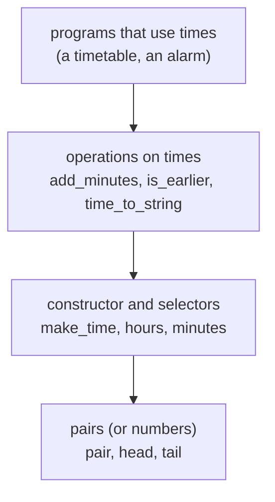
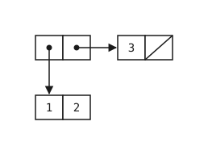
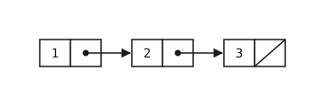
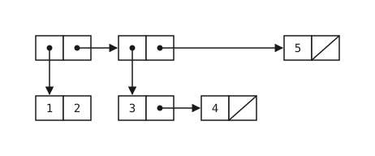

# 7. Data abstraction, pairs and llists

<p class="chapter-goal">Glue values together with pairs, hide the glue behind constructors and selectors, and build linked lists (llists) you can draw and read.</p>

!!! abstract "The big idea, in plain words"
    Think of a printed form at the post office: boxes for a name, an address and a weight. The clerk
    **fills in** the form (a constructor) and later **reads** one box (a selector). Nobody who uses the form
    cares whether the office files it in a drawer or scans it into a computer. Data abstraction is that
    deal in code: users talk to your data only through constructors and selectors, so you can change how
    it is stored without breaking them. Underneath, everything in Unit 2 is made of one tiny form with two
    boxes: the **pair**. (Python §2 starts here: Python §1 plus pairs and the LINKED LISTS library.)

## 1. Pairs: the only glue you need

`pair(x, y)` glues two values together. `head` gives back the first, `tail` the second.

```python title="§2"
p = pair(7, "seven")
print(head(p))
print(tail(p))
print(p)
q = pair(p, pair(8, 9))
print(head(tail(q)))
```
```text title="Output"
7
seven
[7, 'seven']
8
```

A pair prints in **box notation**: `[head, tail]`. A string inside a pair prints with single quotes. Pairs
can hold pairs, so you can build structures as deep as you like from this one operation.

## 2. Your own data type: a time of day

Say a program needs times of day, such as 9:05 or 23:40. Following the textbook's *wishful thinking*, first
decide **what** you want to do with a time, then **how** to store it.

- **Constructor**: `make_time(h, m)` builds a time.
- **Selectors**: `hours(t)` and `minutes(t)` take it apart.
- Operations built *only* from those three: `add_minutes`, `is_earlier`, `time_to_string`.

```python title="§2"
# representation: a pair of hours and minutes
def make_time(h, m):
    return pair(h, m)

def hours(t):
    return head(t)

def minutes(t):
    return tail(t)

# operations: these never use pair, head or tail
def total_minutes(t):
    return hours(t) * 60 + minutes(t)

def add_minutes(t, k):
    new_total = (total_minutes(t) + k) % (24 * 60)
    return make_time(new_total // 60, new_total % 60)

def is_earlier(t1, t2):
    return total_minutes(t1) < total_minutes(t2)

def time_to_string(t):
    m = minutes(t)
    return str(hours(t)) + ":" + ("0" if m < 10 else "") + str(m)

lecture = make_time(10, 50)
print(time_to_string(add_minutes(lecture, 15)))
print(time_to_string(add_minutes(lecture, 13 * 60 + 20)))
print(is_earlier(lecture, make_time(9, 59)))
```
```text title="Output"
11:05
0:10
False
```

`add_minutes` wraps past midnight with `%`. Notice that only the first three functions know a time is a pair.

### Changing the representation

Now store a time as a single number: minutes since midnight. Only the constructor and the selectors
change. The operations are copied **unchanged** and give the same answers.

```python title="§2"
# representation: one number, minutes since midnight
def make_time(h, m):
    return h * 60 + m

def hours(t):
    return t // 60

def minutes(t):
    return t % 60

# operations: exactly as before
def total_minutes(t):
    return hours(t) * 60 + minutes(t)

def add_minutes(t, k):
    new_total = (total_minutes(t) + k) % (24 * 60)
    return make_time(new_total // 60, new_total % 60)

def time_to_string(t):
    m = minutes(t)
    return str(hours(t)) + ":" + ("0" if m < 10 else "") + str(m)

lecture = make_time(10, 50)
print(time_to_string(add_minutes(lecture, 15)))
print(lecture)
```
```text title="Output"
11:05
650
```

That is the payoff of data abstraction: the decision "pair or number?" lives in three small functions.

### Abstraction barriers



Each arrow between two layers (top to bottom) crosses an **abstraction barrier**. Code on one layer uses only the layer right
below it.

!!! warning "Trap: crossing the barrier"
    Writing `head(lecture)` in the timetable code "works" while times are pairs, and silently breaks the day
    someone switches to the number representation (`head(650)` is a TypeError). In an exam, if a question
    gives you a constructor and selectors, use them, never `head`/`tail` on the abstract value.

### Pairs could even be functions

A pair only has to keep one promise: `head(pair(x, y))` is `x` and `tail(pair(x, y))` is `y`. Any three
functions that keep it will do. Here is a version built from lambda expressions alone:

```python title="§2"
def fn_pair(x, y):
    return lambda pick_first: x if pick_first else y

def fn_head(p):
    return p(True)

def fn_tail(p):
    return p(False)

p = fn_pair(3, 4)
print(fn_head(p) + fn_tail(p))
print(p)
```
```text title="Output"
7
<function (anonymous)>
```

The "pair" is a function that remembers `x` and `y`. You cannot tell the difference as long as you only use
the constructor and the selectors. (The real `pair` is built differently; see the note below.)

## 3. Box-and-pointer diagrams

A **box-and-pointer diagram** draws each pair as a box with two halves: head on the left, tail on the right.
A small value is written inside its half; a pair is drawn as an arrow to its own box; `None` is a slash.
sicpfuf's `draw_data` draws them for you, as text and as a picture.

```python title="§2 · figure 07-data-pairs"
draw_data(pair(pair(1, 2), pair(3, None)))
```
```text title="Output"
[•|•]--->[3|/]
 |
 v
 [1|2]
```



How to draw one by hand, from the expression:

1. Find the outermost `pair(...)` and draw its box.
2. For each half: a number, string or boolean goes inside; `None` is a slash; a pair gets an arrow to a new box.
3. Repeat for every new box.

## 4. Linked lists (llists)

Many shapes can hold the numbers 1, 2, 3. The course fixes **one discipline** for sequences: the head holds
an element, the tail holds *the rest*, and the empty rest is `None`.

> A **llist** is either `None`, or a pair whose tail is a llist.

`None` is the **empty llist**. `llist(1, 2, 3)` is short for `pair(1, pair(2, pair(3, None)))`.

```python title="§2 · figure 07-data-llist"
xs = llist(1, 2, 3)
print(xs == pair(1, pair(2, pair(3, None))))
print(xs)
print_llist(xs)
print(tail(tail(tail(xs))))
draw_data(xs)
```
```text title="Output"
True
[1, [2, [3, None]]]
llist(1, 2, 3)
None
[1|•]-->[2|•]-->[3|/]
```



The same value has three faces:

| View | Looks like | Made by |
|---|---|---|
| box notation | `[1, [2, [3, None]]]` | `print(xs)` |
| llist notation | `llist(1, 2, 3)` | `print_llist(xs)` |
| box-and-pointer diagram | the picture above | `draw_data(xs)`, or you with a pen |

`pair(0, xs)` is a llist with one more element in front: the new pair points at the old llist, nothing is
copied.

### Llist notation for messy structures

`print_llist` writes `llist(...)` for every part that is a proper llist, and keeps square brackets for a pair
that is not one:

```python title="§2 · figure 07-data-mixed"
mixed = llist(pair(1, 2), llist(3, 4), 5)
print(mixed)
print_llist(mixed)
print_llist(pair(llist(6, 7), 8))
print(is_llist(mixed), is_llist(pair(1, 2)))
draw_data(mixed)
```
```text title="Output"
[[1, 2], [[3, [4, None]], [5, None]]]
llist([1, 2], llist(3, 4), 5)
[llist(6, 7), 8]
True False
[•|•]--->[•|•]----------->[5|/]
 |        |
 v        v
 [1|2]    [3|•]-->[4|/]
```



`pair(1, 2)` is a pair but not a llist: its tail is 2, not a llist. `mixed` is still a llist of three
elements, because what matters is the chain of tails along the top row.

!!! warning "Trap: counting elements"
    Count the boxes along the **top row** only. `llist(pair(1, 2), llist(3, 4), 5)` has length 3, however
    much hangs below each box.

## 5. Getting at an element: head/tail paths

Each step down the top row is a `tail`; taking the element in a box is a `head`. Read the path **from the
inside out**: the innermost call happens first.

```python title="§2"
xs = llist(10, llist(20, 30), 40)
print(head(xs))
print(head(tail(tail(xs))))
print(head(tail(head(tail(xs)))))
print(llist_ref(xs, 2), length(xs))
```
```text title="Output"
10
40
30
40 3
```

To reach 30: go right once (`tail(xs)`), take that element (`head(...)`, the inner llist), go right once in
it (`tail(...)`), take the element (`head(...)`). Write the steps down, then wrap them inside each other.

`llist_ref(xs, n)` counts from 0. Taking `head` or `tail` of something that is not a pair stops the program:

```python title="§2"
print(head(tail(llist(5))))
```
```text title="Output"
TypeError at line 1
    print(head(tail(llist(5))))
TypeError: head(xs) expects a pair as argument xs, but encountered None
sicpfuf hint: you took the head or tail of None, the EMPTY linked list. The usual cause is a missing base case: check `is_none(xs)` before `head(xs)` / `tail(xs)`.
```

## 6. Equality and the empty llist

In §2, `==` on pairs compares **structure**: same shape, equal leaves. Test for the empty llist with
`is_none(xs)`.

```python title="§2"
print(llist(1, llist(2)) == pair(1, pair(pair(2, None), None)))
print(llist(1, 2) == llist(2, 1))
print(is_none(llist()), is_none(tail(llist(9))))
print(is_pair(None), is_llist(None))
```
```text title="Output"
True
False
True True
False True
```

??? example "X-ray: the substitution model sees pairs as values"
    `--subst` shows each pair in box notation once it has been built. A llist is an ordinary value that
    gets substituted like a number.

    ```python title="§2 · --subst"
    def second(xs):
        return head(tail(xs))

    second(llist(4, 5, 6))
    ```
    ```text title="Output"
    second(llist(4, 5, 6))
    -> second([4, [5, [6, None]]])
    -> head(tail([4, [5, [6, None]]]))
    -> head([5, [6, None]])
    -> 5
    ```

!!! note "Python §2 vs real Python"
    Real Python has no `pair`, `head`, `tail` or `llist`. In sicpfuf (and in the course's own tools) a pair
    is secretly a Python list of length two, which is why it prints as `[1, 2]`. In §2 you cannot see this
    and must not rely on it: there are no `[...]` brackets and no indexing until §3. Also, in §2 `==` on
    two booleans or two functions is a TypeError. `xs == None` does work, but the course writes
    `is_none(xs)`.

## Takeaways

- A **pair** glues two values; `head` and `tail` take them back. Pairs can contain pairs.
- **Data abstraction**: users touch data only through **constructors**, **selectors** (and predicates).
  Then the representation can change without breaking anything above the **abstraction barrier**.
- A **llist** is `None` or a pair whose tail is a llist. `None` is the empty llist.
- Three views: box notation (`print`), llist notation (`print_llist`), box-and-pointer diagram (`draw_data`).
- In a diagram, the elements of a llist are the boxes along the top row; the length counts those only.
- To reach an element, write a chain of `tail`s (move right) and `head`s (go into a box).
- `==` compares pairs by structure. Test emptiness with `is_none`.

## Check yourself

1. Give the box notation and the llist notation of `pair(llist(1), pair(2, None))`.

    ??? success "Answer"
        It is a pair whose tail `pair(2, None)` is a llist, so the whole thing is a llist of two elements:
        the llist `llist(1)` and the number 2.

        ```python title="§2"
        x = pair(llist(1), pair(2, None))
        print(x)
        print_llist(x)
        ```
        ```text
        [[1, None], [2, None]]
        llist(llist(1), 2)
        ```

2. What is `length(llist(llist(1, 2, 3), llist()))`? Careful with `llist()`.

    ??? success "Answer"
        Two elements on the top row: a llist and the empty llist `None`.

        ```python title="§2"
        print(length(llist(llist(1, 2, 3), llist())))
        print_llist(llist(llist(1, 2, 3), llist()))
        ```
        ```text
        2
        llist(llist(1, 2, 3), llist())
        ```

3. Write a head/tail path that gets `"x"` out of `t = llist(1, pair(llist(2, "x"), 3))`.

    ??? success "Answer"
        Right once, into the box (the pair), into its head (the llist), right once, take the element.

        ```python title="§2"
        t = llist(1, pair(llist(2, "x"), 3))
        print(head(tail(head(head(tail(t))))))
        ```
        ```text
        x
        ```

4. Is `pair(1, pair(2, 3))` a llist? Draw it.

    ??? success "Answer"
        No. The last tail is 3, not a llist. Box notation `[1, [2, 3]]`; in the diagram the last box has 3 in
        its right half instead of a slash.

        ```python title="§2"
        print(is_llist(pair(1, pair(2, 3))))
        print_llist(pair(1, pair(2, 3)))
        ```
        ```text
        False
        [1, [2, 3]]
        ```

5. A friend adds `def seconds(t): return tail(t) * 60` to the time-of-day code. What is wrong?

    ??? success "Answer"
        It crosses the abstraction barrier: it uses `tail` on a time instead of the selector `minutes`. It
        works for the pair representation and breaks for the number representation (`tail(650)` is a
        TypeError). Write `return minutes(t) * 60`.

6. Predict: `print(llist(1, 2) == pair(1, 2))`.

    ??? success "Answer"
        `False`: the left is `[1, [2, None]]`, the right is `[1, 2]`. Different shapes.

        ```python title="§2"
        print(llist(1, 2) == pair(1, 2))
        ```
        ```text
        False
        ```

7. Write `fn_head2` and `fn_tail2` for this other functional pair: `def fn_pair2(x, y): return lambda choose: choose(x, y)`.

    ??? success "Answer"
        Pass in a function that picks its second argument.

        ```python title="§2"
        def fn_pair2(x, y):
            return lambda choose: choose(x, y)

        def fn_head2(p):
            return p(lambda a, b: a)

        def fn_tail2(p):
            return p(lambda a, b: b)

        print(fn_head2(fn_pair2(1, 2)), fn_tail2(fn_pair2(1, 2)))
        ```
        ```text
        1 2
        ```

*In the course: L4A · SICPy 2.1, 2.2.1.*
