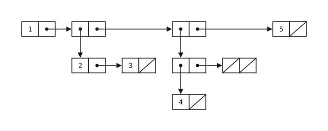

# 9. Trees and continuation-passing style

<p class="chapter-goal">Process llists of llists (trees) by recursion on both head and tail, and turn any recursion into an iterative process by passing "what to do next" as a function.</p>

!!! abstract "The big idea, in plain words"
    A folder on your laptop holds files and other folders, which hold files and folders, and so on. That is
    a **tree**. To count all the files you open each folder and count inside it the same way: a recursion that
    goes **down** into a sub-folder as well as **along** to the next item.

    The second idea is a note passed along a queue. Instead of "give me your answer and I'll add 1 to it"
    (so I have to wait), I hand you a note: "when you have your answer, add 1 and pass it on to whoever my
    note says". Nobody waits any more; the notes do the remembering. That note is a **continuation**.

## 1. Trees as nested llists

> A **tree** of some data type is a llist whose elements are data items of that type, or trees of that type.

The data items are the **leaves**. `None` and pairs cannot be data items (they would look like subtrees),
and an empty llist inside a tree is an empty subtree, not a leaf.

```python title="§2 · figure 09-trees-cps-tree"
t = llist(1, llist(2, 3), llist(llist(4), None), 5)
print_llist(t)
print(length(t))
draw_data(t)
```
```text title="Output"
llist(1, llist(2, 3), llist(llist(4), llist()), 5)
4
[1|•]-->[•|•]----------->[•|•]--------------->[5|/]
         |                |
         v                v
         [2|•]-->[3|/]    [•|•]--->[None|/]
                           |
                           v
                           [4|/]
```



`length(t)` is 4: the top row has four boxes. But the tree holds **five** leaves: 1, 2, 3, 4, 5.

## 2. Counting leaves: recurse on head and tail

Three cases, and the order of the tests matters:

1. The tree is empty: 0 leaves.
2. Its first element is itself a tree (`is_llist(head(tree))`): count in that subtree **plus** count in the rest.
3. Otherwise the first element is a leaf: 1 plus the count in the rest.

```python title="§2"
def count_leaves(tree):
    if is_none(tree):
        return 0
    elif is_llist(head(tree)):
        return count_leaves(head(tree)) + count_leaves(tail(tree))
    else:
        return 1 + count_leaves(tail(tree))

t = llist(1, llist(2, 3), llist(llist(4), None), 5)
print(count_leaves(t))
print(count_leaves(llist(None, None)))
```
```text title="Output"
5
0
```

`is_llist(x)` is `True` for `None` and for any proper llist. That is why `llist(None, None)` has 0 leaves:
both elements are empty subtrees.

!!! warning "Trap: is_pair instead of is_llist"
    If you write these three cases but test `is_pair(head(tree))`, an empty subtree `None` is not a pair,
    so it falls into the leaf case and is counted. `llist(None, None)` would then have 2 "leaves". (The
    textbook's version avoids this differently: it recurses on the whole value and checks `is_none` first.)

## 3. Mapping over a tree

`map` alone only touches the top row. To change every leaf, map a function that **decides**: recurse into
a subtree, or transform a leaf.

```python title="§2"
def scale_tree(tree, k):
    return map(lambda sub: scale_tree(sub, k) if is_llist(sub) else sub * k, tree)

def map_tree(f, tree):
    return map(lambda sub: map_tree(f, sub) if is_llist(sub) else f(sub), tree)

t = llist(1, llist(2, 3), llist(llist(4), None), 5)
print_llist(scale_tree(t, 10))
print_llist(map_tree(lambda x: x % 2 == 0, t))
```
```text title="Output"
llist(10, llist(20, 30), llist(llist(40), llist()), 50)
llist(False, llist(True, False), llist(llist(True), llist()), False)
```

The result has exactly the same shape as the input. `map_tree` is the abstraction; `scale_tree` is one use
of it: `scale_tree(tree, k)` is `map_tree(lambda x: x * k, tree)`.

## 4. Flattening and accumulating

**Flatten** gives the leaves, left to right, as one flat llist. Each element becomes a llist (a leaf becomes
a one-element llist, a subtree is flattened), and `reduce(append, ...)` glues them.

```python title="§2"
def flatten(tree):
    return reduce(append, None,
                  map(lambda sub: flatten(sub) if is_llist(sub) else llist(sub), tree))

t = llist(1, llist(2, 3), llist(llist(4), None), 5)
print_llist(flatten(t))
print(reduce(lambda x, acc: x + acc, 0, flatten(t)))
print(length(flatten(t)) == 5)
```
```text title="Output"
llist(1, 2, 3, 4, 5)
15
True
```

Once a tree is flat, every llist tool from the [previous chapter](08-llist-processing.md) works on its
leaves. You can also accumulate directly, with the same three cases as `count_leaves`:

```python title="§2"
def tree_reduce(f, initial, tree):
    if is_none(tree):
        return initial
    elif is_llist(head(tree)):
        return f(tree_reduce(f, initial, head(tree)), tree_reduce(f, initial, tail(tree)))
    else:
        return f(head(tree), tree_reduce(f, initial, tail(tree)))

def depth(tree):
    return 1 + reduce(lambda sub, d: max(depth(sub) if is_llist(sub) else 0, d), 0, tree)

t = llist(1, llist(2, 3), llist(llist(4), None), 5)
print(tree_reduce(lambda a, b: a + b, 0, t))
print(tree_reduce(lambda a, b: max(a, b), 0, t))
print(depth(t), depth(llist(7)))
```
```text title="Output"
15
5
3 1
```

## 5. Continuation-passing style (CPS)

A **continuation** is a function that says what to do with a result. In **continuation-passing style**
every function gets an extra parameter, usually called `c`, and instead of returning its answer to a
waiting caller it **passes the answer to `c`**.

Start from a recursive process with a deferred `+`:

```python
def sum_rec(xs):
    return 0 if is_none(xs) else head(xs) + sum_rec(tail(xs))
```

The recipe for converting it:

1. Add a parameter `c`, the continuation.
2. Base case: instead of returning `0`, return `c(0)`.
3. Recursive case: the deferred work is "add `head(xs)` to the result". Put it **in the new continuation**:
   `lambda r: c(head(xs) + r)`, and make the recursive call the last thing done.
4. Start it with the identity continuation, `lambda x: x`.

```python title="§2"
def sum_rec(xs):
    return 0 if is_none(xs) else head(xs) + sum_rec(tail(xs))

def sum_cps(xs, c):
    return c(0) if is_none(xs) else sum_cps(tail(xs), lambda r: c(head(xs) + r))

print(sum_cps(llist(1, 2, 3), lambda x: x))
measure(sum_rec, enum_llist(1, 500))
measure(sum_cps, enum_llist(1, 500), lambda x: x)
print(sum_cps(enum_llist(1, 5000), lambda x: x))
```
```text title="Output"
6
[measure] sum_rec([1, [2, [3, [4, [...): 501 calls, 7,006 steps, at most 501 waiting at once
[measure] sum_cps([1, [2, [3, [4, [..., <function (anonym...): 1,002 calls, 9,009 steps, at most 1 waiting at once
12502500
```

`sum_cps` gives rise to an **iterative process**: every call is a tail call, nothing waits ("at most 1
waiting at once"), and it copes with 5000 elements where `sum_rec` would hit the limit near 1000.

### But the space has not gone away

Look at the continuation after three steps on `llist(1, 2, 3)`. Each new lambda wraps the one before:

```python
lambda r: (lambda r: (lambda r: (lambda x: x)(1 + r))(2 + r))(3 + r)
```

Each lambda expression creates a **function object** that remembers its `xs` and its `c`. For a llist of
length n you hold n of them at once, so `sum_cps` still needs **Θ(n) space**. The deferred operations
moved from "calls waiting" into "function values that must be remembered". In Unit 2, space counts
deferred operations, pairs **and** function values created.

!!! warning "Trap: iterative is not the same as constant space"
    "CPS makes the process iterative" is true. "CPS makes it Θ(1) space" is false. The process is iterative
    (no deferred operations); the space is Θ(n) because of the chain of continuations.

### The order the continuations run

The continuations are built from the **front** of the llist, but they run from the **back**: the last one
made (for 3) is applied first, to the base value. A printing helper shows it:

```python title="§2"
def loud_plus(x, r):
    print("adding", x)
    return x + r

def sum_cps(xs, c):
    return c(0) if is_none(xs) else sum_cps(tail(xs), lambda r: c(loud_plus(head(xs), r)))

print(sum_cps(llist(1, 2, 3), lambda x: x))
```
```text title="Output"
adding 3
adding 2
adding 1
6
```

Exactly like the recursive version and like `reduce`: 3 + 0 first, then 2 + 3, then 1 + 5.

??? example "X-ray: every call is a tail call"
    `--trace sum_cps` shows `↻` for each call: the caller is replaced, not kept waiting. A recursive
    process would show `→` arrows nesting deeper and deeper instead.

    ```python title="§2 · --trace sum_cps"
    def sum_cps(xs, c):
        return c(0) if is_none(xs) else sum_cps(tail(xs), lambda r: c(head(xs) + r))

    print(sum_cps(llist(1, 2, 3), lambda x: x))
    ```
    ```text title="Output"
    → sum_cps([1, [2, [3, None]]], <function (anonymous)>)
    ↻ sum_cps([2, [3, None]], <function (anonymous)>)
    ↻ sum_cps([3, None], <function (anonymous)>)
    ↻ sum_cps(None, <function (anonymous)>)
    ← 6
    6
    ```

### CPS append, and CPS on a tree

`append` has a deferred `pair(head(xs), ...)`. Same recipe:

```python title="§2"
def append_cps(xs, ys, c):
    return c(ys) if is_none(xs) else append_cps(tail(xs), ys, lambda r: c(pair(head(xs), r)))

print_llist(append_cps(llist(1, 2), llist(3, 4), lambda x: x))
```
```text title="Output"
llist(1, 2, 3, 4)
```

The library's own `append` and `reduce` are written exactly like this (see `sicpfuf/lib/linked_list.py`).

A tree recursion has **two** recursive calls. In CPS, the continuation of the first call makes the second
call, and the continuation of the second combines both results:

```python title="§2"
def count_cps(tree, c):
    if is_none(tree):
        return c(0)
    elif is_llist(head(tree)):
        return count_cps(head(tree), lambda a: count_cps(tail(tree), lambda b: c(a + b)))
    else:
        return count_cps(tail(tree), lambda b: c(1 + b))

t = llist(1, llist(2, 3), llist(llist(4), None), 5)
print(count_cps(t, lambda x: x))
```
```text title="Output"
5
```

!!! note "Python §2 vs real Python"
    Real Python has no proper tail calls: every call waits, even `return f(...)`. So in real Python CPS
    does not save you from the recursion limit; it is a way of thinking, not a speed trick. The course
    language (and sicpfuf) does run tail calls without growing the waiting calls, which is why CPS gives an
    iterative process there.

## Takeaways

- A **tree** is a llist whose elements are data items or trees. Leaves are the data items.
- Tree recursion has three cases: empty, head is a subtree (recurse on head **and** tail), head is a leaf.
- `is_llist(x)`: `None` or a proper llist. `is_llist(None)` is `True`, `is_pair(None)` is `False`.
- `map_tree(f, tree)`: `map` with a lambda that recurses into subtrees and applies `f` to leaves.
- Flatten with `reduce(append, None, map(...))`; then use llist tools on the leaves.
- **CPS**: pass a continuation `c`; base case `c(base)`; recursive case passes `lambda r: c(combine(r))`;
  start with `lambda x: x`.
- CPS gives an **iterative process**, but space is still Θ(n): the continuations hold it.
- Continuations run in reverse order of creation: the innermost work happens first.

## Check yourself

1. How many leaves does `llist(llist(llist(1)), 2, None, llist(3, llist()))` have, and what is its `length`?

    ??? success "Answer"
        Leaves 1, 2, 3; the two empty llists are empty subtrees. Four elements on the top row.

        ```python title="§2"
        def count_leaves(tree):
            if is_none(tree):
                return 0
            elif is_llist(head(tree)):
                return count_leaves(head(tree)) + count_leaves(tail(tree))
            else:
                return 1 + count_leaves(tail(tree))

        t = llist(llist(llist(1)), 2, None, llist(3, llist()))
        print(count_leaves(t), length(t))
        ```
        ```text
        3 4
        ```

2. Use `map_tree` to turn every number leaf into a string.

    ??? success "Answer"

        ```python title="§2"
        def map_tree(f, tree):
            return map(lambda sub: map_tree(f, sub) if is_llist(sub) else f(sub), tree)

        print_llist(map_tree(str, llist(1, llist(22, llist(333)))))
        ```
        ```text
        llist('1', llist('22', llist('333')))
        ```

3. Convert `product(xs)` to CPS: `return 1 if is_none(xs) else head(xs) * product(tail(xs))`.

    ??? success "Answer"
        Base case passes 1 to `c`; the deferred `head(xs) * ...` moves into the new continuation.

        ```python title="§2"
        def product_cps(xs, c):
            return c(1) if is_none(xs) else product_cps(tail(xs), lambda r: c(head(xs) * r))

        print(product_cps(llist(2, 3, 7), lambda x: x))
        print(product_cps(None, lambda x: x + 100))
        ```
        ```text
        42
        101
        ```

4. What are the time and space orders of growth of `sum_cps` on a llist of length n? Is the process
   recursive or iterative?

    ??? success "Answer"
        Iterative (every call is a tail call, no deferred operations). Time Θ(n): n calls of `sum_cps` and n
        continuation calls. Space Θ(n): n function objects, each holding the previous continuation, exist at
        the moment the base case is reached.

5. Predict the output. Which number is printed first?

    ```python
    def show_cps(xs, c):
        return c("end") if is_none(xs) else show_cps(tail(xs), lambda r: c(str(head(xs)) + ">" + r))

    print(show_cps(llist(1, 2, 3), lambda x: x))
    ```

    ??? success "Answer"
        Only one line is printed, the finished string. The continuation for 3 runs first and builds
        `"3>end"`, then 2 and 1 put themselves in front, so the order in the string is the original order.

        ```python title="§2"
        def show_cps(xs, c):
            return c("end") if is_none(xs) else show_cps(tail(xs), lambda r: c(str(head(xs)) + ">" + r))

        print(show_cps(llist(1, 2, 3), lambda x: x))
        ```
        ```text
        1>2>3>end
        ```

6. Write `flatten` without `reduce`, by recursion on head and tail with `append`.

    ??? success "Answer"

        ```python title="§2"
        def flatten(tree):
            if is_none(tree):
                return None
            elif is_llist(head(tree)):
                return append(flatten(head(tree)), flatten(tail(tree)))
            else:
                return pair(head(tree), flatten(tail(tree)))

        print_llist(flatten(llist(llist(1, llist(2)), 3, None, llist(4))))
        ```
        ```text
        llist(1, 2, 3, 4)
        ```

*In the course: L5B · SICPy 2.2.2.*
