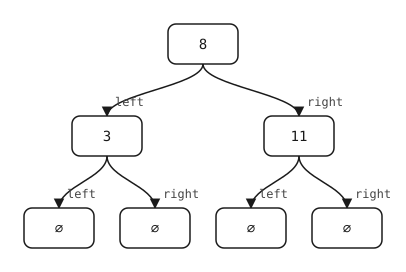

# 10. Sorting, search trees and symbolic data

<p class="chapter-goal">Sort llists three ways and know their costs, search with binary search trees, and treat expressions as data with tagged llists.</p>

!!! abstract "The big idea, in plain words"
    Sorting a hand of cards: you can slide each new card into its place among the ones you hold
    (**insertion sort**), keep pulling out the smallest card left (**selection sort**), or split the pile
    with a friend, each sort half, and then merge the two piles by always taking the smaller top card
    (**merge sort**). All three are wishful thinking: assume you can already sort a smaller pile.

    The second half of the chapter is about writing **expressions as data**: `3 * x + 1` becomes a llist
    such as `llist("+", llist("*", 3, "x"), 1)` that a program can evaluate, print or differentiate.

## 1. Insertion sort

Wishful thinking with a pile one smaller (m = n − 1): sort the tail, then **insert** the head where it belongs.

```python title="§2"
def insert(x, xs):
    return (llist(x) if is_none(xs)
            else pair(x, xs) if x <= head(xs)
            else pair(head(xs), insert(x, tail(xs))))

def insertion_sort(xs):
    return None if is_none(xs) else insert(head(xs), insertion_sort(tail(xs)))

print_llist(insertion_sort(llist(5, 2, 8, 1, 9, 3)))
measure(insertion_sort, enum_llist(1, 100))
measure(insertion_sort, reverse(enum_llist(1, 100)))
measure(insertion_sort, reverse(enum_llist(1, 200)))
```
```text title="Output"
llist(1, 2, 3, 5, 8, 9)
[measure] insertion_sort([1, [2, [3, [4, [...): 201 calls, 2,999 steps, at most 101 waiting at once
[measure] insertion_sort([100, [99, [98, [...): 5,151 calls, 111,206 steps, at most 101 waiting at once
[measure] insertion_sort([200, [199, [198,...): 20,301 calls, 442,406 steps, at most 201 waiting at once
```

- `insert` stops as soon as it finds an element at least as large as `x`.
- **Best case**, the input already ascending: each `insert` stops at once. Θ(n) time.
- **Worst case**, the input descending: each `insert` walks to the end. 1 + 2 + … + n steps: **Θ(n²)** time
  (doubling n made it about four times slower above).
- Space Θ(n): the deferred `insert`s of `insertion_sort` plus the pairs of the result.

## 2. Selection sort

Find the smallest element, put it in front of the sorted rest of the llist without it.

```python title="§2"
def smallest(xs):
    return reduce(lambda x, so_far: x if x < so_far else so_far, head(xs), xs)

def selection_sort(xs):
    if is_none(xs):
        return None
    else:
        m = smallest(xs)
        return pair(m, selection_sort(remove(m, xs)))

print_llist(selection_sort(llist(5, 2, 8, 1, 9, 3, 2)))
```
```text title="Output"
llist(1, 2, 2, 3, 5, 8, 9)
```

Finding the smallest always walks the whole remaining llist, whatever the order: n + (n − 1) + … + 1 steps.
**Θ(n²) in the best and the worst case.** `remove` drops only one copy of `m`, so duplicates survive.

## 3. Merge sort

Wishful thinking with **half** the pile (m = n / 2): split, sort both halves, **merge** the sorted halves.

```python title="§2"
def take(xs, n):
    return None if n == 0 else pair(head(xs), take(tail(xs), n - 1))

def drop(xs, n):
    return xs if n == 0 else drop(tail(xs), n - 1)

def merge(xs, ys):
    if is_none(xs):
        return ys
    elif is_none(ys):
        return xs
    elif head(xs) <= head(ys):
        return pair(head(xs), merge(tail(xs), ys))
    else:
        return pair(head(ys), merge(xs, tail(ys)))

def merge_sort(xs):
    if is_none(xs) or is_none(tail(xs)):
        return xs
    else:
        half = length(xs) // 2
        return merge(merge_sort(take(xs, half)), merge_sort(drop(xs, half)))

print_llist(merge(llist(1, 4, 9), llist(2, 3, 10)))
print_llist(merge_sort(llist(5, 2, 8, 1, 9, 3, 2)))
measure(merge_sort, reverse(enum_llist(1, 200)))
measure(merge_sort, reverse(enum_llist(1, 400)))
```
```text title="Output"
llist(1, 2, 3, 4, 9, 10)
llist(1, 2, 2, 3, 5, 8, 9)
[measure] merge_sort([200, [199, [198,...): 5,214 calls, 80,835 steps, at most 102 waiting at once
[measure] merge_sort([400, [399, [398,...): 11,434 calls, 178,735 steps, at most 202 waiting at once
```

Why **Θ(n log n)**: picture the halving as levels. At each level the llists together hold n elements, and
`length`, `take`, `drop` and `merge` on them cost Θ(n) in total. Halving n until the pieces have one element
takes log₂ n levels. Θ(n) per level × log n levels. Doubling n above made it a bit more than twice as slow,
which is what n log n looks like. This holds for every input order, best case and worst case alike.

`merge` alone on two llists of total length n is Θ(n) time: each step puts one element in front.

### Quicksort, the idea

Another split-and-combine plan: take the head as a **pivot**, split the rest into "smaller" and "not
smaller", sort both parts, and append them around the pivot.

```python title="§2"
def quicksort(xs):
    if is_none(xs):
        return None
    else:
        pivot = head(xs)
        rest = tail(xs)
        return append(quicksort(filter(lambda x: x < pivot, rest)),
                      pair(pivot, quicksort(filter(lambda x: x >= pivot, rest))))

print_llist(quicksort(llist(5, 2, 8, 1, 9, 3, 2)))
```
```text title="Output"
llist(1, 2, 2, 3, 5, 8, 9)
```

When the pivots split the llist roughly in half, it is Θ(n log n) like merge sort. On an already sorted
input every split is "nothing smaller, everything else": n levels, **Θ(n²)**.

| Sort | Best case | Worst case | Notes |
|---|---|---|---|
| insertion | Θ(n) (sorted input) | Θ(n²) (reversed input) | sort the tail, insert the head |
| selection | Θ(n²) | Θ(n²) | always scans for the minimum |
| merge | Θ(n log n) | Θ(n log n) | split in half, merge |
| quicksort | Θ(n log n) | Θ(n²) (sorted input, head as pivot) | split around a pivot |

## 4. Binary search trees as llists

Binary search halves the problem at each step, so it needs Θ(log n) steps. On a llist you cannot jump to
the middle in Θ(1) time, so instead we store the data in a shape that already has the middle at the top.

A **binary tree** is either empty (`None`) or a node with an **entry**, a **left subtree** and a **right
subtree**. In a **binary search tree** (BST) every entry in the left subtree is smaller than the node's
entry, and every entry in the right subtree is larger. Represent a node as `llist(entry, left, right)`,
behind a constructor and selectors (one-line definitions are fine for such tiny functions):

```python title="§2"
def make_node(entry, left, right): return llist(entry, left, right)
def entry(t): return head(t)
def left_branch(t): return head(tail(t))
def right_branch(t): return head(tail(tail(t)))

def bst_member(x, t):
    return (False if is_none(t)
            else True if x == entry(t)
            else bst_member(x, left_branch(t)) if x < entry(t)
            else bst_member(x, right_branch(t)))

def bst_insert(x, t):
    return (make_node(x, None, None) if is_none(t)
            else t if x == entry(t)
            else make_node(entry(t), bst_insert(x, left_branch(t)), right_branch(t)) if x < entry(t)
            else make_node(entry(t), left_branch(t), bst_insert(x, right_branch(t))))

t = reduce(bst_insert, None, llist(9, 1, 5, 12, 7))
print_llist(t)
print(bst_member(9, t), bst_member(5, t), bst_member(4, t))
```
```text title="Output"
llist(7, llist(5, llist(1, llist(), llist()), llist()), llist(12, llist(9, llist(), llist()), llist()))
True True False
```

`reduce` inserts from the right, so 7 became the root, then 12, 5, 1, 9. Each search follows **one** path
from the root down.

In the [visual stepper](../playground.md), choose **Tree**, select `t`, and set **Structure**
to **Binary: entry, left, right**. This displays entries as nodes with labelled left and right
branches. The three-item llist representation is an explicit choice: the same data in
**Nested llists** mode means a llist with three elements, rather than a binary node.

- **Balanced** (height about log₂ n): search and insert are **Θ(log n)**.
- Inserting sorted data sends every entry right: a chain, as slow as a llist, **Θ(n)**.
- `bst_insert` builds new nodes along one path and shares the untouched subtrees; the old tree is unchanged.

For a tree representation directly from your program or terminal, use
`draw_tree(t, "binary")`. The second argument states the representation instead of
guessing whether every three-element llist was intended as a binary node:

```python title="§2 · figure 10-sorting-binary-form"
t = llist(8, llist(3, None, None), llist(11, None, None))
draw_tree(t, "binary")
```
```text title="Output"
8
├── left: 3
│   ├── left: ∅
│   └── right: ∅
└── right: 11
    ├── left: ∅
    └── right: ∅
```

{ width="400" }

The text form appears in the terminal. With `--out diagrams`, the same drawing is saved
as `diagrams/tree-1.svg`. This extra helper is for studying; the underlying tree is still
made from ordinary llists, and `draw_tree` is not a function supplied in an exam.

## 5. Strings as symbols

So far a llist held numbers. Strings can be data too. Mind the quotes: `x` is a **name** whose value is
looked up; `"x"` is the one-letter **string** itself.

```python title="§2"
x = 42
print_llist(llist(x, "x"))
print("x" == "x", "ab" < "b")
print(is_string("x"), is_string(x), is_number(x))
```
```text title="Output"
llist(42, 'x')
True True
True False True
```

## 6. Tagged llists: expressions as data

Represent `3 * x + x * y` as a **tagged llist**: the head is a string **tag** saying what kind of
expression it is, the rest are its parts.

| Expression | Data |
|---|---|
| a number, `3` | the number `3` |
| a variable, `x` | the string `"x"` |
| a sum `a + b` | `llist("+", a, b)` |
| a product `a * b` | `llist("*", a, b)` |

As always, hide the representation behind constructors, selectors and predicates. Then write an
**evaluator** that dispatches on the kind of expression. Variable values come in a llist of name/value pairs.

```python title="§2"
def make_sum(a, b):
    return llist("+", a, b)

def make_product(a, b):
    return llist("*", a, b)

def is_sum(e):
    return is_pair(e) and head(e) == "+"

def is_product(e):
    return is_pair(e) and head(e) == "*"

def is_variable(e):
    return is_string(e)

def left(e):
    return head(tail(e))

def right(e):
    return head(tail(tail(e)))

def lookup(name, bindings):
    return (error("unbound variable:", name) if is_none(bindings)
            else tail(head(bindings)) if head(head(bindings)) == name
            else lookup(name, tail(bindings)))

def value_of(e, bindings):
    if is_number(e):
        return e
    elif is_variable(e):
        return lookup(e, bindings)
    elif is_sum(e):
        return value_of(left(e), bindings) + value_of(right(e), bindings)
    elif is_product(e):
        return value_of(left(e), bindings) * value_of(right(e), bindings)
    else:
        return error("unknown expression:", e)

e = make_sum(make_product(3, "x"), make_product("x", "y"))
print_llist(e)
print(value_of(e, llist(pair("x", 2), pair("y", 10))))
print(value_of(e, llist(pair("x", 2))))
```
```text title="Output"
llist('+', llist('*', 3, 'x'), llist('*', 'x', 'y'))
26
Error: unbound variable: y
  (error(...) was called at line 23)
```

The expression is a tree; `value_of` is a tree recursion that follows its shape. This "evaluate by looking
at the tag" pattern comes back, much bigger, in the metacircular evaluator.

### A symbolic differentiator

The rules of differentiation turn into one case each: a number gives 0; a variable gives 1 if it is the
one we differentiate by, else 0; the derivative of a sum is the sum of the derivatives; for a product
(uv)′ = u·v′ + u′·v.

```python title="§2"
def make_sum(a, b):
    return llist("+", a, b)

def make_product(a, b):
    return llist("*", a, b)

def is_sum(e):
    return is_pair(e) and head(e) == "+"

def left(e):
    return head(tail(e))

def right(e):
    return head(tail(tail(e)))

def deriv(e, v):
    if is_number(e):
        return 0
    elif is_string(e):
        return 1 if e == v else 0
    elif is_sum(e):
        return make_sum(deriv(left(e), v), deriv(right(e), v))
    else:
        return make_sum(make_product(left(e), deriv(right(e), v)),
                        make_product(deriv(left(e), v), right(e)))

print_llist(deriv(make_product("x", "y"), "x"))
```
```text title="Output"
llist('+', llist('*', 'x', 0), llist('*', 1, 'y'))
```

Correct, but `x * 0 + 1 * y` is ugly. Fix it **in the constructors only**: adding 0, multiplying by 0 or 1,
and combining two numbers. `deriv` itself does not change.

```python title="§2"
def is_num(e, n):
    return is_number(e) and e == n

def make_sum(a, b):
    return (b if is_num(a, 0)
            else a if is_num(b, 0)
            else a + b if is_number(a) and is_number(b)
            else llist("+", a, b))

def make_product(a, b):
    return (0 if is_num(a, 0) or is_num(b, 0)
            else b if is_num(a, 1)
            else a if is_num(b, 1)
            else a * b if is_number(a) and is_number(b)
            else llist("*", a, b))

# exactly the constructor calls deriv makes for d/dx of x * y:
print_llist(make_sum(make_product("x", 0), make_product(1, "y")))
print_llist(make_sum(make_product(3, "x"), make_sum(2, 5)))
```
```text title="Output"
'y'
llist('+', llist('*', 3, 'x'), 7)
```

So with these constructors the same `deriv` returns `'y'` for d/dx of `x * y`. What counts as "simplest"
is a matter of taste, which is why the course keeps simplification inside the constructors.

!!! warning "Trap: testing a tag on something that is not a pair"
    `head(e) == "+"` on the number 3 is a TypeError. Every tag predicate must check `is_pair(e)` first, and
    `and` makes sure `head(e)` is only evaluated when that check passed.

## 7. Specification vs implementation

The **specification** says *what*: the functions users may call and the promises they keep. For the BST:
"after `t2 = bst_insert(x, t)`, `bst_member(x, t2)` is `True` and every entry of `t` is in `t2`". The
**implementation** says *how*: `llist(entry, left, right)` and the code of `bst_insert`. Users rely only
on the specification; constructors, selectors and predicates are the wall between the two, so choices such
as "llist or pairs?" or "simplify when building or when printing?" can change freely.

!!! note "Python §2 vs real Python"
    Real Python has `sorted(...)` and a `.sort()` method on lists; neither exists in the course language,
    and neither works on llists. `<` compares two numbers or two strings (strings in dictionary order:
    `"Zebra" < "apple"` because capital letters come first), never a number with a string.

## Takeaways

- Insertion sort: sort the tail, insert the head. Θ(n) best (sorted), Θ(n²) worst (reversed).
- Selection sort: smallest first, then sort the rest. Θ(n²) always.
- Merge sort: halve, sort both, merge. Θ(n log n) always; `merge` is Θ(n).
- Quicksort: pivot, filter into two parts, sort, append. Θ(n log n) on good splits, Θ(n²) on sorted input.
- A BST keeps smaller entries left, larger right: Θ(log n) search and insert if balanced, Θ(n) if not.
- Strings serve as symbols; `x` is a name, `"x"` is data.
- A **tagged llist** `llist(tag, part1, part2)` represents a kind of data; predicates check `is_pair` and the tag.
- Simplify in the constructors; the evaluator or differentiator above them does not change.

## Check yourself

1. Which input of length n makes insertion sort (as written above) fastest, and what is its order of
   growth then?

    ??? success "Answer"
        An already ascending llist. `insertion_sort` inserts the heads from the back, and each head is at most
        the head of the sorted rest, so `insert` stops at its first test. Θ(n) time.

2. What is the order of growth of merge sort on an input that is already sorted? And of selection sort?

    ??? success "Answer"
        Merge sort: Θ(n log n). It halves and merges regardless of the order of the input. Selection sort:
        Θ(n²). It scans the whole rest for the minimum every time, sorted or not.

3. Change `insert` (only one character) so that insertion sort sorts in **descending** order.

    ??? success "Answer"
        Insert `x` before the first element that is **at most** `x`: `<=` becomes `>=`.

        ```python title="§2"
        def insert(x, xs):
            return (llist(x) if is_none(xs)
                    else pair(x, xs) if x >= head(xs)
                    else pair(head(xs), insert(x, tail(xs))))

        def insertion_sort(xs):
            return None if is_none(xs) else insert(head(xs), insertion_sort(tail(xs)))

        print_llist(insertion_sort(llist(3, 1, 4, 1, 5)))
        ```
        ```text
        llist(5, 4, 3, 1, 1)
        ```

4. Insert 1, 2, 3, 4 into an empty BST in that order. What is the height of the tree, and why is that bad?

    ??? success "Answer"
        Every new entry is larger than all before it, so it always goes right: a chain of height 4. Searching
        it is Θ(n), no better than a llist.

5. Extend `value_of` from section 6 with a tag `"neg"` for negation, `llist("neg", a)`. Which functions
   must you add or change?

    ??? success "Answer"
        Add a constructor `make_neg`, a predicate `is_neg` and one more case in `value_of`. `left` already
        selects the only part. (Below, only the number and negation cases are kept, to stay short.)

        ```python title="§2"
        def make_neg(a):
            return llist("neg", a)

        def is_neg(e):
            return is_pair(e) and head(e) == "neg"

        def left(e):
            return head(tail(e))

        def value_of(e):
            if is_number(e):
                return e
            elif is_neg(e):
                return -value_of(left(e))
            else:
                return error("unknown expression:", e)

        print(value_of(make_neg(make_neg(-4))), value_of(make_neg(7)))
        ```
        ```text
        -4 -7
        ```

*In the course: L6A · SICPy 2.3.1–2.3.3, 2.4.*
