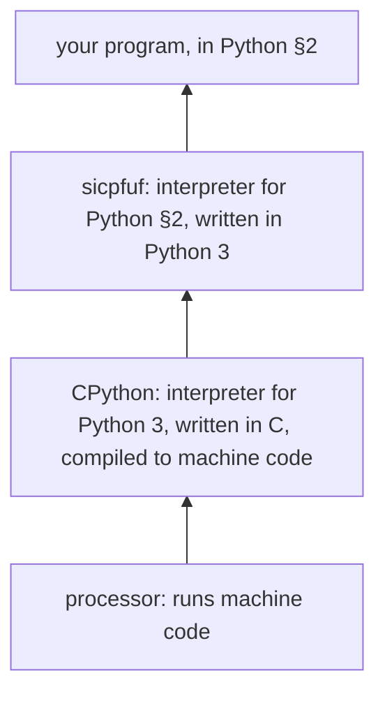

# 11. Streams: delayed evaluation

<p class="chapter-goal">Wrap "the rest" in a lambda so it is computed only when asked for, and you can work with very long, even infinite, sequences.</p>

!!! abstract "The big idea, in plain words"
    A llist is a meal that is fully cooked before you sit down, even if you only want the first bite. A
    **stream** is a first dish plus a **recipe card** for the rest. When you want the next dish, you cook
    from the card, and that dish again comes with a card for the rest. Nothing is cooked that nobody asked
    for, so the menu can even be endless.

    In Python §2 the recipe card is a **nullary function**, a function of no arguments: `lambda: ...`.
    Making it costs nothing; calling it does the work.

In Python §2 you write the stream functions yourself; from Python §3 the STREAMS library is pre-declared.

## 1. Delaying with nullary lambdas

Could you write your own conditional as an ordinary function? Not quite: Python evaluates **all**
arguments before applying a function (applicative order), so both branches would run.

```python title="§2"
def choose(test, if_yes, if_no):
    return if_yes if test else if_no

x = 0
print(choose(x == 0, "zero", 100 / x))
```
```text title="Output"
ZeroDivisionError at line 5
    print(choose(x == 0, "zero", 100 / x))
ZeroDivisionError: division by zero
sicpfuf hint: check the divisor before dividing, for example with a base case `if n == 0`.
```

The fix: pass two **nullary functions**, and call only the chosen one.

```python title="§2"
def choose(test, if_yes, if_no):
    return if_yes() if test else if_no()

x = 0
print(choose(x == 0, lambda: "zero", lambda: 100 / x))
```
```text title="Output"
zero
```

`lambda: 100 / x` is a value that *describes* a computation without doing it. This is **delayed
evaluation**; applying the function is **forcing** it. The continuations of [CPS](09-trees-cps.md) were the
same trick: deferred work stored in a function, run later.

## 2. What a stream is

> A **stream** is either `None` (the empty stream), or a pair whose head is the first element and whose
> tail is a nullary function that returns a stream.

```python title="§2"
def stream_tail(s):
    return tail(s)()

s = pair(1, lambda: pair(2, lambda: pair(3, lambda: None)))
print(head(s))
print(head(stream_tail(s)))
print(stream_tail(stream_tail(stream_tail(s))))
print(s)
```
```text title="Output"
1
2
None
[1, <function (anonymous)>]
```

- Read the first element with plain `head`. Get the rest with `stream_tail(s)`, which **calls** the tail
  function. Never `tail(s)` alone: that is the function, not the rest.
- Printing a stream shows the head and `<function (anonymous)>`: the rest does not exist yet.

## 3. Writing the stream functions yourself (§2)

Each stream function is its llist twin with the rest wrapped in `lambda:` and `tail` replaced by `stream_tail`.

```python title="§2"
def stream_tail(s):
    return tail(s)()

def enum_stream(a, b):
    return None if a > b else pair(a, lambda: enum_stream(a + 1, b))

def integers_from(n):
    return pair(n, lambda: integers_from(n + 1))

def stream_map(f, s):
    return None if is_none(s) else pair(f(head(s)), lambda: stream_map(f, stream_tail(s)))

def stream_filter(keep, s):
    return (None if is_none(s)
            else pair(head(s), lambda: stream_filter(keep, stream_tail(s))) if keep(head(s))
            else stream_filter(keep, stream_tail(s)))

def stream_ref(s, n):
    return head(s) if n == 0 else stream_ref(stream_tail(s), n - 1)

def eval_stream(s, n):
    return None if n == 0 else pair(head(s), eval_stream(stream_tail(s), n - 1))

print_llist(eval_stream(enum_stream(5, 100), 3))
print_llist(eval_stream(stream_map(lambda x: x * x, integers_from(1)), 6))
print(stream_ref(stream_filter(lambda n: n % 7 == 0, integers_from(1)), 9))
```
```text title="Output"
llist(5, 6, 7)
llist(1, 4, 9, 16, 25, 36)
70
```

`eval_stream(s, n)` turns the first n elements into a llist, which is how you look at a stream.
`stream_filter` is the only one that may force tails right away: when the head fails the test it keeps
forcing until it finds an element that passes. (Later snippets repeat the helpers they need, on one line each.)

## 4. Watching laziness happen

Put a `print` inside the function you map, and you can see **when** each element is computed.

```python title="§2"
def stream_tail(s): return tail(s)()
def enum_stream(a, b): return None if a > b else pair(a, lambda: enum_stream(a + 1, b))
def stream_map(f, s): return None if is_none(s) else pair(f(head(s)), lambda: stream_map(f, stream_tail(s)))
def stream_ref(s, n): return head(s) if n == 0 else stream_ref(stream_tail(s), n - 1)

def loud_square(x):
    print("squaring", x)
    return x * x

s = stream_map(loud_square, enum_stream(1, 100))
print("built s")
print(stream_ref(s, 2))
print(stream_ref(s, 2))
```
```text title="Output"
squaring 1
built s
squaring 2
squaring 3
9
squaring 2
squaring 3
9
```

1. Building `s` squares only the **head** (1). The other 99 elements are recipe cards.
2. `stream_ref(s, 2)` forces two tails: 2 and 3 get squared.
3. The second `stream_ref(s, 2)` squares 2 and 3 **again**. These streams are not memoized: forcing the
   same tail twice does the work twice. (Remembering forced tails, with `memo_fun`, comes in
   [Streams II](16-streams-ii.md).)

!!! warning "Trap: forgetting the lambda"
    Without `lambda:` the "rest" is computed immediately, and for an infinite stream that never ends:

    ```python title="§2"
    def integers_from(n):
        return pair(n, integers_from(n + 1))

    print(head(integers_from(1)))
    ```
    ```text
    RecursionError: maximum recursion depth exceeded
    ```

## 5. Infinite streams

Because the rest is only a promise, a stream can go on for ever. You can only ever look at a finite part.

```python title="§2"
def stream_tail(s): return tail(s)()
def stream_map(f, s): return pair(f(head(s)), lambda: stream_map(f, stream_tail(s)))  # infinite s only
def eval_stream(s, n): return None if n == 0 else pair(head(s), eval_stream(stream_tail(s), n - 1))

ones = pair(1, lambda: ones)

def fib_from(a, b):
    return pair(a, lambda: fib_from(b, a + b))

def powers_of(k):
    def from_power(p):
        return pair(p, lambda: from_power(p * k))
    return from_power(1)

print_llist(eval_stream(ones, 4))
print_llist(eval_stream(fib_from(0, 1), 10))
print_llist(eval_stream(stream_map(lambda p: p - 1, powers_of(2)), 8))
```
```text title="Output"
llist(1, 1, 1, 1)
llist(0, 1, 1, 2, 3, 5, 8, 13, 21, 34)
llist(0, 1, 3, 7, 15, 31, 63, 127)
```

`ones = pair(1, lambda: ones)` refers to itself. That is fine: the name `ones` inside the lambda is looked up
only when the tail is forced, and by then the declaration assignment has finished.

### Why bother: be lazy

Find the second prime after 2000. The llist pipeline builds and tests a whole range just to use two
elements; the stream pipeline stops as soon as it has them.

```python title="§2"
def stream_tail(s): return tail(s)()
def integers_from(n): return pair(n, lambda: integers_from(n + 1))
def stream_filter(keep, s):
    return (pair(head(s), lambda: stream_filter(keep, stream_tail(s))) if keep(head(s))
            else stream_filter(keep, stream_tail(s)))

def is_prime(n):
    def no_divisor_from(d):
        return True if d * d > n else False if n % d == 0 else no_divisor_from(d + 1)
    return n >= 2 and no_divisor_from(2)

def with_llists(start):
    return head(tail(filter(is_prime, enum_llist(start, start + 20000))))

def with_streams(start):
    return head(stream_tail(stream_filter(is_prime, integers_from(start))))

print(with_llists(2000), with_streams(2000))
measure(with_llists, 2000)
measure(with_streams, 2000)
```
```text title="Output"
2011 2011
[measure] with_llists(2000): 413,981 calls, 7,045,059 steps, at most 3 waiting at once
[measure] with_streams(2000): 169 calls, 2,340 steps, at most 3 waiting at once
```

Same answer, a tiny fraction of the work, and the stream version needs no guessed upper bound.

??? example "X-ray: who forces whom"
    `--trace` on the stream functions shows that `stream_filter` keeps calling itself (forcing tails) until
    it finds an element that passes, and then returns at once.

    ```python title="§2 · --trace stream_filter"
    def stream_tail(s): return tail(s)()
    def integers_from(n): return pair(n, lambda: integers_from(n + 1))
    def stream_filter(keep, s):
        return (pair(head(s), lambda: stream_filter(keep, stream_tail(s))) if keep(head(s))
                else stream_filter(keep, stream_tail(s)))

    fives = stream_filter(lambda n: n % 5 == 0, integers_from(8))
    print(head(fives))
    print(head(stream_tail(fives)))
    ```
    ```text title="Output"
    → stream_filter(<function (anonymous)>, [8, <function (anonymous)>])
    ↻ stream_filter(<function (anonymous)>, [9, <function (anonymous)>])
    ↻ stream_filter(<function (anonymous)>, [10, <function (anonymous)>])
    ← [10, <function (anonymous)>]
    10
    → stream_filter(<function (anonymous)>, [11, <function (anonymous)>])
    ↻ stream_filter(<function (anonymous)>, [12, <function (anonymous)>])
    ↻ stream_filter(<function (anonymous)>, [13, <function (anonymous)>])
    ↻ stream_filter(<function (anonymous)>, [14, <function (anonymous)>])
    ↻ stream_filter(<function (anonymous)>, [15, <function (anonymous)>])
    ← [15, <function (anonymous)>]
    15
    ```

## 6. The STREAMS library (§3)

From Python §3 on, all of the above is pre-declared: `stream_tail`, `stream_map`, `stream_filter`,
`stream_ref`, `enum_stream`, `integers_from`, `eval_stream`, plus `stream(...)`, `stream_to_llist`,
`is_stream`, `stream_length` and more. They behave exactly like the versions you wrote.

```python title="§3"
evens = stream_filter(lambda n: n % 2 == 0, integers_from(1))
print_llist(eval_stream(stream_map(lambda n: n * n, evens), 5))
print(stream_ref(evens, 99))
s = stream(10, 20, 30)
print_llist(stream_to_llist(s))
print(is_stream(s), stream_length(s))
```
```text title="Output"
llist(4, 16, 36, 64, 100)
200
llist(10, 20, 30)
True 3
```

They are **not memoized** either. Helpers such as `ones`, `add_streams` and `scale_stream` are never pre-declared: define
them yourself when a question needs them.

!!! warning "Trap: walking an infinite stream to the end"
    `stream_length`, `stream_to_llist` and `stream_for_each` walk the **whole** stream: on an infinite
    stream they never finish. Use `eval_stream(s, n)` or `stream_ref(s, n)` instead. Likewise
    `stream_filter` with a test that no element passes never returns.

!!! note "Python §2/§3 vs real Python"
    Real Python has generators (`yield`) for lazy sequences; the course language does not. Course streams are
    plain pairs and lambdas, so everything you know about pairs and functions still applies.

## 7. Interpreters, compilers and T-diagrams

The last part of the lecture steps back: every program runs on *something* that understands its language.

- An **interpreter** is a program that runs programs. It is written in its **implementation language** and
  runs programs of its **interpreted language**. sicpfuf is an interpreter for Python §1–§4 written in Python 3.
- A **compiler** is a program that **translates** programs from a **from-language** to a **to-language**,
  and is itself written in some implementation language. It does not run the program; something else must.

**T-diagrams** (tombstone diagrams) are a picture language for this. A program sits on what runs it; an
interpreter is a block with its interpreted language on top and its implementation language below; a
compiler is a T: from-language on the left arm, to-language on the right arm, implementation language in
the stem.

```text
  interpreter               compiler

  +-----------+     +-----------------------------+
  | Python §2 |     | TypeScript  -->  JavaScript |
  |-----------|     +---------+         +---------+
  | Python 3  |               |  Java-  |
  +-----------+               |  Script |
                              +---------+
```

Stacking them shows a sicpfuf run: your program runs on sicpfuf, which runs on CPython (written in C,
compiled to machine code), which runs on the processor.



The course's own tools stack differently: a Python § interpreter written in TypeScript, **compiled** to
JavaScript, which your browser **interprets** (and partly compiles) on your machine. Real systems mix both
ideas. The most important point is the one Unit 4 builds on: an interpreter is **just another program**.
You will write one, in Python, in the [metacircular evaluator](17-mce.md).

## Takeaways

- `lambda: e` delays `e`; calling it forces it. Applicative order evaluates all arguments, so to delay you
  must wrap.
- A **stream** is `None` or `pair(first, lambda: rest_stream)`. Use `head` and `stream_tail`, never bare `tail`.
- A stream function is its llist twin with `lambda:` around the rest and `stream_tail` for `tail`.
- `stream_map` computes only the head at once, the rest when forced; `stream_filter` forces tails until
  the first element that passes.
- Without memoization, forcing the same tail twice repeats the work (and any printing).
- Infinite streams are fine: look at them with `eval_stream`/`stream_ref`. Write them by hand in §2; the
  STREAMS library is pre-declared from §3.
- Interpreter = runs programs; compiler = translates programs. T-diagrams stack them.

## Check yourself

1. What does this print? Count the lines carefully.

    ```python
    def stream_tail(s): return tail(s)()
    def loud(n):
        print("making", n)
        return pair(n, lambda: loud(n + 1))

    s = loud(1)
    t = stream_tail(stream_tail(s))
    print(head(t))
    ```

    ??? success "Answer"
        `loud(1)` prints once; each `stream_tail` forces one more element.

        ```python title="§2"
        def stream_tail(s): return tail(s)()
        def loud(n):
            print("making", n)
            return pair(n, lambda: loud(n + 1))

        s = loud(1)
        t = stream_tail(stream_tail(s))
        print(head(t))
        ```
        ```text
        making 1
        making 2
        making 3
        3
        ```

2. Write `stream_take_while(keep, s)`: the stream of elements of `s` up to (not including) the first one
   that fails `keep`. It must work on infinite streams. Use the §3 library.

    ??? success "Answer"
        Same shape as `stream_filter`, but stop (return `None`) at the first failure.

        ```python title="§3"
        def stream_take_while(keep, s):
            return (None if is_none(s) or not keep(head(s))
                    else pair(head(s), lambda: stream_take_while(keep, stream_tail(s))))

        squares = stream_map(lambda n: n * n, integers_from(1))
        print_llist(stream_to_llist(stream_take_while(lambda x: x < 50, squares)))
        ```
        ```text
        llist(1, 4, 9, 16, 25, 36, 49)
        ```

3. Define the infinite stream 1, −1, 1, −1, … in §2 without any helper function.

    ??? success "Answer"
        Two names that refer to each other, each delayed by a lambda.

        ```python title="§2"
        def stream_tail(s): return tail(s)()
        plus_minus = pair(1, lambda: minus_plus)
        minus_plus = pair(-1, lambda: plus_minus)

        print(head(stream_tail(plus_minus)), head(stream_tail(stream_tail(plus_minus))))
        ```
        ```text
        -1 1
        ```

4. Why does `stream_map(loud_square, enum_stream(1, 100))` print exactly one line, and when are the others
   printed?

    ??? success "Answer"
        `stream_map` applies the function to the head at once (it is an argument of `pair`) and wraps the
        rest in a lambda. Each other element is squared (and printed) each time its tail is forced.

5. Write `stream_zip_add(s1, s2)`, the element-wise sum of two infinite streams, and use it to list the
   first five elements of the sum of `integers_from(1)` and `integers_from(10)` (§3).

    ??? success "Answer"

        ```python title="§3"
        def stream_zip_add(s1, s2):
            return pair(head(s1) + head(s2), lambda: stream_zip_add(stream_tail(s1), stream_tail(s2)))

        print_llist(eval_stream(stream_zip_add(integers_from(1), integers_from(10)), 5))
        ```
        ```text
        llist(11, 13, 15, 17, 19)
        ```

6. In a T-diagram of a compiler, what do the stem and the two arms stand for?

    ??? success "Answer"
        The stem is the language the compiler itself is **written in** (what must run it). The arms are the
        language of the programs it **reads** (left) and the language of the programs it **writes** (right).
        A compiler from TypeScript to JavaScript written in JavaScript needs a JavaScript interpreter to run.

*In the course: L7B · SICPy 3.5.1–3.5.2.*
