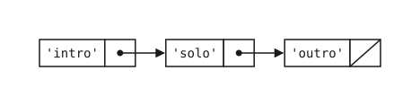
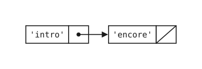
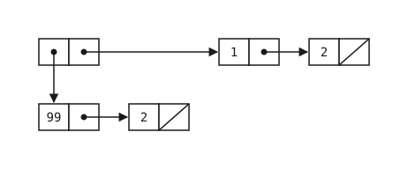
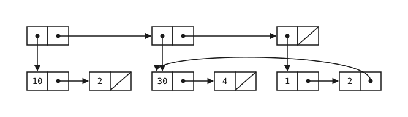
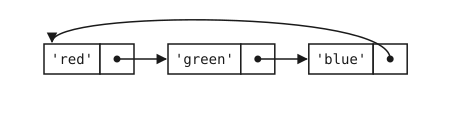
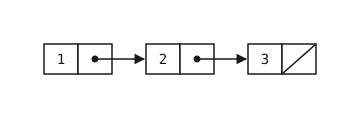
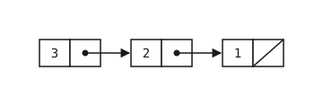

# State and mutation

<p class="chapter-goal">Let names change their value and pairs change their insides, and see exactly what that costs.</p>

!!! abstract "The big idea, in plain words"
    Until now a name was like a word carved in stone: once `price = 10`, it was 10 forever. That is why
    the substitution model worked: wherever you saw `price`, you could write `10`.

    In Python §3 a name can be a **whiteboard** instead: you can wipe it and write a new value. A pair
    can be changed too, like a box whose contents you swap out. This gives us objects that **remember
    their history** (a loyalty card that counts stamps). The price: the same expression can now give
    different values at different times, so "replace the name by its value" no longer explains programs.

## Reassignment

In §1 and §2, assigning a name a second time is an error found before the program runs. In §3 it is
allowed, and it is called **reassignment**. The first `x = …` in a scope is still the **declaration
assignment**.

```python title="§3"
score = 10
score = score + 5
score = score * 2
print(score)
```
```text title="Output"
30
```

The rule for `score = score + 5`: first evaluate the right-hand side **with the old value** (10 + 5),
then change the binding of `score` to the result. Order matters now: swapping the last two lines gives 25.

From §3 on we call a name that can be reassigned a **variable**.

## Functions that remember: `global`

A program that counts visitors needs a value that survives between function applications.

```python title="§3"
visitors = 0

def welcome(name):
    global visitors
    visitors = visitors + 1
    print("Hello", name, "you are visitor", visitors)

welcome("Ana")
welcome("Ben")
welcome("Cy")
```
```text title="Output"
Hello Ana you are visitor 1
Hello Ben you are visitor 2
Hello Cy you are visitor 3
```

`global visitors` says: inside this body, `visitors` means the name declared at top level.

!!! warning "Trap: forgetting `global`"
    Any name that is **assigned** somewhere in a function body is a **local** name of that function,
    for the whole body. Without `global`, `visitors = visitors + 1` reads the local `visitors` before
    it has a value:

    ```python title="§3"
    visitors = 0

    def welcome():
        visitors = visitors + 1
        return visitors

    welcome()
    ```
    ```text
    UnassignedLocalError: cannot access local variable 'visitors' where it is not associated with a value
    ```

    It does **not** fall back to the global `visitors`. Reading a global is fine without `global`;
    only *assigning* it needs the declaration.

## Private state: `nonlocal`

A global counter has a problem: anyone can change it, and there is only one. Better: put the state
inside a **maker function**, and return an inner function that changes it. Here is a coffee loyalty
card: every `needed` stamps you get a free coffee and the card starts again.

```python title="§3"
def make_card(needed):
    stamps = 0
    def stamp():
        nonlocal stamps
        stamps = stamps + 1
        if stamps == needed:
            stamps = 0
            return "free coffee!"
        return stamps
    return stamp

mine = make_card(3)
yours = make_card(3)
print(mine(), mine(), yours(), mine(), mine())
```
```text title="Output"
1 2 1 free coffee! 1
```

- `nonlocal stamps` says: `stamps` is the variable of the **enclosing function** (`make_card`), not a
  new local of `stamp`.
- Each application of `make_card` creates its own `stamps`. `mine` and `yours` are independent:
  `yours()` gives 1 even after `mine` was stamped twice.
- Nobody outside can touch `stamps` except by calling the card. The state is **private**.

The parameter `needed` is also part of each card's private state; it is read, never reassigned, so it
needs no `nonlocal`. *Where* these variables live is exactly what the
[environment model](14-environment-model.md) draws: one frame per card.

## The same expression, different values

In §1 and §2, `f(1)` always gave the same value: functions were **pure**, like mathematical functions.
Now look:

```python title="§3"
def make_card(needed):
    stamps = 0
    def stamp():
        nonlocal stamps
        stamps = stamps + 1
        return stamps
    return stamp

card = make_card(10)
print(card() == card())
print(card() + card())
```
```text title="Output"
False
7
```

`card()` is 1, then 2, then 3, then 4. The expression `card()` has no single value; its value depends
on **when** it is evaluated. We say **referential transparency** is lost: you can no longer replace an
expression by its value ("equals for equals") without changing the program.

That kills the substitution model. Try it on `stamp()`: replace `stamps` by its value 0 everywhere in
the body, and you get `0 = 0 + 1`, `return 0`. Nonsense. A variable is not a value; it is a **place**
that holds a value, and places need a new model: [environments](14-environment-model.md).

## Mutable pairs: `set_head` and `set_tail`

Reassignment changes what a **name** refers to. **Mutation** changes an existing **data structure**.
§3 adds two mutators for pairs:

| | what it does | returns |
|---|---|---|
| `set_head(p, v)` | the head of the pair `p` becomes `v` | `None` |
| `set_tail(p, v)` | the tail of the pair `p` becomes `v` | `None` |

The pair stays **the same pair**; only its contents change. Here is a playlist before and after:

```python title="§3 · figure 12-state-playlist"
songs = llist("intro", "solo", "outro")
draw_data(songs)
set_head(tail(songs), "encore")
set_tail(tail(songs), None)
draw_data(songs)
print(songs)
```
```text title="Output"
['intro'|•]-->['solo'|•]-->['outro'|/]
['intro'|•]-->['encore'|/]
['intro', ['encore', None]]
```




The `"outro"` pair still exists, but nothing points to it any more. Such unreachable pairs are
**garbage**; the system reclaims them.

## Sharing and identity

When two names refer to the **same** pair, they are **aliases**. Mutation through one is visible through
the other, because there is only one pair.

```python title="§3 · figure 12-state-alias"
a = llist(1, 2)
b = a
c = llist(1, 2)
print(a == c, a is c, a is b)
set_head(b, 99)
print(a, b, c)
draw_data(pair(a, c))
```
```text title="Output"
True False True
[99, [2, None]] [99, [2, None]] [1, [2, None]]
[•|•]------------>[1|•]-->[2|/]
 |
 v
 [99|•]-->[2|/]
```



- `x == y` asks "do they look the same?" (structural equality; on pairs and lists it compares contents).
- `x is y` asks "are they the **same object**?" (identity).
- Every evaluation of `pair(...)`, of a list expression `[...]` and of a lambda expression creates a
  new object with its own identity. `b = a` creates nothing: it is a second name for the same pair.
- For numbers, strings, booleans and `None`, `is` behaves like `==`. Use `==` for those anyway.

### Hidden sharing: `append`

`append(xs, ys)` copies the pairs of `xs` but **reuses** `ys` itself as the end of the result. Before
§3 nobody could tell. Now we can:

```python title="§3 · figure 12-state-append"
xs = llist(1, 2)
ys = llist(3, 4)
zs = append(xs, ys)
set_head(ys, 30)
set_head(xs, 10)
print(zs)
print(tail(tail(zs)) is ys)
draw_data(llist(xs, ys, zs))
```
```text title="Output"
[1, [2, [30, [4, None]]]]
True
[•|•]------------>[•|•]--------------->[•|/]
 |                 |                    |
 v                 v                    v
 [10|•]-->[2|/]    #1=[30|•]-->[4|/]    [1|•]-->[2|•]-->#1
```



Changing `ys` changed `zs`; changing `xs` did not. The picture shows why: `zs` has its own copies of
the first two pairs but its third pair **is** the first pair of `ys`.

## Cycles

`set_tail` can point a tail back to an earlier pair. Then the "llist" never ends:

```python title="§3 · figure 12-state-cycle"
ring = llist("red", "green", "blue")
set_tail(tail(tail(ring)), ring)
draw_data(ring)
print(head(tail(tail(tail(ring)))))
```
```text title="Output"
#1=['red'|•]-->['green'|•]-->['blue'|•]-->#1
red
```



Walking 3 tails brings you back to `"red"`. `length(ring)` would never finish: a cycle is not a llist.

## Destructive versus non-destructive

A **non-destructive** function leaves its arguments alone and builds new pairs (`append`, `map`,
`reverse`). A **destructive** function reuses and rewires the pairs it is given and calls `pair` not at
all. It saves space, but every alias of the input sees the change.

`d_append(xs, ys)` joins by pointing the last tail of `xs` at `ys`:

```python title="§3"
def last_pair(xs):
    return xs if is_none(tail(xs)) else last_pair(tail(xs))

def d_append(xs, ys):
    if is_none(xs):
        return ys
    set_tail(last_pair(xs), ys)
    return xs

front = llist(1, 2)
back = llist(3)
both = d_append(front, back)
print(both)
print(front)
print(both is front)
```
```text title="Output"
[1, [2, [3, None]]]
[1, [2, [3, None]]]
True
```

After the call, `front` itself has grown: `both` and `front` are the same pair. Compare `append`, which
leaves `xs` untouched. (If `xs` is empty there is no pair to rewire, so `d_append` can only return `ys`.)

An **in-place reverse** turns every arrow around, one pair at a time. It uses no new pairs, so it needs
Θ(1) extra space instead of `reverse`'s Θ(n) new pairs:

```python title="§3 · figure 12-state-dreverse"
def d_reverse(xs):
    def flip(done, rest):
        if is_none(rest):
            return done
        next_rest = tail(rest)
        set_tail(rest, done)
        return flip(rest, next_rest)
    return flip(None, xs)

nums = llist(1, 2, 3)
draw_data(nums)
first = nums
nums = d_reverse(nums)
print(nums)
print(first)
draw_data(nums)
```
```text title="Output"
[1|•]-->[2|•]-->[3|/]
[3, [2, [1, None]]]
[1, None]
[3|•]-->[2|•]-->[1|/]
```




`flip` keeps two llists: `done` (already reversed) and `rest` (still to do). Each step moves the first
pair of `rest` to the front of `done`. Note the order: save `tail(rest)` **before** `set_tail`
overwrites it, or the rest of the llist is lost.

!!! warning "Trap: the old name after a destructive call"
    `first` still points to the pair holding 1, which is now the **last** pair, so it prints
    `[1, None]`. After a destructive operation, always use the **returned** value, and ask what every
    other name now refers to.

!!! note "Python §3 vs real Python"
    `global`, `nonlocal`, reassignment and `is` work the same in real Python. `set_head`, `set_tail`,
    `pair` and `llist` are course functions (in §3 a pair is a list of length two, so `set_head(p, v)`
    is like `p[0] = v`). Real Python's `is` on numbers and strings can surprise you (two equal large
    integers may not be `is`); in §3 it behaves like `==`. Either way, compare values with `==`.

## Takeaways

- **Reassignment** changes what a name refers to: evaluate the right side with the old value, then update.
- Assigning a name anywhere in a body makes it local to that function for the **whole** body; use
  `global` or `nonlocal` to assign an outer variable instead.
- A maker function with a `nonlocal` variable gives **private, independent state** per application.
- With state, the same expression can have different values: no **referential transparency**, no
  substitution model.
- **Mutation** (`set_head`, `set_tail`) changes an existing pair; every alias sees it.
- `==` compares contents, `is` compares identity. `append` shares its second argument.
- **Destructive** functions rewire existing pairs (`d_append`, in-place reverse): Θ(1) extra space, but
  old names may now point into the middle or end of the result.

## Check yourself

1. What does this print?

    ```python title="§3"
    n = 5
    n = n * n - n
    print(n)
    ```

    ??? success "Answer"
        ```text
        20
        ```
        The right side uses the old `n`: 25 − 5.

2. Why does this fail, and what one line fixes it?

    ```python title="§3"
    def make_timer():
        ticks = 0
        def tick():
            ticks = ticks + 1
            return ticks
        return tick

    t = make_timer()
    t()
    ```

    ??? success "Answer"
        ```text
        UnassignedLocalError: cannot access local variable 'ticks' where it is not associated with a value
        ```
        `tick` assigns `ticks`, so `ticks` is local to `tick` and has no value yet when the right side
        is read. Add `nonlocal ticks` as the first line of `tick`.

3. Predict the output.

    ```python title="§3"
    p = pair(1, 2)
    q = pair(p, p)
    set_head(head(q), 7)
    print(q)
    print(head(q) is tail(q))
    ```

    ??? success "Answer"
        ```text
        [[7, 2], [7, 2]]
        True
        ```
        Both halves of `q` point to the **same** pair `p`, so one mutation shows up twice.

4. Predict the output.

    ```python title="§3"
    xs = llist(1, 2)
    ys = llist(3)
    zs = append(xs, ys)
    set_head(tail(zs), 20)
    set_head(tail(tail(zs)), 30)
    print(xs, ys)
    ```

    ??? success "Answer"
        ```text
        [1, [2, None]] [30, None]
        ```
        The second pair of `zs` is a fresh copy, so `xs` is untouched. The third pair of `zs` **is**
        the first pair of `ys`.

5. Write `d_map(f, xs)` that replaces every element of the llist `xs` by `f` of it, in place, without
   calling `pair`.

    ??? success "Answer"
        ```python title="§3"
        def d_map(f, xs):
            if not is_none(xs):
                set_head(xs, f(head(xs)))
                d_map(f, tail(xs))

        ws = llist(1, 2, 3)
        d_map(lambda x: x * 10, ws)
        print(ws)
        ```
        ```text
        [10, [20, [30, None]]]
        ```
        It returns `None`; the change is visible through `ws` because the same pairs were changed.

*In the course: L8A · SICPy 3.1.1, 3.1.3, 3.3.1.*
