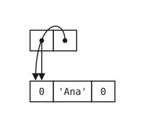

# Lists and loops

<p class="chapter-goal">Use Python lists with indices, and repeat work with while and for loops instead of recursion.</p>

!!! abstract "The big idea, in plain words"
    A llist is a treasure hunt: to reach clue 50 you must follow 50 arrows. A **list** is a row of
    numbered lockers: you walk straight to locker 50. The row has a fixed number of lockers, and you can
    change what is inside any of them.

    A **loop** is the other new tool: "do this again, until done", without a pile of waiting function
    applications. Together they give a second way to write most of Unit 2: with indices instead of
    `head` and `tail`.

## Lists in Python §3

```python title="§3"
temps = [31, 29, 33, 30]
print(temps[0], temps[3], temps[-1], len(temps))
temps[1] = 35
print(temps)
slots = [None] * 3
print(slots)
```
```text title="Output"
31 30 30 4
[31, 35, 33, 30]
[None, None, None]
```

- Indices start at 0. A list of length n has indices 0 … n−1, and also −1 … −n counting from the end.
- `xs[i] = v` changes the existing list (**element reassignment**). Every alias sees it, as with pairs.
- `[v] * n` makes a new list of n slots, each holding `v`. That is how you **allocate** a list.
- Reading or writing `xs[i]` takes Θ(1) time, whatever i is (so does `len(xs)`). Reaching element i of
  a llist takes Θ(i).

A list **cannot grow or shrink**. There is no "add at the end":

```python title="§3"
temps = [31, 29, 33, 30]
temps[4] = 28
```
```text
IndexError: list index out of range: index 4, but the list has 4 items
```

So if you need a new list, you must know its length **before** you create it.

!!! note "Pairs are lists"
    In §3 a pair *is* a list of length two: `pair(1, 2) == [1, 2]` is `True`, `p[0]` is `head(p)` and
    `p[1]` is `tail(p)`. That is why box notation `[1, [2, None]]` looks like list syntax.

## The `while` loop

```python
while condition:
    body
```

Test the condition; if it is `True`, run the body and go back to the test; if `False`, go on after the
loop. The body may run zero times. Something in the body must **make progress** towards a `False` test,
or the loop never ends.

```python title="§3"
def count_digits(n):
    digits = 1
    while n >= 10:
        n = n // 10
        digits = digits + 1
    return digits

print(count_digits(7), count_digits(2026), count_digits(1000000))
```
```text title="Output"
1 4 7
```

Each pass removes one digit (`n // 10`), so the loop stops. Note that the parameter `n` is reassigned;
the caller's value is not affected.

## The `for` loop over `range`

When you know how many times to repeat, use `for`. In §3, `for` works **only** with `range`:

| | visits |
|---|---|
| `range(4)` | 0, 1, 2, 3 |
| `range(2, 6)` | 2, 3, 4, 5 (the end is excluded) |
| `range(10, 0, -3)` | 10, 7, 4, 1 |

```python title="§3"
def countdown(n):
    for k in range(n, 0, -1):
        print(k)
    print("liftoff")

countdown(3)
```
```text title="Output"
3
2
1
liftoff
```

The **loop control variable** `k` gets the next value of the range before each pass. Use a fresh name
for it. To visit every element of a list, loop over its **indices**: `for i in range(len(xs))`.

## `break` and `continue`

- `break` leaves the **innermost** loop at once.
- `continue` skips the rest of this pass and goes to the next one.

```python title="§3"
def first_overdraft(balances):
    found = -1
    for i in range(len(balances)):
        if balances[i] < 0:
            found = i
            break
    return found

def total_positive(xs):
    total = 0
    for i in range(len(xs)):
        if xs[i] < 0:
            continue
        total = total + xs[i]
    return total

print(first_overdraft([50, 20, -5, -10]), first_overdraft([1, 2]))
print(total_positive([4, -1, 6, -2]))
```
```text title="Output"
2 -1
10
```

Inside a function, `return` also stops the loop, and is often simpler than a flag and `break`.

!!! warning "Trap: `continue` that skips the progress"
    In a `while` loop, if `continue` jumps past the line that moves the index, the loop never ends.
    Put the update **before** the `continue`, or use a `for` loop, whose control variable always moves.

## Loop patterns

Most list functions are one of a few patterns.

**Accumulate** (the job `reduce` did for llists) and **count**:

```python title="§3"
def list_sum(xs):
    total = 0
    for i in range(len(xs)):
        total = total + xs[i]
    return total

def count_if(pred, xs):
    count = 0
    for i in range(len(xs)):
        if pred(xs[i]):
            count = count + 1
    return count

marks = [12, 18, 7, 20]
print(list_sum(marks), count_if(lambda m: m >= 10, marks))
```
```text title="Output"
57 3
```

**Two indices and a swap**: reverse a list **in place**. One index walks in from the left, the other
from the right; swap, then move both. There are ⌊n/2⌋ swaps, Θ(n) time and Θ(1) extra space.

```python title="§3"
def reverse_in_place(xs):
    left = 0
    right = len(xs) - 1
    while left < right:
        temp = xs[left]
        xs[left] = xs[right]
        xs[right] = temp
        left = left + 1
        right = right - 1

word = ["l", "o", "o", "p"]
reverse_in_place(word)
print(word)
```
```text title="Output"
['p', 'o', 'o', 'l']
```

The `temp` variable matters: without it, `xs[left] = xs[right]` would overwrite the left value before
it was copied. (`a, b = b, a` does not exist in the course language.)

**Build a new list**: allocate first, then fill.

```python title="§3"
def squares_up_to(n):
    result = [0] * n
    for i in range(n):
        result[i] = (i + 1) * (i + 1)
    return result

print(squares_up_to(5))
```
```text title="Output"
[1, 4, 9, 16, 25]
```

## Lists of lists

A table is a list of rows: `grid[r][c]` is row `r`, column `c`. Make each row with its **own**
`[0] * cols`:

```python title="§3"
def make_grid(rows, cols):
    grid = [None] * rows
    for r in range(rows):
        grid[r] = [0] * cols
    return grid

seats = make_grid(2, 3)
seats[0][1] = "Ana"
print(seats)
```
```text title="Output"
[[0, 'Ana', 0], [0, 0, 0]]
```

!!! warning "Trap: `[[0] * cols] * rows` shares ONE row"
    `*` copies the *element*, and here the element is a list. So every slot holds the **same** row:

    ```python title="§3 · figure 13-lists-rows"
    bad = [[0] * 3] * 2
    bad[0][1] = "Ana"
    print(bad)
    print(bad[0] is bad[1])
    draw_data(bad)
    ```
    ```text title="Output"
    [[0, 'Ana', 0], [0, 'Ana', 0]]
    True
    [•|•]------------>#1
     |
     v
     #1=[0|'Ana'|0]
    ```

    

    `[None] * n` and `[0] * n` are safe because numbers and `None` cannot be changed in place.

## Images: coordinates, channels and separate buffers

An image can be represented as `image[row][column][channel]`. Geometry often calls the
column x and the row y, so accessing `(x, y)` means `image[y][x]`. For RGBA pixels, the
channel positions are red, green, blue, alpha. State the valid range before writing a loop:
`0 <= x and x < width`, `0 <= y and y < height`, and four channels per pixel.

This original filter mirrors an image horizontally and increases its red channel. Each
destination pixel receives its own list; no rows or pixels are accidentally shared.

```python title="§3"
def blank_image(height, width):
    image = [None] * height
    for y in range(height):
        image[y] = [None] * width
        for x in range(width):
            image[y][x] = [0, 0, 0, 255]
    return image

def mirror_and_warm(src, dest, increase):
    height = len(src)
    width = len(src[0])
    for y in range(height):
        for x in range(width):
            pixel = src[y][width - 1 - x]
            dest[y][x][0] = max(0, min(255, pixel[0] + increase))
            dest[y][x][1] = pixel[1]
            dest[y][x][2] = pixel[2]
            dest[y][x][3] = pixel[3]

src = [[[10, 20, 30, 255], [240, 50, 60, 255]],
       [[70, 80, 90, 255], [100, 110, 120, 255]]]
dest = blank_image(2, 2)
mirror_and_warm(src, dest, 30)
print(dest)
print(src[0][0], dest[0][0] is dest[1][0])
```
```text title="Output"
[ [[255, 50, 60, 255], [40, 20, 30, 255]],
[[130, 110, 120, 255], [100, 80, 90, 255]]]
[10, 20, 30, 255] False
```

Assume a nonempty rectangular source and a separate destination with the same dimensions.
Reading and writing the same image during this operation would overwrite pixels that later
iterations still need. A filter that reads source pixels and fills destination pixels takes
Θ(height × width) time here; allocating the destination also takes that much space and time.

### Work backwards from a destination pixel

To avoid holes, visit every destination pixel and calculate **which source pixel to read**.
A horizontal mirror reads source x = width − 1 − destination x. A vertical mirror changes y
instead. For a transform centred on an image, the centre coordinates are `(width - 1)/2`
and `(height - 1)/2`, including for even dimensions. Rounding and handling coordinates
outside the source are part of the transformation's specification.

For an endpoint-aligned resize that rounds down to a source pixel, test the coordinate
arithmetic independently:

```python title="§3"
def source_index(position, source_size, destination_size):
    if destination_size == 1:
        return (source_size - 1) // 2
    return position * (source_size - 1) // (destination_size - 1)

for x in range(5):
    print(source_index(x, 3, 5))
print(source_index(0, 4, 1))
```
```text title="Output"
0
0
1
1
2
1
```

This version chooses the lower source neighbour and maps both endpoints exactly. Other
sampling conventions are possible; do not mix their formulas. Quantizing a brightness
value into k character levels similarly needs a boundary rule: for integer brightness
0…255, `brightness * (k - 1) // 255` maps black to 0 and white to k − 1.

### Compose filters without corrupting their inputs

If A and B both read an image and write another, applying A and then B needs an intermediate
image: `source → A → temporary → B → destination`. To compare two transformations of the
**same original**, run each with that original source and separate temporary destinations.
Feeding A's result to B would show a composition rather than an independent comparison.

A split-screen filter also needs a destination-to-source mapping for each viewport. Decide
which viewport owns the dividing column when the width is odd, map into that viewport's
source image, and write every destination pixel exactly once. Reuse buffers between video
frames when their dimensions are unchanged; allocating them inside the innermost loop is
unnecessary work. These data-processing examples do not implement a live camera interface.

## Sensor-driven programs are state machines

Separate a decision from the hardware command that carries it out. This lets you test the
decision on recorded measurements. Here a vehicle pauses at or below distance 12 and
resumes at or above 18; readings between those limits retain its previous state. The separate thresholds
prevent noisy readings near one boundary from repeatedly starting and stopping it.

```python title="§3"
def next_mode(mode, distance, stop_pressed):
    if mode == "stopped" or stop_pressed:
        return "stopped"
    elif distance <= 12:
        return "waiting"
    elif distance >= 18:
        return "moving"
    else:
        return mode

measurements = [24, 10, 14, 20, 16]
mode = "waiting"
for i in range(len(measurements)):
    mode = next_mode(mode, measurements[i], False)
    print(mode)
mode = next_mode(mode, 25, True)
print(mode, next_mode(mode, 25, False))
```
```text title="Output"
moving
waiting
waiting
moving
moving
stopped stopped
```

The stop state is latched: releasing the button does not restart the vehicle. This is one
chosen policy, not a claim about a specific robot API. Convert sensor units according to
that API, calibrate thresholds on the real surface, and handle absent readings explicitly.
For line following, deciding “dark” or “light” is only the first step: retain which direction
you were correcting so that loss of the line has a defined response.

Non-blocking motor commands return before the movement finishes. Starting the left motor,
waiting, then starting the right motor produces different motion from starting both and
then waiting. Distance also depends on wheel circumference, gear ratio and slip; turning
depends on wheel separation. Pure decision tests cannot validate those physical quantities.

## Partition with three regions

For an in-place three-way partition, keep four regions: finished low values, finished
middle values, unexamined values, and finished high values. This fresh example groups
negative, zero and positive measurements. It does not promise to preserve order within a
group.

```python title="§3"
def group_signs(xs):
    low = 0
    scan = 0
    high = len(xs)
    while scan < high:
        if xs[scan] < 0:
            saved = xs[low]
            xs[low] = xs[scan]
            xs[scan] = saved
            low = low + 1
            scan = scan + 1
        elif xs[scan] == 0:
            scan = scan + 1
        else:
            high = high - 1
            saved = xs[high]
            xs[high] = xs[scan]
            xs[scan] = saved

values = [4, 0, -2, 5, -1, 0]
alias = values
print(group_signs(values))
print(values, alias is values)
```
```text title="Output"
None
[-2, -1, 0, 0, 5, 4] True
```

The unexamined region is `[scan, high)`. After swapping from its right end, **do not advance
scan**: the incoming element has not been classified yet. Each iteration shrinks that
region by one, proving termination and Θ(n) time. Only a fixed number of variables are
needed, so extra space is Θ(1).

## From recursion to loops

A recursive process keeps deferred operations waiting; a loop keeps everything in a few variables.
The recipe: the loop variables are the parameters of the iterative helper you would have written.

```python title="§3"
def llist_sum_rec(xs):
    return 0 if is_none(xs) else head(xs) + llist_sum_rec(tail(xs))

def llist_sum_loop(xs):
    total = 0
    while not is_none(xs):
        total = total + head(xs)
        xs = tail(xs)
    return total

nums = enum_llist(1, 2000)
print(llist_sum_loop(nums))
print(llist_sum_rec(nums))
```
```text
2001000
RecursionError: maximum recursion depth exceeded
```

The recursive version keeps 2000 additions waiting and runs out of room; the loop needs only `total`
and `xs`. A llist cannot be walked with `for` (no `range` fits it), so use `while`.

??? example "X-ray: time and space of the two versions"
    ```python title="§3"
    def llist_sum_rec(xs):
        return 0 if is_none(xs) else head(xs) + llist_sum_rec(tail(xs))

    def llist_sum_loop(xs):
        total = 0
        while not is_none(xs):
            total = total + head(xs)
            xs = tail(xs)
        return total

    measure(llist_sum_rec, enum_llist(1, 500))
    measure(llist_sum_loop, enum_llist(1, 500))
    ```
    ```text title="Output"
    [measure] llist_sum_rec([1, [2, [3, [4, [...): 501 calls, 7,006 steps, at most 501 waiting at once
    [measure] llist_sum_loop([1, [2, [3, [4, [...): 1 call, 7,009 steps, at most 1 waiting at once
    ```

## Lambdas made in a loop

A lambda expression does not copy the **value** of a variable it mentions; it remembers the
**variable** itself. A loop keeps reassigning its control variable, so every lambda sees the last value:

```python title="§3"
greeters = [None] * 3
for i in range(3):
    greeters[i] = lambda: "seat " + str(i)
print(greeters[0](), greeters[1](), greeters[2]())
```
```text title="Output"
seat 2 seat 2 seat 2
```

All three lambdas were created in the global environment and look up the one global `i`, which is 2
when they are finally applied. To freeze each value, create each lambda inside its **own** function
application, so each has its own frame:

```python title="§3"
def make_greeter(seat):
    return lambda: "seat " + str(seat)

greeters = [None] * 3
for i in range(3):
    greeters[i] = make_greeter(i)
print(greeters[0](), greeters[1](), greeters[2]())
```
```text title="Output"
seat 0 seat 1 seat 2
```

The [environment model](14-environment-model.md) makes this precise: three frames, three `seat`s.

## Orders of growth of loops

Count how many times the body runs, times the cost of one pass.

| Shape | Time | Example |
|---|---|---|
| one loop over n elements | Θ(n) | `list_sum` |
| a loop inside a loop, both over n | Θ(n²) | compare every pair of elements |
| the variable is halved (or ×10) each pass | Θ(log n) | `count_digits` |
| loop that may stop early | best case Θ(1), worst case Θ(n) | `first_overdraft` |

Space: a loop that uses a fixed number of variables needs Θ(1) extra space. A loop that **allocates**
`[0] * n` needs Θ(n) for that list.

!!! note "Python §3 vs real Python"
    Real Python's `for` walks over any sequence (`for x in xs`), lists can grow (`xs.append(v)`), and
    there are slices, `in`, `+=` and `a, b = b, a`. None of these exist in §3: loop over
    `range(len(xs))`, allocate the size you need, and swap with a `temp`.

## Takeaways

- A list has a fixed length; `xs[i]` reads and writes in Θ(1); `[v] * n` allocates.
- Out-of-range indices are an `IndexError`; lists never grow. Know the size before you build.
- `while` tests before each pass and needs progress; `for k in range(…)` counts for you.
- `break` leaves the innermost loop; `continue` skips to the next pass; `return` leaves the function.
- In-place work (reverse, swap) uses two indices and a `temp`.
- `[[0] * c] * r` shares one row; build each row in a loop.
- Lambdas made in a loop see the variable, not its value at creation time.
- A loop with a few variables is an iterative process: Θ(1) extra space.

## Check yourself

1. What does this print?

    ```python title="§3"
    xs = [5, 6, 7]
    ys = xs
    ys[0] = xs[2]
    print(xs, xs is ys)
    ```

    ??? success "Answer"
        ```text
        [7, 6, 7] True
        ```
        `ys = xs` makes an alias, not a copy.

2. Write `index_of_max(xs)` for a non-empty list, returning the index of the largest element (the first
   one if there is a tie). Give its order of growth.

    ??? success "Answer"
        ```python title="§3"
        def index_of_max(xs):
            best = 0
            for i in range(1, len(xs)):
                if xs[i] > xs[best]:
                    best = i
            return best

        print(index_of_max([3, 9, 2, 9]), index_of_max([4]))
        ```
        ```text
        1 0
        ```
        Θ(n) time, Θ(1) extra space.

3. Find the bug.

    ```python title="§3"
    def sum_evens(xs):
        total = 0
        i = 0
        while i < len(xs):
            if xs[i] % 2 == 1:
                continue
            total = total + xs[i]
            i = i + 1
        return total
    ```

    ??? success "Answer"
        On an odd element, `continue` skips `i = i + 1`, so `i` never moves and the loop runs forever.
        Fix: also write `i = i + 1` right before the `continue`, or loop with
        `for i in range(len(xs))` and delete both the `i = 0` and the `i = i + 1` lines.

4. What does this print, and why?

    ```python title="§3"
    rows = [[1] * 2] * 2
    rows[1][0] = 9
    print(rows)
    ```

    ??? success "Answer"
        ```text
        [[9, 1], [9, 1]]
        ```
        Both slots hold the same row.

5. What is the order of growth in time of this function, in terms of n?

    ```python
    def pairs_count(n):
        count = 0
        for i in range(n):
            for j in range(i):
                count = count + 1
        return count
    ```

    ??? success "Answer"
        The inner body runs 0 + 1 + … + (n − 1) = n(n − 1)/2 times: Θ(n²).

*In the course: L8A, L9B.*
