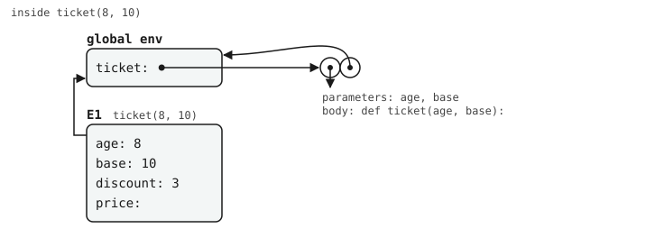
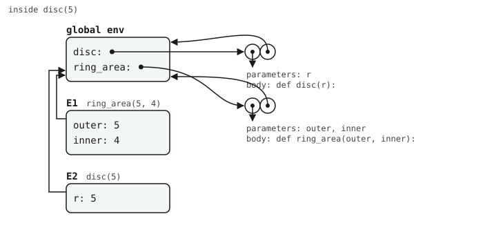
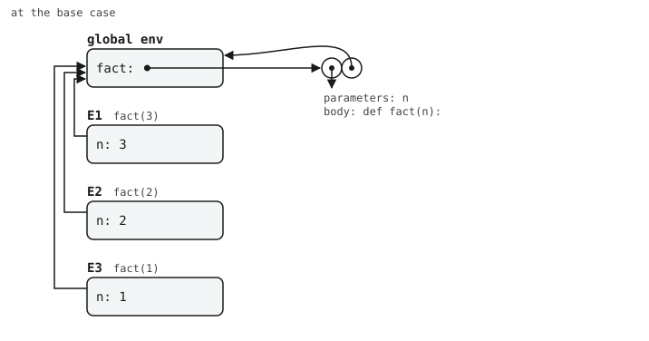
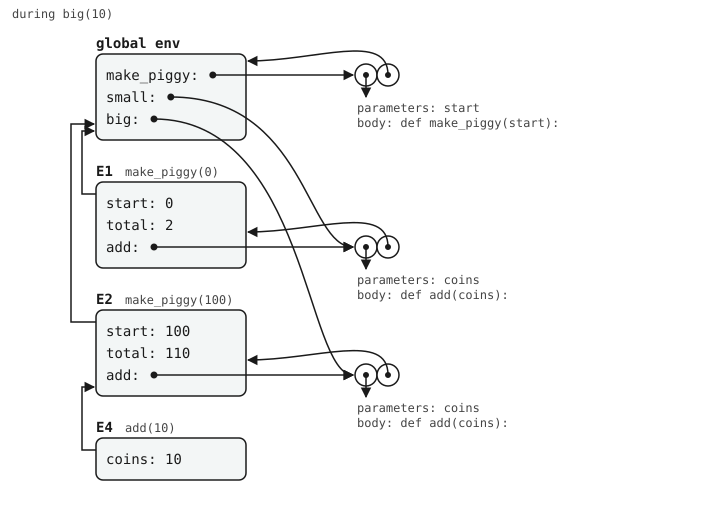
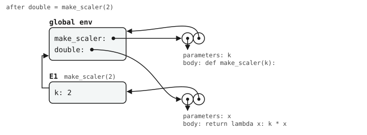
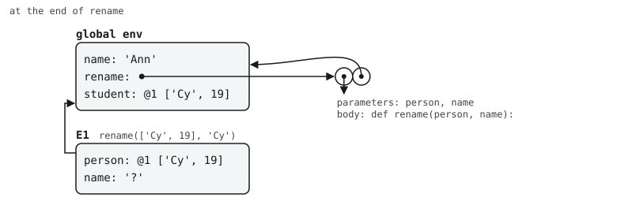

# The environment model

<p class="chapter-goal">Draw exactly where every variable lives, so you can predict any Python §3 program and draw its environment diagram in the exam.</p>

!!! abstract "The big idea, in plain words"
    Think of a stack of sticky-note sheets. Each sheet (a **frame**) lists some names and their values.
    Every sheet is stuck onto an older sheet (its **enclosing environment**), down to the sheet of the
    whole program (the **global frame**) and, under that, the sheet of built-in names.

    To find a name, read your own sheet first; if it is not there, look at the sheet yours is stuck on,
    and so on down. Applying a function starts a **fresh sheet**. And the one rule that surprises
    everyone: the fresh sheet is stuck onto the sheet where the function was **created**, not the sheet
    of whoever applied it.

## Why we need a new model

The substitution model replaces a name by its value. That only works if the value never changes. With
reassignment (see [State and mutation](12-state-mutation.md)) a variable is a **place** whose contents
change over time, so we need a picture of those places. That picture is the **environment model**:

- an **environment** is a sequence of **frames**;
- a **frame** holds **bindings** (name: value), at most one per name, and points to its **enclosing
  environment**;
- the **built-ins frame** holds `print`, `pair`, `math_sqrt` … and has no enclosing environment;
- the **global environment** has one frame, the **global frame**, for the program's top-level names; it
  extends the built-ins environment.

Every expression is evaluated **in some environment**, the **current environment**.

## Rule 1: looking up a name

To find the value of a name in an environment: look in its first frame; if there is no binding, move to
the enclosing environment; repeat. The first binding found wins: an inner binding **shadows** outer ones.

```python title="§3"
x = 10
y = 1

def f(x):
    return x + y

print(f(3))
```
```text title="Output"
4
```

In the frame of `f(3)`, `x` is 3 (the parameter shadows the global `x`). `y` is not in that frame, so
the lookup moves on to the global frame and finds 1.

If no frame has the name at all, the program is rejected before it runs. A name can also be **bound but
unassigned**: its binding exists but has no value yet. Reading it is an error (see the traps below).

## Rule 2: making a function object

Evaluating a `def` or a lambda expression creates a **function object**, drawn as **two circles**:

- the left circle points to the code: its parameters and its body;
- the right circle points to the **environment in which it was created**.

`def f(x): …` works like `f = lambda x: …`: create the object, then bind the name in the current frame.
Creating a function creates **no frame** and runs none of the body.

## Rule 3: applying a function

To apply a function object to arguments:

1. Evaluate the function expression and the argument expressions, left to right, in the current
   environment.
2. Make a **new frame**. Its enclosing environment is the one the function object's right circle points
   to (where the function was created).
3. In the new frame, bind each **parameter** to its argument value.
4. Also bind every **local name**: every name assigned in the body (including names of inner `def`s),
   except names declared `global` or `nonlocal`. They start **unassigned**.
5. Evaluate the body in the new environment. The value is that of the first `return` reached (`None` if
   there is none).

## Rule 4: assignment

To evaluate `name = expression`: evaluate the expression in the current environment, then change the
binding of `name` in the **first frame** of the current environment that has it. Because of step 4
above, inside a function that frame is the function's own frame, unless the body says:

- `nonlocal name`: no local binding is made; the name means the binding in an enclosing function's frame;
- `global name`: no local binding is made; the name means the binding in the global frame.

??? example "X-ray: `global` sends the assignment to the global frame"
    ```python title="§3 · --estep"
    level = 1

    def level_up():
        global level
        level = level + 1

    level_up()
    print(level)
    ```
    ```text title="Output"
    Assigned level = 1 in the global frame
    Defined level_up: function object fn#1, created in the global environment
    Called level_up(): the new frame would have no bindings, so the body runs in the global environment
    Assigned level = 2 in the global frame (global)
    Returned None from the call of level_up
        output: 2
    ```

## Worked example 1: a simple call

A ticket costs `base` minus a discount. We take a snapshot inside the call, between the two local
assignments:

```python title="§3 · figure 14-env-simple"
def ticket(age, base):
    discount = 3 if age < 12 else 0
    show_env("inside ticket(8, 10)")
    price = base - discount
    return price

print(ticket(8, 10))
```
```text title="Output"
-- environment diagram: inside ticket(8, 10) --
global env
    ticket: fn#1
E1: ticket(8, 10)             enclosing environment: global env    <-- current environment
    age: 8
    base: 10
    discount: 3
    price: (unassigned)
function objects
    fn#1   parameters: age, base   body: line 1  def ticket(age, base):   environment: global env
7
```



- E1 holds the parameters `age` and `base` **and** the locals `discount` and `price`.
- `price` is bound but still unassigned: its assignment has not run yet.
- E1 points to the global frame because `ticket` was created there.

## Worked example 2: nested calls

`ring_area` applies `disc` twice. We take a snapshot each time `disc` runs.

```python title="§3 · figure 14-env-nested"
def disc(r):
    show_env("inside disc(" + str(r) + ")")
    return 3 * r * r

def ring_area(outer, inner):
    return disc(outer) - disc(inner)

print(ring_area(5, 4))
```




It prints 27. The key point: E2's enclosing environment is the **global** environment, not E1, even though
`ring_area` is the one that applied `disc`. `disc` was created in the global environment, so `disc` can
never see `outer` or `inner`. When `disc(5)` returns, its frame is no longer needed; `disc(4)` gets a
fresh frame E3.

## Worked example 3: recursion

Every application gets its own frame, even of the same function.

```python title="§3 · figure 14-env-fact"
def fact(n):
    if n <= 1:
        show_env("at the base case")
    return 1 if n <= 1 else n * fact(n - 1)

print(fact(3))
```
```text title="Output"
-- environment diagram: at the base case --
global env
    fact: fn#1
E1: fact(3)                   enclosing environment: global env    (waiting)
    n: 3
E2: fact(2)                   enclosing environment: global env    (waiting)
    n: 2
E3: fact(1)                   enclosing environment: global env    <-- current environment
    n: 1
function objects
    fn#1   parameters: n   body: line 1  def fact(n):   environment: global env
6
```



Three frames, three different `n`s, and **all** of them point to the global frame, because that is where
`fact` was created. "(waiting)" marks frames whose multiplication is still pending: the deferred
operations of a recursive process.

## Worked example 4: local state, two instances

A piggy bank remembers its total. We make two and look inside during a deposit into `big`.

```python title="§3 · figure 14-env-piggy"
def make_piggy(start):
    total = start
    def add(coins):
        nonlocal total
        total = total + coins
        if coins == 10:
            show_env("during big(10)")
        return total
    return add

small = make_piggy(0)
big = make_piggy(100)
small(2)
print(big(10))
```



It prints 110. Read the picture from the top:

1. Each application of `make_piggy` made a frame (E1, E2) with its own `start`, `total` and `add`.
2. Each inner `def add` created a function object whose right circle points to **that** frame. `small`
   and E1's `add` are two arrows to the same object; likewise `big` and E2's `add`.
3. `small(2)` ran in frame E3 (which pointed to E1) and changed E1's `total` to 2. E3 is gone now.
4. `big(10)` runs in E4, which points to E2. `coins` is found in E4; `total` is not in E4 (it is
   `nonlocal`), so lookup and assignment both go to E2.

E1 and E2 do not disappear when `make_piggy` returns: function objects still point to them. **The frame
is where the private state lives.**

## Worked example 5: a function that returns a lambda

```python title="§3 · figure 14-env-lambda"
def make_scaler(k):
    return lambda x: k * x

double = make_scaler(2)
show_env("after double = make_scaler(2)")
print(double(21))
```
```text title="Output"
-- environment diagram: after double = make_scaler(2) --
global env    <-- current environment
    make_scaler: fn#1
    double: fn#2
E1: make_scaler(2)            enclosing environment: global env
    k: 2
function objects
    fn#1   parameters: k   body: line 1  def make_scaler(k):      environment: global env
    fn#2   parameters: x   body: line 2  return lambda x: k * x   environment: E1
42
```



The lambda expression was evaluated inside E1, so its right circle points to E1. That is how `double`
still knows `k` after `make_scaler` has returned.

??? example "X-ray: the application `double(21)` step by step"
    ```python title="§3 · --estep"
    def make_scaler(k):
        return lambda x: k * x

    double = make_scaler(2)
    print(double(21))
    ```
    ```text title="Output"
    Defined make_scaler: function object fn#1, created in the global environment
    Called make_scaler(2): new frame E1, whose enclosing environment is the global environment
    Evaluated a lambda expression: function object fn#2, created in environment E1
    Returned function object fn#2 from E1
    Assigned double = function object fn#2 in the global frame
    Called (anonymous)(21): new frame E2, whose enclosing environment is environment E1
    Looked up k: not in frame E2, found in frame E1: 2
    Returned 42 from E2
        output: 42
    ```

## Worked example 6: a pair passed as an argument

What can a function change in its caller's world? Not the caller's variables, but **objects** it is
given.

```python title="§3 · figure 14-env-pair"
name = "Ann"

def rename(person, name):
    set_head(person, name)
    name = "?"
    show_env("at the end of rename")

student = pair("Bo", 19)
rename(student, "Cy")
print(student, name)
```
```text title="Output"
-- environment diagram: at the end of rename --
global env
    name: 'Ann'
    rename: fn#1
    student: @1 ['Cy', 19]
E1: rename(['Bo', 19], 'Cy')  enclosing environment: global env    <-- current environment
    person: @1 ['Cy', 19]
    name: '?'
function objects
    fn#1   parameters: person, name   body: line 3  def rename(person, name):   environment: global env
(the same @number means the SAME object: `is` would say True)
['Cy', 19] Ann
```



- `person` and `student` are bound to the **same** pair (same `@1`), so `set_head` through `person` is
  visible through `student`. (The frame's label shows that pair as it is *now*.)
- `name = "?"` changes the parameter `name` in E1. The global `name` is a different binding in a
  different frame, so it stays `"Ann"`.

## How to draw it by hand in the exam

1. **Start** with a box for the global frame (and, if asked, the built-ins frame above it with "…").
2. **Walk the program top to bottom**, keeping a finger on the current environment.
3. **`def` or lambda**: draw two circles. Left circle → `parameters: …` / `body: …`. Right circle →
   the frame you are in **now**. For `def`, write `name:` in the current frame with an arrow to the circles.
4. **Application**: evaluate the arguments first. Draw a new frame, label it `E1`, `E2`, … in creation
   order and write the call beside it. Arrow from the new frame to the frame the function's **right
   circle** points to. Inside: parameters with values, then every local name with nothing after the colon.
5. **Assignment**: find the binding (own frame; `nonlocal` → enclosing; `global` → global frame). Strike
   out the old value and write the new one next to it, as in `total: ~~100~~ 110`.
6. **Values**: numbers, strings, booleans, `None` go **inside** the frame. Pairs, lists and functions are
   drawn **outside**, with an arrow, so that sharing shows up as two arrows to one thing.
7. **Return**: go back to the caller's environment. A frame that nothing points to may be left out of a
   final diagram; a frame that a function object points to must stay. Empty frames are usually omitted.
8. **Check**: every frame (except built-ins) has exactly one enclosing arrow; every function object has
   exactly one environment arrow.

!!! warning "Trap: the enclosing environment comes from the function, not the caller"
    The most common mistake. In worked example 2, E2 points to global, not to E1. Ask "where was this
    function object **created**?", never "who applied it?".

!!! warning "Trap: a local name hides the global one for the whole body"
    If a name is assigned **anywhere** in a body, the frame has its own (unassigned) binding for it
    from the start, so reading it earlier in the body is an error. The lookup stops at that binding; it
    never goes on to a global of the same name. (Question 5 below.)

!!! warning "Trap: frames come only from function applications"
    `if`, `while` and `for` bodies do not get frames. A `for` loop's control variable lives in the frame
    where the loop runs (the global frame at top level). That is why lambdas made in a loop all see the
    same variable ([Lists and loops](13-lists-loops.md#lambdas-made-in-a-loop)).

!!! note "Python §3 vs real Python"
    Real Python follows the same model. The drawing conventions (two circles, E1, E2, unassigned names
    written `name:`) are the course's, from the textbook (SICPy 3.2).

## Takeaways

- An environment is a chain of frames; lookup goes from the first frame outwards; inner bindings shadow.
- A function object = code + a pointer to the environment where it was **created**.
- Application: new frame, parameters bound, locals bound but **unassigned**, enclosing environment taken
  from the function object.
- Assignment changes the first frame that binds the name; `nonlocal` and `global` redirect it.
- A maker's frame survives while a returned function points to it: that frame **is** the private state.
- Reassigning a parameter never changes the caller's variable; mutating an object it refers to does.
- Only function applications create frames; every application creates a new one.

## Check yourself

1. In worked example 2, could `disc` use the name `outer` in its body? Why not?

    ??? success "Answer"
        No. The frame of a `disc` application extends the global environment, where `disc` was created;
        `outer` lives only in the frames of `ring_area`. The program would be rejected before running
        (NameNotFoundError): `outer` is not declared in `disc` or in any scope around it.

2. Predict the output, then name the frame each `count` lives in.

    ```python title="§3"
    count = 0

    def make_clicker():
        count = 100
        def click():
            nonlocal count
            count = count + 1
            return count
        return click

    c = make_clicker()
    c()
    print(c(), count)
    ```

    ??? success "Answer"
        ```text
        102 0
        ```
        The global `count` is in the global frame and is never changed. `click` reassigns the `count`
        of E1, the frame of `make_clicker()`, which its function object points to.

3. How many frames (besides global and built-ins) does `fact(4)` from worked example 3 create? Which
   environment does each extend? Does `def fact` itself create a frame?

    ??? success "Answer"
        Four (`fact(4)` … `fact(1)`), each extending the global environment. `def` creates a function
        object and a binding, never a frame.

4. What does this print? Explain with frames.

    ```python title="§3"
    def add_tax(cost):
        cost = cost * 2
        return cost

    cost = 10
    add_tax(cost)
    print(cost)
    ```

    ??? success "Answer"
        ```text
        10
        ```
        The parameter `cost` is a binding in the new frame E1. The assignment changes E1's `cost` to 20.
        The global `cost` is a different binding and stays 10 (and the returned 20 is thrown away).

5. Why is this an error, although the global `limit` exists?

    ```python title="§3"
    limit = 3

    def check(n):
        if n > limit:
            limit = n
        return limit

    print(check(5))
    ```

    ??? success "Answer"
        ```text
        UnassignedLocalError: cannot access local variable 'limit' where it is not associated with a value
        ```
        `limit` is assigned in the body, so the frame of `check(5)` binds its own `limit`, unassigned at
        first. `n > limit` reads that one. Add `global limit` to change the global instead.

*In the course: L9A, L9B · SICPy 3.2.1–3.2.5.*
