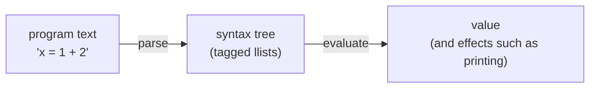
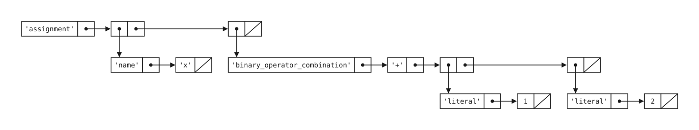
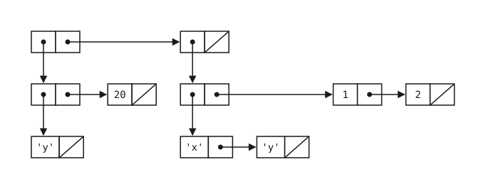

# The metacircular evaluator I: programs as data

<p class="chapter-goal">See a program the way an evaluator sees it: as a tree of tagged llists, walked by a function called evaluate.</p>

!!! abstract "The big idea, in plain words"
    A recipe is text. A cook reads the text and does what it says. An **evaluator** is the cook: a
    program that reads another program and carries it out. The surprise of Unit 4 is that the
    evaluator is an ordinary program, written with the same pairs, llists and conditionals you
    already know. When it is written in the very language it runs, it is called a
    **metacircular evaluator**. Building a new language this way is called **metalinguistic
    abstraction**.

## From text to value

An evaluator never works on the raw text. It works in two stages:



`parse` is pre-declared in Python §4. It takes a string and returns the **syntax tree**: every
piece of the program (the textbook calls each piece a **component**) becomes a **tagged llist**
whose head is a string saying what kind of component it is. `print_llist` shows it in llist
notation:

```python title="§4"
print_llist(parse("x = 1 + 2"))
```
```text title="Output"
llist('assignment', llist('name', 'x'), llist('binary_operator_combination', '+', llist('literal', 1), llist('literal', 2)))
```

Read it from the outside in: an assignment, whose target is the name `x` and whose value
expression is a binary operator combination `+` with two literal operands. `draw_data` draws it:

```python title="§4 · figure 17-mce-tree"
draw_data(parse("x = 1 + 2"))
```


## Every kind of component

What `parse` gives for each kind of component (the tag always comes first):

```python title="§4"
print_llist(parse("42"))
print_llist(parse("'hi'"))
print_llist(parse("size"))
print_llist(parse("-n"))
print_llist(parse("not done"))
print_llist(parse("max(a, 7)"))
```
```text title="Output"
llist('literal', 42)
llist('literal', 'hi')
llist('name', 'size')
llist('unary_operator_combination', '-unary', llist('name', 'n'))
llist('unary_operator_combination', 'not', llist('name', 'done'))
llist('application', llist('name', 'max'), llist(llist('name', 'a'), llist('literal', 7)))
```

Notice: unary minus is written `'-unary'`, so it cannot be mixed up with binary `'-'`. An
**application** keeps its function expression and a llist of argument expressions.

```python title="§4"
print_llist(parse("'big' if n > 9 else 'small'"))
print_llist(parse("lambda k: k * k"))
print_llist(parse("""
def double(k):
    return k + k
"""))
```
```text title="Output"
llist('conditional_expression', llist('binary_operator_combination', '>', llist('name', 'n'), llist('literal', 9)), llist('literal', 'big'), llist('literal', 'small'))
llist('lambda_expression', llist(llist('name', 'k')), llist('binary_operator_combination', '*', llist('name', 'k'), llist('name', 'k')))
llist('function_definition', llist('name', 'double'), llist(llist('name', 'k')), llist('return_statement', llist('binary_operator_combination', '+', llist('name', 'k'), llist('name', 'k'))))
```

!!! warning "Trap: the conditional is stored predicate first"
    You write `'big' if n > 9 else 'small'` with the consequent first, but the tree is
    `llist('conditional_expression', predicate, consequent, alternative)`. Same for conditional
    statements.

A program with several statements becomes a **sequence**. A program with ONE statement is that
statement itself, with no sequence around it (you saw that above for `double`'s body). An `if` with
no `else` gets a `pass_statement` as its alternative:

```python title="§4"
print_llist(parse("""
if n > 0:
    sign = 1
"""))
print_llist(parse("""
a = 5
print(a)
"""))
```
```text title="Output"
llist('conditional_statement', llist('binary_operator_combination', '>', llist('name', 'n'), llist('literal', 0)), llist('assignment', llist('name', 'sign'), llist('literal', 1)), llist('pass_statement'))
llist('sequence', llist(llist('assignment', llist('name', 'a'), llist('literal', 5)), llist('application', llist('name', 'print'), llist(llist('name', 'a')))))
```

| Component | Shape of the tagged llist |
|---|---|
| literal | `llist('literal', value)` |
| name | `llist('name', symbol)` |
| unary / binary operator combination | `llist('unary_operator_combination', op, e)`, `llist('binary_operator_combination', op, e1, e2)` |
| application | `llist('application', fun_expr, llist(arg1, ...))` |
| conditional expression / statement | `llist('conditional_expression', pred, cons, alt)` (same with `'conditional_statement'`) |
| lambda expression | `llist('lambda_expression', llist(names...), body_expr)` |
| sequence | `llist('sequence', llist(stmt1, ...))` |
| return statement | `llist('return_statement', expr)` |
| assignment | `llist('assignment', name, expr)` |
| function definition | `llist('function_definition', name, llist(names...), body)` |
| also | `'pass_statement'`, `'global_statement'`, `'nonlocal_statement'`, `'logical_composition'` (`and`/`or`), `'while_loop'`, `'for_loop'` |

sicpfuf's own parser builds the same shape with real Python's labels (`Assign`, `BinOp`,
`Constant`): try `python3 -m sicpfuf -v 4 --ast -c 'x = 1 + 2'`. In the exam, use the course's tags.

## Step 1: a calculator

The smallest useful language: number literals and the four operators `+ - * /`.

First the **syntax functions**. Like every data abstraction in the course, the evaluator hides the
representation behind **syntax predicates** (`is_literal`: what kind is it?) and **selectors**
(`literal_value`: give me this part). One helper, `is_tagged_llist`, makes every predicate one line
long. Because of this barrier, `evaluate` would not change at all if `parse` used another data
structure: only the syntax functions would.

Then two functions that call each other, following the shape of the tree. `evaluate` looks at one
node; for an operator combination it evaluates the operands (with `llist_of_values`) and hands the
values to `apply`.

```python title="§4"
def is_tagged_llist(component, the_tag):
    return is_pair(component) and head(component) == the_tag
def is_literal(component):
    return is_tagged_llist(component, "literal")
def literal_value(component):
    return head(tail(component))
def is_operator_combination(component):
    return is_tagged_llist(component, "binary_operator_combination")
def operator_symbol(component):
    return llist_ref(component, 1)
def first_operand(component):
    return llist_ref(component, 2)
def second_operand(component):
    return llist_ref(component, 3)

def evaluate(component):
    if is_literal(component):
        return literal_value(component)
    elif is_operator_combination(component):
        operands = llist(first_operand(component), second_operand(component))
        return apply(operator_symbol(component), llist_of_values(operands))
    else:
        return error("unknown syntax", component)

def llist_of_values(exps):
    return map(evaluate, exps)

def apply(operator, values):
    a = head(values)
    b = head(tail(values))
    return (a + b if operator == "+" else
            a - b if operator == "-" else
            a * b if operator == "*" else
            a / b if operator == "/" else
            error("unknown operator", operator))

print(evaluate(parse("1 + 2 * 3")))
print(evaluate(parse("(1 + 2) * 3")))
print(evaluate(parse("8 / 2 - 1")))
evaluate(parse("x + 1"))
```
```text title="Output"
7
9
3.0
Error: unknown syntax ['name', ['x', None]]
  (error(...) was called at line 23)
```

Three things to notice:

1. Precedence and brackets are handled by `parse`, not by `evaluate`: `(1 + 2) * 3` gives a
   different tree from `1 + 2 * 3`.
2. The evaluator explains `+` of the calculator with `+` of Python §4. That is what "metacircular"
   means in practice.
3. A name is not part of this language yet, so `x + 1` is "unknown syntax".

??? example "X-ray: the evaluate calls follow the tree"
    Run the same program with `--trace evaluate`: each node of the tree is one call, and the
    nesting of the calls IS the tree.

    ```python title="§4 · --trace evaluate"
    def is_tagged_llist(component, the_tag):
        return is_pair(component) and head(component) == the_tag
    def evaluate(component):
        if is_tagged_llist(component, "literal"):
            return head(tail(component))
        else:
            a = evaluate(llist_ref(component, 2))
            b = evaluate(llist_ref(component, 3))
            return a + b if llist_ref(component, 1) == "+" else a * b

    evaluate(parse("1 + 2 * 3"))
    ```
    ```text title="Output"
    → evaluate(['binary_operator_combinati...)
    │  → evaluate(['literal', [1, None]])
    │  ← 1
    │  → evaluate(['binary_operator_combinati...)
    │  │  → evaluate(['literal', [2, None]])
    │  │  ← 2
    │  │  → evaluate(['literal', [3, None]])
    │  │  ← 3
    │  ← 6
    ← 7
    ```

## Step 2: booleans, conditionals and sequences

Each new feature is the same recipe: a predicate and selectors for the new tag, one new clause in
`evaluate`, and a small `eval_...` function. The conditional uses a conditional of OUR language to
explain a conditional of the evaluated language. `is_truthy` insists on a boolean, as Python §4 does.

```python title="§4"
def is_tagged_llist(component, the_tag):
    return is_pair(component) and head(component) == the_tag
def is_literal(component):
    return is_tagged_llist(component, "literal")
def is_operator_combination(component):
    return is_tagged_llist(component, "binary_operator_combination")
def is_conditional(component):
    return is_tagged_llist(component, "conditional_expression")
def is_sequence(component):
    return is_tagged_llist(component, "sequence")

def evaluate(component):
    if is_literal(component):
        return head(tail(component))
    elif is_operator_combination(component):
        values = map(evaluate, tail(tail(component)))
        return apply(llist_ref(component, 1), values)
    elif is_conditional(component):
        return eval_conditional(component)
    elif is_sequence(component):
        return eval_sequence(head(tail(component)))
    else:
        return error("unknown syntax", component)

def is_truthy(x):
    return x if is_boolean(x) else error("boolean expected, received", x)

def eval_conditional(component):
    if is_truthy(evaluate(llist_ref(component, 1))):
        return evaluate(llist_ref(component, 2))
    else:
        return evaluate(llist_ref(component, 3))

def eval_sequence(stmts):
    if is_none(stmts):
        return None
    elif is_none(tail(stmts)):
        return evaluate(head(stmts))
    else:
        evaluate(head(stmts))
        return eval_sequence(tail(stmts))

def apply(operator, values):
    a = head(values)
    b = head(tail(values))
    return (a + b if operator == "+" else
            a * b if operator == "*" else
            a < b if operator == "<" else
            a == b if operator == "==" else
            error("unknown operator", operator))

print(evaluate(parse("10 if 2 < 3 else 20")))
print(evaluate(parse("1 + 1\n2 * 21")))
print(evaluate(parse("'yes' if 1 else 'no'")))
```
```text title="Output"
10
42
Error: boolean expected, received 1
  (error(...) was called at line 26)
```

`eval_sequence` evaluates the statements in order and gives back the value of the last one. With no
names and no printing, the earlier statements cannot do anything useful yet. Names fix that.

## Names and environments, as data

To evaluate `x = 1` and later `x + 1`, the evaluator needs somewhere to keep bindings: an
**environment**, exactly as in the environment model, but now built from pairs.

- A **frame** is a pair of two llists: the symbols and their values, in matching order.
- An **environment** is a llist of frames, innermost first. `the_empty_environment` is `None`.
- `extend_environment(symbols, values, env)` puts a new frame in front of `env`.
- `lookup_symbol_value(symbol, env)` searches the first frame, then the enclosing ones, outwards;
  at the empty environment it stops with `unbound name`.
- `assign_symbol_value(symbol, value, env)` changes the first binding it finds, in place, with
  `set_head`.

These are all in `examples/mce.py`. The title `--with examples/mce.py` loads that file first, so
the program below can use them:

```python title="§4 · --with examples/mce.py"
outer = extend_environment(llist("x", "y"), llist(1, 2), the_empty_environment)
inner = extend_environment(llist("y"), llist(20), outer)
print(lookup_symbol_value("y", inner))
print(lookup_symbol_value("x", inner))
assign_symbol_value("x", 100, inner)
print(lookup_symbol_value("x", outer))
lookup_symbol_value("z", inner)
```
```text title="Output"
20
1
100
Error: unbound name z
  (error(...) was called at line 7)
```

`y` is found in the inner frame first (20 hides 2). `x` is not in the inner frame, so the search
moves out. Assigning `x` through `inner` changed the binding in `outer`: there is only one `x`.
Here is `inner` as a box-and-pointer diagram, two frames, each a pair of llists:

```python title="§4 · --with examples/mce.py figure 17-mce-env"
outer = extend_environment(llist("x", "y"), llist(1, 2), the_empty_environment)
draw_data(extend_environment(llist("y"), llist(20), outer))
```



!!! warning "Trap: assignment in the global frame ADDS a binding"
    `assign_symbol_value` never fails for a new name at the top level: when the search for the
    name reaches the global frame without finding it, it adds a binding there with
    `add_binding_to_frame`. That is how `x = 1` creates `x`. The global environment is two frames:
    an empty **global frame** on top of the **built-ins frame**.

With names in place, the evaluator gets two more clauses: a name is looked up, an assignment
evaluates its value expression and calls `assign_symbol_value`. Every `eval_...` function now takes
the environment as a second argument. The full evaluator in `examples/mce.py` has them all:

```python title="§4 · --with examples/mce.py"
parse_and_evaluate("""
width = 3
height = width + 4
width = width * 10
print(width * height)
""")
```
```text title="Output"
210
```

`parse_and_evaluate(text)` is `evaluate(parse(text), the_global_environment)`.

## The evaluate–apply idea

Look back at the calculator: `evaluate` takes a component apart and, when something has to be
*done* to values, calls `apply`. In the full evaluator `apply` can also run a function written by
the user, and to do that it calls `evaluate` on the function's body. `evaluate` calls `apply`,
`apply` calls `evaluate`: the **evaluate–apply loop**. The loop ends at the bottom of the tree:
literals, names (looked up), and built-in functions (run by the underlying Python). The next
chapter fills in `apply`.

!!! note "Python §4 vs real Python"
    Real Python also turns text into a tree before running it (its `ast` module), but the tree is
    made of objects with fields, not tagged llists, and there is no `parse` built-in that returns
    llists. `parse`, `tokenize` and `apply_in_underlying_python` exist only in Python §4.

## Takeaways

- An evaluator is an ordinary program whose data is programs. Written in its own language, it is
  a metacircular evaluator.
- `parse(text)` gives a syntax tree of tagged llists; the head of each llist is its tag.
- Conditionals are stored predicate, consequent, alternative; a one-statement program has no
  `sequence` wrapper; a missing `else` becomes `pass_statement`.
- Syntax predicates and selectors form an abstraction barrier between `evaluate` and the tree.
- `evaluate` has one clause per kind of component; `llist_of_values` evaluates operands by mapping
  `evaluate` over them.
- A frame is a pair of two llists, an environment is a llist of frames; lookup and assignment
  search outwards; a first assignment at top level adds a binding to the global frame.

## Check yourself

1. Write by hand the tagged llist that `parse("f(n - 1)")` returns.

    ??? success "Answer"
        An application whose argument llist holds one binary operator combination:

        ```python title="§4"
        print_llist(parse("f(n - 1)"))
        ```
        ```text
        llist('application', llist('name', 'f'), llist(llist('binary_operator_combination', '-', llist('name', 'n'), llist('literal', 1))))
        ```

2. Is `parse("x = 1")` a `sequence`? Is `parse("x = 1\ny = 2")`?

    ??? success "Answer"
        The first is not (one statement is the statement itself); the second is.

        ```python title="§4"
        print(head(parse("x = 1")))
        print(head(parse("x = 1\ny = 2")))
        ```
        ```text
        assignment
        sequence
        ```

3. In the step 2 calculator, why does `eval_conditional` call `is_truthy` instead of using the
   predicate's value directly?

    ??? success "Answer"
        To enforce the rule of the evaluated language: a condition must be exactly `True` or
        `False`. `is_truthy` turns any other value into an error ("boolean expected"). Changing
        `is_truthy` changes which values count as true, without touching `eval_conditional`.

4. Two frames: the inner one binds `a` to 1, the outer one binds `a` to 2 and `b` to 3. What does
   looking up `a` and `b` from the inner environment give? Check with the evaluator's functions.

    ??? success "Answer"
        `a` is found in the first frame (1); `b` only in the outer one (3).

        ```python title="§4 · --with examples/mce.py"
        env = extend_environment(llist("a"), llist(1),
                                 extend_environment(llist("a", "b"), llist(2, 3), None))
        print(lookup_symbol_value("a", env), lookup_symbol_value("b", env))
        ```
        ```text
        1 3
        ```

5. Why does the calculator need no clause for brackets?

    ??? success "Answer"
        Brackets only change the SHAPE of the tree, and `parse` builds that shape. There is no
        "bracket" tag: `(1 + 2) * 3` is a `*` combination whose first operand is the `+`
        combination.

*In the course: L11B · SICPy 4.1.1, 4.1.2, 4.1.3, 4.1.4.*
