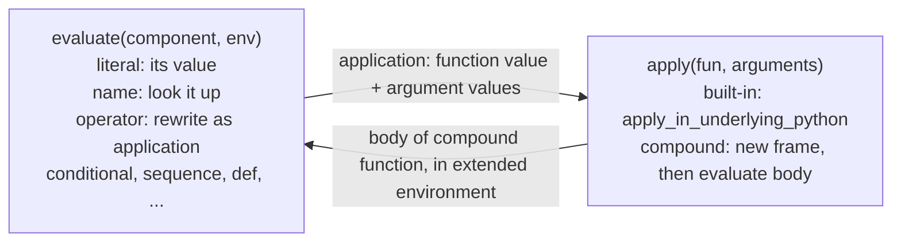

# The metacircular evaluator II: functions, and a lazy evaluator

<p class="chapter-goal">Finish the evaluator with functions, learn to modify it, and change it into a lazy evaluator.</p>

!!! abstract "The big idea, in plain words"
    Picture an office manager with a to-do list. The manager (`evaluate`) reads each item and works
    out what it means. When a job has to be done, the manager hands it to a worker (`apply`). Some
    workers are machines that do the job at once (built-in functions). Others are another to-do
    list (a compound function), which goes straight back to the manager, in a fresh room (a new
    frame). That back-and-forth is the **evaluate–apply loop**, and it is the whole evaluator.

Programs titled `--with examples/mce.py` first load sicpfuf's evaluator (textbook names).

## Applications and built-in functions

An application `f(a, b)` is evaluated in two steps: evaluate the function expression and every
argument expression (in the same environment), then `apply` the function value to the llist of
argument values: `apply(evaluate(function_expression(component), env),
llist_of_values(arg_expressions(component), env))`.

A **built-in function** of the evaluated language is a function of OUR language in a wrapper,
`llist("built_in", implementation)`. `apply` runs it with `apply_in_underlying_python(f, args)`,
which applies a Python §4 function to the elements of a llist:

```python title="§4 · --with examples/mce.py"
print(apply_in_underlying_python(math_pow, llist(2, 10)))
times = lookup_symbol_value("*", the_global_environment)
print(head(times))
print(apply(times, llist(6, 7)))
```
```text title="Output"
1024.0
built_in
42
```

To add a built-in, add one line such as `llist("square", lambda x: x * x)` to `built_in_functions`.

## Operator combinations become applications

In the last program `*` is a NAME in the built-ins frame. So the evaluator rewrites `a * 3` into
an application of the function named `"*"`, and evaluates that:

```python title="§4 · --with examples/mce.py"
print_llist(operator_combination_to_application(parse("a * 3")))
print_llist(operator_combination_to_application(parse("-a")))
```
```text title="Output"
llist('application', llist('name', '*'), llist(llist('name', 'a'), llist('literal', 3)))
llist('application', llist('name', '-unary'), llist(llist('name', 'a')))
```

!!! warning "Trap: `and` and `or` cannot be rewritten this way"
    An application evaluates ALL its arguments first. `x != 0 and 10 // x > 1` must NOT evaluate
    the second operand when `x` is 0. That is why `and`/`or` (tag `logical_composition`) need
    their own clause, built from a conditional. The evaluator in `examples/mce.py` does not have
    them yet: we add them below.

## Compound functions and return values

A `def` or a lambda expression evaluates to a **function object**, a tagged llist that holds the
parameters, the local and global names, the body and the environment it was created in:
`llist("compound_function", parameters, locals, globals, body, env)`.

```python title="§4 · --with examples/mce.py"
parse_and_evaluate("""
def area(w, h):
    return w * h
""")
f = lookup_symbol_value("area", the_global_environment)
print(head(f))
print_llist(function_parameters(f))
print_llist(function_body(f))
print(apply(f, llist(3, 4)))
```
```text title="Output"
compound_function
llist('w', 'h')
llist('return_statement', llist('binary_operator_combination', '*', llist('name', 'w'), llist('name', 'h')))
12
```

`apply` on a compound function does what the environment model says: it **extends** the
function's OWN environment with a new frame binding the parameters to the arguments, and evaluates
the body there. A lambda expression becomes a function whose body is one return statement.

A `return` has two jobs: give the value, and stop the rest of the body. The evaluator solves both
with a wrapper. Evaluating a return statement gives a **return value**,
`llist("return_value", v)`. `eval_sequence` stops as soon as a statement produces one and passes
it up (through conditionals too). Only `apply` unwraps it; if the body ends without one, `apply`
gives `None`.

```python title="§4 · --with examples/mce.py"
parse_and_evaluate("""
def first_positive(a, b):
    if a > 0:
        return a
    print("a was not positive")
    return b
def nothing():
    x = 1
print(first_positive(5, 7))
print(first_positive(-5, 7))
print(nothing())
""")
```
```text title="Output"
5
a was not positive
7
None
```

## Local names and the two markers

When `eval_function_definition` meets a `def`, it scans the body ONCE (at definition time, not at
call time) for the names the body assigns. Those are the function's **local names**, minus the
parameters and minus any names declared `global` or `nonlocal`. Each time the function is applied,
`apply` builds ONE frame with:

| In the new frame | bound to |
|---|---|
| each parameter | its argument |
| each local name | the string `'*unassigned*'` |
| each name declared `global` | the string `'*global*'` |
| names declared `nonlocal` | nothing: they are left out, so the search goes outwards |

When `lookup_symbol_value` or `assign_symbol_value` find `'*global*'`, they start again in the
global environment. Watch both markers at work:

```python title="§4 · --with examples/mce.py"
parse_and_evaluate("""
total = 10
def peek():
    print(total)
    total = 99
    return total
def bump():
    global total
    total = total + 1
print(peek())
bump()
print(total)
""")
```
```text title="Output"
*unassigned*
99
11
```

`total` is local in `peek` (the body assigns it), so the first `print` finds the marker in
`peek`'s frame and does not fall back to the global 10. Python §4 itself would stop with an error
here; this evaluator prints the marker string. In `bump`, `'*global*'` sends both
the lookup and the assignment to the global frame.

!!! warning "Trap: the scan does not look inside nested `def`s"
    It looks into sequences and both branches of conditional statements; a nested `def` adds only
    its own name.

## The evaluate–apply loop



It bottoms out at literals, names and built-ins. The evaluator is the **environment model written
as a program**: frames, bindings and function objects, all as llists.

??? example "X-ray: count the trips round the loop"
    This program wraps `apply` so that it counts what it is asked to run. `evaluate` calls `apply`
    by name, so it finds the new one.

    ```python title="§4 · --with examples/mce.py"
    built_in_calls = 0
    compound_calls = 0
    apply_without_counting = apply
    def apply(fun, arguments):
        global built_in_calls, compound_calls
        if is_built_in_function(fun):
            built_in_calls = built_in_calls + 1
        else:
            compound_calls = compound_calls + 1
        return apply_without_counting(fun, arguments)

    parse_and_evaluate("""
    def factorial(n):
        return 1 if n == 1 else n * factorial(n - 1)
    factorial(5)
    """)
    print(compound_calls, built_in_calls)
    ```
    ```text title="Output"
    5 13
    ```
    Five applications of `factorial`; 5 `==`, 4 `*` and 4 `-` are built-in applications.

## How to modify the evaluator

For "change the evaluator so that ..." questions, use this checklist:

1. **Find the shape.** `print_llist(parse("..."))` on a small example shows the tag and positions.
2. **Syntax functions.** A predicate `is_...` (with `is_tagged_llist`) and selectors.
3. **The meaning.** An `eval_...(component, env)` function. Decide: which parts are evaluated,
   in which environment, in which order, how many times?
4. **One clause in `evaluate`**, calling it.
5. **Side effects on the rest.** Does the new form have a body that assigns names? Then
   `declared_symbols` must look inside it. Does it change what a value is? Then check `apply`,
   `is_truthy`, lookup.
6. **Test** with `parse_and_evaluate`, including the edge case that motivated the change.

On paper you add the clause inside `evaluate`. To keep the programs short here, we put the new
clause in front of the old `evaluate`: the new function handles the new tag and passes everything
else on. Because the old `evaluate` calls `evaluate` by name, nested components also reach the
new clause.

**Modification 1: `and` and `or`.** `parse` gives `llist('logical_composition', op, e1, e2)`, the
same positions as an operator combination, so `operator_symbol`, `first_operand` and
`second_operand` work. The meaning: `a and b` is `b if a else False`; `a or b` is
`True if a else b`.

```python title="§4 · --with examples/mce.py"
def is_logical_composition(component):
    return is_tagged_llist(component, "logical_composition")

def eval_logical_composition(component, env):
    first = is_truthy(evaluate(first_operand(component), env))
    if operator_symbol(component) == "and":
        return evaluate(second_operand(component), env) if first else False
    else:
        return True if first else evaluate(second_operand(component), env)

evaluate_without_logic = evaluate
def evaluate(component, env):
    if is_logical_composition(component):
        return eval_logical_composition(component, env)
    else:
        return evaluate_without_logic(component, env)

parse_and_evaluate("""
x = 0
print(x != 0 and 10 // x > 1)
print(x == 0 or 10 // x > 1)
print(x == 0 and "zero")
""")
```
```text title="Output"
False
True
zero
```

No division by zero happened: the second operand was never evaluated. The last line shows the
rule of the course language: the LAST operand may be any value.

**Modification 2** is the X-ray above: wrapping `apply` to count applications.

## Instrument allocation where it happens

Counting function **applications**, function **objects** and environment **extensions**
answers three different questions. Reusing a function object through an alias creates no
new function object; evaluating a lambda inside a body can create one on every application.
Instrument the constructor rather than counting occurrences of `lambda` in the source.

The following experiment wraps constructors in the book's own evaluator. Its chosen frame
metric is **extensions with at least one symbol**, measured after evaluator setup. Startup
frames and empty implementation frames are excluded. The functions being measured belong
to the interpreted program; the host functions that implement this instrumentation are
not themselves counted as interpreted function objects.

```python title="§4 · --with examples/mce.py"
function_objects = 0
nonempty_extensions = 0
make_function_without_metrics = make_function
extend_without_metrics = extend_environment

def make_function(parameters, locals, globals, body, env):
    global function_objects
    result = make_function_without_metrics(parameters, locals, globals, body, env)
    function_objects = function_objects + 1
    return result

def extend_environment(symbols, values, base):
    global nonempty_extensions
    result = extend_without_metrics(symbols, values, base)
    if not is_none(symbols):
        nonempty_extensions = nonempty_extensions + 1
    return result

parse_and_evaluate("""
def factory(offset):
    def adjust(value):
        return value + offset
    return adjust
first = factory(2)
second = factory(4)
print(first(5), second(5))
""")
print(function_objects, nonempty_extensions)
parse_and_evaluate("""
alias = first
print(alias(1))
def constant():
    return 7
print(constant())
""")
print(function_objects, nonempty_extensions)
```
```text title="Output"
7 9
3 4
3
7
4 5
```

`factory` is created once, and the two executions of its inner definition create separate
`adjust` objects. Both remember the environment of their own creation. The alias adds an
application without creating an object; defining `constant` creates an object, but applying
it adds no nonempty extension under this metric.

Before comparing a counter with a diagram, specify what the diagram omits. This evaluator
stores global-redirection markers as frame entries and still allocates an implementation
frame for an empty call. A model may represent either differently. Physical pair allocations,
nonempty evaluator frames and the model's displayed frames need not have the same count.
If a question prescribes a particular omission rule, implement and test that rule explicitly.
Count only successful creations, keep a fresh counter for an independent experiment, and
include lambdas as well as `def` in function-object tests.

## Extend an operator without evaluating its operands twice

An operator extension should preserve ordinary cases and the existing evaluation order.
The original evaluator converts an operator combination into an application. By the time
`apply` receives it, the operands have already been evaluated once. Dispatching on these
**values** avoids accidentally evaluating a printing or mutating operand again.

This original extension gives text multiplied by a nonnegative integer a repetition meaning.
It is a change to the language interpreted by this evaluator, not a new rule for Python §4
itself. It does not implement the overloaded operations in any mission.

```python title="§4 · --with examples/mce.py"
multiply = lookup_symbol_value("*", the_global_environment)
apply_without_text_repetition = apply

def repeat_text(text, count):
    return "" if count == 0 else text + repeat_text(text, count - 1)

def apply(fun, arguments):
    if fun is multiply and length(arguments) == 2:
        left = head(arguments)
        right = head(tail(arguments))
        if is_string(left) and is_integer(right):
            if right < 0:
                return error("repetition count must be nonnegative")
            return repeat_text(left, right)
    return apply_without_text_repetition(fun, arguments)

parse_and_evaluate("""
def announce(value):
    print(value)
    return value
print(announce("ha") * announce(3))
print(6 * 7)
print("x" * 0)
""")
```
```text title="Output"
ha
3
hahaha
42
```

The printed operands expose their order and number of evaluations. Numeric multiplication
still goes through the original implementation. Test supported operand combinations,
unsupported combinations, zero, invalid counts and operands with side effects. If you add
an entirely new syntax form instead, revisit both the parser representation and any static
scan of names assigned inside that form.

## Lazy evaluation

Python is **applicative order**: all arguments are evaluated before the body runs. In **normal
order** (lazy evaluation) an argument is evaluated only when its value is needed.

```python title="§4"
def choose(flag, if_yes, if_no):
    return if_yes if flag else if_no

print(choose(True, 1, 1 // 0))
```
```text title="Output"
ZeroDivisionError at line 4
    print(choose(True, 1, 1 // 0))
ZeroDivisionError: division by zero
sicpfuf hint: check the divisor before dividing, for example with a base case `if n == 0`.
```

`choose` never uses `if_no`, but `1 // 0` was evaluated anyway. A function is **strict** in an
argument if the argument is evaluated before the body is entered, **non-strict** if not. In the
lazy evaluator, compound functions are non-strict in every argument; built-ins stay strict.

The tool is a **thunk**: an argument expression packed together with the environment of the
application, `llist("thunk", exp, env)`, so that it can be evaluated later as if now.

`delay_it(exp, env)` makes a thunk; `force_it(obj)` evaluates a thunk (any other value comes back
unchanged); `actual_value(exp, env)` is `force_it(evaluate(exp, env))`, for wherever a real value
is needed.

A thunk is forced when its value is passed to a **built-in function**, is the **predicate of a
conditional**, or is the **function about to be applied**. A **memoized** thunk remembers its
value: the first `force_it` overwrites it, in place, with `llist("evaluated_thunk", value)`.

Here is a small lazy evaluator. It changes three things in `examples/mce.py`: the application
clause of `evaluate` (force the function, delay the arguments of compound functions),
`eval_conditional` (force the predicate), and adds the thunk functions. Everything else is reused.

```python title="§4 · --with examples/mce.py"
def delay_it(exp, env):
    return llist("thunk", exp, env)
def is_thunk(obj):
    return is_tagged_llist(obj, "thunk")
def is_evaluated_thunk(obj):
    return is_tagged_llist(obj, "evaluated_thunk")

def force_it(obj):
    if is_thunk(obj):
        result = actual_value(llist_ref(obj, 1), llist_ref(obj, 2))
        set_head(obj, "evaluated_thunk")      # memoize: the thunk becomes
        set_head(tail(obj), result)           #   llist("evaluated_thunk", result)
        set_tail(tail(obj), None)
        return result
    elif is_evaluated_thunk(obj):
        return head(tail(obj))
    else:
        return obj

def actual_value(exp, env):
    return force_it(evaluate(exp, env))

def lazy_apply(fun, arg_exps, env):
    if is_built_in_function(fun):
        return apply(fun, map(lambda e: actual_value(e, env), arg_exps))
    else:
        return apply(fun, map(lambda e: delay_it(e, env), arg_exps))

strict_evaluate = evaluate
def evaluate(component, env):
    if is_application(component):
        return lazy_apply(actual_value(function_expression(component), env),
                          arg_expressions(component), env)
    else:
        return strict_evaluate(component, env)

def eval_conditional(component, env):
    if is_truthy(actual_value(conditional_predicate(component), env)):
        return evaluate(conditional_consequent(component), env)
    else:
        return evaluate(conditional_alternative(component), env)

parse_and_evaluate("""
def choose(flag, if_yes, if_no):
    return if_yes if flag else if_no
print(choose(True, 1, 1 // 0))

def noisy(x):
    print("computing")
    return x
def twice(v):
    return v + v
print(twice(noisy(5)))

def pair(x, y):
    return lambda m: m(x, y)
def head(p):
    return p(lambda x, y: x)
def tail(p):
    return p(lambda x, y: y)
def add_llists(a, b):
    return pair(head(a) + head(b), add_llists(tail(a), tail(b)))
def llist_ref(xs, n):
    return head(xs) if n == 0 else llist_ref(tail(xs), n - 1)
ones = pair(1, ones)
integers = pair(1, add_llists(ones, integers))
print(llist_ref(integers, 9))
""")
```
```text title="Output"
1
computing
10
10
```

First line: `1 // 0` was packed in a thunk and never forced. In `twice`, `v` is used twice but
"computing" appears once: the second use found an evaluated thunk. Without memoization (a
`force_it` that only returns `actual_value(...)`) it would print twice. So with lazy arguments,
WHEN a side effect happens depends on when the thunk is forced, not on where it is written.

**Lazy pairs.** The last part of that program redefines `pair`, `head` and `tail` as compound
functions (the functional representation of pairs). The built-in `pair` is strict, but compound
functions are non-strict, so every llist becomes a stream with no `lambda:` written anywhere.
`ones = pair(1, ones)` works because the second argument is a thunk: the name `ones` is looked up
only when the tail is forced, and by then it has a value. `integers` is infinite, yet
`llist_ref(integers, 9)` gives 10.

!!! note "Python §4 vs real Python"
    Both are applicative order. Neither has thunks; the nearest thing is what streams do by hand:
    wrap an expression in `lambda: ...` and call it later.

## Takeaways

- `evaluate` handles syntax and calls `apply` for applications; `apply` runs built-ins with
  `apply_in_underlying_python`, compound functions by evaluating the body in a new frame.
- Operator combinations are rewritten into applications of built-ins named `"+"`, `"*"`, ...;
  `and`/`or` cannot be, because they must not evaluate every operand.
- `return` makes a tagged return value; `eval_sequence` stops on it; `apply` unwraps it or gives
  `None`.
- Local names are found once, at definition time; each call's frame binds them to
  `'*unassigned*'` and global names to `'*global*'`; nonlocal names are left out.
- To modify: shape (parse), syntax functions, `eval_...`, clause, side effects, test.
- Lazy evaluation: compound functions get thunks (expression + environment); `force_it` and
  `actual_value` produce real values when a built-in, a predicate or an application needs them;
  memoized thunks are evaluated at most once.

## Check yourself

1. Which function decides which names are local to a function, and when does it run?

    ??? success "Answer"
        `eval_function_definition` (through `local_variables`), when the `def` is evaluated, NOT
        when the function is applied. `apply` only binds the names it was given.

2. What does this print in the evaluator, and why not 1?

    ```python title="§4 · --with examples/mce.py"
    parse_and_evaluate("""
    n = 1
    def f():
        if False:
            n = 2
        return n
    print(f())
    """)
    ```

    ??? success "Answer"
        ```text
        *unassigned*
        ```

        The scan looks into both branches of the conditional, so `n` is local to `f` even though
        the assignment never runs. The frame binds it to the marker.

3. Why must the lazy evaluator force the FUNCTION expression of an application with
   `actual_value` and not only `evaluate`?

    ??? success "Answer"
        The function may come out of a parameter, which is bound to a thunk. `apply` needs a real
        function object (built-in or compound), not a thunk, to decide what to do.

4. In the lazy evaluator, which of these force a thunk: passing it to `print`; returning it;
   assigning it to a name; using it as the predicate of a conditional?

    ??? success "Answer"
        `print` (a built-in) and the predicate force it. Returning it and assigning it do not:
        the thunk itself is passed on.

*In the course: L12A · SICPy 4.1.1, 4.1.2, 4.1.3, 4.1.4, 4.2.*
