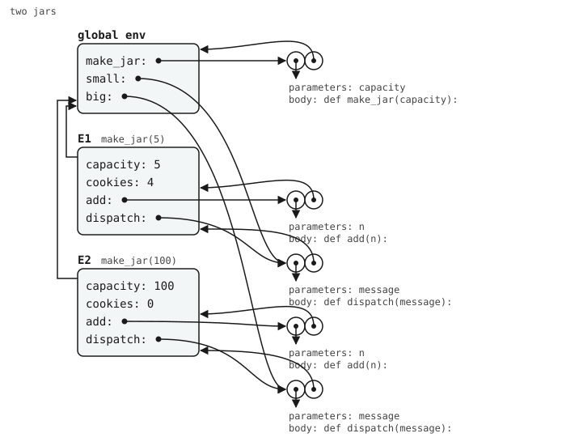

# Types and objects

<p class="chapter-goal">Let a checker find type mistakes before the program runs, and build objects out of functions that share state.</p>

!!! abstract "The big idea, in plain words"
    A plug only fits a socket of the right shape, so you find out it is wrong before you switch
    anything on. A **type** is the shape of a value: which values it can be, and so which
    operations make sense on it. **Python §4 Typed** lets you write the shape of every parameter and
    result next to your code; a **type checker** compares the shapes everywhere in the program
    BEFORE it runs, and refuses to run it if something does not fit.

The second half of the chapter is about **objects**: one piece of state plus the operations on it,
built from the function objects and `nonlocal` you already know.

## Why static types?

In Python §1 to §4 a type mistake is found only when that line runs. If the line runs rarely, the
mistake can hide for a long time:

```python title="§4"
def describe(n):
    return "zero" if n == 0 else "big" if n > 1000 else "size " + n

print(describe(0))
print(describe(5000))
print(describe(7))
```
```text title="Output"
zero
big
TypeError at line 2
    return "zero" if n == 0 else "big" if n > 1000 else "size " + n
TypeError: unsupported operand type(s) for +: str and int
  in describe, called from line 6: print(describe(7))
sicpfuf hint: numbers and strings don't mix in §1-§4. Convert with str(n) first, and there is no "ab" * 3.
```

Two tests passed; the third path was broken all along. A **static** type checker looks at every
path, run or not. With annotations, `"size " + n` with `n: int` is rejected before anything runs.

## Python §4 Typed: the rules

Python §4 Typed is Python §4 plus **type annotations**. The program is parsed, then type-checked,
and runs only if there are no type errors. At run time the annotations are ignored.

1. Every parameter and every return type must be annotated.
2. Conditions (`if`, `while`, conditional expressions) must have type `bool`.
3. A `bool` is not a number, and `str` and numbers do not mix.

The complete new syntax:

```python
def square(x: float) -> float:          # annotated parameters and result
    return x * x

count: int = 0                           # annotated assignment

def identity[A](x: A) -> A:              # a generic function: A stands for any type
    return x

type Point = Pair[float, float]          # a type alias: a new name for a type
```

!!! note "About the typed programs on this page"
    The typed programs are illustrations (they are not run on this page). Where it helps, the same
    program without annotations is shown running in Python §4.

## Types are sets of values

| Type | Its values | Course's older name |
|---|---|---|
| `int` | 0, 1, -7, ... | Number |
| `float` | 0.5, 2.0, and every `int` | Number |
| `str` | `"hi"`, `""`, ... | String |
| `bool` | `True`, `False` | Boolean |
| `None` | only `None` | |
| `Callable[[int, int], bool]` | functions taking two ints and returning a bool | `(Number, Number) → Boolean` |
| `Pair[H, T]` | pairs whose head is an H and tail a T | |
| `LList[T]` | `None`, or a `Pair[T, LList[T]]` (pre-declared) | llist |
| `Stream[T]` | `None`, or a `Pair[T, Callable[[], Stream[T]]]` (pre-declared) | stream |
| `list[T]` | Python lists whose elements are all T | list |
| `T | None` | a T, or `None` | |

A lambda expression has no annotations: its type comes from the name it is assigned to or the
parameter it is passed to.

```python
double: Callable[[float], float] = lambda x: 2 * x

def twice(f: Callable[[float], float], x: float) -> float:
    return f(f(x))
```

## Subtypes

S is a **subtype** of T if every S value is also a T value. A value of the smaller type may be
used where the larger type is expected, never the other way round.

- `int` is a subtype of `float`: `twice(double, 3)` is fine.
- `int` is a subtype of `int | None`: you may pass `5` where an `int | None` is expected.
- But an `int | None` may NOT be used where an `int` is expected: it might be `None`.

## None and narrowing

`None` sneaks into programs: the empty llist is `None`, a function with no `return` gives `None`.
Using `None` as if it were a real value is the classic "billion-dollar mistake" (head of an empty
llist, `None + 1`). The typed fix is to put "might be absent" INTO the type, as `T | None`, and
make the checker insist that you test before you use.

```python
def first_or(xs: LList[int], default: int) -> int:
    return head(xs)                      # rejected: xs may be None

def first_or(xs: LList[int], default: int) -> int:
    return default if is_none(xs) else head(xs)    # accepted
```

After the test `is_none(xs)` (or `xs is None`) the checker knows, in each branch, which case it
is: in the alternative, `xs` is a `Pair[int, LList[int]]`, so `head(xs)` is an `int`. This is
called **narrowing**. The same works for any `T | None`:

```python
def label(age: int | None) -> str:
    return "unknown" if age is None else "age " + str(age)
```

The untyped twins run like this:

```python title="§4"
def first_or(xs, default):
    return default if is_none(xs) else head(xs)
def label(age):
    return "unknown" if age is None else "age " + str(age)

print(first_or(llist(8, 9), 0), first_or(None, 0))
print(label(None), label(19))
```
```text title="Output"
8 0
unknown age 19
```

## Typing llist functions: generics

`sum_llist` works only on llists of numbers, so its type mentions `int`:

```python
def sum_llist(xs: LList[int]) -> int:
    return 0 if is_none(xs) else head(xs) + sum_llist(tail(xs))
```

`length` works for llists of ANY element type. A **generic** function has a type parameter in
square brackets that stands for "any type, the same one everywhere it appears":

```python
def length[A](xs: LList[A]) -> int:
    return 0 if is_none(xs) else 1 + length(tail(xs))

def map[A, B](f: Callable[[A], B], xs: LList[A]) -> LList[B]:
    return None if is_none(xs) else pair(f(head(xs)), map(f, tail(xs)))

def filter[A](pred: Callable[[A], bool], xs: LList[A]) -> LList[A]:
    return (None if is_none(xs) else
            pair(head(xs), filter(pred, tail(xs))) if pred(head(xs)) else
            filter(pred, tail(xs)))
```

Read the type of `map` aloud: "give me a function from A to B and a llist of A, and I give you a
llist of B". With `map(str, llist(1, 2))`, A is `int` and B is `str`. Note how `filter`'s type
says that the result has the SAME element type as the input.

!!! warning "Trap: not everything can be generic"
    A sort compares elements with `<=`, and `<=` does not work on every type (not on functions,
    not on `None`). So `def insertion_sort[A](xs: LList[A]) -> LList[A]` is rejected. Fix the
    element type (`LList[int]`), or pass the comparison in as a
    `Callable[[A, A], bool]` parameter.

`list[T]` types Python lists. With a type alias, the code says what the data means:

```python
type Vector = list[float]

def dot(u: Vector, v: Vector) -> float:
    total: float = 0
    for i in range(len(u)):
        total = total + u[i] * v[i]
    return total
```

## What the checker rejects

| Mistake | Example | Why |
|---|---|---|
| operator on mismatched types | `"size " + n` with `n: int` | `+` needs two numbers or two strings |
| condition that is not a `bool` | `if xs:` with `xs: LList[int]` | conditions must be `bool` |
| possibly-`None` used as present | `head(xs)` with no `is_none` test | `xs` may be `None` |
| wrong argument type | `twice(len, 3)` | `len` is not `Callable[[float], float]` |
| a `bool` used as a number | `flag + 1` with `flag: bool` | `bool` is not a number here |
| wrong return type | `-> int` but `return "x"` | `str` is not `int` |
| missing annotation | `def f(x):` | every parameter and result must be annotated |

The price: the checker also rejects some programs that would have run fine, for example a function
that returns an `int` on one branch and a `str` on another, even when the caller can cope with
both. And types guarantee the ABSENCE of these errors, not that the program is correct: a
`sum_llist` that forgets to add `head(xs)` still type-checks.

## Objects from closures: message passing

An **object** is state plus the operations on it. You can already build one: a maker function
whose local names are the state, inner functions that change them with `nonlocal`, and a
**dispatch function** that picks an operation by a string **message**. This style is called
**message passing**.

```python title="§3"
def make_jar(capacity):
    cookies = 0
    def add(n):
        nonlocal cookies
        if cookies + n > capacity:
            return "jar is full"
        cookies = cookies + n
        return cookies
    def take():
        nonlocal cookies
        if cookies == 0:
            return "jar is empty"
        cookies = cookies - 1
        return cookies
    def dispatch(message):
        return (add if message == "add" else
                take if message == "take" else
                cookies if message == "count" else
                error("unknown message", message))
    return dispatch

small = make_jar(5)
big = make_jar(100)
print(small("add")(4))
print(small("add")(3))
print(small("take")())
print(big("add")(30))
print(small("count"), big("count"))
small("eat")
```
```text title="Output"
4
jar is full
3
30
3 30
Error: unknown message eat
  (error(...) was called at line 19)
```

`small("add")` returns the function `add`, which is then applied to `4`: two applications in a
row. Each call of `make_jar` makes a NEW frame, so `small` and `big` have separate state.

??? example "X-ray: two objects, two frames"
    ```python title="§3 · figure 19-types-objects-jar"
    def make_jar(capacity):
        cookies = 0
        def add(n):
            nonlocal cookies
            cookies = cookies + n
            return cookies
        def dispatch(message):
            return add if message == "add" else cookies
        return dispatch

    small = make_jar(5)
    big = make_jar(100)
    small("add")(4)
    show_env("two jars")
    ```
    

    Each jar is a `dispatch` function object whose environment is its own `make_jar` frame. That
    frame holds the state (`capacity`, `cookies`) and the operations.

!!! warning "Trap: two pairs of brackets"
    Write `small("add")(4)`, not `small("add", 4)`. `dispatch` takes ONE argument, the message,
    and returns an operation; the operation's arguments go in a second pair of brackets.

## A preview: classes in full Python

Python §4 has no classes, but full Python does. A **class** is a blueprint for objects: it lists
the **attributes** (state) and **methods** (operations). Each object made from it is an
**instance**. The jar as a class:

```python
class Jar:
    def __init__(self, capacity):        # runs when an instance is made
        self.capacity = capacity
        self.cookies = 0

    def add(self, n):                    # a method; self is the instance
        if self.cookies + n > self.capacity:
            return "jar is full"
        self.cookies = self.cookies + n
        return self.cookies

small = Jar(5)
print(small.add(4))                      # dot notation instead of small("add")(4)
```

Same idea, different notation: `self` plays the part of the `make_jar` frame, and `small.add`
replaces the dispatch on a message. A class is also a type, so `def fill(j: Jar) -> int:` is a
typed function on jars.

!!! note "Python §4 vs real Python"
    Real Python accepts the same annotations and also ignores them when running; checking is
    done by separate tools. It has classes, methods and the dot notation, which Python §4 leaves
    out, so in §4 you write objects with closures and message passing.

## Takeaways

- A type is a set of values; it says which operations make sense. A static checker finds type
  mistakes on every path before the program runs.
- In Python §4 Typed every parameter and result is annotated; conditions must be `bool`;
  annotations are ignored at run time.
- `int` is a subtype of `float` and of `int | None`; a subtype value may go where the larger type
  is expected.
- `LList[T]` and `T | None` include `None`, so you must test (`is_none`, `is None`) before using
  the value; the checker narrows the type in each branch.
- Generic functions (`def length[A](...)`) work for every element type; `map` has type
  `(Callable[[A], B], LList[A]) -> LList[B]`.
- Types rule out certain errors, not all errors, and some correct programs are rejected.
- An object is state plus operations; with closures, a dispatch function selects an operation by
  a message. Each maker call is a separate object.

## Check yourself

1. Write the type of `reduce` (a right fold: `reduce(f, initial, xs)`) for a llist of A folded
   into a B.

    ??? success "Answer"
        `f` combines an element and the folded rest: `Callable[[A, B], B]`. So
        `def reduce[A, B](f: Callable[[A, B], B], initial: B, xs: LList[A]) -> B`.

2. Is `def bigger(x: float, y: float) -> float` allowed to be called as `bigger(3, 4)`? And may
   a function with result type `int` return `2.5`?

    ??? success "Answer"
        Yes: `int` is a subtype of `float`, so ints may be passed for floats. No: `2.5` is a
        `float`, not an `int`, and a larger type cannot go where a smaller one is expected.

3. Why does the checker reject `return head(xs) + 1` for `xs: LList[int]`, and what is the
   smallest fix?

    ??? success "Answer"
        `LList[int]` includes `None`, and `head(None)` fails. Test first, for example
        `return 0 if is_none(xs) else head(xs) + 1`; in the alternative the checker knows `xs`
        is a pair.

4. Does a program that type-checks always give the right answer?

    ??? success "Answer"
        No. Types guarantee that certain errors (mismatched operands, missing `None` tests, wrong
        argument types) cannot happen. A wrong formula with the right types still type-checks.

5. Predict the output:

    ```python title="§3"
    def make_tally():
        n = 0
        def dispatch(message):
            nonlocal n
            if message == "up":
                n = n + 1
            return n
        return dispatch

    a = make_tally()
    b = make_tally()
    a("up")
    a("up")
    b("up")
    print(a("read"), b("read"))
    ```

    ??? success "Answer"
        ```text
        2 1
        ```

        Each `make_tally()` call has its own frame with its own `n`. Any message other than
        `"up"` only reads the state.

6. In the jar, what does `small("count")` return, and why is it not a function like the other
   messages?

    ??? success "Answer"
        The current number of cookies. The dispatch returns the VALUE of `cookies` for
        `"count"`, so there is nothing to apply; for `"add"` and `"take"` it returns a function.

*In the course: L13A · SICPy 2.4.3 (message passing), 3.1.1.*
