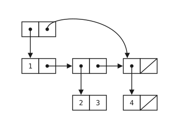
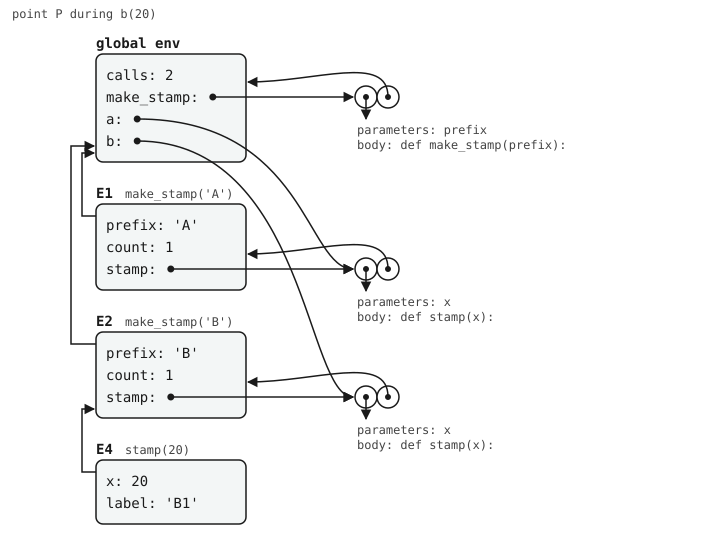

# Mock final 1

<p class="chapter-goal">A balanced two-hour paper over all four units, with checked solutions and a marking scheme for every part.</p>

<div class="exam-info" markdown>

**Time allowed:** 2 hours. **Total:** 100 marks, 10 questions. Aim for about 1.2 minutes per mark.

**Instructions**

1. Answer every question. Write your answers on paper, as you will in the real exam.
2. Each question says which language to use (Python §1, §2, §3 or §4). Use only what that chapter allows.
3. The functions listed in the [Appendix: library](#appendix-library) are pre-declared. You may use them without defining them, unless a question says otherwise.
4. Unless a question says so, your functions must not modify their arguments.
5. Full marks need a solution that is correct, reasonably efficient and easy to read.

Press **Start** to hide the solutions while the clock runs.

</div>

<div id="exam-timer" data-minutes="120"></div>

## Question 1: substitution model and orders of growth <span class="marks">[12 marks]</span>

Python §1. Consider these three functions.

```python
def knot(n):
    return 1 if n == 0 else 2 * knot(n - 1) - n

def weave(n, acc):
    return acc if n == 0 else weave(n - 1, 2 * acc - n)

def spread(n):
    return 1 if n <= 1 else spread(n // 2) + spread(n // 2)
```

**(a)** [4 marks] Use the substitution model (applicative order reduction) to evaluate `knot(2)`. Show every step until you reach a number.

**(b)** [2 marks] Does `knot(n)` give rise to a recursive process or an iterative process? And `weave(n, 1)`? Give a one-line reason for each.

**(c)** [6 marks] Give the order of growth in time and in space, using Θ, of `knot(n)`, `weave(n, 1)` and `spread(n)`. You may assume that n is a power of 2 for `spread`.

??? solution "Solution"

    **(a)** Each line is one step. The deferred operations `2 * … - n` pile up around the recursive application.

    ```python title="§1 · --subst"
    def knot(n):
        return 1 if n == 0 else 2 * knot(n - 1) - n

    knot(2)
    ```
    ```text title="Output"
    knot(2)
    -> 1 if 2 == 0 else 2 * knot(2 - 1) - 2
    -> 1 if False else 2 * knot(2 - 1) - 2
    -> 2 * knot(2 - 1) - 2
    -> 2 * knot(1) - 2
    -> 2 * (1 if 1 == 0 else 2 * knot(1 - 1) - 1) - 2
    -> 2 * (1 if False else 2 * knot(1 - 1) - 1) - 2
    -> 2 * (2 * knot(1 - 1) - 1) - 2
    -> 2 * (2 * knot(0) - 1) - 2
    -> 2 * (2 * (1 if 0 == 0 else 2 * knot(0 - 1) - 0) - 1) - 2
    -> 2 * (2 * (1 if True else 2 * knot(0 - 1) - 0) - 1) - 2
    -> 2 * (2 * 1 - 1) - 2
    -> 2 * (2 - 1) - 2
    -> 2 * 1 - 2
    -> 2 - 2
    -> 0
    ```

    **(b)** `knot` gives a **recursive process**: after `knot(n - 1)` returns, the operations `2 * …` and `… - n` are still waiting (deferred operations). `weave` gives an **iterative process**: the recursive application is the last thing done, and the work is carried in the parameter `acc`, so nothing is deferred.

    **(c)**

    | Function | Time | Space |
    |---|---|---|
    | `knot(n)` | Θ(n) | Θ(n) |
    | `weave(n, 1)` | Θ(n) | Θ(1) |
    | `spread(n)` | Θ(n) | Θ(log n) |

    `spread` is tree recursion, but each level halves n. The tree has 1 + 2 + 4 + … + n ≈ 2n nodes, so time is Θ(n). Only one path from the root to a leaf is waiting at any moment, and that path has about log₂ n calls, so space is Θ(log n). The measurements agree: doubling n doubles the calls of `spread`, but adds only one to the calls waiting at once.

    ```python title="§1"
    def knot(n):
        return 1 if n == 0 else 2 * knot(n - 1) - n

    def weave(n, acc):
        return acc if n == 0 else weave(n - 1, 2 * acc - n)

    def spread(n):
        return 1 if n <= 1 else spread(n // 2) + spread(n // 2)

    measure(knot, 200)
    measure(weave, 200, 1)
    measure(spread, 256)
    measure(spread, 512)
    ```
    ```text title="Output"
    [measure] knot(200): 201 calls, 2,806 steps, at most 201 waiting at once
    [measure] weave(200, 1): 201 calls, 3,006 steps, at most 1 waiting at once
    [measure] spread(256): 511 calls, 5,616 steps, at most 9 waiting at once
    [measure] spread(512): 1,023 calls, 11,248 steps, at most 10 waiting at once
    ```

    **Marking scheme**

    - (a) 4 marks: 1 for substituting 2 for n in the body, 1 for evaluating the predicate before choosing a branch, 1 for keeping the deferred operations `2 * (…) - 2` around the inner application, 1 for the final value 0. Skipping the trivial `2 - 1 → 1` steps is fine; reducing `knot(1)` before `2 - 1` is evaluated (normal order) loses 1 mark.
    - (b) 1 mark each. The classification alone, with no reason, earns ½.
    - (c) 1 mark per entry. O(2ⁿ) or Θ(n log n) for the time of `spread` earns 0: the calls on one level add up to n, not n per level.

## Question 2: higher-order functions and scope <span class="marks">[10 marks]</span>

Python §1. The line numbers are shown in comments.

```python
x = 10                                      # line 1
def f(x):                                   # line 2
    def g(y):                               # line 3
        return x + y                        # line 4
    return g                                # line 5
def h(g):                                   # line 6
    x = 1                                   # line 7
    return g(x)                             # line 8
def twice(g):                               # line 9
    return lambda x: g(g(x))                # line 10
y = 5                                       # line 11
print(h(f(y)))                              # line 12
print(h(lambda y: x * y))                   # line 13
print(twice(f(2))(x))                       # line 14
print(twice(twice)(lambda z: z + 1)(y))     # line 15
```

**(a)** [4 marks] For each name occurrence below, give the line of the declaration it refers to.

1. `x` in line 4.
2. `x` in line 8.
3. `g` in line 8.
4. `x` in line 13.

**(b)** [4 marks] What do lines 12, 13, 14 and 15 print?

**(c)** [2 marks] Write a function `curry(f)` that takes a function `f` of two arguments and returns a function such that `curry(f)(a)(b)` has the same value as `f(a, b)`.

??? solution "Solution"

    **(a)** Each occurrence refers to the closest surrounding declaration of that name (lexical scoping).

    1. Line 2: the parameter `x` of `f`. `g` is written inside `f`, so it sees `f`'s parameter, not the global `x`.
    2. Line 7: the local `x` of `h`.
    3. Line 6: the parameter `g` of `h` (not the `g` of line 3, which is only visible inside `f`).
    4. Line 1: the global `x`. The lambda is written at top level, so it does not see the `x` of `h`, even though `h` applies it.

    **(b)**

    - Line 12: `f(5)` returns a `g` that adds 5. `h` applies it to its local `x`, which is 1: **6**.
    - Line 13: the lambda multiplies its argument 1 by the global `x`, 10: **10**.
    - Line 14: `f(2)` adds 2, `twice` applies it two times to 10: **14**.
    - Line 15: `twice(twice)` applies `twice` two times, so it applies its argument 2 × 2 = 4 times: 5 + 4 = **9**.

    ```python title="§1"
    x = 10
    def f(x):
        def g(y):
            return x + y
        return g
    def h(g):
        x = 1
        return g(x)
    def twice(g):
        return lambda x: g(g(x))
    y = 5
    print(h(f(y)))
    print(h(lambda y: x * y))
    print(twice(f(2))(x))
    print(twice(twice)(lambda z: z + 1)(y))
    ```
    ```text title="Output"
    6
    10
    14
    9
    ```

    **(c)**

    ```python title="§1"
    def curry(f):
        return lambda a: lambda b: f(a, b)

    print(curry(lambda a, b: a - b)(10)(3))
    print(curry(max)(0)(-7))
    ```
    ```text title="Output"
    7
    0
    ```

    **Marking scheme**

    - (a) 1 mark each. The usual mistake is answer 4 = line 7 ("the lambda is applied inside `h`"): that is dynamic scoping, 0 marks.
    - (b) 1 mark each. Line 15: 6 (applying the function only twice) earns 0.
    - (c) 2 marks for a correct nested lambda (or nested `def`). 1 mark if the result must be applied as `curry(f)(a, b)`.

## Question 3: box-and-pointer diagrams <span class="marks">[8 marks]</span>

Python §2.

```python
p = llist(1, pair(2, 3), llist(4))
q = pair(p, tail(tail(p)))
```

**(a)** [3 marks] Draw the box-and-pointer diagram of `q`. Draw every pair once, so that sharing is visible.

**(b)** [1 mark] What does `print(q)` display (box notation)?

**(c)** [1 mark] What does `print_llist(q)` display (llist notation)?

**(d)** [1 mark] Using only `head`, `tail` and the name `q`, write an expression whose value is 3.

**(e)** [2 marks] How many different pairs make up `q`? Count each pair only once.

??? solution "Solution"

    **(a)** The tail of `q` is not a copy: it is the third pair of `p`'s spine (the one whose head is `llist(4)`).

    ```python title="§2 · figure mock-1-q3"
    p = llist(1, pair(2, 3), llist(4))
    q = pair(p, tail(tail(p)))
    draw_data(q)
    ```
    ```text title="Output"
    [•|•]------------------------>#1
     |
     v
     [1|•]-->[•|•]--->#1=[•|/]
              |           |
              v           v
              [2|3]       [4|/]
    ```

    

    **(b), (c), (d)** Box notation cannot show sharing, so the shared part is written out twice.

    ```python title="§2"
    p = llist(1, pair(2, 3), llist(4))
    q = pair(p, tail(tail(p)))
    print(q)
    print_llist(q)
    print(tail(head(tail(head(q)))))
    ```
    ```text title="Output"
    [[1, [[2, 3], [[4, None], None]]], [[4, None], None]]
    llist(llist(1, [2, 3], llist(4)), llist(4))
    3
    ```

    `head(q)` is `p`, `tail(p)` is the second spine pair, its head is `pair(2, 3)`, and the tail of that is 3.

    **(e)** 6 pairs: the 3 pairs of `p`'s spine, `pair(2, 3)`, the one pair of `llist(4)`, and the new pair made for `q`. `tail(tail(p))` creates no pair: only `pair` (and `llist`) create pairs.

    **Marking scheme**

    - (a) 3 marks: 1 for `p`'s spine with the `None` ending, 1 for the improper pair `[2|3]` and the `llist(4)` sub-llist hanging from heads, 1 for the tail of `q` pointing at the existing third spine pair. Drawing a second copy of that pair loses the last mark.
    - (b) 1 mark, exact brackets. (c) 1 mark: `[2, 3]` must stay in box notation because it is not a llist. (d) 1 mark. (e) 2 marks; 7 (counting the shared pair twice) earns 1.

## Question 4: llist processing <span class="marks">[12 marks]</span>

Python §2. The scores of a class are kept in a llist of integers, for example

```python
scores = llist(72, 45, 90, 58, 81)
```

**(a)** For each function, the body must be a single return statement whose value comes from **one** application of `map`, `filter` or `reduce` (as stated). No other llist functions and no recursion.

1. [2 marks] `passed(xs)` returns the llist of scores that are at least 50, in the original order. Use `filter`. For `scores`, the result is `llist(72, 90, 58, 81)`.
2. [2 marks] `curve_up(xs, k)` adds `k` to every score, but no score may go above 100. Use `map`. `curve_up(scores, 15)` is `llist(87, 60, 100, 73, 96)`.
3. [3 marks] `count_above(xs, t)` returns how many scores are greater than `t`. Use `reduce`. `count_above(scores, 60)` is 3.

**(b)** [5 marks] A **run** is a group of equal elements that stand next to each other. Write a recursive function `runs(xs)` that returns the llist of runs of `xs`, each run being a llist, in order. Examples:

```python
runs(llist(1, 1, 2, 3, 3, 3, 1))    # llist(llist(1, 1), llist(2), llist(3, 3, 3), llist(1))
runs(llist("a"))                    # llist(llist("a"))
runs(None)                          # None
```

Your function must run in Θ(n) time for a llist of length n.

??? solution "Solution"

    **(a)** Remember that `reduce` is a right fold and its function gets (current element, result for the rest).

    ```python title="§2"
    scores = llist(72, 45, 90, 58, 81)

    def passed(xs):
        return filter(lambda s: s >= 50, xs)

    def curve_up(xs, k):
        return map(lambda s: min(s + k, 100), xs)

    def count_above(xs, t):
        return reduce(lambda s, count: count + 1 if s > t else count, 0, xs)

    print_llist(passed(scores))
    print_llist(curve_up(scores, 15))
    print(count_above(scores, 60))
    print(count_above(None, 60))
    ```
    ```text title="Output"
    llist(72, 90, 58, 81)
    llist(87, 60, 100, 73, 96)
    3
    0
    ```

    **(b)** Wishful thinking: assume `runs(tail(xs))` is already done. If its first run starts with the same value as `head(xs)`, put `head(xs)` in front of that run. Otherwise start a new run of its own.

    ```python title="§2"
    def runs(xs):
        if is_none(xs):
            return None
        else:
            rest = runs(tail(xs))
            if not is_none(rest) and head(head(rest)) == head(xs):
                return pair(pair(head(xs), head(rest)), tail(rest))
            else:
                return pair(llist(head(xs)), rest)

    print_llist(runs(llist(1, 1, 2, 3, 3, 3, 1)))
    print_llist(runs(llist("a")))
    print(runs(None))
    ```
    ```text title="Output"
    llist(llist(1, 1), llist(2), llist(3, 3, 3), llist(1))
    llist(llist('a'))
    None
    ```

    Each element is handled once, with a constant amount of work, so time is Θ(n). (The `and` matters: when `rest` is `None`, `head(head(rest))` is never evaluated.)

    **Marking scheme**

    - (a)(i) 2 marks. (a)(ii) 2 marks; `min(s + k, 100)` or a conditional expression both fine; forgetting the cap earns 1. (a)(iii) 3 marks: 1 for the initial value 0, 1 for the right argument order of the lambda (element first, then the count), 1 for the conditional. Using `length(filter(…))` breaks the rules of (a): at most 1 mark.
    - (b) 5 marks: 1 base case, 1 for the recursive call on the tail used as wishful thinking, 1 for checking that the rest is not empty before taking its head, 1 for extending the first run, 1 for starting a new run. A Θ(n²) solution (for example appending to the end of a run each time) loses 1 mark.

## Question 5: trees and continuation-passing style <span class="marks">[10 marks]</span>

Python §2. A tree is a llist whose elements are data items (here: numbers) or trees.

**(a)** [4 marks] Write `mirror(tree)`, which returns a new tree with the elements in reverse order at **every** level. Examples:

```python
mirror(llist(1, llist(2, 3), 4))                     # llist(4, llist(3, 2), 1)
mirror(llist(llist(1, 2), 3, llist(4, llist(5, 6)))) # llist(llist(llist(6, 5), 4), 3, llist(2, 1))
```

**(b)** [4 marks] This function returns the llist of the decimal digits of a non-negative integer n:

```python
def digits(n):
    return llist(n) if n < 10 else append(digits(n // 10), llist(n % 10))
```

For example `digits(2026)` is `llist(2, 0, 2, 6)`. Write `digits_cps(n, c)` in continuation-passing style, and `digits_iter(n)` that uses it, so that `digits_iter(n)` gives the same result as `digits(n)` but every recursive application in your code is a tail call.

**(c)** [2 marks] Is the process generated by `digits_iter(n)` iterative? What is its order of growth in space, in terms of the number of digits d? Explain briefly.

??? solution "Solution"

    **(a)** Mirror each subtree, leave data items alone, then reverse this level. `is_llist` tells subtrees from data items.

    ```python title="§2"
    def mirror(tree):
        return reverse(map(lambda t: mirror(t) if is_llist(t) else t, tree))

    print_llist(mirror(llist(1, llist(2, 3), 4)))
    print_llist(mirror(llist(llist(1, 2), 3, llist(4, llist(5, 6)))))
    print(mirror(None))
    ```
    ```text title="Output"
    llist(4, llist(3, 2), 1)
    llist(llist(llist(6, 5), 4), 3, llist(2, 1))
    None
    ```

    **(b)** The deferred operation of `digits` is `append(…, llist(n % 10))`. Move it into the continuation.

    ```python title="§2"
    def digits_cps(n, c):
        return (c(llist(n)) if n < 10
                else digits_cps(n // 10, lambda r: c(append(r, llist(n % 10)))))

    def digits_iter(n):
        return digits_cps(n, lambda r: r)

    print_llist(digits_iter(2026))
    print_llist(digits_iter(7))
    print_llist(digits_iter(1000))
    ```
    ```text title="Output"
    llist(2, 0, 2, 6)
    llist(7)
    llist(1, 0, 0, 0)
    ```

    **(c)** Yes, the process is iterative: each application of `digits_cps` is a tail call, so no deferred operations wait. But the space is still **Θ(d)**: each step creates a new continuation function that remembers the previous one, so a chain of d function objects is built before the base case is reached. CPS guarantees an iterative process, not constant space.

    **Marking scheme**

    - (a) 4 marks: 1 for recursing into subtrees, 1 for keeping data items, 1 for reversing each level, 1 for a correct result on the empty tree. Reversing only the top level earns 2.
    - (b) 4 marks: 1 for the extra parameter applied in the base case, 2 for the new continuation `lambda r: c(append(r, llist(n % 10)))` (1 if `c` is not applied, or the append arguments are swapped), 1 for `digits_iter` passing the identity function.
    - (c) 1 mark for "iterative, because the recursive applications are tail calls", 1 mark for Θ(d) with the continuation chain as the reason. "Θ(1) space because it is iterative" earns 0 for the second mark.

## Question 6: streams <span class="marks">[10 marks]</span>

Python §3.

**(a)** [4 marks] What does this program print?

```python
def noisy_from(n):
    print("make", n)
    return pair(n, lambda: noisy_from(n + 1))

s = stream_filter(lambda x: x % 3 == 0, noisy_from(1))
print(head(s))
t = stream_map(lambda x: x + 100, s)
print(stream_ref(t, 1))
print(stream_ref(t, 1))
```

For (b) and (c) you may use this function:

```python
def add_streams(s1, s2):
    return (s2 if is_none(s1) else s1 if is_none(s2)
            else pair(head(s1) + head(s2),
                      lambda: add_streams(stream_tail(s1), stream_tail(s2))))
```

**(b)** [3 marks] Define the infinite stream `tri` of triangular numbers 1, 3, 6, 10, 15, … (each element adds the next integer to the one before). Your definition must refer to `tri` itself and use `add_streams`.

**(c)** [3 marks] Write `every_other(s)`, which returns the stream of the elements of `s` at positions 0, 2, 4, …. It must work for finite and for infinite streams. For example, `every_other(integers_from(1))` is the stream 1, 3, 5, 7, … and `every_other(stream(1, 2, 3, 4, 5))` is the stream 1, 3, 5.

??? solution "Solution"

    **(a)**

    ```python title="§3"
    def noisy_from(n):
        print("make", n)
        return pair(n, lambda: noisy_from(n + 1))

    s = stream_filter(lambda x: x % 3 == 0, noisy_from(1))
    print(head(s))
    t = stream_map(lambda x: x + 100, s)
    print(stream_ref(t, 1))
    print(stream_ref(t, 1))
    ```
    ```text title="Output"
    make 1
    make 2
    make 3
    3
    make 4
    make 5
    make 6
    106
    make 4
    make 5
    make 6
    106
    ```

    Why:

    - `noisy_from(1)` is an argument, so it runs at once: `make 1`. `stream_filter` must find the first element that passes, so it forces tails until it reaches 3: `make 2`, `make 3`.
    - `stream_map` applies the function to the head 3 straight away (no printing) and delays the rest.
    - `stream_ref(t, 1)` forces one tail of `t`, which forces the tail of `s`, which forces `noisy_from` until the next multiple of 3: `make 4`, `make 5`, `make 6`, and the value 106.
    - The library streams are **not memoized**, so the second `stream_ref(t, 1)` runs the same tail functions again and prints the same four lines.

    **(b)** Element k of `tri` (from 0) is element k − 1 plus k + 1. So `tri` is 1 followed by `tri` added to the stream 2, 3, 4, ….

    ```python title="§3"
    def add_streams(s1, s2):
        return (s2 if is_none(s1) else s1 if is_none(s2)
                else pair(head(s1) + head(s2),
                          lambda: add_streams(stream_tail(s1), stream_tail(s2))))

    tri = pair(1, lambda: add_streams(tri, integers_from(2)))
    print_llist(eval_stream(tri, 6))
    ```
    ```text title="Output"
    llist(1, 3, 6, 10, 15, 21)
    ```

    **(c)** Keep the head, skip one, and continue. The check for a missing second element must also be delayed, so that `every_other` itself forces nothing.

    ```python title="§3"
    def every_other(s):
        return (None if is_none(s)
                else pair(head(s),
                          lambda: None if is_none(stream_tail(s))
                                  else every_other(stream_tail(stream_tail(s)))))

    print_llist(eval_stream(every_other(integers_from(1)), 4))
    print_llist(stream_to_llist(every_other(stream(1, 2, 3, 4, 5))))
    print_llist(stream_to_llist(every_other(stream(1, 2))))
    print(every_other(None))
    ```
    ```text title="Output"
    llist(1, 3, 5, 7)
    llist(1, 3, 5)
    llist(1)
    None
    ```

    **Marking scheme**

    - (a) 4 marks: 1 for `make 1 … make 3` before 3, 1 for the value 106, 1 for `make 4 … make 6` before it, 1 for repeating those lines on the second `stream_ref` (no memoization). An answer that prints the second block only once loses that mark.
    - (b) 3 marks: 1 for the head 1, 1 for a delayed tail (a nullary lambda), 1 for adding `tri` to the correct shifted stream (`integers_from(2)`). `add_streams(tri, integers_from(1))` gives 1, 2, 4, 7, …: 2 marks.
    - (c) 3 marks: 1 for the empty case, 1 for a delayed tail that skips one element, 1 for handling a stream that ends after an odd number of elements (`stream(1, 2)` must not crash).

## Question 7: mutation and the environment model <span class="marks">[12 marks]</span>

Python §3.

```python
calls = 0

def make_stamp(prefix):
    count = 0
    def stamp(x):
        global calls
        nonlocal count
        calls = calls + 1
        count = count + 1
        label = prefix + str(count)
        # point P
        return pair(label, x)
    return stamp

a = make_stamp("A")
b = make_stamp("B")
a(10)
r = b(20)
print(r, calls)
```

**(a)** [6 marks] Draw the environment diagram at the moment the program reaches point P **during the application `b(20)`**. Show all frames that are still in use, their bindings, the enclosing-environment arrow of each frame, and every function object (two circles). Also give what the last line prints.

**(b)** [4 marks] This is a separate program. What does it print?

```python
p = llist(1, 2)
q = pair(0, p)
r = append(p, q)
set_head(p, 9)
set_tail(tail(q), None)
print(q)
print(r)
print(p)
```

**(c)** [2 marks] Go back to the program of (a), and delete the line `nonlocal count`. What happens when `a(10)` is evaluated, and why?

??? solution "Solution"

    **(a)** To draw it, we place `show_env` at point P, only for the application `b(20)`:

    ```python title="§3 · figure mock-1-q7"
    calls = 0

    def make_stamp(prefix):
        count = 0
        def stamp(x):
            global calls
            nonlocal count
            calls = calls + 1
            count = count + 1
            label = prefix + str(count)
            if x == 20:
                show_env("point P during b(20)")
            return pair(label, x)
        return stamp

    a = make_stamp("A")
    b = make_stamp("B")
    a(10)
    r = b(20)
    print(r, calls)
    ```
    ```text
    -- environment diagram: point P during b(20) --
    global env
        calls: 2
        make_stamp: fn#1
        a: fn#2
        b: fn#3
    E1: make_stamp('A')           enclosing environment: global env
        prefix: 'A'
        count: 1
        stamp: fn#2
    E2: make_stamp('B')           enclosing environment: global env
        prefix: 'B'
        count: 1
        stamp: fn#3
    E4: stamp(20)                 enclosing environment: E2    <-- current environment
        x: 20
        label: 'B1'
    function objects
        fn#1   parameters: prefix   body: line 3  def make_stamp(prefix):   environment: global env
        fn#2   parameters: x        body: line 5  def stamp(x):             environment: E1
        fn#3   parameters: x        body: line 5  def stamp(x):             environment: E2
    ['B1', 20] 2
    ```

    

    How to read it:

    - Each application of `make_stamp` made its own frame (E1 for `"A"`, E2 for `"B"`), with its own `count`. Each `stamp` function object points to the frame it was created in.
    - The frame of `b(20)` extends **E2** (where `b`'s function object was created), not the global environment and not the frame of the caller. Its bindings are the parameter `x` and the local `label`. `calls` and `count` are not bound in it: `global` and `nonlocal` stop them from being local.
    - `calls` is 2 (one for `a(10)`, one for `b(20)`), while each `count` is 1.
    - The frame of `a(10)` (E3) is no longer in use, so it is left out; drawing it is not wrong. `r` is not assigned yet: showing `r:` with no value, or leaving it out, are both fine.

    The last line prints `['B1', 20] 2`.

    **(b)** `append` copies the pairs of `p` and **shares** `q`. So the mutations of `p` (which `q` also points to) show through `q` and through the end of `r`, but not in the copied front of `r`.

    ```python title="§3"
    p = llist(1, 2)
    q = pair(0, p)
    r = append(p, q)
    set_head(p, 9)
    set_tail(tail(q), None)
    print(q)
    print(r)
    print(p)
    ```
    ```text title="Output"
    [0, [9, None]]
    [1, [2, [0, [9, None]]]]
    [9, None]
    ```

    `tail(q)` *is* `p`, so `set_tail(tail(q), None)` cuts `p` after its first element.

    **(c)** Without `nonlocal count`, the assignment `count = count + 1` makes `count` a **local** name of `stamp`. Its binding in the new frame starts unassigned, and reading it on the right-hand side is an error. Python does not fall back to the `count` of `make_stamp`.

    ```python title="§3"
    calls = 0

    def make_stamp(prefix):
        count = 0
        def stamp(x):
            global calls
            calls = calls + 1
            count = count + 1
            label = prefix + str(count)
            return pair(label, x)
        return stamp

    a = make_stamp("A")
    print(a(10))
    ```
    ```text
    UnassignedLocalError: cannot access local variable 'count' where it is not associated with a value
    ```

    **Marking scheme**

    - (a) 6 marks: 1 for the global frame with `calls: 2`, `make_stamp`, `a`, `b`; 1 for two separate `make_stamp` frames, each with `prefix`, `count: 1` and `stamp`; 1 for the frame of `b(20)` with `x: 20` and `label: 'B1'`; 1 for its enclosing-environment arrow to the `"B"` frame; 1 for three function objects whose environment pointers go to the right frames; 1 for the output line. A frame for `b(20)` pointing to the global environment loses 2 marks (it is the classic mistake). A binding for `calls` or `count` inside the frame of `b(20)` loses 1.
    - (b) 4 marks: `q` 1, `r` 2 (1 for the unchanged copied front `1, 2`, 1 for the changed shared end `0, 9`), `p` 1.
    - (c) 1 mark for "error (UnassignedLocalError)", 1 for the reason: an assignment in the body makes `count` local to the whole body.

## Question 8: lists, loops and memoization <span class="marks">[12 marks]</span>

Python §3.

**(a)** [6 marks]

1. [5 marks] Write a function `zeros_to_end(A)` that rearranges the list of numbers `A` **in place** so that all non-zero elements come first, in their original order, followed by all the zeros. It returns nothing. It must take Θ(n) time for a list of length n and use only Θ(1) extra space (do not make a new list). Example: after `zeros_to_end(A)` with `A = [0, 4, 0, 0, 7, 1, 0]`, `A` is `[4, 7, 1, 0, 0, 0, 0]`.
2. [1 mark] A classmate's version works differently: every time it finds a zero, it shifts all the elements to the right of it one place to the left and puts the zero at the end. What is the order of growth of its time in the worst case?

**(b)** [6 marks] A frog climbs a staircase of n steps. Each hop goes up 1, 2 or 5 steps. This function counts the different hop sequences that end exactly on step n:

```python
def hops(n):
    return 1 if n == 0 else 0 if n < 0 else hops(n - 1) + hops(n - 2) + hops(n - 5)
```

1. [4 marks] Write `fast_hops(n)`, which returns the same value as `hops(n)` for n ≥ 0 but uses memoization with a list, so that it takes Θ(n) time.
2. [2 marks] State the order of growth in time and in space of your `fast_hops(n)`, and say in one sentence why `hops` is so much slower.

??? solution "Solution"

    **(a)(i)** Two indices: `i` reads every element, `j` is where the next non-zero element goes. `j` never passes `i`, so nothing is overwritten before it is read. Then fill the rest with zeros.

    ```python title="§3"
    def zeros_to_end(A):
        j = 0
        for i in range(len(A)):
            if A[i] != 0:
                A[j] = A[i]
                j = j + 1
        for i in range(j, len(A)):
            A[i] = 0

    A = [0, 4, 0, 0, 7, 1, 0]
    zeros_to_end(A)
    print(A)
    B = [5, 0, 0]
    zeros_to_end(B)
    print(B)
    C = []
    zeros_to_end(C)
    print(C)
    ```
    ```text title="Output"
    [4, 7, 1, 0, 0, 0, 0]
    [5, 0, 0]
    []
    ```

    **(a)(ii)** Θ(n²). With about n/2 zeros near the front, each of them shifts about n/2 elements.

    **(b)(i)** A list `mem` remembers `h(k)` the first time it is computed. The recursive applications must go through the memoized function `h`, not through the slow `hops`.

    ```python title="§3"
    def fast_hops(n):
        mem = [None] * (n + 1)
        def h(k):
            if k < 0:
                return 0
            elif k == 0:
                return 1
            elif mem[k] is not None:
                return mem[k]
            else:
                mem[k] = h(k - 1) + h(k - 2) + h(k - 5)
                return mem[k]
        return h(n)

    def hops(n):
        return 1 if n == 0 else 0 if n < 0 else hops(n - 1) + hops(n - 2) + hops(n - 5)

    print(hops(10), fast_hops(10))
    print(fast_hops(100))
    measure(hops, 20)
    measure(fast_hops, 20)
    ```
    ```text title="Output"
    128 128
    91197869007632925819218
    [measure] hops(20): 112,981 calls, 1,626,182 steps, at most 21 waiting at once
    [measure] fast_hops(20): 62 calls, 1,426 steps, at most 21 waiting at once
    ```

    **(b)(ii)** `fast_hops(n)` is Θ(n) time (each `mem[k]` is computed once, with a constant amount of work) and Θ(n) space (the list of n + 1 slots, and up to n applications waiting at once). `hops` is slow because it solves the same smaller problems again and again: the call tree branches three ways, so it grows exponentially.

    **Marking scheme**

    - (a)(i) 5 marks: 2 for moving the non-zero elements forward in order with a second index, 1 for filling the end with zeros, 1 for being in place with no new list, 1 for correct loop bounds (no IndexError, works for `[]`). A swap-based version that keeps the order is fine. A version that makes a new list earns at most 2.
    - (a)(ii) 1 mark.
    - (b)(i) 4 marks: 1 for the table of size n + 1, 1 for looking up before computing, 1 for storing the result, 1 for making the recursive applications go through the memoized function. Memoizing only the outer application (calling `hops` inside) earns 1.
    - (b)(ii) 1 mark for Θ(n) time and space, 1 for the reason (repeated subproblems).

## Question 9: the metacircular evaluator <span class="marks">[10 marks]</span>

Python §4. The evaluator from the lectures is pre-declared. The parts you need are shown below; the rest of `evaluate` is left out.

```python
def is_tagged_llist(component, the_tag):
    return is_pair(component) and head(component) == the_tag

def evaluate(component, env):
    if is_literal(component):
        return literal_value(component)
    elif is_name(component):
        return lookup_symbol_value(symbol_of_name(component), env)
    # ... one case per kind of component ...
    elif is_conditional(component):
        return eval_conditional(component, env)
    elif is_sequence(component):
        return eval_sequence(sequence_statements(component), env)
    elif is_return_statement(component):
        return eval_return_statement(component, env)   # gives make_return_value(...)
    else:
        return error("unknown syntax -- evaluate", component)

def eval_conditional(component, env):
    if is_truthy(evaluate(conditional_predicate(component), env)):
        return evaluate(conditional_consequent(component), env)
    else:
        return evaluate(conditional_alternative(component), env)

def is_truthy(x):     # only True and False may be used as conditions
    return x if is_boolean(x) else error("boolean expected, received", x)

# eval_sequence stops as soon as a statement gives a return value
# (is_return_value(v) is True) and passes that value up unchanged.

# assign_symbol_value(symbol, val, env) changes the binding of symbol in the
# first frame of env that has one, going outwards. If no frame has one, it adds
# a binding to the global frame.

# The names a function body assigns (its local names) are found by this scan,
# which looks into sequences and both branches of conditionals.
def declared_symbols(component, is_declaration):
    if is_sequence(component):
        return reduce(append, None,
                      map(lambda stmt: declared_symbols(stmt, is_declaration),
                          sequence_statements(component)))
    elif is_conditional(component):
        return append(declared_symbols(conditional_consequent(component), is_declaration),
                      declared_symbols(conditional_alternative(component), is_declaration))
    elif is_declaration(component):
        return target_symbols(component)
    else:
        return None
```

The evaluator has no `and`, `or` or `while` yet. `parse` produces these shapes for them:

```python
llist("logical_composition", "and", left, right)      # left and right
llist("logical_composition", "or", left, right)       # left or right
llist("while_loop", predicate, body)                  # while predicate: body
```

**(a)** [4 marks] Add `and` and `or` to the evaluator. They are syntactic forms: `a and b` means `b if a else False`, and `a or b` means `True if a else b`. The right operand must be evaluated only when needed, and the left operand must be a boolean. Write the new functions and the clause you add to `evaluate`.

**(b)** [4 marks] Add `while` loops. The body is evaluated again and again as long as the predicate evaluates to `True`. The loop itself produces `None`, but if the body produces a return value (a `return` inside the loop), the loop must stop and pass that return value up. Write the new functions and the clause you add to `evaluate`.

**(c)** [2 marks] With only your change from (b), this program prints 2 in the last line instead of `global`. Explain why, and say which evaluator function must change and how.

```python
digit = "global"
def sum_digits(n):
    total = 0
    while n > 0:
        digit = n % 10
        total = total + digit
        n = n // 10
    return total
print(sum_digits(2026))
print(digit)
```

??? solution "Solution"

    On paper you add one clause to `evaluate` for each new form, for example

    ```python
    elif is_logical_composition(component):
        return eval_logical_composition(component, env)
    ```

    To run the answer here without retyping the whole of `evaluate`, the programs below keep the old `evaluate` under another name and put the new cases in front of it. The old one calls `evaluate` by name for the parts of a component, so it reaches the new cases too.

    **(a)** "We explain `and` with a conditional of our own language", like `eval_conditional` does. The right operand is evaluated in one branch only.

    ```python title="§4 · --with examples/mce.py"
    def is_logical_composition(component):
        return is_tagged_llist(component, "logical_composition")

    def eval_logical_composition(component, env):
        operator = llist_ref(component, 1)
        left = evaluate(llist_ref(component, 2), env)
        if operator == "and":
            return evaluate(llist_ref(component, 3), env) if is_truthy(left) else False
        else:
            return True if is_truthy(left) else evaluate(llist_ref(component, 3), env)

    old_evaluate = evaluate
    def evaluate(component, env):
        if is_logical_composition(component):
            return eval_logical_composition(component, env)
        else:
            return old_evaluate(component, env)

    parse_and_evaluate("""
    x = 5
    print(x > 3 and x < 10)
    print(x < 3 and 1 // 0 == 0)
    print(x > 3 or 1 // 0 == 0)
    print(x < 3 or x == 5)
    """)
    ```
    ```text title="Output"
    True
    False
    True
    True
    ```

    The second and third lines would divide by zero if the right operand were evaluated: they show that it is skipped.

    **(b)** The loop is a function that calls itself as a tail call while the predicate is `True`, so long loops do not use up space.

    ```python title="§4 · --with examples/mce.py"
    def is_while_loop(component):
        return is_tagged_llist(component, "while_loop")
    def while_predicate(component):
        return llist_ref(component, 1)
    def while_body(component):
        return llist_ref(component, 2)

    def eval_while_loop(component, env):
        if is_truthy(evaluate(while_predicate(component), env)):
            result = evaluate(while_body(component), env)
            return result if is_return_value(result) else eval_while_loop(component, env)
        else:
            return None

    old_evaluate = evaluate
    def evaluate(component, env):
        if is_while_loop(component):
            return eval_while_loop(component, env)
        else:
            return old_evaluate(component, env)

    parse_and_evaluate("""
    def first_square_above(k):
        i = 0
        while True:
            if i * i > k:
                return i
            i = i + 1
    print(first_square_above(50))
    i = 0
    while i < 3000:
        i = i + 1
    print(i)
    digit = "global"
    def sum_digits(n):
        total = 0
        while n > 0:
            digit = n % 10
            total = total + digit
            n = n // 10
        return total
    print(sum_digits(2026))
    print(digit)
    """)
    ```
    ```text title="Output"
    8
    3000
    10
    2
    ```

    **(c)** The local names of a function are found by `declared_symbols`, which does not look inside `while` loops. So `digit` is not made local to `sum_digits`. When `digit = n % 10` runs, `assign_symbol_value` finds no binding in the function's frame, goes outwards, and changes the global `digit`. The last digit assigned is 2. The fix: add a case to `declared_symbols` that scans the body of a loop.

    ```python title="§4 · --with examples/mce.py"
    def is_while_loop(component):
        return is_tagged_llist(component, "while_loop")
    def while_predicate(component):
        return llist_ref(component, 1)
    def while_body(component):
        return llist_ref(component, 2)

    def eval_while_loop(component, env):
        if is_truthy(evaluate(while_predicate(component), env)):
            result = evaluate(while_body(component), env)
            return result if is_return_value(result) else eval_while_loop(component, env)
        else:
            return None

    old_evaluate = evaluate
    def evaluate(component, env):
        if is_while_loop(component):
            return eval_while_loop(component, env)
        else:
            return old_evaluate(component, env)

    old_declared_symbols = declared_symbols
    def declared_symbols(component, is_declaration):
        if is_while_loop(component):
            return declared_symbols(while_body(component), is_declaration)
        else:
            return old_declared_symbols(component, is_declaration)

    parse_and_evaluate("""
    digit = "global"
    def sum_digits(n):
        total = 0
        while n > 0:
            digit = n % 10
            total = total + digit
            n = n // 10
        return total
    print(sum_digits(2026))
    print(digit)
    """)
    ```
    ```text title="Output"
    10
    global
    ```

    **Marking scheme**

    - (a) 4 marks: 1 for the predicate and selectors (or `llist_ref` used correctly), 1 for evaluating the right operand only when needed, 1 for checking the left operand with `is_truthy`, 1 for the clause in `evaluate`. Turning `and` into an application of a built-in function `"and"` evaluates both operands: at most 1 mark.
    - (b) 4 marks: 1 for evaluating the predicate in each round with `is_truthy`, 1 for evaluating the body in the same environment, 1 for stopping and passing up a return value, 1 for returning `None` at the end and the clause in `evaluate`. A loop of the underlying language (`while is_truthy(…):`) is equally fine.
    - (c) 1 mark for the reason (the local-name scan skips loops, so the assignment goes to the global frame), 1 for the fix in `declared_symbols`.

## Question 10: Typed Python §4 <span class="marks">[4 marks]</span>

Python §4 Typed. `LList[T]` is the pre-declared type `Pair[T, LList[T]] | None`.

```python
def last(xs: LList[int]) -> int:
    return head(xs) if is_none(tail(xs)) else last(tail(xs))
```

**(a)** [2 marks] The type checker rejects this function. Where, and why?

**(b)** [2 marks] Fix the function so that it is accepted and works for every llist of integers, including the empty one. Then make it **generic**, so that it also works for a llist of strings. Write the new header and body.

??? solution "Solution"

    **(a)** At `head(xs)` (and `tail(xs)`): `xs` has type `LList[int]`, which includes `None`, and `head` and `tail` need a pair. Nothing in the function has tested `xs` with `is_none`, so the checker cannot narrow the type to a pair. (The test `is_none(tail(xs))` says something about the tail, not about `xs`.) The program is rejected before it runs, and it would indeed fail on the empty llist.

    **(b)** Test `xs` first. The empty llist has no last element, so the return type must allow `None`. A type parameter `T` makes it generic:

    ```python
    def last[T](xs: LList[T]) -> T | None:
        if is_none(xs):
            return None
        elif is_none(tail(xs)):
            return head(xs)
        else:
            return last(tail(xs))
    ```

    After `if is_none(xs): …`, the checker knows that `xs` is a pair in the other branches, so `head(xs)` and `tail(xs)` are accepted. A caller that wants to compute with the result, for example `last(ys) + 1`, must now test for `None` first.

    **Marking scheme**

    - (a) 1 mark for the place (`head(xs)` / `tail(xs)` on a possibly empty llist), 1 for the reason (`LList[int]` includes `None`, and no `is_none` test narrows it).
    - (b) 1 mark for the `is_none(xs)` test with a return type `int | None` (or `T | None`), 1 for the generic header `def last[T](xs: LList[T]) -> T | None`. Keeping `-> int` and returning a made-up value such as 0 for the empty llist earns ½ of the first mark.

## Appendix: library

These functions are pre-declared. Signatures and one-line descriptions only.

**All chapters**

| Function | Description |
|---|---|
| `print(v1, …, vn)` | displays the values, separated by spaces |
| `error(msg, value)` | stops the program and displays `Error: msg value` |
| `str(v)` | the string that shows `v` |
| `max(a, b)`, `min(a, b)` | the larger / smaller of two (or more) numbers |
| `is_boolean(v)`, `is_number(v)`, `is_string(v)` | type predicates |

**Python §2 (linked lists)**

| Function | Description |
|---|---|
| `pair(x, y)` | makes a new pair with head `x` and tail `y` |
| `head(p)`, `tail(p)` | the head / tail of the pair `p` |
| `is_pair(x)` | `True` if `x` is a pair |
| `is_none(x)` | `True` if `x` is `None` (the empty llist) |
| `llist(x1, …, xn)` | the llist of the given elements |
| `is_llist(x)` | `True` if `x` is `None` or a pair whose tail is a llist |
| `length(xs)` | the number of elements of `xs` |
| `map(f, xs)` | the llist of `f(x)` for each element `x` of `xs`, in order |
| `filter(pred, xs)` | the llist of the elements of `xs` for which `pred` returns `True`, in order |
| `reduce(f, initial, xs)` | right fold: `reduce(f, init, llist(1, 2, 3))` is `f(1, f(2, f(3, init)))` |
| `append(xs, ys)` | a new llist of the elements of `xs` followed by `ys` (shares `ys`) |
| `reverse(xs)` | a new llist of the elements of `xs` in reverse order |
| `member(v, xs)` | the first sub-llist of `xs` whose head is `v`, or `None` |
| `remove(v, xs)` | `xs` without the first occurrence of `v` |
| `enum_llist(a, b)` | `llist(a, a + 1, …, b)` |
| `llist_ref(xs, n)` | element `n` of `xs`, counting from 0 |
| `print_llist(xs)` | displays `xs` in llist notation |

**Python §3 (mutation, lists, streams)**

| Function | Description |
|---|---|
| `set_head(p, v)`, `set_tail(p, v)` | change the head / tail of the pair `p` to `v`; return `None` |
| `len(A)` | the number of elements of the list `A` |
| `range(a, b)` | in `for` loops only: a, a + 1, …, b − 1 (also `range(b)` and `range(a, b, step)`) |
| `stream(x1, …, xn)` | the finite stream of the given elements |
| `stream_tail(s)` | the tail of stream `s` (applies the nullary function in its tail) |
| `stream_map(f, s)` | the stream of `f(x)` for each element of `s` (not memoized) |
| `stream_filter(pred, s)` | the stream of the elements of `s` for which `pred` returns `True` (not memoized) |
| `stream_ref(s, n)` | element `n` of stream `s`, counting from 0 |
| `integers_from(n)` | the infinite stream n, n + 1, n + 2, … |
| `eval_stream(s, n)` | the llist of the first `n` elements of `s` |
| `stream_to_llist(s)` | the llist of all elements of the finite stream `s` |

**Python §4**

| Function | Description |
|---|---|
| `parse(text)` | the syntax tree of the program `text`, as tagged llists |
| `apply_in_underlying_python(f, arg_llist)` | applies the function `f` of our language to the arguments in `arg_llist` |
| `parse_and_evaluate(text)` | (from the evaluator) parses `text` and evaluates it in the global environment of the evaluator |

*In the course: all units, L1A to L13A · SICPy chapters 1 to 4.*
