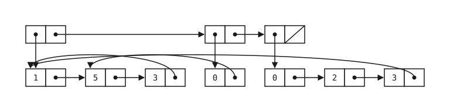
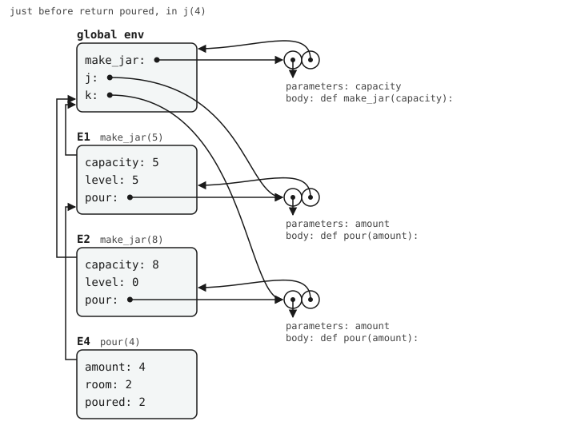
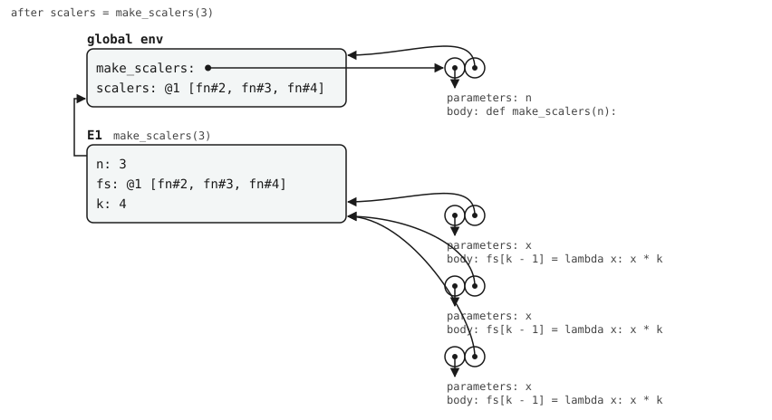
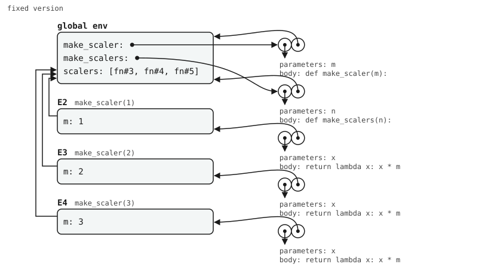

# Mock final 2

<p class="chapter-goal">A full two-hour paper that leans on the second half of the course: state, the environment model, lists and loops, memoization, searching and sorting, and streams.</p>

<div class="exam-info" markdown>

**Time allowed:** 2 hours. **Total:** 100 marks, 9 questions. Plan on about 1.2 minutes per mark.

**Instructions**

- Answer in the Python § that each question states. Python §3 allows everything in §1 and §2.
- The functions in the [Appendix](#appendix-library) are pre-declared: use them without defining them. Any other helper you use must be written out.
- Unless a question says otherwise, your functions must not modify their arguments.
- Write your answers on paper. Draw diagrams by hand. No computer until you mark your work.
- Questions 1 to 3 (30 marks) are mostly unit 1 and 2 material; questions 4 to 9 (70 marks) are units 3 and 4.

</div>

<div id="exam-timer" data-minutes="120"></div>

## Question 1: processes and orders of growth <span class="marks">[10 marks]</span>

Python §1. Here are four functions.

```python
def p(n):
    return 1 if n == 0 else 2 * p(n - 1)

def q(n, acc):
    return acc if n == 0 else q(n - 1, acc + p(n))

def r(n):
    return 0 if n <= 1 else 1 + r(n // 3)

def s(n):
    return 1 if n <= 1 else s(n - 1) + s(n - 1)
```

**(a)** For each of `p(n)`, `q(n, 0)`, `r(n)` and `s(n)`: does it give rise to a recursive process or an iterative process? <span class="marks">[2 marks]</span>

**(b)** Give the order of growth in time and in space, using Θ, of `q(n, 0)`, `r(n)` and `s(n)`. Justify each answer in one line. <span class="marks">[6 marks]</span>

**(c)** `q(n, 0)` returns 2¹ + 2² + … + 2ⁿ. Write a function `q_fast(n)` that returns the same value, gives rise to an iterative process, and runs in Θ(n) time and Θ(1) space. Do not use `p`, `**` or `math_pow`. <span class="marks">[2 marks]</span>

??? solution "Solution"

    **(a)** `p`: recursive (the `2 * …` waits). `q`: iterative (the recursive call is the whole return expression). `r`: recursive (the `1 + …` waits). `s`: recursive (tree recursion: the `+` waits for both calls).

    **(b)**

    | | time | space | why |
    |---|---|---|---|
    | `q(n, 0)` | Θ(n²) | Θ(n) | q makes n steps, and step k calls `p(k)`, which costs k: 1 + 2 + … + n. q itself defers nothing, but each `p(k)` piles up k deferred multiplications while it runs. |
    | `r(n)` | Θ(log n) | Θ(log n) | n is divided by 3 at each call, so there are about log₃ n calls, each leaving a `1 + …` waiting. |
    | `s(n)` | Θ(2ⁿ) | Θ(n) | each call makes two calls with n − 1: the call tree has about 2ⁿ nodes but is only n deep. |

    `measure` counts the calls and the most calls waiting at once. Doubling n roughly quadruples the calls of `q`; squaring n only doubles the calls of `r`; adding 1 to n doubles the calls of `s`.

    ```python title="§1"
    def p(n):
        return 1 if n == 0 else 2 * p(n - 1)

    def q(n, acc):
        return acc if n == 0 else q(n - 1, acc + p(n))

    def r(n):
        return 0 if n <= 1 else 1 + r(n // 3)

    def s(n):
        return 1 if n <= 1 else s(n - 1) + s(n - 1)

    measure(q, 10, 0)
    measure(q, 20, 0)
    measure(q, 40, 0)
    measure(r, 81)
    measure(r, 6561)
    measure(s, 8)
    measure(s, 9)
    measure(s, 10)
    ```
    ```text
    [measure] q(10, 0): 76 calls, 876 steps, at most 12 waiting at once
    [measure] q(20, 0): 251 calls, 2,946 steps, at most 22 waiting at once
    [measure] q(40, 0): 901 calls, 10,686 steps, at most 42 waiting at once
    [measure] r(81): 5 calls, 54 steps, at most 5 waiting at once
    [measure] r(6561): 9 calls, 102 steps, at most 9 waiting at once
    [measure] s(8): 255 calls, 2,800 steps, at most 8 waiting at once
    [measure] s(9): 511 calls, 5,616 steps, at most 9 waiting at once
    [measure] s(10): 1,023 calls, 11,248 steps, at most 10 waiting at once
    ```

    **(c)** Carry the current power of two along, so nothing is recomputed:

    ```python title="§1"
    def q_fast(n):
        def loop(k, power, total):
            return total if k > n else loop(k + 1, 2 * power, total + power)
        return loop(1, 2, 0)

    def p(n):
        return 1 if n == 0 else 2 * p(n - 1)

    def q(n, acc):
        return acc if n == 0 else q(n - 1, acc + p(n))

    print(q_fast(1), q_fast(5), q(5, 0))
    print(q_fast(0))
    print(q_fast(100) == q(100, 0))
    ```
    ```text
    2 62 62
    0
    True
    ```

    **Marking scheme.** (a) ½ each. (b) 1 mark for each of the six Θ answers; for `q`, the space mark needs the remark that the Θ(n) comes from `p`, not from `q`; O(2ⁿ) for `s` time is accepted, a bare "exponential" gets ½. (c) 1 for an iterative process (the recursive call is the whole return expression), 1 for correct values including `q_fast(0) == 0`.

## Question 2: higher-order functions and llists <span class="marks">[10 marks]</span>

Python §2. The following are declared.

```python
def twice(f):
    return lambda x: f(f(x))

def compose(f, g):
    return lambda x: f(g(x))

xs = llist(1, 2, 3, 4)
```

**(a)** What does each statement print? <span class="marks">[4 marks]</span>

```python
print(twice(lambda x: x * 3)(2))
print(twice(twice)(lambda x: x + 1)(0))
print_llist(map(compose(lambda x: x * x, lambda x: x - 1), xs))
print(reduce(lambda x, acc: pair(acc, x), None, xs))
```

**(b)** Write `apply_all(fs, x)`, which takes a llist of one-argument functions `fs` and returns the llist of the results of applying each of them to `x`, in order. One line, no recursion of your own. <span class="marks">[1 mark]</span>

**(c)** Write `pipe(fs)`, which takes a llist of one-argument functions and returns ONE function that applies them from first to last: `pipe(llist(f, g, h))(x)` is `h(g(f(x)))`. `pipe(None)` must return the identity function. Use `reduce`; no recursion of your own. <span class="marks">[3 marks]</span>

**(d)** What is the value of the following expression? Explain in two lines. <span class="marks">[2 marks]</span>

```python
pipe(map(lambda k: lambda x: x * 10 + k, llist(1, 2, 3)))(0)
```

??? solution "Solution"

    **(a)**

    ```python title="§2"
    def twice(f):
        return lambda x: f(f(x))

    def compose(f, g):
        return lambda x: f(g(x))

    xs = llist(1, 2, 3, 4)
    print(twice(lambda x: x * 3)(2))
    print(twice(twice)(lambda x: x + 1)(0))
    print_llist(map(compose(lambda x: x * x, lambda x: x - 1), xs))
    print(reduce(lambda x, acc: pair(acc, x), None, xs))
    ```
    ```text
    18
    4
    llist(0, 1, 4, 9)
    [[[[None, 4], 3], 2], 1]
    ```

    - `twice(twice)` is `lambda f: twice(twice(f))`: it applies `f` 2 × 2 = 4 times.
    - `compose(f, g)` applies `g` first: subtract 1, then square.
    - `reduce` is a RIGHT fold: the call for 4 happens first, with `acc` = `None`, giving `[None, 4]`; each earlier element is then put in the TAIL of a new pair whose head is the result so far.

    **(b), (c), (d)**

    ```python title="§2"
    def apply_all(fs, x):
        return map(lambda f: f(x), fs)

    def pipe(fs):
        return reduce(lambda f, rest: lambda x: rest(f(x)), lambda x: x, fs)

    print_llist(apply_all(llist(lambda x: x + 1, lambda x: x * x, abs), -3))
    print(pipe(llist(lambda x: x + 1, lambda x: x * 2))(5))
    print(pipe(None)(7))
    print(pipe(map(lambda k: lambda x: x * 10 + k, llist(1, 2, 3)))(0))
    ```
    ```text
    llist(-2, 9, 3)
    12
    7
    123
    ```

    In `pipe`, `rest` is the pipeline for the elements AFTER `f`, so the new function runs `f` first and hands the result to `rest`. The identity is the pipeline for the empty llist.

    (d) The `map` makes three functions; each remembers its own `k` (1, 2, 3). `pipe` applies them in order: 0 → 0·10 + 1 = 1 → 12 → 123.

    **Marking scheme.** (a) 1 each; the last one needs exact brackets. (b) 1. (c) 1 for the identity as the initial value, 2 for a combining function that applies `f` BEFORE `rest` (applying them in the wrong order: 1 of these 2). (d) 1 for 123, 1 for the explanation.

## Question 3: box-and-pointer diagrams after mutation <span class="marks">[10 marks]</span>

Python §3. The following program runs.

```python
xs = llist(1, 2, 3)
ys = pair(0, tail(xs))
zs = append(ys, xs)
set_head(tail(xs), 5)
set_tail(tail(tail(xs)), xs)
```

**(a)** Draw the box-and-pointer diagram of `xs`, `ys` and `zs` after the last statement. Show every pair exactly once, with the names pointing at the pairs they refer to. <span class="marks">[5 marks]</span>

**(b)** What do these statements print, if run after the program? <span class="marks">[4 marks]</span>

```python
print(head(tail(ys)))
print(llist_ref(zs, 7))
print(tail(tail(ys)) is tail(tail(xs)))
print(tail(tail(tail(zs))) is xs)
```

**(c)** What happens if we then evaluate `length(zs)`? Why? <span class="marks">[1 mark]</span>

??? solution "Solution"

    **(a)** Seven pairs: three made by `llist`, one by `pair`, three by `append` (it copies the pairs of its FIRST argument, `ys`, and reuses its second, `xs`). `append` ran before the mutation, so its copy still holds 2. The last pair of `xs` now points back to the first: a cycle.

    To draw all three in one picture, the program below draws `llist(xs, ys, zs)`: the top row is that helper llist and is NOT part of the answer. Its three arrows down are `xs`, `ys`, `zs`.

    ```python title="§3 · figure mock-2-q3"
    xs = llist(1, 2, 3)
    ys = pair(0, tail(xs))
    zs = append(ys, xs)
    set_head(tail(xs), 5)
    set_tail(tail(tail(xs)), xs)
    draw_data(llist(xs, ys, zs))
    ```
    ```text
    [•|•]------------------------------>[•|•]-------->[•|/]
     |                                   |             |
     v                                   v             v
     #1=[1|•]-->#2=[5|•]-->[3|•]-->#1    [0|•]-->#2    [0|•]-->[2|•]-->[3|•]-->#1
    ```

    

    In the text drawing, `#1=` labels a pair the first time it appears and `#1` later means "the same pair again".

    **(b)**

    ```python title="§3"
    xs = llist(1, 2, 3)
    ys = pair(0, tail(xs))
    zs = append(ys, xs)
    set_head(tail(xs), 5)
    set_tail(tail(tail(xs)), xs)
    print(head(tail(ys)))
    print(llist_ref(zs, 7))
    print(tail(tail(ys)) is tail(tail(xs)))
    print(tail(tail(tail(zs))) is xs)
    print(tail(tail(tail(xs))) is xs)
    ```
    ```text
    5
    5
    True
    True
    True
    ```

    `ys` shares the pair that `set_head` changed, so it sees 5. Walking `zs`: 0, 2, 3 (the copies), then 1, 5, 3, 1, 5, … around the cycle; position 7 is 5. The last line confirms the cycle: three steps from `xs` lead back to `xs`.

    **(c)** It never finishes: `length` follows tails until it meets `None`, but after the three copied pairs the walk goes round 1 → 5 → 3 → 1 … forever.

    **Marking scheme.** (a) 1 for the `xs` cycle, 1 for the head 5, 1 for `ys` sharing the 5-pair (not a copy), 1 for `zs`'s three NEW pairs holding 0, 2, 3, 1 for the last copy pointing to the first pair of `xs`. (b) 1 each. (c) 1 (the reason is required).

## Question 4: environment model, a function with private state <span class="marks">[12 marks]</span>

Python §3. A jar holds at most `capacity` litres. Pouring into it adds as much as fits and returns how much went in.

```python
def make_jar(capacity):
    level = 0
    def pour(amount):
        nonlocal level
        room = capacity - level
        poured = amount if amount <= room else room
        level = level + poured
        return poured
    return pour

j = make_jar(5)
k = make_jar(8)
print(j(3))
print(j(4))
print(k(6))
```

**(a)** What does the program print? <span class="marks">[2 marks]</span>

**(b)** Draw the environment diagram at the moment when `return poured` is about to be evaluated during the call `j(4)`. Show the global environment, every frame that still matters and every function object (two circles, with parameters and the frame it points to). You may leave out the built-ins frame and frames of calls that have already returned. Label call frames E1, E2, … in the order they are created. <span class="marks">[7 marks]</span>

**(c)** The line `nonlocal level` is deleted and the program is run again. What happens, and why? <span class="marks">[2 marks]</span>

**(d)** After the whole (original) program has run, which call frames still exist, and why do they survive? <span class="marks">[1 mark]</span>

??? solution "Solution"

    **(a)** 3, 2, 6. The second pour into `j` only fits 5 − 3 = 2; `k` has its own `level`.

    **(b)** The program is the one in the question plus two `show_env` lines: the one inside `pour` fires in the call `j(4)` only (the `if`), the last one is for part (d).

    ```python title="§3 · figure mock-2-q4"
    def make_jar(capacity):
        level = 0
        def pour(amount):
            nonlocal level
            room = capacity - level
            poured = amount if amount <= room else room
            level = level + poured
            if amount == 4:
                show_env("just before return poured, in j(4)")
            return poured
        return pour

    j = make_jar(5)
    k = make_jar(8)
    print(j(3))
    print(j(4))
    print(k(6))
    show_env("after the program")
    ```
    ```text
    3
    -- environment diagram: just before return poured, in j(4) --
    global env
        make_jar: fn#1
        j: fn#2
        k: fn#3
    E1: make_jar(5)               enclosing environment: global env
        capacity: 5
        level: 5
        pour: fn#2
    E2: make_jar(8)               enclosing environment: global env
        capacity: 8
        level: 0
        pour: fn#3
    E4: pour(4)                   enclosing environment: E1    <-- current environment
        amount: 4
        room: 2
        poured: 2
    function objects
        fn#1   parameters: capacity   body: line 1  def make_jar(capacity):   environment: global env
        fn#2   parameters: amount     body: line 3  def pour(amount):         environment: E1
        fn#3   parameters: amount     body: line 3  def pour(amount):         environment: E2
    2
    6
    -- environment diagram: after the program --
    global env    <-- current environment
        make_jar: fn#1
        j: fn#2
        k: fn#3
    E1: make_jar(5)               enclosing environment: global env
        capacity: 5
        level: 5
        pour: fn#2
    E2: make_jar(8)               enclosing environment: global env
        capacity: 8
        level: 6
        pour: fn#3
    function objects
        fn#1   parameters: capacity   body: line 1  def make_jar(capacity):   environment: global env
        fn#2   parameters: amount     body: line 3  def pour(amount):         environment: E1
        fn#3   parameters: amount     body: line 3  def pour(amount):         environment: E2
    ```

    

    What to check in your drawing:

    - E1 (`make_jar(5)`) holds `capacity: 5`, `level` and `pour`. On paper write `level: 0 3 5` with the old values struck out.
    - E2 (`make_jar(8)`) holds `capacity: 8`, `level: 0`, `pour`. Two different function objects with the same code: one points to E1 (bound to `j` and E1's `pour`), one to E2 (bound to `k` and E2's `pour`).
    - E3 was the frame of `j(3)`; it has returned, so it may be left out. E4 (`j(4)`) holds `amount: 4`, `room: 2`, `poured: 2`, and NO binding for `level` (it is `nonlocal`). E4's enclosing environment is E1, the environment stored in the function object, not the global environment where `j(4)` was written.

    **(c)** Without `nonlocal`, the assignment `level = level + poured` makes `level` a local name of `pour`. Every call frame of `pour` then has its own unassigned `level`, and `room = capacity - level` reads it before it has a value. The very first call `j(3)` stops with an error and nothing is printed:

    ```python title="§3"
    def make_jar(capacity):
        level = 0
        def pour(amount):
            room = capacity - level
            poured = amount if amount <= room else room
            level = level + poured
            return poured
        return pour

    j = make_jar(5)
    k = make_jar(8)
    print(j(3))
    print(j(4))
    print(k(6))
    ```
    ```text
    UnassignedLocalError: cannot access local variable 'level' where it is not associated with a value
    ```

    **(d)** E1 and E2 (see the second diagram above). Each is pointed to by a function object that is still bound to a global name (`j`, `k`). The frames of the `pour` calls are not pointed to by anything, so they are gone.

    **Marking scheme.** (a) 2 (½ off per wrong number). (b) 1 global frame with `make_jar`, `j`, `k`; 1 E1 correct with `level` 5; 1 E2 correct; 1 two separate `pour` function objects pointing to E1 and E2; 1 `j` and E1's `pour` point to the SAME object; 1 E4 with `amount`, `room`, `poured` and no `level`; 1 E4 encloses E1. (c) 1 for "error at the first call", 1 for the reason (local, unassigned). (d) 1.

## Question 5: environment model, lambdas made in a loop <span class="marks">[10 marks]</span>

Python §3.

```python
def make_scalers(n):
    fs = [None] * n
    k = 1
    while k <= n:
        fs[k - 1] = lambda x: x * k
        k = k + 1
    return fs

scalers = make_scalers(3)
print(scalers[0](10), scalers[2](10))
```

**(a)** What does the program print? <span class="marks">[2 marks]</span>

**(b)** Draw the environment diagram just after `scalers = make_scalers(3)` has finished. Include the list and all function objects. <span class="marks">[4 marks]</span>

**(c)** The author wanted `scalers[i](10)` to be `10 * (i + 1)`. Fix `make_scalers` by adding a helper function `make_scaler(m)` and calling it inside the loop. Explain, using the environment model, why your version works. <span class="marks">[4 marks]</span>

??? solution "Solution"

    **(a)** `40 40`. All three lambdas were made in the SAME frame (the one call of `make_scalers`), so they all look up the same `k`. A lambda remembers the frame, not the value `k` had when the lambda was made. When they run, the loop has finished and `k` is 4.

    **(b)**

    ```python title="§3 · figure mock-2-q5"
    def make_scalers(n):
        fs = [None] * n
        k = 1
        while k <= n:
            fs[k - 1] = lambda x: x * k
            k = k + 1
        return fs

    scalers = make_scalers(3)
    show_env("after scalers = make_scalers(3)")
    print(scalers[0](10), scalers[2](10))
    ```
    ```text
    -- environment diagram: after scalers = make_scalers(3) --
    global env    <-- current environment
        make_scalers: fn#1
        scalers: @1 [fn#2, fn#3, fn#4]
    E1: make_scalers(3)           enclosing environment: global env
        n: 3
        fs: @1 [fn#2, fn#3, fn#4]
        k: 4
    function objects
        fn#1   parameters: n   body: line 1  def make_scalers(n):          environment: global env
        fn#2   parameters: x   body: line 5  fs[k - 1] = lambda x: x * k   environment: E1
        fn#3   parameters: x   body: line 5  fs[k - 1] = lambda x: x * k   environment: E1
        fn#4   parameters: x   body: line 5  fs[k - 1] = lambda x: x * k   environment: E1
    (the same @number means the SAME object: `is` would say True)
    40 40
    ```

    

    On paper draw the list as a row of three boxes outside the frames, with `scalers` (global) and `fs` (E1) both pointing to it (`@1` in the picture: the same list). Each box points to its own function object; all three objects point to E1, where `k` is 4 (`k: 1 2 3 4` with the old values struck out).

    **(c)** Each call `make_scaler(k)` creates a NEW frame holding its own `m`, bound to the value of `k` at that moment. The lambda is created inside that frame, so it remembers it. Later reassignments of `k` do not touch `m`.

    ```python title="§3 · figure mock-2-q5fix"
    def make_scaler(m):
        return lambda x: x * m

    def make_scalers(n):
        fs = [None] * n
        k = 1
        while k <= n:
            fs[k - 1] = make_scaler(k)
            k = k + 1
        return fs

    scalers = make_scalers(3)
    show_env("fixed version")
    print(scalers[0](10), scalers[1](10), scalers[2](10))
    ```
    ```text
    -- environment diagram: fixed version --
    global env    <-- current environment
        make_scaler: fn#1
        make_scalers: fn#2
        scalers: [fn#3, fn#4, fn#5]
    E2: make_scaler(1)            enclosing environment: global env
        m: 1
    E3: make_scaler(2)            enclosing environment: global env
        m: 2
    E4: make_scaler(3)            enclosing environment: global env
        m: 3
    function objects
        fn#1   parameters: m   body: line 1  def make_scaler(m):      environment: global env
        fn#2   parameters: n   body: line 4  def make_scalers(n):     environment: global env
        fn#3   parameters: x   body: line 2  return lambda x: x * m   environment: E2
        fn#4   parameters: x   body: line 2  return lambda x: x * m   environment: E3
        fn#5   parameters: x   body: line 2  return lambda x: x * m   environment: E4
    10 20 30
    ```

    The frame of the call `make_scalers(3)` is no longer pointed to by anything, so the picture leaves it out.

    

    **Marking scheme.** (a) 2 (1 for each 40). (b) 1 E1 with `n: 3`, `fs`, `k: 4`; 1 the list shared by `scalers` and `fs`; 1 three distinct function objects; 1 all of them pointing to E1. (c) 2 for working code, 2 for the explanation (a new frame per call, each with its own `m`).

## Question 6: lists and loops <span class="marks">[12 marks]</span>

Python §3.

**(a)** What does this program print? <span class="marks">[3 marks]</span>

```python
total = 0
for i in range(1, 5):
    for j in range(i):
        if j == 2:
            break
        if (i + j) % 2 == 0:
            continue
        print(i, j)
        total = total + i * j
print(total)
```

**(b)** Write `rotate_left(A)`, which changes the list `A` in place so that every element moves one position to the left and the first element goes to the end: `[1, 2, 3, 4]` becomes `[2, 3, 4, 1]`. It returns nothing. It must take Θ(n) time and Θ(1) extra space, and work for the empty list. <span class="marks">[4 marks]</span>

**(c)** Write `compress(A)`, which returns a NEW list in which every run of equal neighbouring elements of `A` is replaced by one copy: `compress([3, 3, 1, 1, 1, 3, 2, 2])` is `[3, 1, 3, 2]`. `A` must not change. Remember that a list cannot grow. Give the order of growth of your function in time. <span class="marks">[5 marks]</span>

??? solution "Solution"

    **(a)** `break` leaves only the inner loop, so `j` never reaches 2; `continue` skips the pairs where `i + j` is even.

    ```python title="§3"
    total = 0
    for i in range(1, 5):
        for j in range(i):
            if j == 2:
                break
            if (i + j) % 2 == 0:
                continue
            print(i, j)
            total = total + i * j
    print(total)
    ```
    ```text
    1 0
    2 1
    3 0
    4 1
    6
    ```

    **(b)** Save the first element, shift the rest left by one, put the saved element in the last slot.

    ```python title="§3"
    def rotate_left(A):
        n = len(A)
        if n > 0:
            first = A[0]
            for i in range(n - 1):
                A[i] = A[i + 1]
            A[n - 1] = first

    A = [1, 2, 3, 4]
    rotate_left(A)
    print(A)
    rotate_left(A)
    print(A)
    E = []
    rotate_left(E)
    print(E)
    print(rotate_left([7]))
    ```
    ```text
    [2, 3, 4, 1]
    [3, 4, 1, 2]
    []
    None
    ```

    **(c)** Two passes: count the runs (an element starts a new run when it differs from its left neighbour), allocate exactly that many slots, then copy the first element of each run. Θ(n) time: two loops of n − 1 steps each.

    ```python title="§3"
    def compress(A):
        n = len(A)
        if n == 0:
            return []
        count = 1
        for i in range(1, n):
            if A[i] != A[i - 1]:
                count = count + 1
        B = [None] * count
        B[0] = A[0]
        k = 1
        for i in range(1, n):
            if A[i] != A[i - 1]:
                B[k] = A[i]
                k = k + 1
        return B

    A = [3, 3, 1, 1, 1, 3, 2, 2]
    print(compress(A))
    print(A)
    print(compress([5, 5, 5]), compress([]), compress([1, 2, 3]))
    ```
    ```text
    [3, 1, 3, 2]
    [3, 3, 1, 1, 1, 3, 2, 2]
    [5] [] [1, 2, 3]
    ```

    **Marking scheme.** (a) ½ per printed line (5 lines), ½ for the final 6. (b) 1 for saving the first element, 2 for the shifting loop with the right bounds, 1 for the empty list. A solution that builds a second list loses 2 (not Θ(1) space). (c) 1 counting pass, 1 allocation of the exact size, 2 copying with a second index, 1 for Θ(n). Modifying `A`: at most 2 marks.

## Question 7: memoization <span class="marks">[12 marks]</span>

Python §3. A robot walks on a grid of rows and columns, starting in the top-left cell (0, 0). Each move goes one cell DOWN or one cell RIGHT. A grid is a list of rows; a cell holding 1 is a wall the robot cannot enter. This function counts the ways to reach cell (r, c):

```python
def paths(grid, r, c):
    if r < 0 or c < 0:
        return 0
    elif grid[r][c] == 1:
        return 0
    elif r == 0 and c == 0:
        return 1
    else:
        return paths(grid, r - 1, c) + paths(grid, r, c - 1)

g = [[0, 0, 0, 0],
     [0, 1, 0, 0],
     [0, 0, 0, 1],
     [1, 0, 0, 0]]
print(paths(g, 3, 3))
```

You may use this function, which makes a table of `rows` rows and `cols` columns filled with `None`:

```python
def make_table(rows, cols):
    t = [None] * rows
    for i in range(rows):
        t[i] = [None] * cols
    return t
```

**(a)** Let `e` be a 4 × 4 grid with no walls. During the evaluation of `paths(e, 3, 3)`, how many times is `paths(e, 1, 1)` applied? What does this tell you about `paths`? <span class="marks">[2 marks]</span>

**(b)** Write `count_paths(grid)`, which returns the number of ways to reach the bottom-right cell of `grid`, using memoization with a table made by `make_table`. Each cell's answer must be computed at most once. <span class="marks">[6 marks]</span>

**(c)** For a grid of R rows and C columns, give the order of growth of `count_paths` in time and in space. <span class="marks">[2 marks]</span>

**(d)** A student writes the version below. It gives the right answers, but it is as slow as `paths`. Explain why. <span class="marks">[2 marks]</span>

```python
def slow_paths(grid, r, c):
    mem = make_table(len(grid), len(grid[0]))
    if r < 0 or c < 0:
        return 0
    elif mem[r][c] is not None:
        return mem[r][c]
    else:
        result = (0 if grid[r][c] == 1 else
                  1 if r == 0 and c == 0 else
                  slow_paths(grid, r - 1, c) + slow_paths(grid, r, c - 1))
        mem[r][c] = result
        return result
```

??? solution "Solution"

    **(a)** 6 times. Every route BACK from (3, 3) to (1, 1) (two steps up and two steps left, in any order: 6 orders) makes one call `paths(e, 1, 1)`. The same sub-problem is solved again and again, so the time grows exponentially: a sign that memoization will help.

    ```python title="§3"
    calls = 0

    def paths(grid, r, c):
        global calls
        if r == 1 and c == 1:
            calls = calls + 1
        if r < 0 or c < 0:
            return 0
        elif grid[r][c] == 1:
            return 0
        elif r == 0 and c == 0:
            return 1
        else:
            return paths(grid, r - 1, c) + paths(grid, r, c - 1)

    e = [[0, 0, 0, 0], [0, 0, 0, 0], [0, 0, 0, 0], [0, 0, 0, 0]]
    print(paths(e, 3, 3), calls)
    ```
    ```text
    20 6
    ```

    **(b)** The inner function's recursive calls go through the table, and the table is made ONCE per call of `count_paths`.

    ```python title="§3"
    def make_table(rows, cols):
        t = [None] * rows
        for i in range(rows):
            t[i] = [None] * cols
        return t

    def count_paths(grid):
        rows = len(grid)
        cols = len(grid[0])
        mem = make_table(rows, cols)
        def ways(r, c):
            if r < 0 or c < 0:
                return 0
            elif mem[r][c] is not None:
                return mem[r][c]
            else:
                if grid[r][c] == 1:
                    result = 0
                elif r == 0 and c == 0:
                    result = 1
                else:
                    result = ways(r - 1, c) + ways(r, c - 1)
                mem[r][c] = result
                return result
        return ways(rows - 1, cols - 1)

    g = [[0, 0, 0, 0],
         [0, 1, 0, 0],
         [0, 0, 0, 1],
         [1, 0, 0, 0]]
    print(count_paths(g))
    print(count_paths([[0, 1], [1, 0]]))
    big = make_table(30, 30)
    for i in range(30):
        for j in range(30):
            big[i][j] = 0
    print(count_paths(big))
    ```
    ```text
    3
    0
    30067266499541040
    ```

    The empty 30 × 30 grid has 58!/(29!·29!) routes, about 3 × 10¹⁶: hopeless without the table, instant with it.

    **(c)** Θ(R·C) time: each of the R·C cells is computed once, and each computation makes two calls, which are either answered from the table or compute a new cell. Θ(R·C) space for the table (the deferred calls add only Θ(R + C), the length of one route).

    **(d)** `mem` is a local variable, so EVERY call (including each recursive call) makes its own fresh, empty table and throws it away when it returns. The lookup `mem[r][c] is not None` therefore never succeeds, and the calls are exactly those of `paths` (each now also paying Θ(R·C) to build a table). The table must be created once, outside the recursion, as in (b).

    ```python title="§3"
    hits = 0

    def make_table(rows, cols):
        t = [None] * rows
        for i in range(rows):
            t[i] = [None] * cols
        return t

    def slow_paths(grid, r, c):
        global hits
        mem = make_table(len(grid), len(grid[0]))
        if r < 0 or c < 0:
            return 0
        elif mem[r][c] is not None:
            hits = hits + 1
            return mem[r][c]
        else:
            result = (0 if grid[r][c] == 1 else
                      1 if r == 0 and c == 0 else
                      slow_paths(grid, r - 1, c) + slow_paths(grid, r, c - 1))
            mem[r][c] = result
            return result

    e = [[0, 0, 0, 0], [0, 0, 0, 0], [0, 0, 0, 0], [0, 0, 0, 0]]
    print(slow_paths(e, 3, 3), hits)
    ```
    ```text
    20 0
    ```

    **Marking scheme.** (a) 1 for 6, 1 for "repeated work, exponential time". (b) 1 table made once, 1 lookup before computing, 1 store after computing, 1 recursive calls go through the memoized function, 1 out-of-grid and wall cases, 1 start cell. (c) 1 each. (d) 2: "a new table at every call, so nothing is ever found".

## Question 8: searching and sorting <span class="marks">[12 marks]</span>

Python §3. Here is insertion sort on lists.

```python
def insertion_sort(A):
    for i in range(1, len(A)):
        key = A[i]
        j = i - 1
        while j >= 0 and A[j] > key:
            A[j + 1] = A[j]
            j = j - 1
        A[j + 1] = key
```

**(a)** `A = [4, 1, 3, 5, 2]` and `insertion_sort(A)` is evaluated. Write down `A` after each iteration of the `for` loop. <span class="marks">[3 marks]</span>

**(b)** A list of n distinct numbers is *nearly sorted* if every element is at most one position away from where it belongs, for example `[2, 1, 3, 5, 4, 6]`. Give the order of growth in time of `insertion_sort` on nearly sorted lists, and of the selection sort from the lectures (which always scans the whole unsorted part for the smallest element). Justify both. <span class="marks">[4 marks]</span>

**(c)** Write `count_in_range(A, lo, hi)`, where `A` is a list of integers sorted in ascending order (repeats allowed) and `lo <= hi`. It returns how many elements `x` of `A` satisfy `lo <= x <= hi`. It must run in Θ(log n) time, where n is `len(A)`. <span class="marks">[5 marks]</span>

??? solution "Solution"

    **(a)** A `print` at the end of each iteration shows the list.

    ```python title="§3"
    def insertion_sort(A):
        for i in range(1, len(A)):
            key = A[i]
            j = i - 1
            while j >= 0 and A[j] > key:
                A[j + 1] = A[j]
                j = j - 1
            A[j + 1] = key
            print(A)

    A = [4, 1, 3, 5, 2]
    insertion_sort(A)
    ```
    ```text
    [1, 4, 3, 5, 2]
    [1, 3, 4, 5, 2]
    [1, 3, 4, 5, 2]
    [1, 2, 3, 4, 5]
    ```

    **(b)** Insertion sort: Θ(n). The `while` loop moves `key` left past the elements bigger than it; in a nearly sorted list that is at most one element, so each of the n − 1 iterations does a constant amount of work. Selection sort: Θ(n²). Finding the smallest of the unsorted part always looks at every element of it, whatever their order: (n − 1) + (n − 2) + … + 1 comparisons.

    Counting the comparisons of elements on nearly sorted lists of length 10, 20, 40 shows it: insertion sort grows like n, selection sort like n²/2.

    ```python title="§3"
    comparisons = 0

    def greater(x, y):
        global comparisons
        comparisons = comparisons + 1
        return x > y

    def insertion_sort(A):
        for i in range(1, len(A)):
            key = A[i]
            j = i - 1
            while j >= 0 and greater(A[j], key):
                A[j + 1] = A[j]
                j = j - 1
            A[j + 1] = key

    def selection_sort(A):
        n = len(A)
        for i in range(n - 1):
            smallest = i
            for j in range(i + 1, n):
                if greater(A[smallest], A[j]):
                    smallest = j
            temp = A[i]
            A[i] = A[smallest]
            A[smallest] = temp

    def nearly_sorted(n):
        A = [None] * n
        for i in range(0, n, 2):
            A[i] = i + 1
            A[i + 1] = i
        return A

    print(nearly_sorted(6))
    for k in range(3):
        n = 10 * (2 ** k)
        comparisons = 0
        insertion_sort(nearly_sorted(n))
        ins = comparisons
        comparisons = 0
        selection_sort(nearly_sorted(n))
        print(n, ins, comparisons)
    ```
    ```text
    [1, 0, 3, 2, 5, 4]
    10 13 45
    20 28 190
    40 58 780
    ```

    **(c)** Binary search twice. `first_at_least(A, v)` finds the first index whose element is at least `v` (or `len(A)` if there is none). The elements in range sit between the first index with an element ≥ `lo` and the first index with an element ≥ `hi + 1` (the elements are integers). Each search halves `high - low` every step: Θ(log n).

    ```python title="§3"
    def first_at_least(A, v):
        low = 0
        high = len(A)
        while low < high:
            mid = (low + high) // 2
            if A[mid] < v:
                low = mid + 1
            else:
                high = mid
        return low

    def count_in_range(A, lo, hi):
        return first_at_least(A, hi + 1) - first_at_least(A, lo)

    A = [1, 3, 3, 3, 5, 8, 8, 13]
    print(count_in_range(A, 3, 8))
    print(count_in_range(A, 4, 7))
    print(count_in_range(A, 14, 20), count_in_range(A, -5, 0))
    print(count_in_range(A, 1, 13), count_in_range([], 1, 2))
    ```
    ```text
    6
    1
    0 0
    8 0
    ```

    A loop that walks from the first match until the elements pass `hi` is Θ(log n + k), which is Θ(n) when many elements match: it gets at most 3 of the 5 marks.

    **Marking scheme.** (a) ¾ per line. (b) 1 for each Θ, 1 for each reason. (c) 2 for a correct binary search for a boundary, 1 for handling repeats (finding the FIRST or LAST occurrence), 1 for combining two searches correctly, 1 for empty list and ranges outside `A`.

## Question 9: streams and memoization <span class="marks">[12 marks]</span>

Python §3. `add_streams` adds two infinite streams element by element.

```python
def add_streams(s1, s2):
    return pair(head(s1) + head(s2),
                lambda: add_streams(stream_tail(s1), stream_tail(s2)))

tri = pair(0, lambda: add_streams(tri, integers_from(1)))
```

**(a)** What are the first six elements of `tri`? <span class="marks">[3 marks]</span>

**(b)** Write `pairwise_diff(s)`, which takes an infinite stream s₀, s₁, s₂, … and returns the infinite stream s₁ − s₀, s₂ − s₁, s₃ − s₂, … . What are the first five elements of `pairwise_diff(tri)`? <span class="marks">[3 marks]</span>

**(c)** Here is `memo_fun`, and a stream of squares that prints a line each time a new pair of it is built.

```python
def memo_fun(fun):
    already_run = False
    result = None
    def mf():
        nonlocal already_run, result
        if not already_run:
            result = fun()
            already_run = True
        return result
    return mf

def noisy_squares(n):
    print("sq", n)
    return pair(n * n, memo_fun(lambda: noisy_squares(n + 1)))

s = noisy_squares(1)
evens = stream_filter(lambda x: x % 2 == 0, s)
print(head(evens))
print(stream_ref(s, 4))
print(stream_ref(evens, 1))
```

(i) What does the program print? <span class="marks">[3 marks]</span>

(ii) What does it print if `memo_fun(lambda: noisy_squares(n + 1))` is replaced by `lambda: noisy_squares(n + 1)`? <span class="marks">[3 marks]</span>

??? solution "Solution"

    **(a)** 0, 1, 3, 6, 10, 15. Element k + 1 is element k of `tri` plus element k of 1, 2, 3, …: 0 + 1 = 1, 1 + 2 = 3, 3 + 3 = 6, and so on (the triangular numbers). It works because, when the tail is forced, `tri` already has a value.

    **(b)** Both heads are needed now; the rest is delayed.

    ```python title="§3"
    def add_streams(s1, s2):
        return pair(head(s1) + head(s2),
                    lambda: add_streams(stream_tail(s1), stream_tail(s2)))

    tri = pair(0, lambda: add_streams(tri, integers_from(1)))

    def pairwise_diff(s):
        return pair(head(stream_tail(s)) - head(s),
                    lambda: pairwise_diff(stream_tail(s)))

    print_llist(eval_stream(tri, 6))
    print_llist(eval_stream(pairwise_diff(tri), 5))
    print_llist(eval_stream(pairwise_diff(stream_map(lambda x: x * x, integers_from(0))), 4))
    ```
    ```text
    llist(0, 1, 3, 6, 10, 15)
    llist(1, 2, 3, 4, 5)
    llist(1, 3, 5, 7)
    ```

    **(c)(i)** With `memo_fun`, each `noisy_squares(k)` runs at most once.

    ```python title="§3"
    def memo_fun(fun):
        already_run = False
        result = None
        def mf():
            nonlocal already_run, result
            if not already_run:
                result = fun()
                already_run = True
            return result
        return mf

    def noisy_squares(n):
        print("sq", n)
        return pair(n * n, memo_fun(lambda: noisy_squares(n + 1)))

    s = noisy_squares(1)
    evens = stream_filter(lambda x: x % 2 == 0, s)
    print(head(evens))
    print(stream_ref(s, 4))
    print(stream_ref(evens, 1))
    ```
    ```text
    sq 1
    sq 2
    4
    sq 3
    sq 4
    sq 5
    25
    16
    ```

    - `s = …` builds the first pair: `sq 1`.
    - `stream_filter` rejects 1 and forces the next pair, `sq 2`; 4 is even, so it stops there.
    - `stream_ref(s, 4)` walks 1 → 4 → 9 → 16 → 25. The tail to 4 was already forced, so it is remembered and prints nothing; `sq 3`, `sq 4`, `sq 5` are new.
    - `stream_ref(evens, 1)` forces the filter's delayed part: it walks on from 4 to 9 (odd) to 16 (even). All of these pairs exist already: nothing printed.

    **(ii)** Without `memo_fun`, every forcing of a tail calls `noisy_squares` again, and prints again.

    ```python title="§3"
    def noisy_squares(n):
        print("sq", n)
        return pair(n * n, lambda: noisy_squares(n + 1))

    s = noisy_squares(1)
    evens = stream_filter(lambda x: x % 2 == 0, s)
    print(head(evens))
    print(stream_ref(s, 4))
    print(stream_ref(evens, 1))
    ```
    ```text
    sq 1
    sq 2
    4
    sq 2
    sq 3
    sq 4
    sq 5
    25
    sq 3
    sq 4
    16
    ```

    `stream_ref(s, 4)` starts again from the first pair and rebuilds 2, 3, 4, 5; then the filter's delayed part rebuilds 3 and 4.

    **Marking scheme.** (a) ½ each. (b) 2 for `pairwise_diff` (the tail must be delayed with `lambda:`; forcing it eagerly loops forever: 0 of these 2), 1 for 1, 2, 3, 4, 5. (c)(i) and (ii): 3 each; 1 off per missing, extra or misplaced line, minimum 0.

## Appendix: library

These are pre-declared. `make_table`, `add_streams` and `memo_fun` are NOT: they are given inside the questions that use them.

| Function | What it does |
|---|---|
| `print(a, b, …)` | prints its arguments separated by spaces; returns `None` |
| `abs(x)` | the absolute value of `x` |
| `len(xs)` | the number of elements of the list `xs` (§3) |
| `range(start, end, step)` | the integers counted by a `for` loop: start, start + step, … before end; also `range(end)` and `range(start, end)` (§3, `for` loops only) |
| `pair(x, y)` | makes a new pair with head `x` and tail `y` |
| `head(p)`, `tail(p)` | the head and the tail of the pair `p` |
| `llist(x1, …, xn)` | a llist of the given elements; `llist()` is `None` |
| `print_llist(xs)` | prints `xs` in llist notation |
| `length(xs)` | the number of elements of the llist `xs` |
| `llist_ref(xs, n)` | the element at position `n` of `xs`, counting from 0 |
| `map(f, xs)` | the llist of `f(x)` for each element `x` of `xs` |
| `filter(pred, xs)` | the llist of the elements of `xs` for which `pred` returns `True` |
| `reduce(f, initial, xs)` | right fold: `reduce(f, init, llist(1, 2, 3))` is `f(1, f(2, f(3, init)))` |
| `append(xs, ys)` | a llist of the elements of `xs` then `ys`: copies the pairs of `xs`, shares `ys` |
| `set_head(p, v)`, `set_tail(p, v)` | change the head / tail of the pair `p` to `v`; return `None` (§3) |
| `stream_tail(s)` | the stream after the first element: `tail(s)()` (§3) |
| `stream_ref(s, n)` | the element at position `n` of the stream `s`, counting from 0 (§3) |
| `stream_map(f, s)` | the stream of `f(x)` for each element `x` of `s`, not memoized (§3) |
| `stream_filter(p, s)` | the stream of the elements of `s` for which `p` is `True`, not memoized; forces `s` up to the first such element at once (§3) |
| `integers_from(n)` | the infinite stream n, n + 1, n + 2, … (§3) |
| `eval_stream(s, n)` | a llist of the first `n` elements of `s` (§3) |
