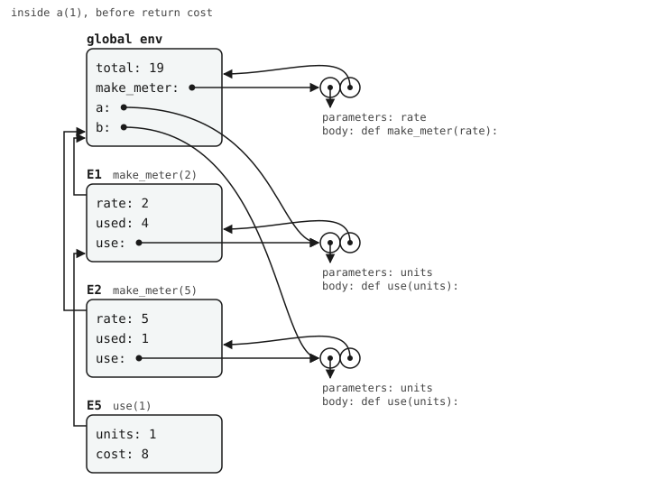
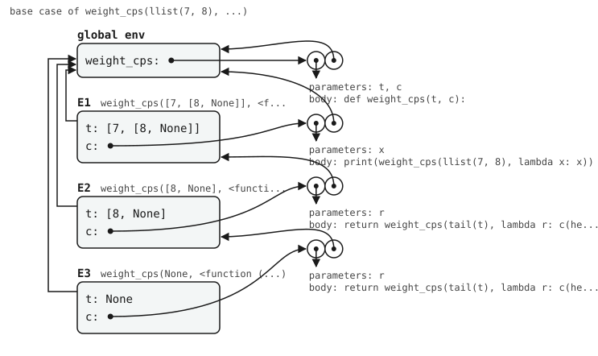

# Mock final 3

<p class="chapter-goal">The hardest of the three mock papers: two hours, 100 marks, the metacircular evaluator at its centre, with checked worked solutions and marking schemes.</p>

<div class="exam-info" markdown>

**Time:** 2 hours. **Total:** 100 marks, 8 questions. Answer all of them.

- Write your answers on paper, as you will in the exam hall. Budget about 1 minute per mark; question 7 alone is worth a quarter of the paper.
- Each question says which language to use (Python §1, §2, §3 or §4). Use only what that chapter allows.
- The functions in [Appendix: library](#appendix-library) are pre-declared and may be used without definition. Question 7 refers to the evaluator described in [Appendix: the evaluator](#appendix-the-evaluator).
- "Θ" means the tightest bound. Space counts deferred operations **and** the pairs and function objects that must be kept at the same moment.
- Start the clock below: the solutions stay hidden while it runs.

</div>

<div id="exam-timer" data-minutes="120"></div>

## Question 1: Orders of growth <span class="marks">[12 marks]</span>

Python §2. For each part give the order of growth in **time** and in **space** with Θ, and a reason of one or two sentences. Take `length(xs)` to need Θ(n) time and Θ(1) space for a llist of length n.

**(a)** [3 marks] `halves(n)`, where n is a power of 2.

```python
def halves(n):
    return 0 if n <= 1 else halves(n // 2) + halves(n // 2) + 1
```

**(b)** [3 marks] `tags(xs)`, where `xs` is a llist of length n.

```python
def tags(xs):
    return None if is_none(xs) else pair(length(xs), tags(tail(xs)))
```

**(c)** [3 marks] `build(n)`. Is the process that `loop` gives rise to recursive or iterative? Does that answer settle the space?

```python
def build(n):
    def loop(i, acc):
        return acc if i > n else loop(i + 1, pair(i, acc))
    return length(loop(1, None))
```

**(d)** [3 marks] (i) Time and space of `counter_chain(n)`. (ii) Let `f = counter_chain(n)`. What is `f(0)`, and what are the time and space of evaluating `f(0)`?

```python
def counter_chain(n):
    return ((lambda x: x) if n == 0
            else (lambda g: lambda x: g(x) + 1)(counter_chain(n - 1)))
```

??? solution "Solution"

    **(a)** Time **Θ(n)**: every call with n > 1 makes two calls on n/2, so the call tree is a full binary tree of depth log₂ n with 2n − 1 calls, each doing a constant amount of work. Space **Θ(log n)**: only the calls on one path from the root wait at the same time, and a path has log₂ n + 1 calls.

    **(b)** Time **Θ(n²)**: the call on a llist of length k spends Θ(k) in `length`, so the total is n + (n − 1) + … + 1 = n(n + 1)/2. Space **Θ(n)**: n deferred `pair(...)` operations wait at the deepest point, and the result has n pairs.

    **(c)** The process is **iterative**: the call of `loop` is the last thing `loop` does. Time **Θ(n)**: n + 1 calls of `loop`, then n steps of `length`. But space is **Θ(n)**, not Θ(1): there are no deferred operations, yet `acc` holds a llist of up to n pairs that are all still needed. "Iterative" does not mean "constant space".

    **(d)** (i) `counter_chain(n - 1)` is an argument, so the application around it waits: a recursive process, n calls waiting at the deepest point. Time **Θ(n)**, space **Θ(n)**. The result is a chain of n + 1 function objects, each one's environment holding `g` = the previous one, so Θ(n) space stays in use after `counter_chain(n)` returns.

    (ii) `f(0)` is **n**. Each level calls `g` once and then adds 1, so time is **Θ(n)**, and the n additions `g(x) + 1` are deferred, so space is **Θ(n)** (plus the n function objects that already exist).

    `measure` shows the shapes. Doubling n doubles the calls of `halves` but adds only one to the waiting calls. `tags` takes four times the steps. `build` never has more than 2 calls waiting (its pairs are not counted by `measure`). `counter_chain` and `f` keep n calls waiting.

    ```python title="§2"
    def halves(n):
        return 0 if n <= 1 else halves(n // 2) + halves(n // 2) + 1

    def tags(xs):
        return None if is_none(xs) else pair(length(xs), tags(tail(xs)))

    def build(n):
        def loop(i, acc):
            return acc if i > n else loop(i + 1, pair(i, acc))
        return length(loop(1, None))

    def counter_chain(n):
        return ((lambda x: x) if n == 0
                else (lambda g: lambda x: g(x) + 1)(counter_chain(n - 1)))

    measure(halves, 256)
    measure(halves, 512)
    measure(tags, enum_llist(1, 100))
    measure(tags, enum_llist(1, 200))
    measure(build, 100)
    measure(build, 200)
    measure(counter_chain, 100)
    measure(counter_chain, 200)
    f = counter_chain(300)
    measure(f, 0)
    print(f(0))
    ```
    ```text title="Output"
    [measure] halves(256): 511 calls, 6,126 steps, at most 9 waiting at once
    [measure] halves(512): 1,023 calls, 12,270 steps, at most 10 waiting at once
    [measure] tags([1, [2, [3, [4, [...): 5,351 calls, 68,356 steps, at most 101 waiting at once
    [measure] tags([1, [2, [3, [4, [...): 20,701 calls, 266,706 steps, at most 201 waiting at once
    [measure] build(100): 204 calls, 2,726 steps, at most 2 waiting at once
    [measure] build(200): 404 calls, 5,426 steps, at most 2 waiting at once
    [measure] counter_chain(100): 201 calls, 1,306 steps, at most 101 waiting at once
    [measure] counter_chain(200): 401 calls, 2,606 steps, at most 201 waiting at once
    [measure] (anonymous)(0): 301 calls, 1,501 steps, at most 301 waiting at once
    300
    ```

    **Marking scheme** (12): in each part, 1 for time, 1 for space, 1 for a reason that names the mechanism (call tree / sum of `length` costs / pairs kept in `acc` / chain of function objects and deferred additions). (c): "iterative, so Θ(1) space" gets 1 of 3. (d): `f(0)` = n is part of the reason mark in (ii).

## Question 2: Environment model <span class="marks">[12 marks]</span>

Python §3.

```python
total = 0

def make_meter(rate):
    used = 0
    def use(units):
        nonlocal used
        global total
        used = used + units
        cost = used * rate
        total = total + cost
        return cost
    return use

a = make_meter(2)
b = make_meter(5)
a(3)
b(1)
print(a(1), total)
```

**(a)** [2 marks] What does the last line print?

**(b)** [6 marks] Draw the environment diagram at the moment when the call `a(1)` on the last line is about to evaluate `return cost`. Show every frame that still exists with its bindings, the enclosing-environment arrows, and every function object (two circles). You may leave out the built-ins frame and the frames of calls that have already returned.

**(c)** [2 marks] The line `nonlocal used` is deleted. What happens when `a(3)` runs? Explain with the environment model.

**(d)** [2 marks] How many frames are created while the original program runs, not counting the global and built-ins frames? After the last line, which of them can still be reached from the global environment, and through which names?

??? solution "Solution"

    **(a)** `8 19`. Step by step: `a(3)`: `used` in E1 becomes 3, cost 6, `total` 6. `b(1)`: `used` in E2 becomes 1, cost 5, `total` 11. `a(1)`: `used` in E1 becomes 4, cost 8, `total` 19.

    ```python title="§3"
    total = 0

    def make_meter(rate):
        used = 0
        def use(units):
            nonlocal used
            global total
            used = used + units
            cost = used * rate
            total = total + cost
            return cost
        return use

    a = make_meter(2)
    b = make_meter(5)
    a(3)
    b(1)
    print(a(1), total)
    ```
    ```text title="Output"
    8 19
    ```

    **(b)** The same program with one line added, which draws the diagram only inside `a(1)` (the only call where `cost` is 8):

    ```python title="§3 · figure mock-3-meter"
    total = 0

    def make_meter(rate):
        used = 0
        def use(units):
            nonlocal used
            global total
            used = used + units
            cost = used * rate
            total = total + cost
            if cost == 8:
                show_env("inside a(1), before return cost")
            return cost
        return use

    a = make_meter(2)
    b = make_meter(5)
    a(3)
    b(1)
    print(a(1), total)
    ```

    

    What to see in the diagram:

    - The global frame: `total: 19` (on paper: 0, 6, 11 struck out), `make_meter`, `a`, `b`.
    - Two frames for the two calls of `make_meter`, both extending the global environment: E1 with `rate: 2`, `used: 4` (0, 3 struck out), `use`; E2 with `rate: 5`, `used: 1`.
    - The frame of `a(1)` (E5 in the figure: E3 and E4 were the earlier `use` calls) extends **E1**, because `a` is the function object created in E1. It holds only `units: 1` and `cost: 8`. There is no `used` and no `total` in it: `nonlocal` and `global` stop those assignments from making local names.
    - `a` points to a function object whose environment circle points to E1; `b` to one that points to E2.

    **(c)** `used = used + units` now makes `used` a **local** name of `use`. The frame of `a(3)` gets a binding `used` that is unassigned, and the right-hand side reads it before the assignment: an UnassignedLocalError. It does not fall back to `used` in E1.

    ```python title="§3"
    total = 0

    def make_meter(rate):
        used = 0
        def use(units):
            global total
            used = used + units
            cost = used * rate
            total = total + cost
            return cost
        return use

    a = make_meter(2)
    print(a(3))
    ```
    ```text
    UnassignedLocalError: cannot access local variable 'used' where it is not associated with a value
    ```

    **(d)** **Five** frames: `make_meter(2)`, `make_meter(5)`, `use(3)` and the two `use(1)` calls. After the last line only the two `make_meter` frames can be reached: E1 through `a` (its function object's environment is E1) and E2 through `b`. No function object or name refers to the three `use` frames, so they are no longer needed.

    **Marking scheme** (12). (a) 2: one for each number. (b) 6: global frame correct with `total: 19` (1); E1 and E2 with the right values of `rate` and `used` (1); the `a(1)` frame extends E1 (1); that frame contains exactly `units` and `cost` (1); two function objects for `use`, pointing to E1 and E2, bound to `a` and `b` (1); `make_meter`'s function object points to the global environment (1). (c) 2: UnassignedLocalError (1), because the assignment makes `used` local to the whole body (1). (d) 2: five frames (1), E1 via `a` and E2 via `b` (1).

## Question 3: Paying with at most k coins <span class="marks">[12 marks]</span>

Python §2. A parking machine takes coins. `coins` is a llist of different positive denominations, for example `llist(5, 2, 1)`, and you have as many coins of each kind as you like. A **way** to pay `amount` is a collection of coins whose values add up to exactly `amount` and that has **at most `k` coins**. The order in which coins go in does not matter: 5 + 1 and 1 + 5 are the same way.

For example, there are 2 ways to pay 6 with `llist(5, 2, 1)` and at most 3 coins: 5 + 1 and 2 + 2 + 2. (1 + 1 + 2 + 2 is not allowed: four coins.)

**(a)** [5 marks] Write `count_pay(amount, coins, k)`, the number of ways. Use wishful thinking and say in one sentence which smaller problems you rely on.

**(b)** [4 marks] Write `list_pay(amount, coins, k)`, which returns a llist of all the ways. Each way is a llist of coins, listed in the order of `coins`. You may use `map` and `append`.

```python
print_llist(list_pay(6, llist(5, 2, 1), 3))
# llist(llist(5, 1), llist(2, 2, 2))
```

**(c)** [3 marks] (i) [1 mark] A classmate puts the test `k == 0` before the test `amount == 0`. Give a call of `count_pay` whose answer is then wrong. (ii) [2 marks] Let m be the length of `coins`. Give an upper bound (O) on the number of calls of `count_pay`, and the order of growth of the space, in terms of k and m. Explain.

??? solution "Solution"

    **(a)** Wishful thinking: assume `count_pay` already works for a smaller k or a shorter `coins`. Every way either **uses** at least one coin of the first kind `d` (take one out: what is left pays `amount - d` with at most `k - 1` coins, all kinds still allowed), or **skips** that kind (pays `amount` with the other kinds, still at most `k` coins). The two groups do not overlap and together contain every way, so we add their counts.

    Base cases: `amount == 0` is one way (no more coins). A negative amount, no coins left to use (`k == 0`) or no kinds left are 0 ways.

    ```python title="§2"
    def count_pay(amount, coins, k):
        if amount == 0:
            return 1
        elif amount < 0 or k == 0 or is_none(coins):
            return 0
        else:
            return (count_pay(amount - head(coins), coins, k - 1)
                    + count_pay(amount, tail(coins), k))

    coins = llist(5, 2, 1)
    print(count_pay(6, coins, 3))
    print(count_pay(6, coins, 2))
    print(count_pay(6, coins, 6))
    print(count_pay(100, llist(50, 20, 10, 5), 4))
    ```
    ```text title="Output"
    2
    1
    5
    2
    ```

    (With at most 2 coins only 5 + 1 is left; with 6 coins there are 5 ways: 5+1, 2+2+2, 2+2+1+1, 2+1+1+1+1, 1×6.)

    **(b)** Same split. The ways that use the first kind are the ways for `amount - d` with `d` put in front of each; the base case `amount == 0` has exactly **one** way, the empty llist, so it returns `llist(None)`, not `None` (which would mean "no way").

    ```python title="§2"
    def list_pay(amount, coins, k):
        if amount == 0:
            return llist(None)
        elif amount < 0 or k == 0 or is_none(coins):
            return None
        else:
            using = map(lambda way: pair(head(coins), way),
                        list_pay(amount - head(coins), coins, k - 1))
            return append(using, list_pay(amount, tail(coins), k))

    print_llist(list_pay(6, llist(5, 2, 1), 3))
    print_llist(list_pay(4, llist(2, 1), 4))
    print(length(list_pay(6, llist(5, 2, 1), 6)))
    ```
    ```text title="Output"
    llist(llist(5, 1), llist(2, 2, 2))
    llist(llist(2, 2), llist(2, 1, 1), llist(1, 1, 1, 1))
    5
    ```

    **(c)** (i) `count_pay(6, llist(5, 2, 1), 2)` should be 1 (5 + 1). After the coin 1 is used, the call is `count_pay(0, …, 0)`: the amount is paid exactly with the last allowed coin, but the classmate's version sees `k == 0` first and returns 0.

    ```python title="§2"
    def count_pay_wrong(amount, coins, k):
        if k == 0 or amount < 0 or is_none(coins):
            return 0
        elif amount == 0:
            return 1
        else:
            return (count_pay_wrong(amount - head(coins), coins, k - 1)
                    + count_pay_wrong(amount, tail(coins), k))

    print(count_pay_wrong(6, llist(5, 2, 1), 2))
    ```
    ```text
    0
    ```

    (ii) Each call either stops or makes two calls: the first has k one smaller, the second has m one smaller, and a call with k = 0 or m = 0 stops. So k + m drops by at least 1 from a call to each of its two calls, the call tree has depth at most k + m, and there are at most 2^(k+m+1) − 1 calls: **O(2^(k+m))** time. Space: the deferred additions along one path of the tree, **O(k + m)** (Θ(k + m) when the amount is large enough that no branch stops early).

    **Marking scheme** (12). (a) 5: the use/skip split with the right arguments (2), base case `amount == 0` → 1 tested first (1), the other base cases (1), a correct wishful-thinking sentence (1). (b) 4: `llist(None)` for the empty way (1), `None` for no way (1), `map` putting the coin in front (1), `append` of the two groups (1). (c) 3: (i) a correct call with its wrong result (1); (ii) the bound with the "k + m shrinks on every path" reason (1), the space (1).

## Question 4: Pipelines with map, filter and reduce <span class="marks">[10 marks]</span>

Python §2. In this question **do not write any recursive function of your own**: use `map`, `filter`, `reduce`, `append`, `length` and `enum_llist`.

A record is a pair of a name and a non-empty llist of scores:

```python
records = llist(pair("ann", llist(70, 90)),
                pair("bo", llist(40, 55, 61)),
                pair("cy", llist(88)))
```

**(a)** [3 marks] Write `names_with_average_at_least(records, k)`: the llist of the names (in the same order) whose average score is at least `k`. For the records above and `k = 60` the result is `llist("ann", "cy")`.

**(b)** [4 marks] (i) [2 marks] Write `all_scores(records)` with **one** call of `reduce`: the llist of all scores, record after record, each record's scores in their order. Above: `llist(70, 90, 40, 55, 61, 88)`. (ii) [1 mark] With N scores in m records in total, what is the order of growth of its time? Why? (iii) [1 mark] What would your function return for `records` if `append(X, Y)` in it were changed to `append(Y, X)`, and how would the time change?

**(c)** [3 marks] Write `divisor_pairs(n)`: the llist of all pairs `pair(i, j)` with 1 ≤ i < j ≤ n where `i` divides `j`, ordered by `j` and then by `i`.

```python
print_llist(divisor_pairs(4))
# llist([1, 2], [1, 3], [1, 4], [2, 4])
```

??? solution "Solution"

    **(a)** Filter the records, then map out the names. To avoid floats, compare `total >= k * count` instead of dividing.

    **(b)** `reduce` is a right fold: `f(r1, f(r2, f(r3, None)))`. With `append(tail(r), acc)`, each record's scores are put in front of the scores of the records after it.

    **(c)** For each `j` from 2 to n, filter the candidates `1 … j - 1`, map each `i` to `pair(i, j)`; that gives a llist of llists, which `reduce(append, None, …)` flattens.

    ```python title="§2"
    def total(xs):
        return reduce(lambda x, so_far: x + so_far, 0, xs)

    def names_with_average_at_least(records, k):
        return map(head,
                   filter(lambda r: total(tail(r)) >= k * length(tail(r)),
                          records))

    def all_scores(records):
        return reduce(lambda r, acc: append(tail(r), acc), None, records)

    def all_scores_swapped(records):
        return reduce(lambda r, acc: append(acc, tail(r)), None, records)

    def divisor_pairs(n):
        return reduce(append, None,
                      map(lambda j: map(lambda i: pair(i, j),
                                        filter(lambda i: j % i == 0, enum_llist(1, j - 1))),
                          enum_llist(2, n)))

    records = llist(pair("ann", llist(70, 90)),
                    pair("bo", llist(40, 55, 61)),
                    pair("cy", llist(88)))
    print_llist(names_with_average_at_least(records, 60))
    print_llist(names_with_average_at_least(records, 85))
    print_llist(all_scores(records))
    print_llist(all_scores_swapped(records))
    print_llist(divisor_pairs(4))
    print(length(divisor_pairs(6)))
    ```
    ```text title="Output"
    llist('ann', 'cy')
    llist('cy')
    llist(70, 90, 40, 55, 61, 88)
    llist(88, 40, 55, 61, 70, 90)
    llist([1, 2], [1, 3], [1, 4], [2, 4])
    8
    ```

    (b)(ii) **Θ(N + m)**, which is Θ(N) because every record has at least one score. `append` copies only its **first** argument; each record's scores are the first argument exactly once, so every score is copied once.

    (b)(iii) The result is `llist(88, 40, 55, 61, 70, 90)`: the records come out last first (the fold starts from the right end). Now the first argument of `append` is `acc`, everything collected so far, and it is copied again at every step. The time becomes O(N·m), and Θ(N²) when every record has one score.

    **Marking scheme** (10). (a) 3: `filter` with a correct average test (1), `map(head, …)` (1), no division or a correct float comparison, right order (1). (b) 4: (i) correct `reduce` with initial `None` (1) and `append(tail(r), acc)` (1); (ii) Θ(N) with "append copies only its first argument" (1); (iii) reversed record order and quadratic-type time (1). (c) 3: inner `filter` + `map` (1), outer `map` over `j` (1), flattened with `reduce(append, None, …)` (1).

## Question 5: Continuation-passing style <span class="marks">[10 marks]</span>

Python §2. A tree of numbers is a llist whose elements are numbers or trees of numbers. Its **weight** counts each number once, but everything inside a subtree counts double, at every level of nesting:

```python
def weight(t):
    if is_none(t):
        return 0
    elif is_llist(head(t)):
        return 2 * weight(head(t)) + weight(tail(t))
    else:
        return head(t) + weight(tail(t))

print(weight(llist(1, llist(2, llist(3)), 4)))   # 1 + 2 * (2 + 2 * 3) + 4 = 21
```

**(a)** [2 marks] Does `weight` give rise to a recursive or an iterative process? For a flat llist of n numbers (no subtrees), give the time and space with Θ.

**(b)** [5 marks] Write `weight_cps(t, c)` in continuation-passing style, so that `weight_cps(t, lambda x: x)` equals `weight(t)` for every tree `t`. Every call of `weight_cps` and every application of a continuation must be the last thing its function does.

**(c)** [3 marks] Again for a flat llist of n numbers: (i) is the process of `weight_cps` recursive or iterative? (ii) Give its time and space with Θ, and say where the space goes in the environment model. (iii) What can `weight_cps(enum_llist(1, 5000), lambda x: x)` do that `weight(enum_llist(1, 5000))` cannot, and why?

??? solution "Solution"

    **(a)** Recursive: the `+` (and the `2 *`) wait for the recursive calls. For a flat llist of n numbers: time **Θ(n)**, space **Θ(n)** (n deferred additions).

    **(b)** The deferred operation becomes the continuation. A subtree needs **two** recursive results, so the continuation of the first call (for the head) makes the second call (for the tail), and only the innermost continuation combines both and passes the sum to `c`.

    ```python title="§2"
    def weight(t):
        if is_none(t):
            return 0
        elif is_llist(head(t)):
            return 2 * weight(head(t)) + weight(tail(t))
        else:
            return head(t) + weight(tail(t))

    def weight_cps(t, c):
        if is_none(t):
            return c(0)
        elif is_llist(head(t)):
            return weight_cps(head(t),
                              lambda h: weight_cps(tail(t), lambda r: c(2 * h + r)))
        else:
            return weight_cps(tail(t), lambda r: c(head(t) + r))

    t = llist(1, llist(2, llist(3)), 4)
    print(weight(t), weight_cps(t, lambda x: x))
    print(weight_cps(llist(llist(), llist(llist(5))), lambda x: x))
    print(weight_cps(enum_llist(1, 5000), lambda x: x))
    measure(weight_cps, enum_llist(1, 1000), lambda x: x)
    measure(weight_cps, enum_llist(1, 2000), lambda x: x)
    print(weight(enum_llist(1, 5000)))
    ```
    ```text title="Output"
    21 21
    20
    12502500
    [measure] weight_cps([1, [2, [3, [4, [..., <function (anonym...): 3,002 calls, 33,009 steps, at most 2 waiting at once
    [measure] weight_cps([1, [2, [3, [4, [..., <function (anonym...): 6,002 calls, 66,009 steps, at most 2 waiting at once
    RecursionError at line 4
        elif is_llist(head(t)):
    RecursionError: maximum recursion depth exceeded
      in weight, called from line 7: return head(t) + weight(tail(t))  (x1023)
      in weight, called from line 24: print(weight(enum_llist(1, 5000)))
    sicpfuf hint: more than 1024 calls were waiting for an answer at the same time. Either the BASE CASE is never reached, or the function is a deep RECURSIVE PROCESS (it has deferred operations). A tail call (`return f(...)` with nothing left to do afterwards) does not pile up: rewrite it as an ITERATIVE process with an accumulator.
    ```

    **(c)** (i) **Iterative**: every call is a tail call, so there are no deferred operations (`measure`: at most 2 calls waiting, whatever n is).

    (ii) Time **Θ(n)**. Space **Θ(n)**: each call creates a new continuation, a function object whose environment is the call's frame, where `c` is the previous continuation. Just before the base case runs, all n continuations are chained together and every one is still needed. The pending work has moved from deferred operations into function objects in the environment. The diagram below is drawn at the base case of `weight_cps(llist(7, 8), lambda x: x)`. Follow the arrows from `c` in E3: that continuation was created in E2, where `c` is the continuation created in E1, where `c` is the starting `lambda x: x`. Every frame stays reachable through this chain.

    ```python title="§2 · figure mock-3-cps"
    def weight_cps(t, c):
        if is_none(t):
            show_env("base case of weight_cps(llist(7, 8), ...)")
            return c(0)
        elif is_llist(head(t)):
            return weight_cps(head(t),
                              lambda h: weight_cps(tail(t), lambda r: c(2 * h + r)))
        else:
            return weight_cps(tail(t), lambda r: c(head(t) + r))

    print(weight_cps(llist(7, 8), lambda x: x))
    ```

    

    (iii) It returns 12502500, while `weight` fails with a RecursionError: `weight` keeps 5000 calls waiting at once, more than the limit, whereas `weight_cps` (and the continuations, which also make only tail calls) never has more than a couple of calls waiting. Its memory goes into 5000 function objects instead.

    **Marking scheme** (10). (a) 2: recursive (1), Θ(n) time and space (1). (b) 5: base case `c(0)` (1); number case with `lambda r: c(head(t) + r)` (1); subtree case: first call on `head(t)` (1), its continuation calls `weight_cps(tail(t), …)` (1), inner continuation applies `c(2 * h + r)` (1). Combining as `2 * weight_cps(…)` (not CPS) gets at most 2. (c) 3: iterative (1); Θ(n) time and Θ(n) space with the chain of continuations as the reason (1); (iii) no deep chain of waiting calls, so no RecursionError (1).

## Question 6: Streams and lazy evaluation <span class="marks">[14 marks]</span>

Python §3. `add_streams` is **not** pre-declared; here it is:

```python
def add_streams(s1, s2):
    return (s2 if is_none(s1) else s1 if is_none(s2)
            else pair(head(s1) + head(s2),
                      lambda: add_streams(stream_tail(s1), stream_tail(s2))))

q = pair(1, lambda: add_streams(q, stream_map(lambda x: 2 * x + 1, q)))
```

**(a)** [3 marks] Write down the first five elements of `q`. Give a rule for the element at position n + 1 in terms of the element at position n.

**(b)** [4 marks] Write `zip_with(f, s1, s2)` for two infinite streams: the stream of `f(a, b)` for the elements `a`, `b` at the same position. Then use it to define, **in terms of itself**, the infinite stream `pell` of 0, 1, 2, 5, 12, 29, 70, …, where each element after the first two is the one two places before it plus twice the one before it.

**(c)** [3 marks] No tail of `q` is memoized. Give, with a reason, the order of growth in n of the number of times the function `lambda x: 2 * x + 1` is applied while `stream_ref(q, n)` is evaluated. What would it be if every tail involved (in `q`, in `add_streams` and in `stream_map`) were memoized with `memo_fun`?

**(d)** [4 marks]

```python
def noisy(v):
    print("computing", v)
    return v

def double(x):
    return x + x

def keep_left(a, b):
    return a
```

(i) What does `print(double(noisy(3)))` print in Python §3? (ii) What would it print under **normal order reduction**? (iii) And under **lazy evaluation with memoization** (each argument evaluated at most once, when first needed)? (iv) What happens with `print(keep_left(7, 1 // 0))` under applicative order, and what under normal order?

??? solution "Solution"

    **(a)** 1, 4, 13, 40, 121. Position by position, the tail of `q` adds `q` and the mapped `q`, so the element at n + 1 is qₙ + (2qₙ + 1) = **3qₙ + 1**.

    **(b)** The pattern is Fibonacci's with a factor 2: the stream after the first two elements is `zip_with` of `pell` and its own tail.

    ```python title="§3"
    def add_streams(s1, s2):
        return (s2 if is_none(s1) else s1 if is_none(s2)
                else pair(head(s1) + head(s2),
                          lambda: add_streams(stream_tail(s1), stream_tail(s2))))

    q = pair(1, lambda: add_streams(q, stream_map(lambda x: 2 * x + 1, q)))
    print(eval_stream(q, 6))

    def zip_with(f, s1, s2):
        return pair(f(head(s1), head(s2)),
                    lambda: zip_with(f, stream_tail(s1), stream_tail(s2)))

    pell = pair(0, lambda: pair(1, lambda: zip_with(lambda a, b: a + 2 * b,
                                                     pell, stream_tail(pell))))
    print(eval_stream(pell, 8))
    ```
    ```text title="Output"
    [1, [4, [13, [40, [121, [364, None]]]]]]
    [0, [1, [2, [5, [12, [29, [70, [169, None]]]]]]]]
    ```

    **(c)** Exponential: **Θ(2ⁿ)**. The element at position n of `q` is the element at n − 1 of `add_streams(q, stream_map(…, q))`. Reaching it walks `q` to position n − 1 **and**, separately, walks `stream_map(…, q)` to position n − 1, which is a second, independent walk over `q` that recomputes everything (no tail remembers its result), plus n applications along the mapped stream. So A(n) = 2·A(n − 1) + n, which doubles at each step. With memoized tails each element of the mapped stream is computed once: **Θ(n)** applications.

    The count, checked with a counting step function:

    ```python title="§3"
    def add_streams(s1, s2):
        return (s2 if is_none(s1) else s1 if is_none(s2)
                else pair(head(s1) + head(s2),
                          lambda: add_streams(stream_tail(s1), stream_tail(s2))))

    applied = 0
    def step(x):
        global applied
        applied = applied + 1
        return 2 * x + 1

    q = pair(1, lambda: add_streams(q, stream_map(step, q)))
    for n in range(1, 8):
        applied = 0
        stream_ref(q, n)
        print("n =", n, "applications:", applied)

    def memo_fun(fun):
        already_run = False
        result = None
        def memoized():
            nonlocal already_run, result
            if not already_run:
                result = fun()
                already_run = True
            return result
        return memoized

    def add_streams_memo(s1, s2):
        return (s2 if is_none(s1) else s1 if is_none(s2)
                else pair(head(s1) + head(s2),
                          memo_fun(lambda: add_streams_memo(stream_tail(s1), stream_tail(s2)))))

    def stream_map_memo(f, s):
        return (None if is_none(s)
                else pair(f(head(s)), memo_fun(lambda: stream_map_memo(f, stream_tail(s)))))

    r = pair(1, memo_fun(lambda: add_streams_memo(r, stream_map_memo(step, r))))
    applied = 0
    stream_ref(r, 7)
    print("memoized, n = 7, applications:", applied)
    ```
    ```text title="Output"
    n = 1 applications: 1
    n = 2 applications: 4
    n = 3 applications: 11
    n = 4 applications: 26
    n = 5 applications: 57
    n = 6 applications: 120
    n = 7 applications: 247
    memoized, n = 7, applications: 7
    ```

    **(d)** (i) Python §3 uses applicative order: `noisy(3)` is evaluated once, before `double`'s body runs.

    ```python title="§3"
    def noisy(v):
        print("computing", v)
        return v

    def double(x):
        return x + x

    print(double(noisy(3)))
    ```
    ```text title="Output"
    computing 3
    6
    ```

    (ii) Normal order substitutes the **expression** `noisy(3)` for `x`: the body becomes `noisy(3) + noisy(3)`, so `computing 3` is printed **twice**, then `6`. (iii) With memoization the argument is evaluated the first time it is needed and remembered: `computing 3` **once**, then `6`.

    We can imitate both in Python §3 by passing a nullary function in place of the argument, calling it where the value is needed, with and without `memo_fun`:

    ```python title="§3"
    def noisy(v):
        print("computing", v)
        return v

    def memo_fun(fun):
        already_run = False
        result = None
        def memoized():
            nonlocal already_run, result
            if not already_run:
                result = fun()
                already_run = True
            return result
        return memoized

    def double_delayed(x):
        return x() + x()

    print(double_delayed(lambda: noisy(3)))
    print(double_delayed(memo_fun(lambda: noisy(3))))
    ```
    ```text title="Output"
    computing 3
    computing 3
    6
    computing 3
    6
    ```

    (iv) Applicative order evaluates `1 // 0` before `keep_left` runs: a ZeroDivisionError, nothing printed. Normal order never needs `b`, so it prints `7`.

    ```python title="§3"
    def keep_left(a, b):
        return a

    print(keep_left(7, lambda: 1 // 0))
    print(keep_left(7, 1 // 0))
    ```
    ```text
    7
    ZeroDivisionError: division by zero
    ```

    (The first line imitates normal order: the division is wrapped in a function that is never called.)

    **Marking scheme** (14). (a) 3: five correct elements (2, one off for each wrong element, at least 0), rule 3qₙ + 1 (1). (b) 4: `zip_with` with delayed tail (2), `pell` with two explicit first elements and `zip_with(…, pell, stream_tail(pell))` (2); a tail that is not wrapped in `lambda:` loses 1. (c) 3: Θ(2ⁿ) (1) with the two-independent-walks reason (1); Θ(n) with memoization (1). (d) 4: one mark for each of (i) to (iv).

## Question 7: The metacircular evaluator <span class="marks">[25 marks]</span>

Python §4. The evaluator is the one described in [Appendix: the evaluator](#appendix-the-evaluator). Write all modifications as complete Python §4 function definitions that replace or add to the evaluator's functions.

### 7(a) Reading the output of `parse` <span class="marks">[4 marks]</span>

A program was given to `parse`, which returned this tagged llist:

```python
llist("sequence", llist(
    llist("assignment", llist("name", "k"), llist("literal", 3)),
    llist("function_definition", llist("name", "m"), llist(llist("name", "x")),
        llist("sequence", llist(
            llist("conditional_statement",
                llist("binary_operator_combination", ">", llist("name", "x"), llist("name", "k")),
                llist("return_statement", llist("unary_operator_combination", "-unary", llist("name", "x"))),
                llist("pass_statement")),
            llist("return_statement",
                llist("application",
                    llist("lambda_expression", llist(llist("name", "y")),
                        llist("binary_operator_combination", "*", llist("name", "y"), llist("name", "k"))),
                    llist(llist("name", "x"))))))),
    llist("application", llist("name", "print"),
        llist(llist("application", llist("name", "m"), llist(llist("literal", 2)))))))
```

(i) [3 marks] Write the program. (ii) [1 mark] What does it print when evaluated?

??? solution "Solution"

    (i) A conditional statement whose alternative is `pass_statement` is an `if` with no `else`. The function expression of the second application is a lambda expression, so it needs parentheses.

    ```python
    k = 3
    def m(x):
        if x > k:
            return -x
        return (lambda y: y * k)(x)
    print(m(2))
    ```

    (ii) `2 > 3` is `False`, so the lambda is applied to 2: it prints `6`. Checked: `parse` of the text gives exactly the tree above, and evaluating the tree prints 6.

    ```python title="§4 · --with examples/mce.py"
    tree = llist("sequence", llist(
        llist("assignment", llist("name", "k"), llist("literal", 3)),
        llist("function_definition", llist("name", "m"), llist(llist("name", "x")),
            llist("sequence", llist(
                llist("conditional_statement",
                    llist("binary_operator_combination", ">", llist("name", "x"), llist("name", "k")),
                    llist("return_statement", llist("unary_operator_combination", "-unary", llist("name", "x"))),
                    llist("pass_statement")),
                llist("return_statement",
                    llist("application",
                        llist("lambda_expression", llist(llist("name", "y")),
                            llist("binary_operator_combination", "*", llist("name", "y"), llist("name", "k"))),
                        llist(llist("name", "x"))))))),
        llist("application", llist("name", "print"),
            llist(llist("application", llist("name", "m"), llist(llist("literal", 2)))))))

    text = """
    k = 3
    def m(x):
        if x > k:
            return -x
        return (lambda y: y * k)(x)
    print(m(2))
    """
    print(parse(text) == tree)
    evaluate(tree, the_global_environment)
    ```
    ```text title="Output"
    True
    6
    ```

    **Marking scheme** (4): assignment and `def` header (1); `if` without `else` with `return -x` (1); the applied lambda with parentheses and the `print(m(2))` line (1); output 6 (1).

### 7(b) Tracing evaluate and apply <span class="marks">[5 marks]</span>

```python
parse_and_evaluate("""
def twice(f):
    return lambda x: f(f(x))
print(twice(lambda y: y * 3)(2))
""")
```

(i) [2 marks] How many times is `apply` called with a compound function, and how many times with a built-in function? (Remember how operator combinations are evaluated.)

(ii) [3 marks] For each call of `apply` with a compound function, in the order the calls happen, give the parameter of the function and say which environment the new frame extends: the global environment, or an environment made by an earlier call (which one?).

??? solution "Solution"

    (i) **4** compound, **3** built-in. Compound: `twice`, the lambda with parameter `x`, then the lambda with parameter `y` twice (once for `f(x)`, once for `f(f(x))`). Built-in: `*` twice (each `y * 3` becomes an application of the built-in named `"*"`) and `print` once. The definition of `twice` calls no `apply`.

    (ii) In order:

    1. `f`: the frame extends the **global** environment (`twice` was defined at top level).
    2. `x`: extends the environment made by the call **`twice(...)`** (the frame where `f` is the `y`-lambda), because the `x`-lambda was evaluated there. That environment has three frames: the `twice` frame, global, built-ins.
    3. `y`: extends the **global** environment (the `y`-lambda was evaluated at top level), not the frame of the caller.
    4. `y` again: the **global** environment.

    Checked by putting a wrapper around `apply` that reports each call. "Frames below" is the length of the function's environment: 2 means global + built-ins.

    ```python title="§4 · --with examples/mce.py"
    original_apply = apply

    def apply(fun, arguments):
        if is_compound_function(fun):
            print("compound, parameter", head(function_parameters(fun)),
                  "- frames below the new one:", length(function_environment(fun)))
        else:
            print("built-in, arguments", arguments)
        return original_apply(fun, arguments)

    parse_and_evaluate("""
    def twice(f):
        return lambda x: f(f(x))
    print(twice(lambda y: y * 3)(2))
    """)
    ```
    ```text title="Output"
    compound, parameter f - frames below the new one: 2
    compound, parameter x - frames below the new one: 3
    compound, parameter y - frames below the new one: 2
    built-in, arguments [2, [3, None]]
    compound, parameter y - frames below the new one: 2
    built-in, arguments [6, [3, None]]
    built-in, arguments [18, None]
    18
    ```

    (The last `print` is the built-in `print` of the evaluated program; its output `18` comes after its own report.)

    **Marking scheme** (5): (i) 4 compound (1), 3 built-in with `*` counted (1). (ii) `twice` frame extends global (1); `x` frame extends the `twice(...)` environment (1); both `y` frames extend global, with the reason "where the lambda was created" (1).

### 7(c) Making unassigned names an error <span class="marks">[5 marks]</span>

```python
parse_and_evaluate("""
limit = 10
def check(v):
    if v > 100:
        limit = v
    return limit
print(check(4))
""")
```

Here is the evaluator's `lookup_symbol_value`:

```python
def lookup_symbol_value(symbol, env):
    def env_loop(env):
        def scan(symbols, vals):
            if is_none(symbols):
                return env_loop(enclosing_environment(env))
            elif symbol == head(symbols):
                if head(vals) == "*global*":
                    return lookup_symbol_value(symbol, the_global_environment)
                else:
                    return head(vals)
            else:
                return scan(tail(symbols), tail(vals))
        if env is the_empty_environment:
            return error("unbound name", symbol)
        else:
            frame = first_frame(env)
            return scan(frame_symbols(frame), frame_values(frame))
    return env_loop(env)
```

(i) [2 marks] What does the evaluator print for this program, and why? What would Python §4 itself do?

(ii) [3 marks] Change `lookup_symbol_value` so that reading a name whose value is still `"*unassigned*"` stops with `error("name used before its assignment:", symbol)`.

??? solution "Solution"

    (i) It prints `*unassigned*`. `limit` is assigned in a branch of the body, so `local_variables` (computed when the definition is evaluated) makes it local, and `apply` binds it to the marker `"*unassigned*"` in the new frame. The branch does not run, so `return limit` finds the marker in the first frame and returns it as if it were a value. Python §4 stops with an UnassignedLocalError instead (the name is local to the whole body; there is no fall-back to the global `limit`).

    ```python title="§4 · --with examples/mce.py"
    parse_and_evaluate("""
    limit = 10
    def check(v):
        if v > 100:
            limit = v
        return limit
    print(check(4))
    """)
    ```
    ```text title="Output"
    *unassigned*
    ```

    (ii) One new case in `scan`, where the binding is found:

    ```python title="§4 · --with examples/mce.py"
    def lookup_symbol_value(symbol, env):
        def env_loop(env):
            def scan(symbols, vals):
                if is_none(symbols):
                    return env_loop(enclosing_environment(env))
                elif symbol == head(symbols):
                    if head(vals) == "*global*":
                        return lookup_symbol_value(symbol, the_global_environment)
                    elif head(vals) == "*unassigned*":
                        return error("name used before its assignment:", symbol)
                    else:
                        return head(vals)
                else:
                    return scan(tail(symbols), tail(vals))
            if env is the_empty_environment:
                return error("unbound name", symbol)
            else:
                frame = first_frame(env)
                return scan(frame_symbols(frame), frame_values(frame))
        return env_loop(env)

    parse_and_evaluate("""
    limit = 10
    def check(v):
        if v > 100:
            limit = v
        return limit
    print(check(400))
    print(check(4))
    """)
    ```
    ```text
    400
    Error: name used before its assignment: limit
    ```

    The error must be raised where the binding is **found**, not by continuing the search outward: continuing would wrongly return the global `limit`, 10.

    **Marking scheme** (5): (i) prints `*unassigned*` (1), with the reason "local by assignment, bound to the marker by `apply`, branch not run" (1). (ii) test of `head(vals)` against `"*unassigned*"` in the found case (2), calls `error` rather than searching on (1).

### 7(d) Argument evaluation order <span class="marks">[4 marks]</span>

The evaluator evaluates arguments with

```python
def llist_of_values(exps, env):
    return map(lambda arg: evaluate(arg, env), exps)
```

and the library `map` applies its function to the elements from left to right.

```python
parse_and_evaluate("""
def say(v):
    print(v)
    return v
print(say(1) + say(2) * say(3))
""")
```

(i) [1 mark] What does this print?

(ii) [3 marks] Rewrite `llist_of_values` without `map`, so that the argument expressions are evaluated **from right to left**, whatever `map` does. The llist it returns must still have the values in the order of the arguments. What does the program above print now?

??? solution "Solution"

    (i) `1`, `2`, `3`, `7`, one per line. Operator combinations become applications, so their operands also go through `llist_of_values`.

    ```python title="§4 · --with examples/mce.py"
    parse_and_evaluate("""
    def say(v):
        print(v)
        return v
    print(say(1) + say(2) * say(3))
    """)
    ```
    ```text title="Output"
    1
    2
    3
    7
    ```

    (ii) Evaluate the rest of the arguments first, in a declaration assignment, and only then the first one. The names force the order: a statement runs before the next one.

    ```python title="§4 · --with examples/mce.py"
    def llist_of_values(exps, env):
        if is_none(exps):
            return None
        else:
            rest_values = llist_of_values(tail(exps), env)
            first_value = evaluate(head(exps), env)
            return pair(first_value, rest_values)

    parse_and_evaluate("""
    def say(v):
        print(v)
        return v
    print(say(1) + say(2) * say(3))
    print(pair(say("a"), say("b")))
    """)
    ```
    ```text title="Output"
    3
    2
    1
    7
    b
    a
    ['a', 'b']
    ```

    The operands of `+` are `say(1)` and `say(2) * say(3)`; the second is evaluated first, and inside it `say(3)` before `say(2)`. So `3`, `2`, `1`, `7`. The `pair` line shows that the values still arrive in the right order.

    **Marking scheme** (4): (i) correct output (1). (ii) recursive version with base case `None` (1), rest evaluated in a statement **before** the first (1), output `3 2 1 7` (1). Writing `pair(evaluate(head(exps), env), llist_of_values(tail(exps), env))` loses the order mark: the order then depends on how the arguments of `pair` are evaluated, which is exactly what the question removes.

### 7(e) Adding a for loop <span class="marks">[7 marks]</span>

`parse` turns `for i in range(a, b): body` into

```python
llist("for_loop", llist("name", "i"), llist("range_args", a_tree, b_tree), body_tree)
```

and `for i in range(b): body` into the same with only `b_tree` after `"range_args"`. Only these two forms (step 1) are to be supported.

(i) [5 marks] Add the for loop to the evaluator: the syntax functions, a function `eval_for_loop(component, env)`, and the clause you add to `evaluate`. The range arguments are evaluated once, before the first iteration. A `return` in the body must end the loop **and** the function around it. Test case:

```python
def sum_squares(n):
    total = 0
    for k in range(1, n + 1):
        total = total + k * k
    return total

def first_multiple(m, lo):
    for x in range(lo, lo + m):
        if x % m == 0:
            return x
    return -1
```

`sum_squares(4)` must be 30 and `first_multiple(7, 30)` must be 35.

(ii) [2 marks] With only the changes of (i), after `sum_squares(4)` has run, the global environment has a binding for `k`. Explain why, and change `declared_symbols` (and anything else needed) so that the loop variable is a local name of the function whose body contains the loop.

??? solution "Solution"

    (i) The loop runs in **our** language with a `while` loop, assigning the loop variable with `assign_symbol_value` before each iteration. If the body produces a return value, `eval_for_loop` passes it up at once, just like `eval_sequence` does, so the function's `apply` sees it.

    The clause for `evaluate` is

    ```python
    elif is_for_loop(component):
        return eval_for_loop(component, env)
    ```

    placed before the final `else`. In the checked program below, the same effect is obtained by wrapping the old `evaluate`, so the whole evaluator does not have to be repeated.

    (ii) The loop variable is assigned with `assign_symbol_value`, but `k` is not in the frame of `sum_squares`: `local_variables` comes from `declared_symbols`, which knows only sequences and conditionals and never looks at a `for_loop` (or into its body). So the search for `k` goes outward and, at the global frame, **adds** a binding. The fix: `declared_symbols` looks into the loop body, and counts the loop itself as declaring its variable when it collects assigned names.

    ```python title="§4 · --with examples/mce.py"
    # ---------- part (i): syntax functions
    def is_for_loop(component):
        return is_tagged_llist(component, "for_loop")
    def for_loop_symbol(component):
        return symbol_of_name(llist_ref(component, 1))
    def for_loop_range_args(component):
        return tail(llist_ref(component, 2))        # drop the "range_args" tag
    def for_loop_body(component):
        return llist_ref(component, 3)

    def eval_for_loop(component, env):
        bounds = llist_of_values(for_loop_range_args(component), env)
        one_bound = is_none(tail(bounds))
        i = 0 if one_bound else head(bounds)
        end = head(bounds) if one_bound else head(tail(bounds))
        while i < end:
            assign_symbol_value(for_loop_symbol(component), i, env)
            result = evaluate(for_loop_body(component), env)
            if is_return_value(result):
                return result
            i = i + 1
        return None

    # the new clause, in front of all the old ones
    evaluate_without_loops = evaluate
    def evaluate(component, env):
        return (eval_for_loop(component, env) if is_for_loop(component)
                else evaluate_without_loops(component, env))

    parse_and_evaluate("""
    def sum_squares(n):
        total = 0
        for k in range(1, n + 1):
            total = total + k * k
        return total

    def first_multiple(m, lo):
        for x in range(lo, lo + m):
            if x % m == 0:
                return x
        return -1

    print(sum_squares(4))
    print(first_multiple(7, 30))
    for j in range(3):
        print(j)
    print(k)
    """)

    # ---------- part (ii)
    def declared_symbols(component, is_declaration):
        if is_sequence(component):
            return reduce(append, None,
                          map(lambda stmt: declared_symbols(stmt, is_declaration),
                              sequence_statements(component)))
        elif is_conditional(component):
            return append(declared_symbols(conditional_consequent(component), is_declaration),
                          declared_symbols(conditional_alternative(component), is_declaration))
        elif is_for_loop(component):
            inside = declared_symbols(for_loop_body(component), is_declaration)
            return (pair(for_loop_symbol(component), inside) if is_declaration(component)
                    else inside)
        elif is_declaration(component):
            return target_symbols(component)
        else:
            return None

    def assigned_variables(component):
        return declared_symbols(component,
                                lambda c: is_assignment(c) or is_function_definition(c)
                                          or is_for_loop(c))

    parse_and_evaluate("""
    def sum_cubes(n):
        s = 0
        for c in range(n + 1):
            s = s + c * c * c
        return s

    print(sum_cubes(3))
    print(c)
    """)
    ```
    ```text
    30
    35
    0
    1
    2
    4
    36
    Error: unbound name c
    ```

    Before the fix, `print(k)` shows `4`: `k` leaked into the global frame. After the fix, `c` is local to `sum_cubes` and the global lookup fails. The `inside` part matters too: a `global` statement or an assignment inside a loop body is now found, so a name assigned only inside the loop also becomes local.

    **Marking scheme** (7). (i) 5: correct selectors, including dropping the `"range_args"` tag (1); one and two range arguments both handled, evaluated once (1); loop assigns the variable through `assign_symbol_value` and evaluates the body each time (1); a return value stops the loop and is returned unchanged (1); the clause in `evaluate` (1). (ii) 2: the reason (`declared_symbols` does not see the loop, so assignment reaches the global frame and adds a binding) (1); a correct change to `declared_symbols`/`assigned_variables` (1).

## Question 8: Python §4 Typed <span class="marks">[5 marks]</span>

Each part is a function in Python §4 Typed. Recall: `LList[T]` is `Pair[T, LList[T]] | None`, and after a test `is_none(xs)` the checker knows in each branch whether `xs` is `None`.

**(a)** [2 marks] The checker rejects this function. Say why, and give a corrected version that returns `None` for the empty llist.

```python
def last(xs: LList[int]) -> int:
    return head(xs) if is_none(tail(xs)) else last(tail(xs))
```

**(b)** [1 mark] Why is this rejected? Give two different fixes.

```python
def mean(a: int, b: int) -> int:
    return (a + b) / 2
```

**(c)** [2 marks] Add annotations so that `count_if` is generic in the element type and accepted.

```python
def count_if(pred, xs):
    if is_none(xs):
        return 0
    else:
        return (1 if pred(head(xs)) else 0) + count_if(pred, tail(xs))
```

??? solution "Solution"

    What sicpfuf's type checker (`--typed`) reports for the program in the question:

    ```python title="§4 · --typed"
    def last(xs: LList[int]) -> int:
        return head(xs) if is_none(tail(xs)) else last(tail(xs))
    ```
    ```text title="Output"
    StaticTypeError at line 2
        return head(xs) if is_none(tail(xs)) else last(tail(xs))
                    ^
    StaticTypeError: head expects p to be Pair[H, T], but got LList[int]. The value can be None: test for that first, for example with is_none(...)
    sicpfuf hint: a linked list (LList) or a stream can be None: the EMPTY list. Test it first, as in `0 if is_none(xs) else head(xs)` or `if is_none(xs): return ...`: after that test the checker knows that xs is a pair.

    StaticTypeError at line 2
        return head(xs) if is_none(tail(xs)) else last(tail(xs))
                                        ^
    StaticTypeError: tail expects p to be Pair[H, T], but got LList[int]. The value can be None: test for that first, for example with is_none(...)

    StaticTypeError at line 2
        return head(xs) if is_none(tail(xs)) else last(tail(xs))
                                                            ^
    StaticTypeError: tail expects p to be Pair[H, T], but got LList[int]. The value can be None: test for that first, for example with is_none(...)

    3 type errors: the program was not run.
    ```


    What sicpfuf's type checker (`--typed`) reports for the program in the question:

    ```python title="§4 · --typed"
    def mean(a: int, b: int) -> int:
        return (a + b) / 2
    ```
    ```text title="Output"
    StaticTypeError at line 2
        return (a + b) / 2
                ^
    StaticTypeError: Type "float" is not assignable to return type "int"
    sicpfuf hint: what a `return` gives back must fit the return type written after `->` in the def.

    1 type error: the program was not run.
    ```


    The programs labelled **§4 · --typed** are checked automatically, including the rejection diagnostics and the corrected programs below.

    **(a)** `xs` has type `LList[int]`, which includes `None`, and `head(xs)` and `tail(xs)` need a pair: the checker complains that the argument may be `None`. Test for `None` first; the result type must then allow `None`:

    ```python title="§4 · --typed"
    def last(xs: LList[int]) -> int | None:
        if is_none(xs):
            return None
        elif is_none(tail(xs)):
            return head(xs)
        else:
            return last(tail(xs))
    ```

    **(b)** `/` always gives a `float`, and a `float` is not assignable to the declared return type `int` (`int` is a subtype of `float`, not the other way round). Fixes: declare `-> float`, or use `(a + b) // 2` (which changes the meaning for odd sums).

    **(c)**

    ```python title="§4 · --typed"
    def count_if[A](pred: Callable[[A], bool], xs: LList[A]) -> int:
        if is_none(xs):
            return 0
        else:
            return (1 if pred(head(xs)) else 0) + count_if(pred, tail(xs))
    ```

    **Marking scheme** (5). (a) 2: "`xs` may be `None`" (1), a version that tests `is_none(xs)` first with return type `int | None` (1). (b) 1: the reason and both fixes. (c) 2: type parameter `[A]` with `Callable[[A], bool]` and `LList[A]` (1), return type `int` (1).

## Appendix: library

Pre-declared functions used in this paper (from Python §2 unless stated).

| Function | What it does |
|---|---|
| `pair(x, y)`, `head(p)`, `tail(p)` | make a pair; its first and second part |
| `is_pair(x)`, `is_none(x)` | is `x` a pair; is `x` `None` |
| `llist(x1, ..., xn)` | the llist of the arguments |
| `is_llist(x)` | is `x` a llist (`None`, or a pair whose tail is a llist) |
| `length(xs)` | the number of elements of llist `xs` |
| `map(f, xs)` | llist of `f(x)` for each element, in order |
| `filter(pred, xs)` | llist of the elements for which `pred` is `True`, in order |
| `reduce(f, initial, xs)` | right fold: `f(x1, f(x2, … f(xn, initial)))` |
| `append(xs, ys)` | llist of the elements of `xs` then `ys`; copies `xs`, shares `ys` |
| `enum_llist(a, b)` | llist of the integers a … b inclusive |
| `llist_ref(xs, n)` | element at position n, counting from 0 |
| `print_llist(xs)` | print in llist notation |
| `stream_tail(s)` | (§3) the stream after the first element: `tail(s)()` |
| `stream_map(f, s)` | (§3) stream of `f(x)` for each element, not memoized |
| `stream_ref(s, n)` | (§3) element at position n, counting from 0 |
| `eval_stream(s, n)` | (§3) llist of the first n elements |
| `set_head(p, v)`, `set_tail(p, v)` | (§3) change a part of a pair |
| `parse(text)` | (§4) the syntax tree of a program, as tagged llists |
| `error("msg", value)` | stop with `Error: msg value` |
| `is_boolean(x)` | is `x` `True` or `False` |

## Appendix: the evaluator

Question 7 uses the metacircular evaluator of the textbook (SICPy 4.1), the same design as sicpfuf's `examples/mce.py`. These are the functions the paper refers to:

| Function | Role |
|---|---|
| `parse_and_evaluate(program)` | `evaluate(parse(program), the_global_environment)` |
| `evaluate(component, env)` | one case per tag; applications go to `apply`, operator combinations are first turned into applications |
| `apply(fun, arguments)` | built-in: run the underlying function; compound: evaluate the body in a new frame for parameters, locals (`"*unassigned*"`) and globals (`"*global*"`), then unwrap a return value |
| `llist_of_values(exps, env)` | evaluates the argument expressions, with `map` |
| `operator_combination_to_application(component)` | `x + y` becomes the application of the name `"+"` to `x` and `y` |
| `eval_sequence(stmts, env)` | statements in order; stops at the first return value |
| `eval_function_definition(component, env)` | makes the function object, with its locals computed **now** by `local_variables` |
| `declared_symbols(component, is_declaration)` | collects names from sequences and both branches of conditionals (not nested function bodies) |
| `assigned_variables(component)`, `local_variables(parameters, body)` | assigned names; minus parameters, globals and nonlocals |
| `target_symbols(component)` | the name(s) a declaring statement declares |
| `lookup_symbol_value(symbol, env)` | search frames outward; follows `"*global*"` to the global environment |
| `assign_symbol_value(symbol, val, env)` | change the first binding found; at the global frame, add a binding if there is none |
| `make_function(parameters, locals, globals, body, env)` | the function object `llist("compound_function", …)`, with selectors `function_parameters`, `function_body`, `function_environment` … |
| `is_compound_function(f)`, `is_return_value(v)`, `make_return_value(v)` | evaluator data structures |
| `is_tagged_llist(component, the_tag)`, `symbol_of_name(component)` | the syntax helpers every predicate and selector is built on |
| `first_frame(env)`, `enclosing_environment(env)`, `frame_symbols(f)`, `frame_values(f)`, `the_empty_environment`, `the_global_environment` | environments as llists of frames; a frame is a pair of a symbol llist and a value llist |

*In the course: L2B, L5A, L5B, L7B, L9A, L11A, L11B, L12A, L13A · SICPy 1.2, 2.2, 3.2, 3.5, 4.1, 4.2.*
