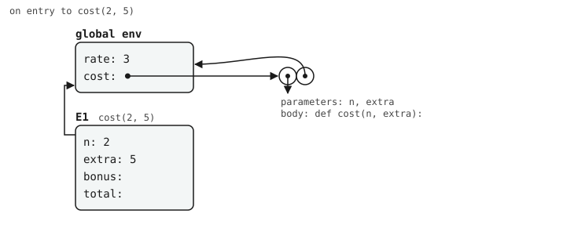
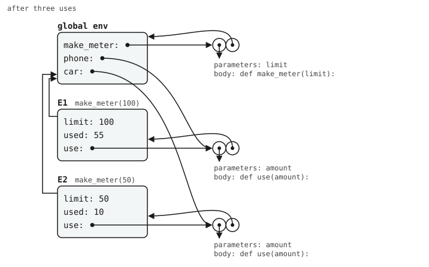
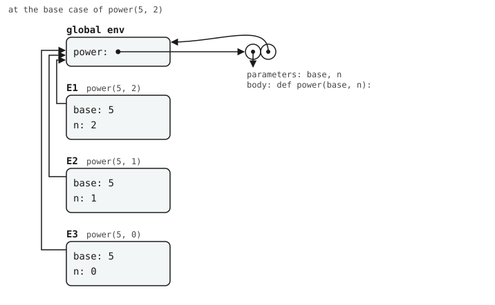

# The environment model

<p class="chapter-goal">The model for Python §3 and §4: five rules, a drawing recipe, three worked diagrams and the traps that cost marks.</p>

!!! abstract "The words"
    An **environment** is a sequence of **frames**. A frame is a box of **bindings** `name: value`, and points to its **enclosing environment**. The **global environment** has one frame for the program's top-level names; it encloses nothing but the **built-ins frame** (`print`, `pair`, `math_sqrt` …). Every expression is evaluated **in the current environment**.

## 1. The rules

1. **Name lookup.** Look in the first frame of the current environment. Not there: go to its enclosing environment, and so on outwards. Not found anywhere: error. A binding that exists but is **unassigned** is an error too; lookup does NOT go further out.
2. **`def` and `lambda` make a function object.** Draw it as **two circles**: the left one points to the parameters and body, the right one to the environment **in which it was created** (the current environment at that moment). `def f(x): ...` binds `f` to that object in the current frame, just like `f = lambda x: ...`.
3. **Function application.** Evaluate the function expression and the arguments in the current environment. Then:
    1. make a **new frame** whose enclosing environment is the **function object's environment** (not the caller's!);
    2. bind each parameter to its argument;
    3. bind each **local name** (assigned anywhere in the body, `def` included, and not declared `global`/`nonlocal`) as **unassigned**;
    4. evaluate the body in the new environment. The return value goes back to the caller.
4. **Assignment `x = e`.** Evaluate `e`, then change the binding of `x` in the frame where `x` belongs: the function's own frame if `x` is local, the closest enclosing function frame that has `x` if the body says `nonlocal x`, the global frame if it says `global x`. At top level, the first assignment adds the binding to the global frame.
5. **Frames stay alive.** Returning does not delete a frame. As long as some function object (or data) points to it, it is still there with its bindings, and later calls can read and change them.

Rule 1 and rule 3 together, in `--estep` (the narrated environment model):

```python title="§3 · --estep"
rate = 3

def cost(n):
    total = n * rate
    return total

print(cost(2))
```
```text title="Output"
Assigned rate = 3 in the global frame
Defined cost: function object fn#1, created in the global environment
Called cost(2): new frame E1, whose enclosing environment is the global environment (local name total: unassigned so far)
Looked up rate: not in frame E1, found in the global frame: 3
Assigned total = 6 in frame E1
Returned 6 from E1
    output: 6
```

## 2. How to draw a diagram, step by step

1. Draw the **built-ins frame** as a stub at the top (write "built-ins" and "…"), and under it the **global env** frame, with an arrow from global to built-ins.
2. Walk the program statement by statement. For each top-level assignment or `def`, write `name:` in the global frame. Primitive values (numbers, strings, booleans, `None`) go **inside** the frame: `rate: 3`.
3. For each function object, draw the two circles **outside** all frames. Left circle → "parameters: … / body: …". Right circle → the frame where the `def` or `lambda` was evaluated. Arrow from the binding to the circles.
4. Pairs and lists are also drawn **outside** frames, as box-and-pointer, with an arrow from the binding. That is how sharing becomes visible.
5. For each call: new frame labelled `E1`, `E2` … (in creation order), write the call next to it. Arrow from the new frame to the **function's** environment (follow the right circle).
6. In the new frame: `param: argument` for every parameter, then `local:` with nothing after it for every local name. A frame that would be empty (no parameters, no locals) is left out: the body runs in the function's environment.
7. When a binding changes, cross out the old value and write the new one next to it (`count: 0 1 2`).
8. When a call returns, keep its frame (rule 5). Write program output beside the diagram as `output: …`.

## 3. Worked example A: a call with local names

The picture is drawn **on entry** to the call: `total` and `bonus` are local (they are assigned in the body) but have no value yet.

```python title="§3 · figure environment-model-locals"
rate = 3

def cost(n, extra):
    show_env("on entry to cost(2, 5)")
    total = n * rate
    bonus = total + extra
    return bonus

print(cost(2, 5))
```
??? info "What `show_env` prints (the same diagram as text)"
    ```text title="Output"
    -- environment diagram: on entry to cost(2, 5) --
    global env
        rate: 3
        cost: fn#1
    E1: cost(2, 5)                enclosing environment: global env    <-- current environment
        n: 2
        extra: 5
        bonus: (unassigned)
        total: (unassigned)
    function objects
        fn#1   parameters: n, extra   body: line 3  def cost(n, extra):   environment: global env
    11
    ```



Read it: E1 points to global because `cost` was created in global. `rate` is not in E1, so lookup finds it in global (rule 1).

## 4. Worked example B: function objects with private state

Each call of `make_meter` creates a new frame holding `used`. The returned `use` points to that frame, so the frame survives the return (rule 5), and `nonlocal` lets `use` change it (rule 4).

```python title="§3 · figure environment-model-closures"
def make_meter(limit):
    used = 0
    def use(amount):
        nonlocal used
        used = used + amount
        return limit - used
    return use

phone = make_meter(100)
car = make_meter(50)
phone(30)
phone(25)
print(car(10))
show_env("after three uses")
```
??? info "What `show_env` prints (the same diagram as text)"
    ```text title="Output"
    40
    -- environment diagram: after three uses --
    global env    <-- current environment
        make_meter: fn#1
        phone: fn#2
        car: fn#3
    E1: make_meter(100)           enclosing environment: global env
        limit: 100
        used: 55
        use: fn#2
    E2: make_meter(50)            enclosing environment: global env
        limit: 50
        used: 10
        use: fn#3
    function objects
        fn#1   parameters: limit    body: line 1  def make_meter(limit):   environment: global env
        fn#2   parameters: amount   body: line 3  def use(amount):         environment: E1
        fn#3   parameters: amount   body: line 3  def use(amount):         environment: E2
    ```



Things to notice:

- **Two maker calls, two frames** (E1, E2), so two independent meters. In the exam you would write `used: 0 30 55` in E1, crossing out the old values.
- The three calls of `use` made frames too (E3, E4, E5, each with `amount`). sicpfuf leaves them out because nothing points to them any more; in the exam, draw them if the question asks for "all frames".
- Without `nonlocal used`, `used` would be local to `use`, and `used + amount` would read an unassigned name: UnassignedLocalError.

## 5. Worked example C: recursion

One frame **per call**, and every frame points to **global**, because `power` was created in global. The frames do NOT nest inside each other.

```python title="§3 · figure environment-model-recursion"
def power(base, n):
    if n == 0:
        show_env("at the base case of power(5, 2)")
        return 1
    else:
        return base * power(base, n - 1)

print(power(5, 2))
```
??? info "What `show_env` prints (the same diagram as text)"
    ```text title="Output"
    -- environment diagram: at the base case of power(5, 2) --
    global env
        power: fn#1
    E1: power(5, 2)               enclosing environment: global env    (waiting)
        base: 5
        n: 2
    E2: power(5, 1)               enclosing environment: global env    (waiting)
        base: 5
        n: 1
    E3: power(5, 0)               enclosing environment: global env    <-- current environment
        base: 5
        n: 0
    function objects
        fn#1   parameters: base, n   body: line 1  def power(base, n):   environment: global env
    25
    ```



## 6. `global` and `nonlocal` in one picture

```python title="§3 · --estep"
x = 0

def outer():
    x = 10
    def bump_mine():
        nonlocal x
        x = x + 1
    def bump_global():
        global x
        x = x + 100
    bump_mine()
    bump_global()
    return x

print(outer(), x)
```
```text title="Output"
Assigned x = 0 in the global frame
Defined outer: function object fn#1, created in the global environment
Called outer(): new frame E1, whose enclosing environment is the global environment (local names bump_global, bump_mine, x: unassigned so far)
Assigned x = 10 in frame E1
Defined bump_mine: function object fn#2, created in environment E1
Defined bump_global: function object fn#3, created in environment E1
Called bump_mine(): the new frame would have no bindings, so the body runs in environment E1
Assigned x = 11 in frame E1 (nonlocal)
Returned None from the call of bump_mine
Called bump_global(): the new frame would have no bindings, so the body runs in environment E1
Looked up x: not in frame E1, found in the global frame: 0
Assigned x = 100 in the global frame (global)
Returned None from the call of bump_global
Returned 11 from E1
    output: 11 100
```

`nonlocal x` changes `outer`'s `x` (10 → 11); `global x` skips `outer` and changes the global `x` (0 → 100).

## 7. The x-ray tools

`--estep` narrates every rule application; `show_env("label")` draws the diagram at that moment; `--env` draws it when the program ends; `:env` does it at the prompt.

## 8. How to answer this in the exam

1. Read the whole program first and list, for every function, its **local names** (assigned in the body, minus `global`/`nonlocal`).
2. Draw built-ins stub and global frame. Process top-level statements in order (section 2).
3. At every call: new frame, arrow to the function's **right circle environment**, parameters, unassigned locals. Number frames E1, E2 … in the order they are created, including frames of calls that have already returned.
4. Run the body line by line. For every name, apply rule 1 and say in which frame you found it.
5. Stop exactly at the point the question marks ("after line 12", "when `show` is called the second time"). Values reassigned before that point are crossed out.
6. For "what is printed / returned", answer from the diagram, not from intuition.

## 9. Traps

1. **Created, not called.** A function's frame encloses the environment where the function was **created**. Calling it from inside another function does not give it access to that function's names:

    ```python title="§3"
    x = "global x"

    def show_x():
        return x

    def caller():
        x = "caller's x"
        return show_x()

    print(caller())
    ```
    ```text title="Output"
    global x
    ```

2. **Recursion is not nesting.** `fact(3)` gives three frames side by side, all pointing to global.
3. **Assignment makes a name local to the whole body**, even before the assignment line. Reading it earlier is `UnassignedLocalError`, not the global value.
4. **Reassigning a parameter changes only the call's frame.** The caller's variable is untouched. Mutating a pair or list argument (`set_head`, `xs[0] = …`) IS seen by the caller: both bindings point to the same object.
5. **Forgetting `nonlocal`** in a state-changing inner function: the name becomes local, and the first read fails.
6. **One frame per call**, also for a lambda: `(lambda y: y + 1)(4)` makes a frame with `y: 4`. Only a frame with no bindings at all is left out of the picture.
7. **Don't put pairs or function objects inside frames.** Inside go only primitive values; everything else is an arrow.

*In the course: L8A, L9A · SICPy 3.1, 3.2.*
