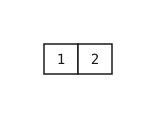
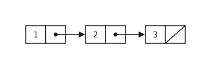
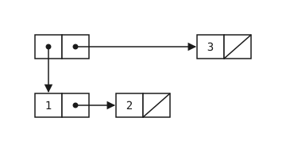
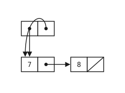

# Pairs, llists & box-and-pointer

<p class="chapter-goal">One page: build, draw, print and process linked lists without a single wrong bracket.</p>

## Definitions

- A **pair** glues two values: `pair(a, b)`, read back with `head(p)` and `tail(p)`. `is_pair(x)` tests for one.
- A **llist** is either `None` (the empty llist) or a pair whose tail is a llist.
- `llist(1, 2, 3)` is short for `pair(1, pair(2, pair(3, None)))`.
- A llist of numbers: every head is a number, the last tail is `None`. `pair(1, 2)` is a pair but NOT a llist.
- `head(None)` and `tail(5)` are errors: check `is_none(xs)` first.

## Three ways to show the same value

| Form | How you get it | `pair(llist(1, 2), pair(3, None))` |
|---|---|---|
| box notation | `print(x)` | `[[1, [2, None]], [3, None]]` |
| llist notation | `print_llist(x)` | `llist(llist(1, 2), 3)` |
| box-and-pointer | `draw_data(x)` | the picture below |

Rules for box-and-pointer diagrams:

1. One box with two halves per pair: head on the left, tail on the right. Count the `pair` calls (`llist(a, b, c)` makes 3) to know how many boxes to draw.
2. Small values (numbers, strings, booleans) are written inside the half.
3. A pair (or function) inside a half is an **arrow** to that box. A `None` tail is a diagonal slash.
4. A llist is drawn as a horizontal chain; a llist inside a head hangs below it.
5. If the same pair is used twice, draw ONE box with two arrows into it. Never copy a box.

```python title="§2 · figure llists-shapes"
draw_data(pair(1, 2))
draw_data(llist(1, 2, 3))
draw_data(pair(llist(1, 2), pair(3, None)))
```
```text title="Output"
[1|2]
[1|•]-->[2|•]-->[3|/]
[•|•]----------->[3|/]
 |
 v
 [1|•]-->[2|/]
```





Sharing: `a` appears twice in `b`, but there is only ONE box for it.

```python title="§2 · figure llists-shared"
a = llist(7, 8)
b = pair(a, a)
draw_data(b)
print_llist(b)
```
```text title="Output"
[•|•]-------------->#1
 |
 v
 #1=[7|•]-->[8|/]
llist(llist(7, 8), 7, 8)
```



`#1` marks the shared box in the text drawing. Since the tail of `b` is the llist `a`, `b` is itself a llist of three elements: `llist(7, 8)`, 7 and 8.

Llist notation writes `llist(...)` for every part that is a proper llist and keeps box notation for pairs that are not:

```python title="§2"
print_llist(pair(pair(1, 2), llist(3, 4)))
print_llist(pair(llist(1, 2), 3))
```
```text title="Output"
llist([1, 2], 3, 4)
[llist(1, 2), 3]
```

## Access paths

Read from the outside in: the last function written is applied first. To reach 3 in `llist(1, llist(2, 3), 4)`:

```python title="§2"
xs = llist(1, llist(2, 3), 4)
print(head(tail(head(tail(xs)))))
print(llist_ref(llist_ref(xs, 1), 1))
```
```text title="Output"
3
3
```

`tail(xs)` skips the 1; `head` of that is `llist(2, 3)`; `tail` skips the 2; `head` gives 3.

## The §2 library

Argument order: a function argument comes FIRST (`map`, `filter`, `reduce`, `build_llist`, `for_each`); a value to look for comes before the llist (`member`, `remove`, `remove_all`); `llist_ref` takes the llist first, the index second.

| Signature | Returns |
|---|---|
| `length(xs)` | number of elements (top level only) |
| `llist_ref(xs, n)` | element at position n, counting from 0 |
| `append(xs, ys)` | new llist: copies of xs's pairs, then `ys` itself (shared, not copied) |
| `reverse(xs)` | new llist, elements in reverse order |
| `map(f, xs)` | new llist of `f(x)` for each x, same order |
| `filter(pred, xs)` | new llist of the x with `pred(x)` `True`, same order |
| `reduce(f, init, xs)` | RIGHT fold: `f(x1, f(x2, f(x3, init)))` |
| `member(v, xs)` | the sub-llist starting at the first `v`, or `None` |
| `remove(v, xs)` | xs without the FIRST `v` |
| `remove_all(v, xs)` | xs without any `v` |
| `enum_llist(a, b)` | `llist(a, a + 1, ..., b)`, both ends included |
| `build_llist(f, n)` | `llist(f(0), f(1), ..., f(n - 1))` |
| `for_each(f, xs)` | applies f to each element for its effect, returns `True` |
| `is_llist(x)` | `True` if x is `None` or a pair whose tail is a llist |
| `print_llist(x)`, `llist_to_string(x)` | print in llist notation / box notation as a string |

`reduce` is a right fold, and `f` receives (current element, result for the rest):

```python title="§2"
xs = llist(1, 2, 3)
print(reduce(lambda x, rest: x - rest, 0, xs))
print(reduce(lambda x, rest: pair(x * 10, rest), None, xs))
print(member(2, xs), remove(2, llist(2, 5, 2)), remove_all(2, llist(2, 5, 2)))
print(build_llist(lambda i: i * i, 4), length(None))
```
```text title="Output"
2
[10, [20, [30, None]]]
[2, [3, None]] [5, [2, None]] [5, None]
[0, [1, [4, [9, None]]]] 0
```

`1 - (2 - (3 - 0))` is 2, not −6. The second line shows that `reduce` with `pair` and `None` rebuilds the llist in order (it is `map` in disguise).

## Recursion patterns over llists

Every function over a llist has the same skeleton: a base case for `None`, and a step that handles `head(xs)` and recurses on `tail(xs)`.

```python title="§2"
def sum_all(xs):                  # combine: deferred +
    return 0 if is_none(xs) else head(xs) + sum_all(tail(xs))

def evens(xs):                    # build: keep some heads
    if is_none(xs):
        return None
    elif head(xs) % 2 == 0:
        return pair(head(xs), evens(tail(xs)))
    else:
        return evens(tail(xs))

def last(xs):                     # walk: stop at the last pair
    return head(xs) if is_none(tail(xs)) else last(tail(xs))

def zip_sum(xs, ys):              # two llists at once
    return (None if is_none(xs) or is_none(ys)
            else pair(head(xs) + head(ys), zip_sum(tail(xs), tail(ys))))

nums = llist(3, 4, 6, 7)
print(sum_all(nums), last(nums))
print_llist(evens(nums))
print_llist(zip_sum(nums, llist(10, 20)))
print(reduce(lambda x, r: x + r, 0, filter(lambda x: x % 2 == 0, map(lambda x: x * x, nums))))
```
```text title="Output"
20 7
llist(4, 6)
llist(13, 24)
52
```

The last line is the map/filter/reduce one-liner style: square each, keep the even squares, add them up.

## Equality

- In §1/§2, `==` on pairs compares the structure: `llist(1, 2) == llist(1, 2)` is `True`.
- `==` on booleans or functions is an error in §1/§2; `is` does not exist before §3.
- From §3, `a is b` asks "the SAME pair?", while `==` still compares structure.

## How to answer this in the exam

1. **"Draw the box-and-pointer diagram"**: count the `pair` calls first, then draw left to right, slashes for `None`. Mark shared boxes once.
2. **"What does `print` show?"**: write box notation from the diagram: `[head, tail]` for each box.
3. **"Write `f` with map/filter/reduce"**: decide the pipeline first (which elements? what to each? how to combine?), then nest the calls inside out.
4. **"Order of growth"**: count the pairs you create and any hidden `append`/`length`/`llist_ref` (see [orders of growth](growth.md)).

## Top traps

- `reduce(f, init, xs)` with `f`'s arguments swapped, or treating it as a left fold.
- `pair(xs, x)` to "add at the end": it makes a pair whose head is a llist, not a longer llist. Use `append(xs, llist(x))`.
- `length(llist(llist(1, 2), 3))` is 2, not 3: only the top level counts.
- `append(xs, ys)` copies `xs` but SHARES `ys`.
- Missing `is_none` base case, so `head(None)` crashes.

*In the course: L4A, L5A · SICPy 2.1, 2.2.1, 2.2.3.*
