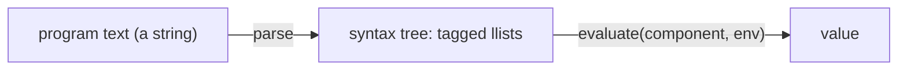

# The metacircular evaluator

<p class="chapter-goal">How the evaluator turns program text into values, the shapes it works on, and a template for adding a feature.</p>

## 1. The pipeline



1. `parse(text)` turns a string into a **syntax tree** made of **tagged llists**: `llist(tag, part, part, …)`.
2. `evaluate(component, env)` looks at the tag of ONE component and decides what to do. For a function application it calls `apply`.
3. `apply(fun, arguments)` runs a **built-in** function directly, or a **compound** function by calling `evaluate` on its body in a new environment. `evaluate` calls `apply` calls `evaluate`: the **evaluate–apply loop**.

The evaluator on this site is `examples/mce.py` (same function names as the textbook). Run your own program on it with `--with examples/mce.py` and `parse_and_evaluate("""…""")`.

## 2. The shapes `parse` produces

All shapes below were produced by `parse` in Python §4. Position 0 is the tag; names inside other components are full `llist("name", …)` components.

| Component | `parse` gives |
|---|---|
| `42`, `"hi"`, `None`, `True` | `llist("literal", value)` |
| `x` | `llist("name", "x")` |
| `x = e` | `llist("assignment", llist("name", "x"), e)` |
| `a + b` (also `-` `*` `/` `//` `%` `**` `==` `<` `is` …) | `llist("binary_operator_combination", "+", a, b)` |
| `-x`, `not b` | `llist("unary_operator_combination", "-unary", x)`, `… "not" …` |
| `a and b`, `a or b` | `llist("logical_composition", "and", a, b)` |
| `f(a, b)` | `llist("application", f, llist(a, b))` |
| `c if p else a` | `llist("conditional_expression", p, c, a)`: **predicate first** |
| `if p: … else: …` | `llist("conditional_statement", p, consequent, alternative)`; no `else` gives `llist("pass_statement")` |
| `lambda x, y: e` | `llist("lambda_expression", llist(x, y), e)` |
| `def f(x): body` | `llist("function_definition", llist("name", "f"), llist(x), body)` |
| `return e` | `llist("return_statement", e)` |
| two or more statements | `llist("sequence", llist(s1, s2, …))`; ONE statement is not wrapped |
| `while p: body` | `llist("while_loop", p, body)` |
| `for i in range(3): body` | `llist("for_loop", llist("name", "i"), llist("range_args", …), body)` |
| `pass`, `break` | `llist("pass_statement")`, `llist("break_statement")` |
| `global x`, `nonlocal x, y` | `llist("global_statement", llist(x))`, `llist("nonlocal_statement", llist(x, y))` |
| `[1, 2]`, `xs[0]` | `llist("list_expression", llist(…))`, `llist("list_access", xs, index)` |

When in doubt, ask `parse` itself:

```python title="§4"
print_llist(parse("total = price * 2 if big else price"))
print_llist(parse("show(n - 1)"))
```
```text title="Output"
llist('assignment', llist('name', 'total'), llist('conditional_expression', llist('name', 'big'), llist('binary_operator_combination', '*', llist('name', 'price'), llist('literal', 2)), llist('name', 'price')))
llist('application', llist('name', 'show'), llist(llist('binary_operator_combination', '-', llist('name', 'n'), llist('literal', 1))))
```

## 3. `evaluate` and `apply`

`evaluate(component, env)` is one big case analysis on the tag:

| Tag | What happens |
|---|---|
| literal | return the value |
| name | `lookup_symbol_value(symbol, env)` |
| application | `apply(evaluate(function expression), llist_of_values(arguments, env))` |
| operator combination | rewrite as an application of the built-in named `"+"`, `"-unary"` …, then evaluate that |
| conditional | evaluate the predicate; `is_truthy` accepts only `True`/`False`; evaluate ONE branch |
| lambda expression | `make_function(parameters, …, return statement of the body, env)`: remembers `env` |
| sequence | `eval_sequence`: statements in order; stop at the first **return value** |
| return statement | wrap the value: `llist("return_value", value)` |
| function definition | make the function object, assign it to the name |
| assignment | evaluate the right side, then `assign_symbol_value` |

`apply(fun, arguments)`:

1. **Built-in** `llist("built_in", implementation)`: `apply_in_underlying_python(implementation, arguments)`.
2. **Compound** `llist("compound_function", parameters, locals, globals, body, env)`: extend the function's `env` with a frame binding parameters to arguments, locals to `"*unassigned*"`, globals to `"*global*"`; evaluate the body there; unwrap a return value, or give `None` if there was none.

## 4. Environments as data

1. A **frame** is `pair(llist of symbols, llist of values)`.
2. An **environment** is a llist of frames, innermost first; `the_empty_environment` is `None`. `extend_environment(symbols, values, env)` puts a new frame in front.
3. **Lookup** scans the first frame, then `enclosing_environment(env)`, and so on; at `None`: error "unbound name".
4. **Assignment** changes the value in the first frame that has the symbol (with `set_head`); at the global frame, a new name gets a new binding.
5. Which names are local is decided **once, when the definition is evaluated** (`local_variables`), and marked in each new frame by `apply`.

## 5. Adding a feature: the template

1. **Shape.** Run `parse` on an example to see the tagged llist.
2. **Syntax functions.** A predicate `is_…` (with `is_tagged_llist`) and one selector per part (with `llist_ref`).
3. **A clause in `evaluate`**: `elif is_…(component): return eval_…(component, env)`.
4. **An `eval_…` function** that evaluates the parts it needs (in `env`) and combines them, using the host language.
5. **Test** with `parse_and_evaluate`.

Worked: the evaluator has no lists yet. Add list expressions `[a, b]` and list access `xs[i]`. (To avoid copying all of `evaluate`, the snippet wraps the old one; in the exam you write the two `elif` lines into `evaluate`.)

```python title="§4 · --with examples/mce.py"
def is_list_expression(component):
    return is_tagged_llist(component, "list_expression")
def list_element_expressions(component):
    return head(tail(component))

def is_list_access(component):
    return is_tagged_llist(component, "list_access")
def list_access_list(component):
    return llist_ref(component, 1)
def list_access_index(component):
    return llist_ref(component, 2)

def eval_list_expression(component, env):
    values = llist_of_values(list_element_expressions(component), env)
    result = [None] * length(values)
    for i in range(len(result)):
        result[i] = head(values)
        values = tail(values)
    return result

def eval_list_access(component, env):
    the_list = evaluate(list_access_list(component), env)
    index = evaluate(list_access_index(component), env)
    return the_list[index]

old_evaluate = evaluate
def evaluate(component, env):
    if is_list_expression(component):
        return eval_list_expression(component, env)
    elif is_list_access(component):
        return eval_list_access(component, env)
    else:
        return old_evaluate(component, env)

parse_and_evaluate("""
def middle(xs):
    return xs[1]
primes = [2, 3, 5]
print(primes)
print(middle(primes) * primes[-1])
""")
```
```text title="Output"
[2, 3, 5]
15
```

Note what `eval_list_access` does: it explains list access of the evaluated language **with list access of our own language**, the same way `eval_conditional` explains `if` with an `if`.

## 6. Lazy evaluation in a nutshell

**Strict** (applicative order): arguments are evaluated before the call. **Non-strict** (lazy): an argument is evaluated only when its value is needed. In the lazy evaluator, compound functions are non-strict in every argument; built-ins stay strict.

1. Application: get the function with `actual_value`; built-in → `actual_value` of every argument; compound → `delay_it(exp, env)` for every argument, a **thunk** `llist("thunk", exp, env)`.
2. `force_it(x)`: a thunk is evaluated in ITS environment; the memoizing version then overwrites it with `llist("evaluated_thunk", value)`, so it runs at most once.
3. `actual_value(exp, env)` is `force_it(evaluate(exp, env))`. It is used where a real value is needed: the function being applied, arguments of built-ins (so `+` and `print` force), the predicate of a conditional.

```python title="§4 · --with examples/mce.py"
def delay_it(exp, env):
    return llist("thunk", exp, env)
def is_thunk(x):
    return is_tagged_llist(x, "thunk")
def is_evaluated_thunk(x):
    return is_tagged_llist(x, "evaluated_thunk")

def force_it(x):
    if is_thunk(x):
        value = actual_value(llist_ref(x, 1), llist_ref(x, 2))
        set_head(x, "evaluated_thunk")          # memoize: remember the value
        set_head(tail(x), value)
        set_tail(tail(x), None)
        return value
    elif is_evaluated_thunk(x):
        return head(tail(x))
    else:
        return x

def actual_value(exp, env):
    return force_it(evaluate(exp, env))

def eval_conditional(component, env):           # the predicate must be forced
    if is_truthy(actual_value(conditional_predicate(component), env)):
        return evaluate(conditional_consequent(component), env)
    else:
        return evaluate(conditional_alternative(component), env)

strict_evaluate = evaluate
def evaluate(component, env):
    if is_application(component):
        fun = actual_value(function_expression(component), env)
        exps = arg_expressions(component)
        if is_built_in_function(fun):
            return apply(fun, map(lambda e: actual_value(e, env), exps))
        else:
            return apply(fun, map(lambda e: delay_it(e, env), exps))
    else:
        return strict_evaluate(component, env)

parse_and_evaluate("""
def first(a, b):
    return a
def loud(x):
    print("forced")
    return x
def twice(v):
    return v + v
print(first(7, head(None)))
print(twice(loud(5)))
""")
```
```text title="Output"
7
forced
10
```

`head(None)` is never evaluated. `loud(5)` is forced once although `v` is used twice (memoized thunk).

## 7. How to answer this in the exam

1. **"What does `parse` give?"**: tag first; predicate before consequent; names are `llist("name", …)`; one statement is not wrapped in a sequence.
2. **"Add a feature"**: the five steps of section 5. Say which existing function you change (`evaluate`, `apply`, a selector) and why.
3. **"Change a rule"** (truthiness, order of argument evaluation, scoping): find the ONE function that implements that rule (`is_truthy`, `llist_of_values`, `local_variables`/`apply`) and change only that.
4. **"Where is X decided?"**: locals at definition time, frames at call time, `return` by the return-value wrapper.

## 8. Traps

1. Operators are applications of built-ins, so **both** operands are evaluated: `and`/`or` cannot be done that way; they need their own clause that may skip the right side.
2. `return` is not a jump: it produces a wrapped value that `eval_sequence` passes upwards and only `apply` unwraps.
3. A lambda's body is an expression; the evaluator wraps it in a return statement.
4. Arguments are evaluated in the **caller's** env; the body in an extension of the **function's** env.

*In the course: L11B, L12A · SICPy 4.1.1–4.1.4, 4.2.*
