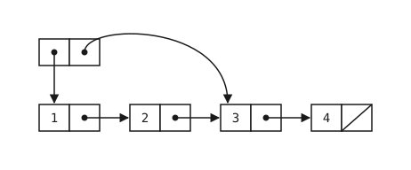

# Mutation, lists & loops

<p class="chapter-goal">Python §3 on one page: reassignment vs mutation, sharing, lists, loops, and the aliasing traps.</p>

## 1. Reassignment vs mutation

1. **Reassignment** `x = e` changes which value a **name** is bound to. Nothing else that pointed to the old value notices.
2. **Mutation** changes an existing **object**: `set_head(p, v)`, `set_tail(p, v)`, `xs[i] = v`. Every name that points to that object (every **alias**) sees the change. `set_head`/`set_tail` return `None`.
3. `pair(...)`, `llist(...)`, `[...]`, `[v] * n`, every `lambda` and `def` make a **new** object. `q = p` does not: it makes an alias.

```python title="§3"
p = llist(1, 2, 3)
q = p                 # alias: same pairs
r = tail(p)           # alias of the second pair
set_head(r, 20)       # mutation: seen through p, q and r
p = llist(9)          # reassignment: only p changes
print(q)
print(p)
```
```text title="Output"
[1, [20, [3, None]]]
[9, None]
```

## 2. Identity: `is` vs `==`

- `a == b`: same **structure** and values, compared all the way down.
- `a is b`: the **same object**. Two separate `llist(1, 2)` calls are `==` but not `is`.

For numbers, strings, booleans and `None`, `is` behaves like `==`. A pair **is** a list of length two: `pair(1, 2) == [1, 2]` is `True`.

```python title="§3"
a = [1, 2]
b = a
c = [1, 2]
print(a == c, a is c, a is b, pair(1, 2) == [1, 2])
```
```text title="Output"
True False True True
```

## 3. Sharing: before/after pictures

`append(xs, ys)` copies the pairs of `xs` but **reuses** `ys` itself. Draw the result and `ys` together to see it (`#1` marks the shared pair):

```python title="§3 · figure mutation-lists-loops-sharing"
xs = llist(1, 2)
ys = llist(3, 4)
zs = append(xs, ys)
draw_data(pair(zs, ys))
set_head(ys, 30)
set_head(xs, 10)
print(zs)
```
```text title="Output"
[•|•]------------------------------>#1
 |
 v
 [1|•]-->[2|•]-->#1=[3|•]-->[4|/]
[1, [2, [30, [4, None]]]]
```



The change to `ys` shows up in `zs` (shared); the change to `xs` does not (copied).

**Recipe for "draw before and after":** draw the boxes once, then for each `set_head`/`set_tail` cross out ONE arrow (or value) and draw the new one. Names are arrows into the picture; reassigning a name moves only that arrow.

## 4. Destructive vs non-destructive

`d_append` makes **no new pairs**: it walks to the last pair of `xs` and points its tail at `ys`. Cheaper in space, but `xs` itself is changed. A cycle appears if you set a tail back to an earlier pair.

```python title="§3"
def d_append(xs, ys):
    if is_none(xs):
        return ys
    else:
        last = xs
        while not is_none(tail(last)):
            last = tail(last)
        set_tail(last, ys)
        return xs

xs = llist(1, 2)
zs = d_append(xs, llist(3))
print(xs, zs is xs)

ring = llist("a", "b", "c")
set_tail(tail(tail(ring)), ring)    # a cycle
print(llist_ref(ring, 4))           # goes round: a b c a b
draw_data(ring)
```
```text title="Output"
[1, [2, [3, None]]] True
b
#1=['a'|•]-->['b'|•]-->['c'|•]-->#1
```

`length(ring)` would never return. Unless the question says so, your functions must **not** mutate their arguments.

## 5. Lists

1. `xs = [4, 5, 6]`; `xs[0]` is 4, `xs[-1]` is 6; valid indices are `-len(xs)` … `len(xs) - 1`. Reading or writing elsewhere: IndexError.
2. `xs[i] = v` mutates in place. Lists never grow or shrink: no `append` method, no `+` on lists, no slices.
3. `[0] * n` makes a new list of n slots in Θ(n). Indexing and `len` are Θ(1); reaching element i of a **llist** is Θ(i).
4. 2-D: `table[r][c]`. Make a **fresh row** in each iteration. `[[0] * 3] * 2` puts the SAME row in both slots.

```python title="§3"
def make_table(rows, cols):
    table = [None] * rows
    for r in range(rows):
        table[r] = [0] * cols       # a new row each time
    return table

good = make_table(2, 3)
bad = [[0] * 3] * 2                 # one row, two arrows to it
good[0][1] = 7
bad[0][1] = 7
print(good)
print(bad, bad[0] is bad[1])
```
```text title="Output"
[[0, 7, 0], [0, 0, 0]]
[[0, 7, 0], [0, 7, 0]] True
```

## 6. Loops

1. `while p:` tests `p` (must be `True`/`False`) **before** each iteration; the body must make progress.
2. `for i in range(a, b, step):` visits a, a+step, … stopping **before** b. `range(n)` is 0 … n−1. `range(n - 1, -1, -1)` counts down to 0. `for` works ONLY over `range`: to visit a list, loop over its indices; to walk a llist, use `while`.
3. `break` leaves the innermost loop; `continue` skips to the next iteration (careful: in a `while`, it can skip the progress step).

The patterns you will write in the exam:

```python title="§3"
def reverse_in_place(xs):             # two indices walking inward
    low = 0
    high = len(xs) - 1
    while low < high:
        temp = xs[low]                # swap needs a temporary
        xs[low] = xs[high]
        xs[high] = temp
        low = low + 1
        high = high - 1

def first_negative(xs):               # stop early with break
    found = None
    for i in range(len(xs)):
        if xs[i] < 0:
            found = i
            break
    return found

def sum_odd(xs):                      # accumulator; skip with continue
    total = 0
    for i in range(len(xs)):
        if xs[i] % 2 == 0:
            continue
        total = total + xs[i]
    return total

nums = [3, 8, -2, 5, -7]
print(first_negative(nums), sum_odd(nums))
reverse_in_place(nums)
print(nums)
```
```text title="Output"
2 1
[-7, 5, -2, 8, 3]
```

A list **filter** needs two passes (count the matches, then allocate `[None] * count` and fill it), because a list cannot grow.

## 7. The loop-variable trap

A `lambda` made inside a loop remembers the **environment**, not the current value. All of them see the loop variable's **last** value. Fix: create each function inside a call, which gives each one its own frame.

```python title="§3"
fs = [None] * 3
for i in range(3):
    fs[i] = lambda: i * 10
print(fs[0](), fs[1](), fs[2]())

def make_const(k):
    return lambda: k * 10

gs = [None] * 3
for i in range(3):
    gs[i] = make_const(i)            # new frame with its own k
print(gs[0](), gs[1](), gs[2]())
```
```text title="Output"
20 20 20
0 10 20
```

## 8. Orders of growth

| Operation | Time | Extra space |
|---|---|---|
| `xs[i]`, `xs[i] = v`, `len(xs)` | Θ(1) | Θ(1) |
| `[0] * n`, `make_table(r, c)` | Θ(n), Θ(r·c) | same |
| one loop over a list (sum, max, map in place) | Θ(n) | Θ(1) |
| reverse in place | Θ(n) | Θ(1) |
| `llist_ref(xs, i)`, `length(xs)` | Θ(i), Θ(n) | Θ(1) |
| `append(xs, ys)` | Θ(length of xs) | Θ(length of xs) new pairs |
| `d_append(xs, ys)` | Θ(length of xs) | Θ(1): no new pairs |

## 9. How to answer this in the exam

1. **"What is printed?"** Draw every object once, names as arrows. Apply each statement: reassignment moves a name's arrow; mutation changes a box. Then read the answer off the picture.
2. **"Write a destructive function"**: use only `set_head`/`set_tail`, never `pair`; keep a pointer to the pair *before* the one you remove; return the (possibly new) first pair.
3. **"Write it with a loop"**: decide the loop variable, the accumulator, the invariant ("after k iterations, `total` is the sum of the first k elements"), and the stopping test. State the order of growth in time **and** extra space.

## 10. Traps

1. `[[0] * c] * r`: all rows are one row. `q = p` copies nothing. `append` shares its second argument.
2. `swap(a, b)` that reassigns its parameters changes nothing for the caller; swap **list elements** `swap(xs, i, j)` instead.
3. A mutating function returns `None`: `ys = reverse_in_place(xs)` makes `ys` `None`.
4. Lambdas made in a loop all see the last value of the loop variable.
5. `for x in xs:` is not allowed. Loop over `range(len(xs))`.

*In the course: L8A, L9A, L9B · SICPy 3.3.1.*
