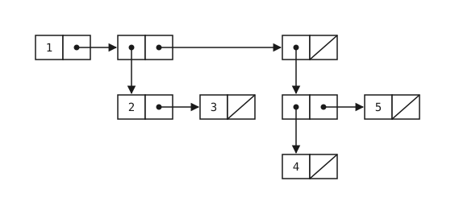

# Trees & CPS

<p class="chapter-goal">One page: recurse over nested llists with one template, and turn any recursion into continuation-passing style.</p>

## Trees are llists of llists

- A **tree** (of numbers, say) is a llist whose elements are numbers or trees.
- The numbers are the **data items** (leaves). A llist inside the tree is a **subtree**.
- `None` inside a tree is an empty subtree, not a data item. So a tree of `None`s or of pairs makes no sense.
- `length(t)` counts only the top level. Counting every leaf needs tree recursion.

```python title="§2 · figure trees-cps-tree"
t = llist(1, llist(2, 3), llist(llist(4), 5))
draw_data(t)
print(length(t))
```
```text title="Output"
[1|•]-->[•|•]----------->[•|/]
         |                |
         v                v
         [2|•]-->[3|/]    [•|•]--->[5|/]
                           |
                           v
                           [4|/]
3
```



## The tree-recursion template

Look at a node `x`. There are exactly three cases, and the ORDER of the tests matters:

1. `is_none(x)`: an empty tree. Return the "nothing" answer (0, `None`, the initial value).
2. `not is_pair(x)`: a data item. Return the answer for one leaf.
3. Otherwise `x` is a pair: recurse on `head(x)` (a subtree or a leaf) AND on `tail(x)` (the rest of the tree), then combine.

Test 1 must come before test 2: `None` is also "not a pair", so the other order counts `None` as a leaf.

```python title="§2"
def count_leaves(x):
    return (0 if is_none(x)
            else 1 if not is_pair(x)
            else count_leaves(head(x)) + count_leaves(tail(x)))

def tree_sum(x):
    return (0 if is_none(x)
            else x if not is_pair(x)
            else tree_sum(head(x)) + tree_sum(tail(x)))

def flatten(x):
    return (None if is_none(x)
            else llist(x) if not is_pair(x)
            else append(flatten(head(x)), flatten(tail(x))))

def accumulate_tree(leaf_op, op, initial, x):
    return (initial if is_none(x)
            else leaf_op(x) if not is_pair(x)
            else op(accumulate_tree(leaf_op, op, initial, head(x)),
                    accumulate_tree(leaf_op, op, initial, tail(x))))

t = llist(1, llist(2, 3), llist(llist(4), 5))
print(count_leaves(t), tree_sum(t))
print_llist(flatten(t))
print(accumulate_tree(lambda v: v * v, lambda a, b: a + b, 0, t))
```
```text title="Output"
5 15
llist(1, 2, 3, 4, 5)
55
```

`accumulate_tree` is the pattern behind the other three: pick what a leaf gives and how two answers combine.

## Mapping over a tree

`map` over the top level, and recurse into any element that is itself a subtree. The result has the same shape.

```python title="§2"
def map_tree(f, tree):
    return map(lambda sub: map_tree(f, sub) if is_pair(sub) else f(sub), tree)

t = llist(1, llist(2, 3), llist(llist(4), 5))
print_llist(map_tree(lambda v: v * 10, t))
```
```text title="Output"
llist(10, llist(20, 30), llist(llist(40), 50))
```

Costs: each of these visits every pair once, so time is Θ(n) for n pairs in the tree (except `flatten`, whose `append`s can cost more on deep trees). Space is Θ(depth) deferred operations plus any new pairs built.

## CPS: continuation-passing style

A **continuation** is a function that says "what to do with the result". In CPS, a function gets one extra parameter `c` and, instead of returning its answer, hands it to `c`.

Recipe to convert a recursive function:

1. Add a parameter `c`.
2. Base case: `return base` becomes `return c(base)`.
3. Recursive case `return combine(x, f(smaller))` becomes `return f_cps(smaller, lambda r: c(combine(x, r)))`. The deferred operation moves INTO the new continuation.
4. Start it with the identity: `f_cps(n, lambda x: x)`.

```python title="§2"
def fact(n):
    return 1 if n == 0 else n * fact(n - 1)

def fact_cps(n, c):
    return c(1) if n == 0 else fact_cps(n - 1, lambda r: c(n * r))

print(fact(5), fact_cps(5, lambda x: x))
```
```text title="Output"
120 120
```

The substitution model shows where the deferred work went: it is not piling up outside the call any more, it is piling up inside the continuation.

```python title="§2 · --subst"
def fact_cps(n, c):
    return c(1) if n == 0 else fact_cps(n - 1, lambda r: c(n * r))

fact_cps(2, lambda x: x)
```
```text title="Output"
fact_cps(2, lambda x: x)
-> (lambda x: x)(1) if 2 == 0 else fact_cps(2 - 1, lambda r: (lambda x: x)(2 * r))
-> (lambda x: x)(1) if False else fact_cps(2 - 1, lambda r: (lambda x: x)(2 * r))
-> fact_cps(2 - 1, lambda r: (lambda x: x)(2 * r))
-> fact_cps(1, lambda r: (lambda x: x)(2 * r))
-> (lambda r: (lambda x: x)(2 * r))(1) if 1 == 0 else fact_cps(1 - 1, lambda r: (lambda r: (lambda x: x)(2 * r))(1 * r))
-> (lambda r: (lambda x: x)(2 * r))(1) if False else fact_cps(1 - 1, lambda r: (lambda r: (lambda x: x)(2 * r))(1 * r))
-> fact_cps(1 - 1, lambda r: (lambda r: (lambda x: x)(2 * r))(1 * r))
-> fact_cps(0, lambda r: (lambda r: (lambda x: x)(2 * r))(1 * r))
-> (lambda r: (lambda r: (lambda x: x)(2 * r))(1 * r))(1) if 0 == 0 else fact_cps(0 - 1, lambda r: (lambda r: (lambda r: (lambda x: x)(2 * r))(1 * r))(0 * r))
-> (lambda r: (lambda r: (lambda x: x)(2 * r))(1 * r))(1) if True else fact_cps(0 - 1, lambda r: (lambda r: (lambda r: (lambda x: x)(2 * r))(1 * r))(0 * r))
-> (lambda r: (lambda r: (lambda x: x)(2 * r))(1 * r))(1)
-> (lambda r: (lambda x: x)(2 * r))(1 * 1)
-> (lambda r: (lambda x: x)(2 * r))(1)
-> (lambda x: x)(2 * 1)
-> (lambda x: x)(2)
-> 2
```

## Iterative, but not constant space

- Every recursive call `fact_cps(n - 1, ...)` is the whole return expression: **no deferred operations**, so the process is **iterative**. It survives n = 2000, where the plain version would hit the limit of 1024 waiting calls.
- But each step makes a NEW function value that remembers the previous continuation. After n steps there is a chain of n continuations: **Θ(n) space**. "CPS guarantees an iterative process, not constant space."

```python title="§2"
def fact(n):
    return 1 if n == 0 else n * fact(n - 1)

def fact_cps(n, c):
    return c(1) if n == 0 else fact_cps(n - 1, lambda r: c(n * r))

measure(fact, 500)
measure(fact_cps, 500, lambda x: x)
```
```text title="Output"
[measure] fact(500): 501 calls, 6,006 steps, at most 501 waiting at once
[measure] fact_cps(500, <function (anonym...): 1,002 calls, 8,009 steps, at most 1 waiting at once
```

`measure` counts waiting calls only. The 500 continuations are the hidden Θ(n) space.

## In which order do the continuations run?

The LAST continuation made runs FIRST: the one for the end of the llist (or the smallest n) gets the base value, then passes its result outward. The work is done right to left, like the plain recursive version.

```python title="§2"
def loud_add(x, r):
    print("adding", x)
    return x + r

def sum_cps(xs, c):
    return c(0) if is_none(xs) else sum_cps(tail(xs), lambda r: c(loud_add(head(xs), r)))

print(sum_cps(llist(1, 2, 3), lambda x: x))
```
```text title="Output"
adding 3
adding 2
adding 1
6
```

## How to answer this in the exam

1. **"Write a tree function"**: copy the three-case template, then fill in the three answers (empty, leaf, combine).
2. **"Convert to CPS"**: follow the 4-step recipe; check that no operation is left outside the recursive call.
3. **"Iterative or recursive process? Space?"**: CPS gives an iterative process (no deferred operations) but Θ(n) space for the chain of continuations.
4. **"In what order ..."**: continuations run from the last one created back to the first one.

## Top traps

- Testing `not is_pair(x)` before `is_none(x)`: every `None` is counted as a leaf.
- Using `length` when the question wants all data items.
- Forgetting to apply `c` in the base case (returning `1` instead of `c(1)`).
- Starting a CPS function with something other than the identity continuation when you want the plain answer.
- Claiming CPS uses Θ(1) space.

*In the course: L5B, L7B · SICPy 2.2.2.*
