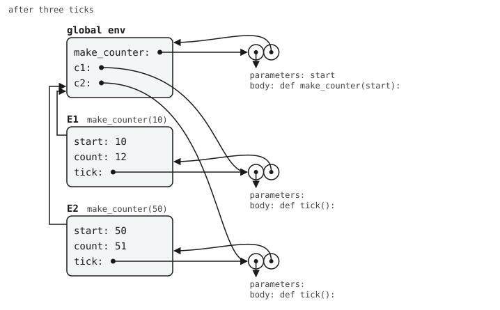

# sicpfuf: SICP in Python, with x-ray vision

**sicpfuf** is an unofficial study companion for a first course on *Structure and Interpretation of Computer Programs* taught in Python (the textbook is called **SICPy**, and the language comes in four sizes: **Python §1, §2, §3 and §4**). It is three things:

1. **A finals kit**: a topic checklist, one-page summary sheets, and three original mock papers with fully worked, machine-checked solutions.
2. **An easy textbook and drills** that follow the course in order, from "what is a name" to the metacircular evaluator.
3. **A tiny interpreter for Python §1–§4**, written in readable Python, that *shows you* the two mental models the course is built on.

[Open the visual stepper →](playground.md){ .md-button .md-button--primary }

```python title="§1 · --subst"
def factorial(n):
    return 1 if n == 1 else n * factorial(n - 1)

factorial(3)
```
```text title="Output"
factorial(3)
-> 1 if 3 == 1 else 3 * factorial(3 - 1)
-> 1 if False else 3 * factorial(3 - 1)
-> 3 * factorial(3 - 1)
-> 3 * factorial(2)
-> 3 * (1 if 2 == 1 else 2 * factorial(2 - 1))
-> 3 * (1 if False else 2 * factorial(2 - 1))
-> 3 * (2 * factorial(2 - 1))
-> 3 * (2 * factorial(1))
-> 3 * (2 * (1 if 1 == 1 else 1 * factorial(1 - 1)))
-> 3 * (2 * (1 if True else 1 * factorial(1 - 1)))
-> 3 * (2 * 1)
-> 3 * 2
-> 6
```

That is the **substitution model**, printed step by step. From Python §3 on, sicpfuf draws the **environment model** instead:

```python title="§3 · figure home"
def make_counter(start):
    count = start
    def tick():
        nonlocal count
        count = count + 1
        return count
    return tick

c1 = make_counter(10)
c2 = make_counter(50)
c1()
c1()
c2()
show_env("after three ticks")
```
```text title="Output"
-- environment diagram: after three ticks --
global env    <-- current environment
    make_counter: fn#1
    c1: fn#2
    c2: fn#3
E1: make_counter(10)          enclosing environment: global env
    start: 10
    count: 12
    tick: fn#2
E2: make_counter(50)          enclosing environment: global env
    start: 50
    count: 51
    tick: fn#3
function objects
    fn#1   parameters: start    body: line 1  def make_counter(start):   environment: global env
    fn#2   parameters: (none)   body: line 3  def tick():                environment: E1
    fn#3   parameters: (none)   body: line 3  def tick():                environment: E2
```



## Finals in a few days? Start here

<div class="grid cards" markdown>

- :material-clipboard-check: **[Finals kit](finals/index.md)**

    What to revise, in which order, and how to use the next few days.

- :material-format-list-checks: **[Topic checklist](finals/checklist.md)**

    Every examinable skill, lecture by lecture. Tick them off.

- :material-file-document-multiple: **[One-page sheets](finals/sheets/index.md)**

    The models, the idioms and the traps, each on one page.

- :material-timer-sand: **[Mock papers](finals/exam-mode.md)**

    Three original two-hour papers with a clock. Solutions are hidden until you stop it.

</div>

## Everything else

<div class="grid cards" markdown>

- :material-book-open-page-variant: **[The Book](book/index.md)**

    The whole course in plain words. Every program on this site is run automatically, so the output you see is real.

- :material-dumbbell: **[Drills](practice/index.md)**

    Original problems for every topic, with answers hidden until you click.

- :material-magnify-scan: **[The x-ray tools](reference/xray.md)**

    Substitution stepper, environment stepper, environment diagrams, box-and-pointer diagrams, call trees.

- :material-code-braces: **[Language reference](reference/language.md)**

    What Python §1, §2, §3 and §4 allow, every library function, and every error message explained.

</div>

## Start in 30 seconds

You only need `python3` (3.9 or newer). There is nothing to install.

```sh
git clone https://github.com/Jay-Jay-Tee/sicpfuf.git
cd sicpfuf
python3 -m sicpfuf -v 2                         # an interactive prompt for Python §2
python3 -m sicpfuf examples/mce.py              # run a program
python3 -m sicpfuf my_program.py -v 1 --subst   # watch the substitution model
python3 -m sicpfuf my_program.py -v 3 --estep   # watch the environment model
```

More in **[Getting started](start.md)**.

!!! note "What sicpfuf is not"
    sicpfuf is a student-made companion. It is **not** affiliated with or endorsed by the authors of SICPy, Source Academy or any university, and it is not a substitute for the course's own lectures, textbook and tools. All explanations, problems and mock papers here are original. sicpfuf's interpreter is tested against the reference implementation of Python §1–§4 on hundreds of programs, but if the two ever disagree, the reference implementation is right.
