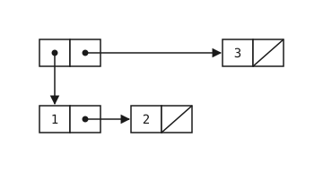
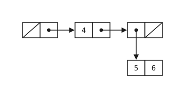
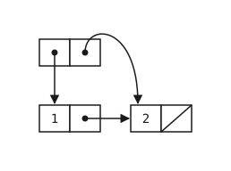

# Drills: Pairs, llists & box-and-pointer

<p class="chapter-goal">Ten problems on drawing box-and-pointer diagrams, moving between box notation and llist notation, head/tail access paths, and writing constructors and selectors.</p>

Three ways to show the same structure:

- **box notation**, what `print` shows: `pair(1, 2)` is `[1, 2]`, `llist(1, 2)` is `[1, [2, None]]`;
- **llist notation**, what `print_llist` shows: every part that is a proper llist is written `llist(...)`;
- the **box-and-pointer diagram**: each pair is a box with two halves; a slash in a half means `None`.

The answers draw the diagrams with `draw_data`. On paper, draw one box per call of `pair` (an `llist` of n elements is n pairs). All programs run as Python §2.

## 1. Read the box notation ★

**Skill:** predict what `print` shows; tell a llist from a pair that is not a llist.

```python title="§2"
print(pair(1, pair(2, 3)))
print(llist(1, 2, 3))
print(pair(llist(1), 2))
print(is_llist(pair(1, pair(2, 3))), is_llist(llist(1, 2, 3)), is_llist(None))
```

??? success "Answer"
    ```text
    [1, [2, 3]]
    [1, [2, [3, None]]]
    [[1, None], 2]
    False True True
    ```

    A llist is `None` or a pair whose tail is a llist. `pair(1, pair(2, 3))` ends in `3`, not `None`, so it is not a llist. `None` is the empty llist. In box notation, `[x, y]` is always one pair: count the opening brackets to count the pairs.

## 2. Read the llist notation ★

**Skill:** predict what `print_llist` shows, including parts that are not llists.

```python title="§2"
print_llist(llist(5, llist(6), 7))
print_llist(pair(llist(1, 2), pair(3, None)))
print_llist(pair(1, pair(llist(2), 3)))
print_llist(llist(1, None, 2))
```

??? success "Answer"
    ```text
    llist(5, llist(6), 7)
    llist(llist(1, 2), 3)
    [1, [llist(2), 3]]
    llist(1, llist(), 2)
    ```

    `pair(3, None)` is `llist(3)`, so the second structure is a two-element llist whose first element is a llist. The third one ends in `3`, so it is not a llist: it stays in brackets, but its proper part `llist(2)` is still written in llist notation. An element that is `None` is an empty llist, shown as `llist()`.

## 3. From box notation to a program ★

**Skill:** read box notation and write the shortest expression that builds it.

Write an expression, using `llist` where you can, that prints as `[[1, None], [[2, [3, None]], None]]`.

??? success "Answer"
    ```python title="§2"
    print(llist(llist(1), llist(2, 3)))
    ```
    ```text
    [[1, None], [[2, [3, None]], None]]
    ```

    The outer structure is `[A, [B, None]]`, a llist of two elements A and B. A is `[1, None]`, that is `llist(1)`. B is `[2, [3, None]]`, that is `llist(2, 3)`. Work from the outside in: find where the top-level pair splits into head and tail.

## 4. Draw it: a llist in the head ★★

**Skill:** draw a box-and-pointer diagram for a pair whose head is a llist.

Draw `pair(llist(1, 2), pair(3, None))`. How many pairs are there?

??? success "Answer"
    Four pairs.

    ```python title="§2 · figure practice-05-head-llist"
    draw_data(pair(llist(1, 2), pair(3, None)))
    ```
    ```text title="Output"
    [•|•]----------->[3|/]
     |
     v
     [1|•]-->[2|/]
    ```

    

    Start with the outer pair. Its head is a pointer down to the two pairs of `llist(1, 2)`; its tail is a pointer right to the pair `[3|/]`. The whole thing is also `llist(llist(1, 2), 3)`.

## 5. Draw it: an empty llist as an element ★★

**Skill:** where `None` goes in a diagram when it is an element, not the end.

Draw `llist(llist(), 4, pair(5, 6))`.

??? success "Answer"
    ```python title="§2 · figure practice-05-empty-element"
    draw_data(llist(llist(), 4, pair(5, 6)))
    print(llist(llist(), 4, pair(5, 6)))
    ```
    ```text title="Output"
    [/|•]-->[4|•]-->[•|/]
                     |
                     v
                     [5|6]
    [None, [4, [[5, 6], None]]]
    ```

    

    `llist()` is `None`, so the **head** half of the first box gets a slash: the first element is the empty llist. The last box has a slash in its **tail** half: that is the end of the llist. Both slashes mean `None`, but they play different roles: the slash in the head is an element (data), the slash in the tail is the end marker. `pair(5, 6)` is one box with both values inside.

## 6. Draw it: sharing ★★

**Skill:** a name is a pointer, not a copy.

How many pairs exist after this program? Draw `b`.

```python
a = llist(1, 2)
b = pair(a, tail(a))
```

??? success "Answer"
    Three: two made by `llist(1, 2)`, one made by `pair`. `tail(a)` makes nothing new; it is a pointer to the second pair of `a`.

    ```python title="§2 · figure practice-05-sharing"
    a = llist(1, 2)
    b = pair(a, tail(a))
    draw_data(b)
    print(b)
    ```
    ```text title="Output"
    [•|•]-------------->#1
     |
     v
     [1|•]-->#1=[2|/]
    [[1, [2, None]], [2, None]]
    ```

    

    Box notation would print `[[1, [2, None]], [2, None]]`, which shows the pair `[2, None]` twice and hides the sharing; the diagram shows that both arrows end at the same box. Only `pair` (and functions that call it, such as `llist`) makes new pairs.

## 7. Access paths ★★

**Skill:** write the `head`/`tail` chain that reaches one element.

With `x = llist(llist(7, 8), 9, pair(10, llist(11)))`, write expressions that give 8, 10 and 11.

??? success "Answer"
    ```python title="§2"
    x = llist(llist(7, 8), 9, pair(10, llist(11)))
    print(head(tail(head(x))))
    print(head(head(tail(tail(x)))))
    print(head(tail(head(tail(tail(x))))))
    ```
    ```text
    8
    10
    11
    ```

    Read the chain from the inside out. `head(x)` is `llist(7, 8)`; its tail's head is 8. `tail(tail(x))` is the llist holding the third element only, so `head` of it is `pair(10, llist(11))`. Its `head` is 10; its `tail` is `llist(11)`, whose `head` is 11. Each `tail` moves right along a row of boxes, each `head` goes down an arrow.

## 8. Count the pairs ★★

**Skill:** count pairs in a nested structure (needed for space questions later).

How many pairs does `llist(llist(1, 2), llist(3), 4)` contain? Write `count_pairs(x)` that counts the pairs in any structure without sharing.

??? success "Answer"
    Six: three for the outer llist, two for `llist(1, 2)`, one for `llist(3)`.

    ```python title="§2"
    def count_pairs(x):
        return 1 + count_pairs(head(x)) + count_pairs(tail(x)) if is_pair(x) else 0

    print(count_pairs(llist(llist(1, 2), llist(3), 4)))
    print(count_pairs(pair(1, 2)), count_pairs(None), count_pairs(5))
    ```
    ```text
    6
    1 0 0
    ```

    Every pair counts 1, plus whatever its two halves contain. A number or `None` contains no pairs. With sharing (problem 6) this would count a shared pair twice, which is exactly the mistake the course warns about when you count pairs from box notation.

## 9. Find the bug ★★

**Skill:** read a §2 error message and find the missing base case.

```python title="§2"
def total(xs):
    return head(xs) + total(tail(xs))

print(total(llist(3, 4)))
```

??? success "Answer"
    ```text
    TypeError: head(xs) expects a pair as argument xs, but encountered None
    ```

    After 3 and 4, `xs` is `None`, the empty llist, and `head(None)` is an error. Every function on llists needs a case for `None`:

    ```python title="§2"
    def total(xs):
        return 0 if is_none(xs) else head(xs) + total(tail(xs))

    print(total(llist(3, 4)), total(None))
    ```
    ```text
    7 0
    ```

## 10. Write an ADT, then change it ★★★

**Skill:** constructor, selectors and operations; the abstraction barrier.

Write a data abstraction for a time of day: `make_time(h, m)`, selectors `hours(t)` and `minutes(t)`, and, **using only these**, `add_minutes(t, k)` (wraps past midnight) and `time_to_string(t)`. Represent a time as a pair. Then change the representation to a single number of minutes since midnight, without touching `add_minutes` or `time_to_string`.

??? success "Answer"
    ```python title="§2"
    # representation 1: a pair (hours, minutes)
    def make_time(h, m):
        return pair(h, m)

    def hours(t):
        return head(t)

    def minutes(t):
        return tail(t)

    # above the barrier: uses only make_time, hours, minutes
    def add_minutes(t, k):
        total = (hours(t) * 60 + minutes(t) + k) % (24 * 60)
        return make_time(total // 60, total % 60)

    def time_to_string(t):
        m = minutes(t)
        return str(hours(t)) + ":" + ("0" if m < 10 else "") + str(m)

    print(time_to_string(add_minutes(make_time(9, 50), 15)))
    print(time_to_string(add_minutes(make_time(23, 30), 45)))
    print(make_time(9, 5))
    ```
    ```text
    10:05
    0:15
    [9, 5]
    ```

    Now only the three functions below the barrier change:

    ```python title="§2"
    # representation 2: minutes since midnight
    def make_time(h, m):
        return h * 60 + m

    def hours(t):
        return t // 60

    def minutes(t):
        return t % 60

    # exactly the same as before
    def add_minutes(t, k):
        total = (hours(t) * 60 + minutes(t) + k) % (24 * 60)
        return make_time(total // 60, total % 60)

    def time_to_string(t):
        m = minutes(t)
        return str(hours(t)) + ":" + ("0" if m < 10 else "") + str(m)

    print(time_to_string(add_minutes(make_time(9, 50), 15)))
    print(time_to_string(add_minutes(make_time(23, 30), 45)))
    print(make_time(9, 5))
    ```
    ```text
    10:05
    0:15
    545
    ```

    The answers are the same; only the raw value (the last line) shows the change. That is the point of the abstraction barrier: code above it never uses `head`, `tail` or `//` on a time directly, so it does not care how a time is stored. If `time_to_string` had used `tail(t)`, representation 2 would break it.

*In the course: L4A, R4, S5 · SICPy 2.1.1, 2.1.2, 2.2.1.*
