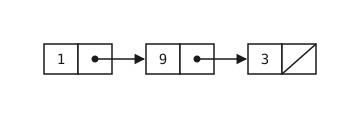
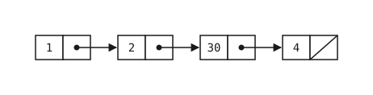
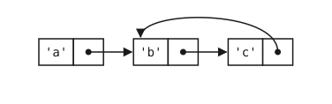
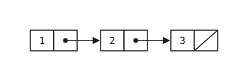
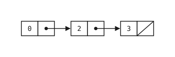
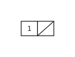
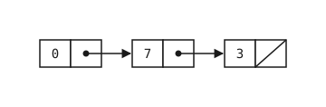
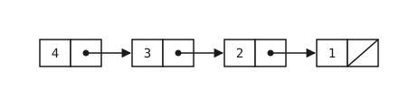

# Drill 09 · State & mutation

<p class="chapter-goal">Reassignment, private state, set_head/set_tail, sharing, cycles, is vs ==: predict, draw, write.</p>

Easiest first. Try each problem on paper before you open the answer. Every answer was run in Python §3.

!!! tip "Two questions to ask every time"
    1. **Reassignment or mutation?** `x = ...` changes which value a *name* is bound to. `set_head`, `set_tail` and `xs[i] = ...` change an existing *pair or list*, and every name that refers to it sees the change.
    2. **Which frame?** An assignment inside a function makes the name local, unless the body says `global` or `nonlocal`.

## 1. A running total ★

*Skill: `global` and reassignment.*

What does this program print?

```python title="§3"
total = 0

def add(n):
    global total
    total = total + n
    return total

add(3)
print(add(4))
print(total)
```

??? success "Answer"
    ```text
    7
    7
    ```
    `global total` means `total` in `add` is the binding in the global frame. The first application changes it from 0 to 3 (its result is thrown away, a bare expression statement prints nothing). The second changes it to 7 and returns 7.

## 2. Forgot the declaration ★

*Skill: the "assignment makes it local" rule.*

The same program without the `global` line. What happens, and why?

```python title="§3"
total = 0

def add(n):
    total = total + n
    return total

print(add(4))
```

??? success "Answer"
    ```text
    UnassignedLocalError: cannot access local variable 'total' where it is not associated with a value
    ```
    Because the body assigns to `total`, `total` is a **local variable** of `add`: the new frame gets its own binding, unassigned at first. The right side `total + n` reads that local binding before it has a value. It does **not** fall back to the global `total`. Fix: add `global total`.

## 3. Two ticket machines ★

*Skill: each call of a maker function creates a separate frame of private state.*

```python title="§3"
def make_ticket_machine(first):
    next_number = first
    def take():
        nonlocal next_number
        given = next_number
        next_number = next_number + 1
        return given
    return take

bank = make_ticket_machine(100)
clinic = make_ticket_machine(1)
bank()
print(bank(), clinic(), bank())
```

??? success "Answer"
    ```text
    101 1 102
    ```
    `bank` and `clinic` were made by two different applications of `make_ticket_machine`, so each remembers its own frame with its own `next_number`. `bank` has already given out 100, so it now gives 101 and then 102; `clinic` gives its first ticket, 1. The arguments of `print` are evaluated left to right.

## 4. A running average ★★

*Skill: write a maker with two pieces of private state.*

Write `make_averager()`. It returns a function that takes a number and returns the average of **all** numbers it has received so far.

```python
avg = make_averager()
avg(10)    # 10.0
avg(20)    # 15.0
avg(0)     # 10.0
```

??? success "Answer"
    ```python title="§3"
    def make_averager():
        total = 0
        count = 0
        def add(x):
            nonlocal total, count
            total = total + x
            count = count + 1
            return total / count
        return add

    avg = make_averager()
    print(avg(10), avg(20), avg(0))
    other = make_averager()
    print(other(7), avg(30))
    ```
    ```text
    10.0 15.0 10.0
    7.0 15.0
    ```
    Both `total` and `count` live in the frame of one `make_averager()` call. One `nonlocal` line may list several names. Without it, `total = total + x` would make `total` local to `add` and fail as in problem 2. `other` has its own frame, so it does not disturb `avg`.

## 5. One change, two names ★

*Skill: aliasing; `==` vs `is`.*

```python title="§3 · figure practice-09-alias"
a = llist(1, 2, 3)
b = a
c = llist(1, 2, 3)
set_head(tail(b), 9)
print(a)
print(c)
print(a == c, a is b)
draw_data(a)
```

??? success "Answer"
    ```text
    [1, [9, [3, None]]]
    [1, [2, [3, None]]]
    False True
    [1|•]-->[9|•]-->[3|/]
    ```
    

    `b = a` copies no pairs: `a` and `b` are two names for the **same** first pair, so a change made through `b` is seen through `a`. `c` was built by its own `llist` call, so its pairs are different objects and keep the 2. Now `a == c` is `False` (the contents differ) and `a is b` is `True` (same object).

## 6. Same contents, same object? ★★

*Skill: identity vs equality, for pairs, lists and functions.*

Predict every `True`/`False`.

```python title="§3"
p = pair(1, 2)
q = pair(1, 2)
r = p
print(p == q, p is q, r is p)
print([0, 0] == pair(0, 0), [0, 0] is [0, 0])
set_head(r, 5)
print(p == q, p)
f = lambda x: x
g = lambda x: x
print(f is g, f is f)
```

??? success "Answer"
    ```text
    True False True
    True False
    False [5, 2]
    False True
    ```
    `==` compares contents, `is` asks "the very same object?". Every `pair(...)` call, every list expression `[...]` and every evaluation of a lambda expression creates a **new** object, so two of them are never `is`, however alike they look. A pair is a list of length two, so `[0, 0] == pair(0, 0)`. `set_head(r, 5)` changes the pair that `p` also names, so `p` and `q` are no longer equal.

## 7. Reassign or mutate? ★★

*Skill: a parameter is a new binding; mutation goes through it, reassignment does not.*

```python title="§3"
def tweak(p):
    set_head(p, "changed")
    p = pair("new", None)
    return p

q = pair("old", None)
r = tweak(q)
print(q)
print(r)
```

??? success "Answer"
    ```text
    ['changed', None]
    ['new', None]
    ```
    In `tweak`'s frame, `p` starts out bound to the same pair as `q`, so `set_head` changes the pair that `q` refers to. The reassignment `p = ...` only changes the binding of `p` in `tweak`'s frame; `q` in the global frame still refers to the old (now changed) pair.

## 8. Who shares with whom after append? ★★

*Skill: `append` copies its first argument and shares its second.*

```python title="§3 · figure practice-09-append"
xs = llist(1, 2)
ys = llist(3, 4)
zs = append(xs, ys)
set_head(xs, 10)
set_head(ys, 30)
print(zs)
print(tail(tail(zs)) is ys)
draw_data(zs)
```

??? success "Answer"
    ```text
    [1, [2, [30, [4, None]]]]
    True
    [1|•]-->[2|•]-->[30|•]-->[4|/]
    ```
    

    `append(xs, ys)` makes a **new** pair for each element of `xs` and then points the last new tail at `ys` itself. So changing `xs` afterwards does not touch `zs` (it still starts with 1), but changing `ys` does: the last two pairs of `zs` **are** the pairs of `ys`.

## 9. Around and around ★★

*Skill: making a cycle with `set_tail`; reading a cyclic structure.*

Predict the output. Then: what would `length(p)` do?

```python title="§3 · figure practice-09-cycle"
p = llist("a", "b", "c")
set_tail(tail(tail(p)), tail(p))
draw_data(p)
print(llist_ref(p, 5))
print(tail(tail(tail(p))) is tail(p))
```

??? success "Answer"
    ```text
    ['a'|•]-->#1=['b'|•]-->['c'|•]-->#1
    b
    True
    ```
    

    The tail of the `"c"` pair now points back at the `"b"` pair (in the text drawing, `#1` marks that pair). Walking along: index 0 is a, 1 b, 2 c, 3 b, 4 c, 5 b. `length(p)` never reaches `None`, so it **never terminates**: never call `length`, `print` or `map` on a cyclic structure unless you know how it is written.

## 10. Cut and rejoin ★★★

*Skill: before/after box-and-pointer diagrams with shared pairs.*

Draw `a` and `b` before and after the two mutations, then predict the output.

```python title="§3 · figure practice-09-rejoin"
a = llist(1, 2, 3)
b = pair(0, tail(a))
draw_data(a)
draw_data(b)
set_head(tail(b), 7)
set_tail(a, None)
draw_data(a)
draw_data(b)
print(a)
print(b)
```

??? success "Answer"
    ```text
    [1|•]-->[2|•]-->[3|/]
    [0|•]-->[2|•]-->[3|/]
    [1|/]
    [0|•]-->[7|•]-->[3|/]
    [1, None]
    [0, [7, [3, None]]]
    ```
    Before (the pairs 2 and 3 are shared: `tail(b) is tail(a)`):

    
    

    After:

    
    

    `set_head(tail(b), 7)` changes the shared pair, so for a moment both `a` and `b` would show 7. Then `set_tail(a, None)` cuts `a` after its first pair. That changes only `a`'s first pair; `b` still points at the 7 and 3 pairs, which are still there.

## 11. Reverse without new pairs ★★★

*Skill: write a destructive function; say what the old name refers to afterwards.*

Write `d_reverse(xs)` that reverses a llist **in place**: it calls neither `pair` nor `llist`, only `set_tail`, and returns the new first pair. Then: after `ys = d_reverse(xs)`, what is `xs`?

??? success "Answer"
    ```python title="§3 · figure practice-09-dreverse"
    def d_reverse(xs):
        done = None
        while not is_none(xs):
            rest = tail(xs)
            set_tail(xs, done)
            done = xs
            xs = rest
        return done

    xs = llist(1, 2, 3, 4)
    ys = d_reverse(xs)
    print(ys)
    print(xs)
    draw_data(ys)
    ```
    ```text
    [4, [3, [2, [1, None]]]]
    [1, None]
    [4|•]-->[3|•]-->[2|•]-->[1|/]
    ```
    

    Each iteration takes the front pair off what is left and turns its tail around to point at the already reversed part `done`. Save `tail(xs)` **before** `set_tail`, or you lose the rest of the llist. The global `xs` still refers to the pair holding 1, which is now the **last** pair: `xs` is `[1, None]`. Θ(n) time, Θ(1) extra space, no new pairs.

*In the course: L8A, L9A · SICPy 3.1, 3.3.1.*
