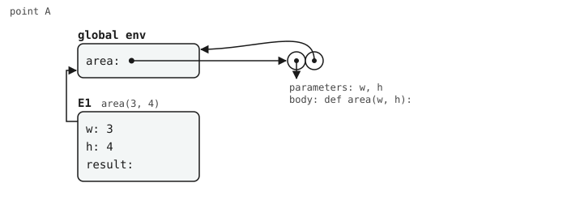
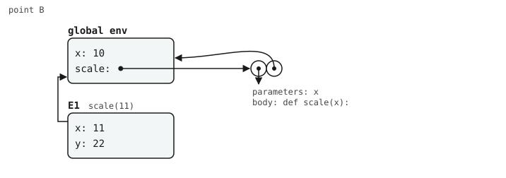
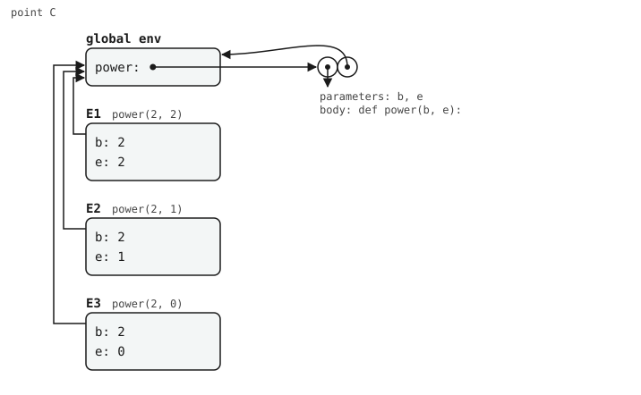
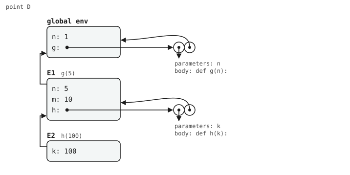
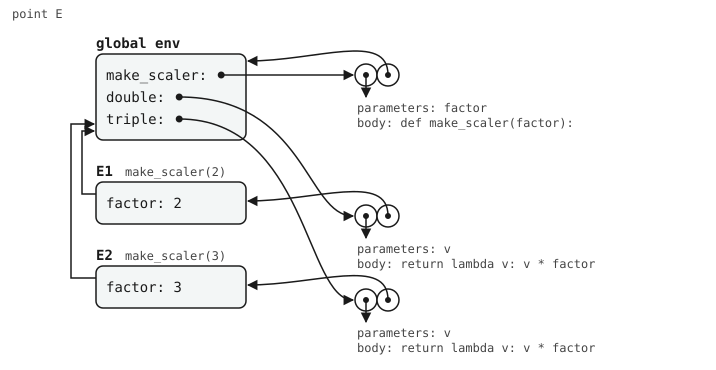
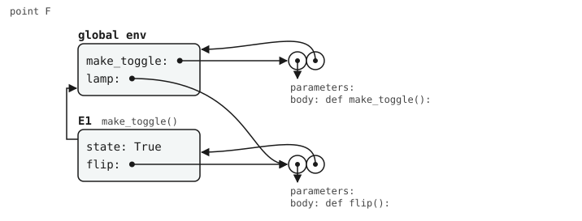
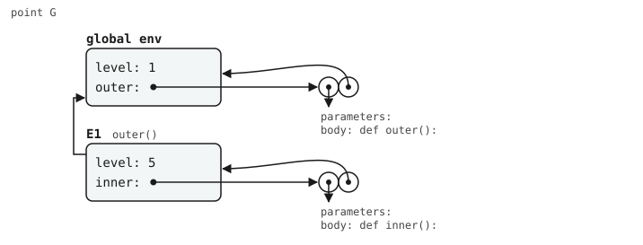
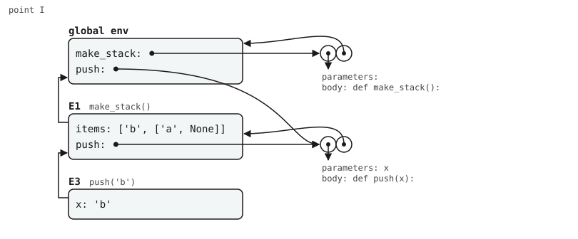
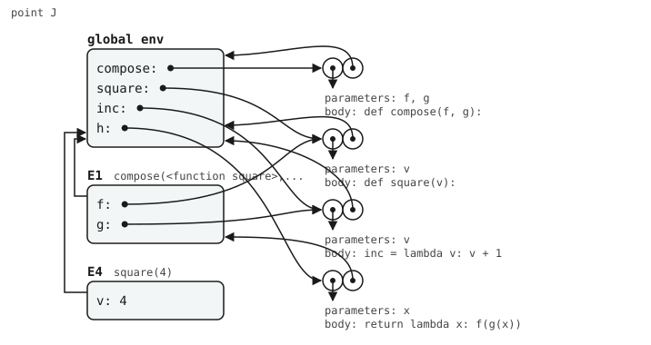

# Drill 11 · The environment model

<p class="chapter-goal">Draw the environment diagram at the marked point, find the frame a name comes from, read an e-step trace.</p>

The exam's favourite question: "draw the environment diagram at the marked point". In every problem below the marked point is the `show_env("…")` line. Draw on paper first, then open the answer: it has sicpfuf's diagram (text and picture) and a short reading of each frame and arrow.

!!! tip "The recipe, every time"
    1. **Global frame first.** One binding per top-level name, in program order. A name whose assignment has not run yet is there but **unassigned** (`name:` with nothing after it).
    2. **`def` or `lambda`** makes a function object: two circles. Left circle → parameters and body. Right circle → the environment **where it was created** (the current one at that moment).
    3. **Application** makes a new frame. Its enclosing-environment arrow goes where the function object's right circle points, **not** to the caller. Put in it: the parameters with their argument values, then every local name (anything the body assigns, unless declared `global`/`nonlocal`), unassigned at first.
    4. **Lookup:** current frame, then follow the enclosing arrows outward. **Assignment** changes the binding it finds the same way (`nonlocal`/`global` say where).
    5. Pairs, lists and function objects are drawn **outside** frames, with arrows from the bindings.

!!! note "How sicpfuf draws it"
    Frames are numbered E1, E2, … in the order they were made. sicpfuf leaves out empty frames (the course does too) and frames nothing can reach any more (finished calls whose frame no function object remembers). In the pictures, pairs and lists are written as box notation inside the frame.

## 1. Before the body runs ★

*Skill: parameters and unassigned local names.*

```python title="§3 · figure practice-11-area"
def area(w, h):
    show_env("point A")
    result = w * h
    return result

size = area(3, 4)
print(size)
```

??? success "Answer"
    ```text
    -- environment diagram: point A --
    global env
        area: fn#1
    E1: area(3, 4)                enclosing environment: global env    <-- current environment
        w: 3
        h: 4
        result: (unassigned)
    function objects
        fn#1   parameters: w, h   body: line 1  def area(w, h):   environment: global env
    12
    ```
    

    - **global env**: `area` points to its function object (created in the global environment). `size` is unassigned in the course's drawing (`size:`): `area(3, 4)` has not returned yet. sicpfuf only lists global names once they have a value.
    - **E1** (the `area(3, 4)` frame): `w: 3`, `h: 4`, and `result` already exists but is **unassigned**, because the body assigns it. Its arrow points to the global env, because that is where `area`'s object was created.

## 2. Same name, two frames ★

*Skill: a parameter shadows a global name.*

```python title="§3 · figure practice-11-shadow"
x = 10

def scale(x):
    y = x * 2
    show_env("point B")
    return y

print(scale(x + 1), x)
```

??? success "Answer"
    ```text
    -- environment diagram: point B --
    global env
        x: 10
        scale: fn#1
    E1: scale(11)                 enclosing environment: global env    <-- current environment
        x: 11
        y: 22
    function objects
        fn#1   parameters: x   body: line 3  def scale(x):   environment: global env
    22 10
    ```
    

    - The argument `x + 1` is evaluated in the **global** environment (the caller's): 11.
    - **E1** binds the parameter `x` to 11. Inside `scale`, the name `x` is found in E1 first, so the global `x: 10` is hidden (shadowed) and never changes. `y: 22` is a local.
    - So `print` shows 22 and then the global `x`, still 10.

## 3. Waiting frames ★★

*Skill: recursion makes one frame per application, all enclosed by the global env.*

```python title="§3 · figure practice-11-power"
def power(b, e):
    if e == 0:
        show_env("point C")
        return 1
    return b * power(b, e - 1)

print(power(2, 2))
```

??? success "Answer"
    ```text
    -- environment diagram: point C --
    global env
        power: fn#1
    E1: power(2, 2)               enclosing environment: global env    (waiting)
        b: 2
        e: 2
    E2: power(2, 1)               enclosing environment: global env    (waiting)
        b: 2
        e: 1
    E3: power(2, 0)               enclosing environment: global env    <-- current environment
        b: 2
        e: 0
    function objects
        fn#1   parameters: b, e   body: line 1  def power(b, e):   environment: global env
    4
    ```
    

    Three frames, one per application of `power`: E1 `e: 2`, E2 `e: 1`, E3 `e: 0`. **All three** arrows point to the global env, not to each other: `power`'s function object was created in the global environment, and that is the only thing that decides the arrow. E1 and E2 are still waiting for `b * power(…)` to come back (the deferred operations of this recursive process).

## 4. A function inside a function ★★

*Skill: a nested `def` makes a function object whose right circle points to the call frame.*

```python title="§3 · figure practice-11-nested"
n = 1

def g(n):
    m = n * 2
    def h(k):
        show_env("point D")
        return k + m + n
    return h(100)

print(g(5))
```

??? success "Answer"
    ```text
    -- environment diagram: point D --
    global env
        n: 1
        g: fn#1
    E1: g(5)                      enclosing environment: global env
        n: 5
        m: 10
        h: fn#2
    E2: h(100)                    enclosing environment: E1    <-- current environment
        k: 100
    function objects
        fn#1   parameters: n   body: line 3  def g(n):   environment: global env
        fn#2   parameters: k   body: line 5  def h(k):   environment: E1
    115
    ```
    

    - **E1** (`g(5)`): `n: 5`, `m: 10` and `h`. The `def h` was evaluated **in E1**, so the function object of `h` points back to E1.
    - **E2** (`h(100)`): `k: 100`; its arrow goes to **E1** (where `h` was created).
    - In `k + m + n`, `k` comes from E2, `m` and `n` from E1. The global `n: 1` is never reached: 100 + 10 + 5 = 115.

## 5. Two scalers ★★

*Skill: frames that stay alive after the call has returned.*

```python title="§3 · figure practice-11-scalers"
def make_scaler(factor):
    return lambda v: v * factor

double = make_scaler(2)
triple = make_scaler(3)
show_env("point E")
print(double(5), triple(5))
```

??? success "Answer"
    ```text
    -- environment diagram: point E --
    global env    <-- current environment
        make_scaler: fn#1
        double: fn#2
        triple: fn#3
    E1: make_scaler(2)            enclosing environment: global env
        factor: 2
    E2: make_scaler(3)            enclosing environment: global env
        factor: 3
    function objects
        fn#1   parameters: factor   body: line 1  def make_scaler(factor):      environment: global env
        fn#2   parameters: v        body: line 2  return lambda v: v * factor   environment: E1
        fn#3   parameters: v        body: line 2  return lambda v: v * factor   environment: E2
    10 15
    ```
    

    Both `make_scaler` applications have returned, but their frames stay in the diagram: **E1** (`factor: 2`) is remembered by the lambda that `double` names, **E2** (`factor: 3`) by the one `triple` names. The two lambda objects have the same code but different environments, which is why `double(5)` is 10 and `triple(5)` is 15. Point E is in the global env: no call is running.

## 6. A switch with a memory ★★

*Skill: `nonlocal` updates the maker's frame; say which frame each call changes.*

Draw the diagram at point F. Which frame does each `lamp()` call change? What happens without the `nonlocal` line?

```python title="§3 · figure practice-11-toggle"
def make_toggle():
    state = False
    def flip():
        nonlocal state
        state = not state
        return "on" if state else "off"
    return flip

lamp = make_toggle()
print(lamp())
print(lamp())
print(lamp())
show_env("point F")
```

??? success "Answer"
    ```text
    on
    off
    on
    -- environment diagram: point F --
    global env    <-- current environment
        make_toggle: fn#1
        lamp: fn#2
    E1: make_toggle()             enclosing environment: global env
        state: True
        flip: fn#2
    function objects
        fn#1   parameters: (none)   body: line 1  def make_toggle():   environment: global env
        fn#2   parameters: (none)   body: line 3  def flip():          environment: E1
    ```
    

    - **E1** (`make_toggle()`) holds `state` and `flip`; `lamp` in the global frame points to the **same** function object as `flip` in E1. Its right circle points to E1.
    - Each `lamp()` call makes a new frame for `flip`, which is **empty** (`state` is not local, thanks to `nonlocal`), so it is left out. The reassignment `state = not state` changes `state` **in E1** every time: False → True → False → True (in the course drawing, cross out the old values).
    - Without `nonlocal`, `state` would be a local of `flip`, and `not state` would read it while it is still unassigned: an `UnassignedLocalError` at the first `lamp()`.

## 7. Jumping to the global frame ★★

*Skill: `global` in a nested function skips the enclosing frame.*

```python title="§3 · figure practice-11-global"
level = 0

def outer():
    level = 5
    def inner():
        global level
        level = level + 1
        show_env("point G")
    inner()
    return level

print(outer(), level)
```

??? success "Answer"
    ```text
    -- environment diagram: point G --
    global env
        level: 1
        outer: fn#1
    E1: outer()                   enclosing environment: global env    <-- current environment
        level: 5
        inner: fn#2
    function objects
        fn#1   parameters: (none)   body: line 3  def outer():   environment: global env
        fn#2   parameters: (none)   body: line 5  def inner():   environment: E1
    5 1
    ```
    

    - The `outer()` frame (shown as E1) has its own local `level: 5` and `inner`.
    - The `inner()` frame has no bindings at all: `level` is declared `global` there (the course writes `global: level` in that frame). sicpfuf leaves the empty frame out, so its picture marks E1, the frame that `inner()`'s frame extends.
    - `level = level + 1` reads and writes the **global** binding (0 → 1). `outer`'s `level` is skipped, so `outer()` returns 5, and the global `level` is now 1.

## 8. A stack in a frame ★★★

*Skill: `nonlocal` plus pairs drawn outside the frame; a frame per application.*

Draw the diagram at point I during the **second** application of `push`.

```python title="§3 · figure practice-11-stack"
def make_stack():
    items = None
    def push(x):
        nonlocal items
        items = pair(x, items)
        show_env("point I")
        return length(items)
    return push

push = make_stack()
push("a")
print(push("b"))
```

??? success "Answer"
    ```text
    -- environment diagram: point I --
    global env
        make_stack: fn#1
        push: fn#2
    E1: make_stack()              enclosing environment: global env
        items: ['a', None]
        push: fn#2
    E2: push('a')                 enclosing environment: E1    <-- current environment
        x: 'a'
    function objects
        fn#1   parameters: (none)   body: line 1  def make_stack():   environment: global env
        fn#2   parameters: x        body: line 3  def push(x):        environment: E1
    -- environment diagram: point I --
    global env
        make_stack: fn#1
        push: fn#2
    E1: make_stack()              enclosing environment: global env
        items: ['b', ['a', None]]
        push: fn#2
    E3: push('b')                 enclosing environment: E1    <-- current environment
        x: 'b'
    function objects
        fn#1   parameters: (none)   body: line 1  def make_stack():   environment: global env
        fn#2   parameters: x        body: line 3  def push(x):        environment: E1
    2
    ```
    The second diagram is the one asked for:

    

    - Two different bindings are called `push`: the global one and the one in **E1** (`make_stack()`). Both point to the same function object, whose right circle points to E1.
    - The first `push` frame (E2, `x: 'a'`) is finished and nothing remembers it, so sicpfuf leaves it out (keep it if your drawing keeps finished frames). The current frame is **E3** with `x: 'b'`, enclosed by E1.
    - `items` in E1 points (in your drawing, by an arrow out of the frame) to the pair `['b', •]`, whose tail is the pair `['a', None]` made by the first push. Nothing was mutated: `items` was **reassigned** to a new pair each time.

## 9. Compose, frame by frame ★★★

*Skill: a call frame's arrow follows the function object, wherever the call happens.*

```python title="§3 · figure practice-11-compose"
def compose(f, g):
    return lambda x: f(g(x))

def square(v):
    show_env("point J")
    return v * v

inc = lambda v: v + 1
h = compose(square, inc)
print(h(3))
```

??? success "Answer"
    ```text
    -- environment diagram: point J --
    global env
        compose: fn#1
        square: fn#2
        inc: fn#3
        h: fn#4
    E1: compose(<function square>, <function (anonym...)  enclosing environment: global env
        f: fn#2
        g: fn#3
    E4: square(4)                 enclosing environment: global env    <-- current environment
        v: 4
    function objects
        fn#1   parameters: f, g   body: line 1  def compose(f, g):         environment: global env
        fn#2   parameters: v      body: line 4  def square(v):             environment: global env
        fn#3   parameters: v      body: line 8  inc = lambda v: v + 1      environment: global env
        fn#4   parameters: x      body: line 2  return lambda x: f(g(x))   environment: E1
    16
    ```
    

    - **E1** (`compose(square, inc)`) binds `f` and `g` to the two function objects; the lambda made there (named `h` globally) points to E1.
    - `h(3)` makes frame **E2** for the lambda, with `x: 3`, enclosed by **E1**. There `g(x)` calls `inc`: frame **E3**, `v: 3`, enclosed by the **global** env; it returns 4. Then `f(4)` calls `square`: frame **E4**, `v: 4`, enclosed by the **global** env (where `square` was defined), even though it was called from inside E2.
    - sicpfuf does not show E2 and E3 at point J. E3 is finished, and E2 is no longer needed: `f(g(x))` is the lambda's return expression, so `square(4)` is a tail call that takes E2's place. If your drawing keeps finished frames (many hand-drawn diagrams do), draw E2 and E3 as well, with the arrows given here.

## 10. Where does each name come from? ★★

*Skill: link every name to the frame where it is found.*

For each of `a`, `b`, `c`, `d` in the body of `g`, say which frame the value is found in. Does using `d` before its line in `f` cause an error? What is printed?

```python title="§3"
a = 1

def f(a, b):
    def g(c):
        return a + b + c + d
    d = 100
    return g(a * 10)

b = 2
print(f(3, b))
```

??? success "Answer"
    ```text
    135
    ```
    | Name | Found in | Value |
    |---|---|---|
    | `c` | the frame of `g(30)` | 30 |
    | `a` | the frame of `f(3, 2)` (shadows the global `a: 1`) | 3 |
    | `b` | the frame of `f(3, 2)` (the parameter) | 2 |
    | `d` | the frame of `f(3, 2)` (a local of `f`) | 100 |

    `d` appears in `g`'s body before the line `d = 100`, but the body of `g` is only evaluated when `g` is **applied**, and by then `d` has its value. A function object stores an environment, not the values that are in it at creation time.

## 11. Remembered, then reassigned ★★

*Skill: which `x`? The one in the frame the function object remembers.*

```python title="§3"
x = 5
f = lambda x: lambda y: x * y
g = f(x + 1)
x = 100
print(g(2), f(1)(2))
```

??? success "Answer"
    ```text
    12 2
    ```
    `f(x + 1)` evaluates `x + 1` to 6 and makes a frame with **its own** `x: 6`; the inner lambda (now `g`) remembers that frame. Reassigning the global `x` later changes the global frame only. `g(2)` finds `y: 2` in its own frame and `x: 6` one frame out: 12. `f(1)(2)` uses a new frame with `x: 1`: 2. The global `x` is not used by either.

## 12. Read the e-stepper ★★

*Skill: follow an `--estep` narration; tail calls and lookups.*

Before running it: how many frames are made, what does each enclosing-environment arrow point to, and where is `n` found?

```python title="§3 · --estep"
n = 2

def add_n(k):
    return k + n

def twice(f, v):
    return f(f(v))

print(twice(add_n, 1))
```

??? success "Answer"
    ```text title="Output"
    Assigned n = 2 in the global frame
    Defined add_n: function object fn#1, created in the global environment
    Defined twice: function object fn#2, created in the global environment
    Called twice(function object fn#1, 1): new frame E1, whose enclosing environment is the global environment
    Called add_n(1): new frame E2, whose enclosing environment is the global environment
    Looked up n: not in frame E2, found in the global frame: 2
    Returned 3 from E2
    Tail call add_n(3): new frame E3, whose enclosing environment is the global environment
    Looked up n: not in frame E3, found in the global frame: 2
    Returned 5 from E3
        output: 5
    ```
    Three frames: E1 for `twice`, E2 and E3 for the two applications of `add_n`. **All** of them are enclosed by the global environment, because both function objects were created there: `add_n` is called from inside `twice`, but that does not matter. `n` is not in E2 or E3, so it is looked up in the global frame. The outer `f(…)` is a tail call (it is the return expression), so `twice`'s frame is no longer needed once it starts.

*In the course: L9A · SICPy 3.2.*
