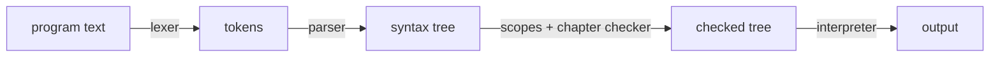

# How sicpfuf works

<p class="chapter-goal">A short tour of the interpreter for the curious: how program text becomes a running program, and how the x-ray tools see inside it.</p>

You do not need this page for the exam. But the course ends with an interpreter written in the language itself (the metacircular evaluator), and sicpfuf is the same idea one level down: an interpreter for Python §1–§4, written in ordinary Python. Every file is short and commented, so you can read along.

All files are in [`sicpfuf/`](https://github.com/Jay-Jay-Tee/sicpfuf/blob/main/sicpfuf/__main__.py) on GitHub.

## The pipeline



Each arrow is one file. The first three run **before** your program does. That is why errors such as NameNotFoundError appear even for lines that never run, and why nothing is printed before them.

## 1. The lexer: text to tokens

[`lexer.py`](https://github.com/Jay-Jay-Tee/sicpfuf/blob/main/sicpfuf/lexer.py) reads the text one character at a time and cuts it into **tokens**: names, numbers, strings, operators, and the end of each line. You can see its output with `--tokens` (see [the x-ray tools](xray.md#tokens-and-syntax-trees-tokens-and-ast)).

Indentation becomes tokens too. The lexer keeps a **stack** of indentation widths. A line indented more than the top of the stack pushes a new width and produces an INDENT token; a line indented less pops widths and produces one DEDENT for each. A width that matches nothing on the stack is the IndentationError "unindent does not match any outer indentation level". This is how real Python does it as well.

## 2. The parser: tokens to a tree

[`parser.py`](https://github.com/Jay-Jay-Tee/sicpfuf/blob/main/sicpfuf/parser.py) is a **recursive-descent** parser: one function per rule of the grammar, and the functions call each other. Operator precedence comes from the order of the rules: the rule for `+` asks the rule for `*` for its operands, so `*` binds tighter.

```python
1 + 2 * 3        # arith asks term for "1", sees +, asks term again for "2 * 3"
```

The tree is made of node objects from [`nodes.py`](https://github.com/Jay-Jay-Tee/sicpfuf/blob/main/sicpfuf/nodes.py) (`BinOp`, `Call`, `If`, `FunctionDef`, …). `--ast` prints it.

The parser deliberately accepts almost **all** of Python, far more than Python §1–§4 allow. Rejecting things is the next stage's job, because that stage can say *what* is not allowed and *why*, instead of a bare "invalid syntax".

## 3. Scopes and the chapter checker

Before anything runs, two passes walk the finished tree.

[`scopes.py`](https://github.com/Jay-Jay-Tee/sicpfuf/blob/main/sicpfuf/scopes.py) decides, for every function, which names are **local**: every name assigned anywhere in its body (by `=`, `def`, a `for` loop or an import), unless the body says `global` or `nonlocal` for it. This is the rule behind UnassignedLocalError: the name is local for the *whole* body, even on the lines before its assignment.

[`chapters.py`](https://github.com/Jay-Jay-Tee/sicpfuf/blob/main/sicpfuf/chapters.py), the **chapter checker**, then rejects three kinds of mistake:

1. a feature your chapter does not have ("Feature not supported", and the `range`, `break`, `continue` and `nonlocal` rules);
2. a name that is used but declared nowhere (NameNotFoundError);
3. in §1 and §2, a name that gets a value twice in the same scope (NameReassignmentError).

Rule 3 is what makes the substitution model safe: if a name can never change, you may always replace it by its value.

## 4. The interpreter: walking the tree

[`interpreter.py`](https://github.com/Jay-Jay-Tee/sicpfuf/blob/main/sicpfuf/interpreter.py) is the evaluate–apply loop of the course, written in Python. It has one method per kind of node: `eval_BinOp`, `eval_Call`, `exec_If`, … An expression node is **evaluated** to a value; a statement node is **executed**.

Names live in **environments**, built exactly as in the environment model ([`env.py`](https://github.com/Jay-Jay-Tee/sicpfuf/blob/main/sicpfuf/env.py)). An environment is a chain of frames:

```text
builtins   print, pair, head, math_sqrt, ...
   ↑
library    map, filter, reduce, stream_map, ...
   ↑
program    the global frame: your top-level names
   ↑
E1, E2 …   one new frame per function call
```

The two rules of the environment model are two short pieces of code:

- **Lookup** starts in the current frame and follows the enclosing-environment arrows outwards until it finds the name.
- **A call** makes a new frame whose enclosing environment is the one stored in the function object (where the function was *created*), puts the arguments in it, and runs the body there.

A function value, `Closure` in [`values.py`](https://github.com/Jay-Jay-Tee/sicpfuf/blob/main/sicpfuf/values.py), is exactly the course's "two circles": the tree of the function's body, and the environment it was created in.

The three ways the course language differs from Python are all in this file: conditions are checked to be exactly `True` or `False`; operators check the types of their operands and never convert; and calls in tail position are handled specially, as the next section explains.

## Proper tail calls: the trampoline

A tree-walking interpreter in Python uses Python's own stack for each call of *your* function. A tail call `return f(n - 1, acc)` would still use one more Python stack frame each time, so an iterative process would run out of stack after a few thousand rounds.

sicpfuf avoids that with a **trampoline**. When the expression after `return` is a function application (or a conditional expression or `and`/`or` whose chosen part is one), the interpreter does **not** make the call. It hands back a small note, "the answer is whatever `f(args)` gives". The function that is running then finishes, and the loop in `call_closure` picks up the note and makes the call in its place. In outline:

```python
def call_closure(func, args):
    while True:
        frame = new_frame(func, args)      # the old frame is no longer needed
        result = run_body(func, frame)
        if result is a TailCall note:
            func, args = result.func, result.args
            continue                       # bounce: same loop, nothing waits
        return result
```

So the number of calls **waiting** (`depth`) does not grow for a tail call. This is what makes `measure` report "at most 1 waiting at once" for an iterative process, however long it runs:

```python title="§1"
def count_down(n, steps):
    return steps if n == 0 else count_down(n - 1, steps + 1)

measure(count_down, 100000, 0)
```
```text title="Output"
[measure] count_down(100000, 0): 100,001 calls, 1,300,006 steps, at most 1 waiting at once
```

For calls that do have to wait, `call_closure` counts them and raises RecursionError when a 1025th would start, the same limit as the course's implementation. To have room for 1024 waiting calls (each uses several Python stack frames), the program runs in a separate thread with a large stack ([`__main__.py`](https://github.com/Jay-Jay-Tee/sicpfuf/blob/main/sicpfuf/__main__.py)).

## The substitution stepper: rewriting trees

`--subst` ([`xray/stepper.py`](https://github.com/Jay-Jay-Tee/sicpfuf/blob/main/sicpfuf/xray/stepper.py)) does not use the environment at all. It works on the tree itself, the way you work on paper:

1. Find the **leftmost** part of the tree that is not a value yet, and go inside it until you reach a part whose own pieces are all values.
2. Reduce that one part: an operator on two values becomes the result; `a if True else b` becomes `a`; a call of your function becomes the function's return expression with each parameter replaced by its argument.
3. Build a **new** tree with that part replaced, print it as text, and repeat until the whole tree is a value.

The arithmetic itself is done by the real interpreter, so `--subst` cannot disagree with a normal run about what `7 // 2` is. A function body with several statements is first rewritten into one expression (an `if` statement with two `return`s becomes a conditional expression), so that every step is a rewrite of a single expression.

```python title="§1 · --subst"
def double(x):
    return x + x

double(3 * 2)
```
```text title="Output"
double(3 * 2)
-> double(6)
-> 6 + 6
-> 12
```

Applicative order is visible in the first step: the argument `3 * 2` is reduced to `6` *before* `double` is applied.

## Libraries written in Python §2 itself

Only a few library functions are written in ordinary Python: `pair`, `head`, `tail`, `llist`, `print`, the `math_` functions and the like ([`lib/`](https://github.com/Jay-Jay-Tee/sicpfuf/blob/main/sicpfuf/lib/__init__.py)). Everything else (`map`, `filter`, `reduce`, `append`, `stream_map`, …) is a string of **Python §2 or §3 source code** in [`lib/linked_list.py`](https://github.com/Jay-Jay-Tee/sicpfuf/blob/main/sicpfuf/lib/linked_list.py) and [`lib/stream.py`](https://github.com/Jay-Jay-Tee/sicpfuf/blob/main/sicpfuf/lib/stream.py). When sicpfuf starts, it runs that code through the interpreter itself, into the "library" frame. That is why `print(map)` shows `<function map>` and not `<built-in function map>`, as in the course's implementation.

Those definitions are written as iterative processes or in continuation-passing style, so they never pile up deferred operations. They are quoted in the [library reference](library.md#written-in-python-2-itself).

Library code is marked, so that an error inside `map` is reported at the line of *your* call into `map`, and the library's own calls are left out of the "called from" lines.

## The other x-ray tools

All of them plug into the same interpreter:

| Tool | File | How |
|---|---|---|
| `--estep` | [`xray/estepper.py`](https://github.com/Jay-Jay-Tee/sicpfuf/blob/main/sicpfuf/xray/estepper.py) | an interpreter that writes one line for each environment-model rule it applies |
| interactive E-stepper | [`xray/reduction.py`](https://github.com/Jay-Jay-Tee/sicpfuf/blob/main/sicpfuf/xray/reduction.py), `reduction_trace.py` | rewrites the remaining program and store; the ordinary interpreter supplies primitive operations and atomic library applications |
| `show_env`, `--env` | [`xray/envdiagram.py`](https://github.com/Jay-Jay-Tee/sicpfuf/blob/main/sicpfuf/xray/envdiagram.py) | walks the frames still reachable from the current one and lists their bindings and function objects |
| `trace`, `measure`, `--trace` | [`xray/calltree.py`](https://github.com/Jay-Jay-Tee/sicpfuf/blob/main/sicpfuf/xray/calltree.py) | a "hook" that the trampoline tells about every call, tail call and return |
| `draw_data` | [`xray/boxpointer.py`](https://github.com/Jay-Jay-Tee/sicpfuf/blob/main/sicpfuf/xray/boxpointer.py) | lays out pairs with tails to the right and heads downwards, labelling boxes it meets twice |
| pictures with `--out` | [`xray/svg.py`](https://github.com/Jay-Jay-Tee/sicpfuf/blob/main/sicpfuf/xray/svg.py) | draws the same diagrams as SVG, in hand-drawn exam style |

## How it is tested against py-slang

sicpfuf is only useful if it behaves like the course's own implementation, py-slang. So the tests are **differential**: the same program goes into both, and the answers must agree.

- [`tests/cases/`](https://github.com/Jay-Jay-Tee/sicpfuf/blob/main/tests/run_tests.py) holds a few hundred small programs, each marked with its chapter. What py-slang printed for each, and the kind and line of its error, is recorded in `tests/expected.json`. `python3 tests/run_tests.py` checks that sicpfuf prints the same output and stops with the same kind of error on the same line. With `--oracle` it asks py-slang again, live.
- `tests/xray/` checks the outputs of the x-ray tools, which py-slang does not have.
- `examples/*.py` must run, and print what py-slang prints.
- Every program on this site is run by [`tests/check_docs.py`](https://github.com/Jay-Jay-Tee/sicpfuf/blob/main/tests/check_docs.py), and the output shown on the page must be exactly what sicpfuf prints. With `--oracle`, every plain program is also run in py-slang and must print the same.

sicpfuf's error *messages* are its own (with the hints), but the first line, the kind of error and its line number, is meant to match py-slang. A disagreement needs a reproducible case: compare it with both the published specification and the reference runtime. The [compatibility review](compatibility.md) records known runtime quirks and differences.

*In the course: L11B–L12A (the metacircular evaluator is the same idea, written in Python §4) · SICPy 4.1.*
