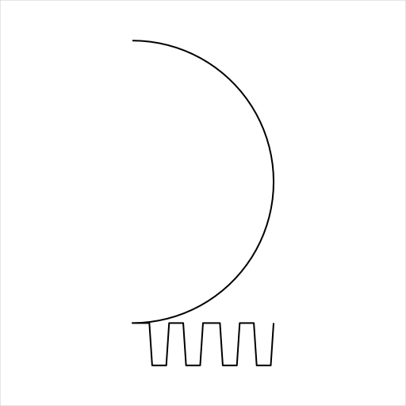
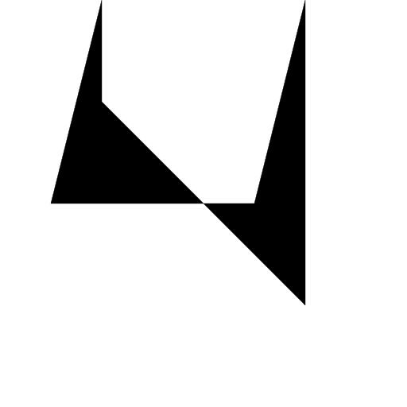

# Library

<p class="chapter-goal">Every pre-declared name, chapter by chapter, with what it does and what process it gives.</p>

A **pre-declared** name exists before your program starts: you use it without defining it. Each chapter keeps the names of the chapters before it and adds its own:

| Library | From | Names |
|---|---|---|
| [MISC](#misc-1) | §1 | `print`, `error`, `str`, `is_number`, `abs`, `max`, … |
| [MATH](#math-1) | §1 | `math_pi`, `math_sqrt`, `math_floor`, … |
| [LINKED LISTS](#linked-lists-2) | §2 | `pair`, `head`, `tail`, `llist`, `map`, `filter`, `reduce`, … |
| [PAIR MUTATORS and LIST](#pair-mutators-and-list-3) | §3 | `set_head`, `set_tail`, `is_list` |
| [STREAMS](#streams-3) | §3 | `stream_tail`, `stream_map`, `integers_from`, … |
| [MCE](#mce-4) | §4 | `parse`, `tokenize`, `apply_in_underlying_python` |
| [modules](#modules) | §1, after an import | `rune`, `curve`, `sound`, `repeat` |

sicpfuf also has a few x-ray builtins of its own in every chapter (`trace`, `measure`, `show_env`, and `draw_data` from §2). They are described in [the x-ray tools](xray.md).

Using a name from a later chapter is a NameNotFoundError, found before the program runs:

```python title="§1"
print(pair(1, 2))
```
```text title="Output"
NameNotFoundError at line 1
    print(pair(1, 2))
          ^
NameNotFoundError: the name 'pair' is not found in the current or enclosing environment(s)
sicpfuf hint: 'pair' only exists from Python §2 on. This program runs as §1.
```

## MISC (§1)

| Name | Meaning |
|---|---|
| `print(a, b, ...)` | show the values on one line, separated by spaces; returns `None` |
| `error(a, b, ...)` | stop the program with the message `Error: a b ...` |
| `input(prompt)` | ask the user to type a line; returns it as a string |
| `str(x)` | `x` as a string, as `print` would show it |
| `repr(x)` | `x` as a string, with quotes if it is a string |
| `len(x)` | the length of a string (and, from §3, of a list) |
| `abs(x)` | absolute value |
| `max(a, b, ...)`, `min(a, b, ...)` | the largest / smallest of **two or more** numbers, or two or more strings |
| `round(x)`, `round(x, n)` | round to an integer (halves go to the even neighbour), or to `n` decimals |
| `is_number(x)` | is `x` a number? (`True` is **not** a number) |
| `is_integer(x)`, `is_float(x)` | is `x` an integer / a float? |
| `is_string(x)`, `is_boolean(x)`, `is_function(x)` | is `x` a string / a boolean / a function? |
| `is_none(x)` | is `x` equal to `None`? (the usual test for the empty llist) |
| `arity(f)` | how many parameters `f` has (for a `*rest` function: the fixed ones) |
| `random_random()` | a random float, at least 0 and less than 1 |
| `time_time()` | the time now, in seconds |
| `complex(a, b)`, `real(z)`, `imag(z)`, `is_complex(x)` | complex numbers (rarely needed) |

```python title="§1"
print(str(42) + "!", repr("hi"), len("hello"))
print(max(3, 8, 5), min("pear", "apple"), abs(-2.5))
print(round(3.7), round(2.5), round(3.5), round(3.14159, 2))
print(is_number(1.5), is_number(True), is_integer(3.0), is_string("3"))
print(arity(lambda a, b: a), arity(print))
```
```text title="Output"
42! 'hi' 5
8 apple 2.5
4 2 4 3.14
True False False True
2 0
```

`max` and `min` need at least two arguments, all numbers or all strings:

```python title="§1"
print(max(7))
```
```text
TypeError: max() takes at least 2 arguments (1 given)
```

## MATH (§1)

Every name of Python's `math` module, with `math_` in front (there is no `math.` in the course language).

| Kind | Names |
|---|---|
| constants | `math_pi`, `math_e`, `math_tau`, `math_inf`, `math_nan` |
| roots and powers | `math_sqrt(x)`, `math_cbrt(x)`, `math_isqrt(n)`, `math_pow(x, y)`, `math_exp(x)`, `math_exp2(x)`, `math_expm1(x)` |
| logarithms | `math_log(x)` (natural), `math_log(x, base)`, `math_log2(x)`, `math_log10(x)`, `math_log1p(x)` |
| rounding | `math_floor(x)`, `math_ceil(x)`, `math_trunc(x)` |
| whole numbers | `math_gcd(a, b, ...)`, `math_lcm(a, b, ...)`, `math_factorial(n)`, `math_comb(n, k)`, `math_perm(n, k)` |
| angles | `math_sin`, `math_cos`, `math_tan`, `math_asin`, `math_acos`, `math_atan`, `math_atan2(y, x)`, `math_degrees`, `math_radians` |
| hyperbolic | `math_sinh`, `math_cosh`, `math_tanh`, `math_asinh`, `math_acosh`, `math_atanh` |
| floats | `math_fabs`, `math_fmod`, `math_remainder`, `math_copysign`, `math_isfinite`, `math_isinf`, `math_isnan`, `math_ldexp`, `math_nextafter`, `math_ulp`, `math_fma` |
| special | `math_erf`, `math_erfc`, `math_gamma`, `math_lgamma` |

```python title="§1"
print(math_sqrt(16), math_floor(2.7), math_ceil(2.1), math_pow(2, 10))
print(math_gcd(12, 18), math_factorial(5), math_log2(8), math_pi)
```
```text title="Output"
4.0 2 3 1024.0
6 120 3.0 3.141592653589793
```

A value outside the function's domain is a ValueError:

```python title="§1"
print(math_sqrt(-1))
```
```text
ValueError: math domain error: math_sqrt can't take -1
```

## LINKED LISTS (§2)

A **pair** glues two values together. A **llist** is either `None` (the empty llist) or a pair whose tail is a llist.

### The six built-ins

| Name | Meaning |
|---|---|
| `pair(h, t)` | a new pair with head `h` and tail `t` |
| `head(p)`, `tail(p)` | the head / tail of the pair `p` (a TypeError for anything that is not a pair) |
| `is_pair(x)` | is `x` a pair? |
| `llist(a, b, ...)` | the llist of the arguments; `llist()` is `None` |
| `print_llist(xs)` | print `xs` in llist notation |
| `draw_data(x, ...)` | draw the box-and-pointer diagram (see [the x-ray tools](xray.md#box-and-pointer-diagrams-draw_data)) |

```python title="§2"
p = pair(1, pair(2, None))
print(p, head(tail(p)), is_pair(p), is_pair(None))
print(llist(1, 2) == p, llist())
print_llist(llist(1, pair(2, 3), "x"))
```
```text title="Output"
[1, [2, None]] 2 True False
True None
llist(1, [2, 3], 'x')
```

### Written in Python §2 itself

Everything else is written in Python §2, in sicpfuf's [linked-list library](https://github.com/Jay-Jay-Tee/sicpfuf/blob/main/sicpfuf/lib/linked_list.py). Open the boxes to read each definition: they are good worked examples. Each of them gives an **iterative process** (an accumulator and a tail call) or uses **continuation-passing style** (CPS), so none of them piles up deferred operations, however long the llist is. In the table, *n* is the length of the llist.

Space is a different matter: `map`, `filter`, `reverse`, `remove`, `enum_llist` and `build_llist` build a new llist, so they need Θ(n) space for the pairs of the result, and the CPS functions build one continuation (a function) per item while they walk, which is Θ(n) space too. Only `length`, `member`, `for_each`, `llist_ref` and `is_llist` run in Θ(1) space.

| Name | Meaning | Process | Time |
|---|---|---|---|
| `is_llist(xs)` | is `xs` a llist (ends in `None`)? | iterative | Θ(n) |
| `length(xs)` | the number of items | iterative | Θ(n) |
| `reverse(xs)` | a new llist, items in reverse order | iterative | Θ(n) |
| `map(f, xs)` | a new llist of `f(x)` for each item | iterative, then `reverse` | Θ(n) |
| `filter(pred, xs)` | a new llist of the items with `pred(x)` true | iterative, then `reverse` | Θ(n) |
| `reduce(f, initial, xs)` | `f(x1, f(x2, ... f(xn, initial)))`, a **right** fold | CPS | Θ(n) |
| `append(xs, ys)` | the items of `xs`, then `ys` (which is shared, not copied) | CPS | Θ(length of xs) |
| `member(v, xs)` | the part of `xs` that starts at the first `v`, or `None` | iterative | Θ(n) |
| `remove(v, xs)` | `xs` without the first `v` | iterative | Θ(n) |
| `remove_all(v, xs)` | `xs` without any `v` | iterative | Θ(n) |
| `enum_llist(a, b)` | `llist(a, a + 1, ..., b)`; `None` if `a > b` | iterative | Θ(b − a) |
| `build_llist(fun, n)` | `llist(fun(0), fun(1), ..., fun(n - 1))` | iterative | Θ(n) |
| `for_each(fun, xs)` | call `fun` on each item, in order; returns `True` | iterative | Θ(n) |
| `llist_ref(xs, k)` | the item at position `k`, counting from 0 | iterative | Θ(k) |
| `llist_to_string(xs)` | `xs` in box notation, as a string | CPS | Θ(n) |

??? note "How `is_llist`, `length`, `reverse` are defined"

    ```python
    def is_llist(xs):
        return is_none(xs) or (is_pair(xs) and is_llist(tail(xs)))

    def length(xs):
        def count(ys, so_far):
            return so_far if is_none(ys) else count(tail(ys), so_far + 1)
        return count(xs, 0)

    def reverse(xs):
        def rev(original, reversed_so_far):
            return (reversed_so_far
                    if is_none(original)
                    else rev(tail(original), pair(head(original), reversed_so_far)))
        return rev(xs, None)
    ```

```python title="§2"
xs = llist(3, 1, 4, 1, 5)
print(length(xs), reverse(xs), llist_ref(xs, 2))
print(map(lambda x: x * x, xs))
print(filter(lambda x: x > 2, xs))
```
```text title="Output"
5 [5, [1, [4, [1, [3, None]]]]] 4
[9, [1, [16, [1, [25, None]]]]]
[3, [4, [5, None]]]
```

??? note "How `map`, `filter`, `reduce` are defined"

    ```python
    def map(f, xs):
        def go(ys, done):
            return reverse(done) if is_none(ys) else go(tail(ys), pair(f(head(ys)), done))
        return go(xs, None)

    def filter(pred, xs):
        def go(ys, kept):
            if is_none(ys):
                return reverse(kept)
            elif pred(head(ys)):
                return go(tail(ys), pair(head(ys), kept))
            else:
                return go(tail(ys), kept)
        return go(xs, None)

    def reduce(f, initial, xs):
        def go(ys, cont):
            return (cont(initial)
                    if is_none(ys)
                    else go(tail(ys), lambda reduced_tail: cont(f(head(ys), reduced_tail))))
        return go(xs, lambda x: x)
    ```

`reduce` folds from the **right**: the last item is combined with `initial` first. With `-` you can see the order:

```python title="§2"
print(reduce(lambda x, acc: x - acc, 0, llist(1, 2, 3)))
print(reduce(lambda x, acc: pair(x * 10, acc), None, llist(1, 2, 3)))
```
```text title="Output"
2
[10, [20, [30, None]]]
```

The first line is `1 - (2 - (3 - 0))`, which is 2.

??? note "How `append`, `member`, `remove`, `remove_all` are defined"

    ```python
    def append(xs, ys):
        def go(zs, cont):
            return (cont(ys)
                    if is_none(zs)
                    else go(tail(zs), lambda appended_tail: cont(pair(head(zs), appended_tail))))
        return go(xs, lambda x: x)

    def member(v, xs):
        if is_none(xs):
            return None
        elif v == head(xs):
            return xs
        else:
            return member(v, tail(xs))

    def remove(v, xs):
        def go(ys, kept):
            if is_none(ys):
                return reverse(kept)
            elif v == head(ys):
                return append(reverse(kept), tail(ys))
            else:
                return go(tail(ys), pair(head(ys), kept))
        return go(xs, None)

    def remove_all(v, xs):
        def go(ys, kept):
            if is_none(ys):
                return reverse(kept)
            elif v == head(ys):
                return go(tail(ys), kept)
            else:
                return go(tail(ys), pair(head(ys), kept))
        return go(xs, None)
    ```

```python title="§2"
xs = llist(1, 2, 3, 2)
print(append(xs, llist(9)), member(2, xs), member(7, xs))
print(remove(2, xs), remove_all(2, xs))
```
```text title="Output"
[1, [2, [3, [2, [9, None]]]]] [2, [3, [2, None]]] None
[1, [3, [2, None]]] [1, [3, None]]
```

??? note "How `enum_llist`, `build_llist`, `for_each`, `llist_ref`, `llist_to_string` are defined"

    ```python
    def enum_llist(start, end):
        def go(n, built):
            return reverse(built) if n > end else go(n + 1, pair(n, built))
        return go(start, None)

    def build_llist(fun, n):
        def go(i, built):
            return built if i < 0 else go(i - 1, pair(fun(i), built))
        return go(n - 1, None)

    def for_each(fun, xs):
        if is_none(xs):
            return True
        else:
            fun(head(xs))
            return for_each(fun, tail(xs))

    def llist_ref(xs, n):
        if is_none(xs):
            return error("llist_ref: index out of bounds")
        elif n == 0:
            return head(xs)
        else:
            return llist_ref(tail(xs), n - 1)

    def llist_to_string(xs):
        def go(ys, cont):
            if is_none(ys):
                return cont("None")
            elif is_pair(ys):
                return go(head(ys), lambda h: go(tail(ys), lambda t: cont("[" + h + ", " + t + "]")))
            else:
                return cont(repr(ys))
        return go(xs, lambda x: x)
    ```

```python title="§2"
print(enum_llist(2, 5), enum_llist(5, 2))
print(build_llist(lambda i: i * i, 4))
print(for_each(lambda x: print("item", x), llist("a", "b")))
print(llist_to_string(llist(1, 2)))
print(llist_ref(llist(1, 2), 5))
```
```text
[2, [3, [4, [5, None]]]] None
[0, [1, [4, [9, None]]]]
item a
item b
True
[1, [2, None]]
Error: llist_ref: index out of bounds
```

Because the library never piles up deferred operations, it copes with long llists, while a non-tail recursion of your own does not:

```python title="§2"
def my_length(xs):
    return 0 if is_none(xs) else 1 + my_length(tail(xs))

long = enum_llist(1, 5000)
print(length(long), length(map(lambda x: x + 1, long)))
print(my_length(long))
```
```text
5000 5000
RecursionError: maximum recursion depth exceeded
```

## PAIR MUTATORS and LIST (§3)

| Name | Meaning |
|---|---|
| `set_head(p, v)` | change the head of pair `p` to `v`; returns `None` |
| `set_tail(p, v)` | change the tail of pair `p` to `v`; returns `None` |
| `is_list(x)` | is `x` a list `[...]`? (a pair is a list of two, so `is_list(pair(1, 2))` is `True`) |
| `len(xs)` | the number of items of a list (already in MISC for strings) |

```python title="§3"
p = llist(1, 2, 3)
set_head(tail(p), 20)
print(p)
print(set_tail(tail(p), None), p)
print(is_list([1, 2, 3]), is_list(pair(1, 2)), is_list(None), len([7, 8, 9]))
```
```text title="Output"
[1, [20, [3, None]]]
None [1, [20, None]]
True True False 3
```

## STREAMS (§3)

A **stream** is either `None` or a pair whose tail is a **nullary function** (a function of no arguments) that returns the rest of the stream. The tail is computed only when you **force** it with `stream_tail`. So a stream can be infinite.

All of these are written in Python §3 in sicpfuf's [stream library](https://github.com/Jay-Jay-Tee/sicpfuf/blob/main/sicpfuf/lib/stream.py), except `stream` itself. The "Process" column says whether the function is **lazy** (it returns at once and leaves the rest in a lambda, so it works on infinite streams) or walks the stream **now**. None of them use memoization: forcing the same tail twice computes it twice.

| Name | Meaning | Process |
|---|---|---|
| `stream(a, b, ...)` | the stream with exactly these items | built-in |
| `stream_tail(s)` | force the tail: the rest of the stream | now: calls the tail function once |
| `is_stream(x)` | is `x` a (finite) stream? | now; never finishes on an infinite stream |
| `integers_from(n)` | `n, n + 1, n + 2, ...` forever | lazy |
| `enum_stream(a, b)` | `a, a + 1, ..., b` | lazy |
| `build_stream(fun, n)` | `fun(0), ..., fun(n - 1)` | lazy |
| `llist_to_stream(xs)` | the items of llist `xs`, as a stream | lazy |
| `stream_map(f, s)` | `f` of each item | lazy |
| `stream_filter(p, s)` | the items with `p(x)` true | lazy (but searches now for the next item that passes) |
| `stream_append(s1, s2)` | the items of `s1`, then `s2` | lazy |
| `stream_remove(v, s)`, `stream_remove_all(v, s)` | without the first / any `v` | lazy |
| `stream_ref(s, n)` | the item at position `n`, counting from 0 | now, iterative |
| `stream_member(v, s)` | the part of `s` from the first `v` on, or `None` | now, iterative |
| `stream_for_each(fun, s)` | call `fun` on each item; returns `True` | now, iterative |
| `stream_reverse(s)` | reversed (finite streams only) | now, iterative |
| `eval_stream(s, n)` | a **llist** of the first `n` items | now, **recursive** process |
| `stream_to_llist(s)` | a llist of all items (finite streams only) | now, **recursive** process |
| `stream_length(s)` | the number of items (finite streams only) | now, **recursive** process |

`add_streams`, `scale_stream`, `mul_streams`, `memo_fun`, `ones` and `integers` are **not** pre-declared: define them yourself when you need them.

```python title="§3"
s = stream(1, 2, 3)
print(head(s), head(stream_tail(s)), s)
evens = stream_filter(lambda x: x % 2 == 0, integers_from(1))
print(eval_stream(evens, 4), stream_ref(evens, 10))
print(stream_to_llist(stream_map(lambda x: x * x, enum_stream(1, 4))))
```
```text title="Output"
1 2 [1, <built-in function anonymous stream>]
[2, [4, [6, [8, None]]]] 22
[1, [4, [9, [16, None]]]]
```

The library's own `stream(1, 2, 3)` prints its tail as a built-in function. A stream you build with `lambda` prints `<function (anonymous)>` in that place.

??? note "How `stream_tail`, `is_stream`, `integers_from`, `enum_stream`, `build_stream`, `llist_to_stream` are defined"

    ```python
    def stream_tail(xs):
        if is_pair(xs):
            the_tail = tail(xs)
            if is_function(the_tail):
                return the_tail()
            else:
                return error(the_tail, "stream_tail(xs) expects a function as the tail of the argument pair xs, but encountered ")
        else:
            return error(xs, "stream_tail(xs) expects a pair as argument xs, but encountered ")

    def is_stream(xs):
        return is_none(xs) or (is_pair(xs) and is_function(tail(xs))
                               and arity(tail(xs)) == 0 and is_stream(stream_tail(xs)))

    def integers_from(n):
        return pair(n, lambda: integers_from(n + 1))

    def enum_stream(start, end):
        return None if start > end else pair(start, lambda: enum_stream(start + 1, end))

    def build_stream(fun, n):
        def build(i):
            return None if i >= n else pair(fun(i), lambda: build(i + 1))
        return build(0)

    def llist_to_stream(xs):
        return None if is_none(xs) else pair(head(xs), lambda: llist_to_stream(tail(xs)))
    ```

??? note "How `stream_map`, `stream_filter`, `stream_append`, `stream_remove`, `stream_remove_all` are defined"

    ```python
    def stream_map(f, s):
        return None if is_none(s) else pair(f(head(s)), lambda: stream_map(f, stream_tail(s)))

    def stream_filter(p, s):
        return (None
                if is_none(s)
                else pair(head(s), lambda: stream_filter(p, stream_tail(s)))
                if p(head(s))
                else stream_filter(p, stream_tail(s)))

    def stream_append(xs, ys):
        return ys if is_none(xs) else pair(head(xs), lambda: stream_append(stream_tail(xs), ys))

    def stream_remove(v, xs):
        return (None
                if is_none(xs)
                else stream_tail(xs)
                if v == head(xs)
                else pair(head(xs), lambda: stream_remove(v, stream_tail(xs))))

    def stream_remove_all(v, xs):
        return (None
                if is_none(xs)
                else stream_remove_all(v, stream_tail(xs))
                if v == head(xs)
                else pair(head(xs), lambda: stream_remove_all(v, stream_tail(xs))))
    ```

```python title="§3"
print(stream_to_llist(stream_append(stream(1, 2), build_stream(lambda i: 10 * i, 3))))
print(stream_to_llist(stream_remove(2, stream(1, 2, 3, 2))), stream_to_llist(stream_reverse(stream(1, 2, 3))))
print(is_stream(stream(1, 2)), is_stream(pair(1, 2)), stream_length(enum_stream(1, 9)))
```
```text title="Output"
[1, [2, [0, [10, [20, None]]]]]
[1, [3, [2, None]]] [3, [2, [1, None]]]
True False 9
```

??? note "How `stream_ref`, `stream_member`, `stream_for_each`, `stream_reverse`, `eval_stream`, `stream_to_llist`, `stream_length` are defined"

    ```python
    def stream_ref(s, n):
        return head(s) if n == 0 else stream_ref(stream_tail(s), n - 1)

    def stream_member(x, s):
        return None if is_none(s) else s if head(s) == x else stream_member(x, stream_tail(s))

    def stream_for_each(fun, xs):
        if is_none(xs):
            return True
        else:
            fun(head(xs))
            return stream_for_each(fun, stream_tail(xs))

    def stream_reverse(xs):
        def rev(original, reversed_so_far):
            return (reversed_so_far
                    if is_none(original)
                    else rev(stream_tail(original), pair(head(original), lambda: reversed_so_far)))
        return rev(xs, None)

    def eval_stream(s, n):
        def es(s, n):
            return llist(head(s)) if n == 1 else pair(head(s), es(stream_tail(s), n - 1))
        return None if n == 0 else es(s, n)

    def stream_to_llist(xs):
        return None if is_none(xs) else pair(head(xs), stream_to_llist(stream_tail(xs)))

    def stream_length(xs):
        return 0 if is_none(xs) else 1 + stream_length(stream_tail(xs))
    ```

`eval_stream`, `stream_to_llist` and `stream_length` keep a deferred operation per item, so they fail on more than about 1000 items:

```python title="§3"
print(stream_ref(integers_from(1), 5000))
print(length(eval_stream(integers_from(1), 1100)))
```
```text
5001
RecursionError: maximum recursion depth exceeded
```

## MCE (§4)

| Name | Meaning |
|---|---|
| `parse(text)` | the syntax tree of the program `text`, made of tagged llists |
| `tokenize(text)` | a llist of the tokens (as strings) of `text` |
| `apply_in_underlying_python(f, args)` | call the built-in function `f` with the items of the llist `args` |

Each node of a `parse` tree is a llist whose head is a **tag**. The tags and their parts:

| Tag | Parts after the tag |
|---|---|
| `"literal"` | the value |
| `"name"` | the name, as a string |
| `"application"` | function expression, llist of argument expressions |
| `"binary_operator_combination"` | operator string (`"+"`, `"=="`, …), left, right |
| `"unary_operator_combination"` | `"not"` or `"-unary"`, operand |
| `"logical_composition"` | `"and"` or `"or"`, left, right |
| `"conditional_expression"`, `"conditional_statement"` | predicate, consequent, alternative |
| `"lambda_expression"` | llist of parameter names (as `"name"` nodes), body |
| `"function_definition"` | name, llist of parameters, body |
| `"return_statement"` | the return expression |
| `"assignment"` | name, value expression |
| `"sequence"` | llist of statements (only when there are two or more) |
| `"while_loop"`, `"for_loop"`, `"pass_statement"`, `"global_statement"`, `"nonlocal_statement"` | the parts of those statements |

A conditional statement without `else` gets `llist("pass_statement")` as its alternative. A program of one statement is that statement itself, with no `"sequence"` around it.

```python title="§4"
print_llist(parse("x = 1 + 2"))
print_llist(parse("square(5)"))
print_llist(parse("a\nb"))
print_llist(tokenize("print(x + 1)"))
print(apply_in_underlying_python(math_pow, llist(2, 5)))
```
```text title="Output"
llist('assignment', llist('name', 'x'), llist('binary_operator_combination', '+', llist('literal', 1), llist('literal', 2)))
llist('application', llist('name', 'square'), llist(llist('literal', 5)))
llist('sequence', llist(llist('name', 'a'), llist('name', 'b')))
llist('print', '(', 'x', '+', '1', ')')
32.0
```

## Modules

A module's names exist only after you import them, and only by name: `from rune import heart, show`. (`import rune` and `from rune import *` are not allowed.) Modules work in every chapter. sicpfuf draws pictures as text in the terminal and, with `--out FOLDER`, also saves them as SVG pictures and WAV sounds (see [the x-ray tools](xray.md#saving-pictures-and-sounds-out)).

### rune

A **rune** is a picture in a square. You combine runes with functions that take runes and return runes.

| Kind | Names |
|---|---|
| show it | `show(r)` (returns `r`); `anaglyph(r)` and `hollusion(r)` do the same in sicpfuf |
| primitive runes | `heart`, `sail`, `corner`, `nova`, `rcross`, `circle`, `square`, `triangle`, `pentagram`, `ribbon`, `blank` |
| combine | `stack(r1, r2)` (r1 on top), `beside(r1, r2)` (r1 on the left), `stack_frac(f, r1, r2)`, `beside_frac(f, r1, r2)` (r1 gets the fraction `f`), `stackn(n, r)`, `make_cross(r)`, `overlay(r1, r2)`, `overlay_frac(f, r1, r2)` |
| turn and flip | `quarter_turn_right(r)`, `quarter_turn_left(r)`, `turn_upside_down(r)`, `flip_vert(r)`, `flip_horiz(r)`, `rotate(radians, r)` (anticlockwise) |
| move and resize | `scale(ratio, r)`, `scale_independent(ratio_x, ratio_y, r)`, `translate(x, y, r)` |
| colour | `red`, `pink`, `purple`, `indigo`, `blue`, `green`, `yellow`, `orange`, `brown`, `black`, `white` (each takes a rune), `color(r, red, green, blue)` with values from 0 to 1, `random_color(r)` |

```python title="§1 · figure library-rune"
from rune import show, heart, sail, stack, beside, quarter_turn_right, red

show(stack(red(heart), beside(sail, quarter_turn_right(sail))))
```


### curve

A **curve** is a function from a number `t` between 0 and 1 to a **point**. A curve transformation takes a curve and returns a curve.

| Kind | Names |
|---|---|
| points | `make_point(x, y)`, `make_3D_point(x, y, z)`, `make_color_point(x, y, r, g, b)`, `make_3D_color_point(x, y, z, r, g, b)` (colours 0 to 255), `x_of(p)`, `y_of(p)`, `z_of(p)`, `r_of(p)`, `g_of(p)`, `b_of(p)` |
| ready-made curves | `unit_circle`, `unit_line`, `arc` (half a circle), `unit_line_at(y)` (returns a curve) |
| transformations | `translate(x, y, z)`, `scale(x, y, z)`, `scale_proportional(s)`, `rotate_around_origin(angle)`, `rotate_around_origin_3D(a, b, c)`: each returns a function from curve to curve; `invert(c)`, `put_in_standard_position(c)` |
| join | `connect_rigidly(c1, c2)` (c1 for the first half of `t`, then c2), `connect_ends(c1, c2)` (c2 moved to start where c1 ends) |
| draw | `draw_connected(n)`, `draw_connected_full_view(n)`, `draw_connected_full_view_proportional(n)`, and the same with `draw_points` instead of `draw_connected`, and `draw_3D_connected...`, `draw_3D_points...`: each takes the number of pieces `n` and returns a function that draws a curve |

`draw_connected(n)` shows the unit square from (0, 0) to (1, 1); `..._full_view` stretches the curve to fill the picture; `..._full_view_proportional` fits it without changing its shape.

```python title="§1 · figure library-curve"
from curve import make_point, draw_connected_full_view_proportional, connect_ends, arc

def zigzag(t):
    return make_point(t, 0.3 if math_floor(t * 8) % 2 == 0 else 0)

draw_connected_full_view_proportional(100)(connect_ends(arc, zigzag))
```



### sound

A **wave** is a function from a time `t` (in seconds) to a number between -1 and 1. A **sound** is a wave plus a duration.

| Kind | Names |
|---|---|
| make and read | `make_sound(wave, duration)`, `get_wave(s)`, `get_duration(s)`, `is_sound(x)` |
| ready-made sounds | `sine_sound(freq, dur)`, `square_sound(freq, dur)`, `triangle_sound(freq, dur)`, `sawtooth_sound(freq, dur)`, `noise_sound(dur)`, `silence_sound(dur)` |
| combine | `consecutively(llist(s1, s2, ...))` one after the other, `simultaneously(llist(s1, s2, ...))` at the same time |
| envelopes | `adsr(attack, decay, sustain, release)` returns a function from sound to sound; `stacking_adsr(waveform, freq, dur, envelopes)`; `phase_mod(freq, dur, amount)` returns a function from sound to sound |
| notes | `midi_note_to_frequency(n)` (69 is 440 Hz), `letter_name_to_midi_note("C4")`, `letter_name_to_frequency("A4")` |
| instruments | `piano(note, dur)`, `violin`, `cello`, `trombone`, `bell` (`note` is a MIDI number) |
| play | `play(s)` (returns `s`), `play_wave(wave, dur)`, `play_in_tab(s)`, `stop()` |

`play` prints a small picture of the start of the wave. With `--out` it also saves a WAV file.

```python title="§2 · figure library-sound"
from sound import sine_sound, piano, consecutively, play, letter_name_to_midi_note

print(letter_name_to_midi_note("C4"))
play(consecutively(llist(sine_sound(440, 0.25), piano(60, 0.25))))
```
```text title="Output"
60
[sound: 0.5 s]
│  █      █      █       █      █      █      ██      █      █   │
│ █        █      █     █      █        █            █      █ █  │
│   █    █      █         █      █    █                █         │
│                  █   █                     █  █                │
│█··········█·················█··········█··········█············│
│    █  █                         █  █                     █   █ │
│              █           █                █    █      █        │
│            █      █ █      █            █        █      █     █│
│     ██      █      █      █      ██      █      █      █       │
```

[Listen to it](../assets/figures/library-sound-sound-1.wav).

### repeat

| Name | Meaning |
|---|---|
| `repeat_apply(f, n, x)` | `f(f(...f(x)...))`, with `f` applied `n` times; an iterative process |

??? note "How `repeat_apply` is defined"

    ```python
    def repeat_apply(pat, n, init):
        return init if n == 0 else repeat_apply(pat, n - 1, pat(init))
    ```

```python title="§1 · figure library-repeat"
from rune import show, nova, beside, quarter_turn_right
from repeat import repeat_apply

print(repeat_apply(lambda x: x * 2, 10, 1))
show(beside(nova, repeat_apply(quarter_turn_right, 3, nova)))
```



*In the course: L1B (rune, repeat), L3B (curve, sound), L4A–L5A (linked lists), L8A (pair mutators, streams library), L11B–L12A (parse) · SICPy 2.2, 3.3, 3.5, 4.1.*
