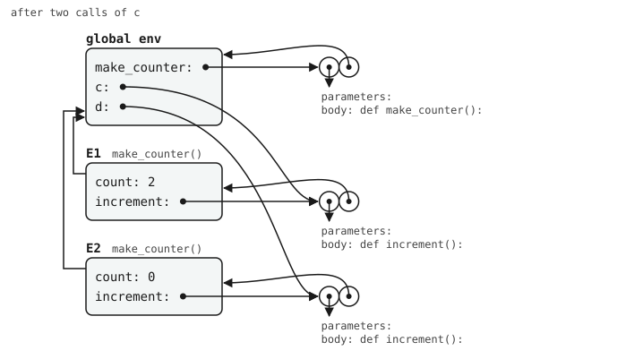
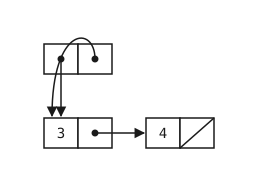

# The x-ray tools

<p class="chapter-goal">The full manual for every command-line flag, every sicpfuf-only builtin and the interactive prompt, with how to read what they print.</p>

The x-ray tools show you what the course's models of evaluation *do*, one step at a time. They exist only in sicpfuf. They are for understanding and checking your hand-drawn work; in the exam you still draw by hand.

| You want to see | Use |
|---|---|
| the substitution model, step by step (§1, §2) | [`--subst`](#the-substitution-model-subst) |
| the environment model, step by step | [`--estep`](#the-environment-model-step-by-step-estep) |
| the environment diagram at one moment | [`show_env()`](#environment-diagrams-show_env-and-env), [`--env`](#environment-diagrams-show_env-and-env) |
| which calls a function makes (recursive or iterative process?) | [`trace(f, ...)`, `--trace`](#call-trees-trace-and-trace) |
| time and space used | [`measure(f, ...)`, `--steps`](#time-and-space-measure-and-steps) |
| a box-and-pointer diagram | [`draw_data(x)`](#box-and-pointer-diagrams-draw_data) |
| what the lexer and parser make of a program | [`--tokens`, `--ast`](#tokens-and-syntax-trees-tokens-and-ast) |
| type errors, before running (§4 Typed) | [`--typed`](#python-4-typed-typed) |

## Running a program

```sh
python3 -m sicpfuf program.py -v 2        # run a file as Python §2
python3 -m sicpfuf -v 1 -c 'print(1 + 2)'   # run a one-liner
python3 -m sicpfuf -v 2                   # the interactive prompt
python3 -m sicpfuf --help                 # list every flag
```

What the program prints goes to the normal output. Error reports and the x-ray reports of `--steps` go to the error output, so `python3 -m sicpfuf p.py > out.txt` keeps only what the program printed.

### Choosing the chapter

`-v N` (or `--chapter N`) picks Python §N. Without it, sicpfuf looks at the **first line** of the file. Any of these work:

```python
# chapter 2
```

```python
# Python §3
```

With neither, the program runs as §4. A `-v` on the command line wins over the first line.

## Interactive steppers: `--ui` and `--tui`

```sh
python3 -m sicpfuf --ui program.py
python3 -m sicpfuf --tui program.py
python3 -m sicpfuf --ui program.py --typed --max-steps 1000
```

The browser UI opens a local session. The terminal UI uses arrows or n/p to step,
Space to play, r to reload and q to quit; + increases the limit and retraces.
Press v to switch the terminal between the remaining program and its frames.
In the E-stepper each reduction has a before and after state. **Program** shows the
remaining code, with the changed part highlighted; **Diagram** shows frames, functions
and shared lists. Grey objects are unreachable and remain available for inspection.
Select a function to inspect its parameters, body and creation environment.

The default is 400 states. `--max-steps` accepts 2–5000; histories and execution time
are bounded too. Typed checking requires §4 and prevents execution on a type error.
These interactive histories differ from the compact `--estep` event log below.
See [compatibility](compatibility.md) for exact reference checks and remaining differences.

## The substitution model: `--subst`

For Python §1 and §2 only. Each line starting with `->` is one step of the substitution model with **applicative order reduction**:

- an operator combination: evaluate the operands left to right, then apply the operator;
- a conditional expression: evaluate the predicate, then keep one branch;
- an application of a primitive function (`print`, `head`, `math_sqrt`, …): do it in one step;
- an application of a compound function: replace it by the function's return expression, with each parameter replaced by its argument.

When a substitution would capture a free name, the stepper gives a local binder a
fresh spelling such as `x_1`. The renaming preserves lexical scope.

```python title="§2 · --subst"
def sum_llist(xs):
    if is_none(xs):
        return 0
    else:
        return head(xs) + sum_llist(tail(xs))

print(sum_llist(llist(5, 7)))
```
```text title="Output"
print(sum_llist(llist(5, 7)))
-> print(sum_llist([5, [7, None]]))
-> print(0 if is_none([5, [7, None]]) else head([5, [7, None]]) + sum_llist(tail([5, [7, None]])))
-> print(0 if False else head([5, [7, None]]) + sum_llist(tail([5, [7, None]])))
-> print(head([5, [7, None]]) + sum_llist(tail([5, [7, None]])))
-> print(5 + sum_llist(tail([5, [7, None]])))
-> print(5 + sum_llist([7, None]))
-> print(5 + (0 if is_none([7, None]) else head([7, None]) + sum_llist(tail([7, None]))))
-> print(5 + (0 if False else head([7, None]) + sum_llist(tail([7, None]))))
-> print(5 + (head([7, None]) + sum_llist(tail([7, None]))))
-> print(5 + (7 + sum_llist(tail([7, None]))))
-> print(5 + (7 + sum_llist(None)))
-> print(5 + (7 + (0 if is_none(None) else head(None) + sum_llist(tail(None)))))
-> print(5 + (7 + (0 if True else head(None) + sum_llist(tail(None)))))
-> print(5 + (7 + 0))
-> print(5 + 7)
-> print(12)
    output: 12
```

### How to read the output

- The first line is the statement being evaluated. Every top-level statement gets its own group of steps.
- A body made of statements is first turned into one expression: `if p: return a else: return b` becomes `a if p else b` (as above).
- The **deferred operations** of a recursive process pile up on the left: `5 + (7 + ...)`. The longest line shows the most deferred operations, which is the space the process needs. An iterative process keeps lines of the same length.
- What the program prints appears as `output:`, at the moment it is printed.
- An assignment inside a body is shown in braces, `{ a2 = 9; ... }`, until its value is substituted into the rest.

```python title="§1 · --subst"
def hyp(a, b):
    a2 = a * a
    return math_sqrt(a2 + b * b)

hyp(3, 4)
```
```text title="Output"
hyp(3, 4)
-> { a2 = 3 * 3; math_sqrt(a2 + 4 * 4) }
-> { a2 = 9; math_sqrt(a2 + 4 * 4) }
-> math_sqrt(9 + 4 * 4)
-> math_sqrt(9 + 16)
-> math_sqrt(25)
-> 5.0
```

### `--max-steps N`

`--subst` stops after 400 steps, so an infinite recursion cannot flood your screen. `--max-steps N` changes the limit:

```python title="§1 · --subst --max-steps 6"
def fib(n):
    return n if n < 2 else fib(n - 1) + fib(n - 2)

fib(10)
```
```text title="Output"
fib(10)
-> 10 if 10 < 2 else fib(10 - 1) + fib(10 - 2)
-> 10 if False else fib(10 - 1) + fib(10 - 2)
-> fib(10 - 1) + fib(10 - 2)
-> fib(9) + fib(10 - 2)
-> (9 if 9 < 2 else fib(9 - 1) + fib(9 - 2)) + fib(10 - 2)
-> (9 if False else fib(9 - 1) + fib(9 - 2)) + fib(10 - 2)
... stopped after 6 steps (see more with --max-steps N)
```

In §3 and §4 names can be reassigned, so a name can no longer be replaced by its value, and `--subst` refuses. Use `--estep` there.

## The environment model, step by step: `--estep`

For every chapter. Each line says what one rule of the environment model just did, and **where**:

```python title="§3 · --estep"
def make_counter():
    count = 0
    def increment():
        nonlocal count
        count = count + 1
        return count
    return increment

c = make_counter()
print(c())
```
```text title="Output"
Defined make_counter: function object fn#1, created in the global environment
Called make_counter(): new frame E1, whose enclosing environment is the global environment (local names count, increment: unassigned so far)
Assigned count = 0 in frame E1
Defined increment: function object fn#2, created in environment E1
Returned function object fn#2 from E1
Assigned c = function object fn#2 in the global frame
Called increment(): the new frame would have no bindings, so the body runs in environment E1
Assigned count = 1 in frame E1 (nonlocal)
Returned 1 from the call of increment
    output: 1
```

### How to read the output

| Line | The rule of the environment model |
|---|---|
| `Defined f: function object fn#1, created in ...` | a `def` (or lambda) makes a function object that remembers the current environment |
| `Called f(...): new frame E1, whose enclosing environment is ...` | a call makes a new frame; its enclosing environment is the one the function object **remembers**, not the caller's |
| `(local names ...: unassigned so far)` | the local names get a slot in the new frame straight away, still unassigned |
| `the new frame would have no bindings, so the body runs in ...` | a call with no parameters and no local names; hand-drawn diagrams leave that empty frame out |
| `Assigned x = ... in frame E1` | an assignment changes the binding in the frame the name belongs to (`(nonlocal)` / `(global)` when that was declared) |
| `Looked up x: not in frame E2, found in frame E1: 5` | a name lookup that had to follow the enclosing-environment arrows outwards |
| `Tail call f(...): ...` | a tail call: its new frame *replaces* the frame of the call that made it, so nothing waits |
| `Returned v from E1` | the call is finished (`from the call of f` when the call had no frame of its own) |
| `output: ...` | what the program printed |

Lookups that succeed in the current frame, or that find a built-in such as `print`, are not shown (there would be too many). Frames are numbered E1, E2, … in the order they are made; function objects fn#1, fn#2, … in the order they are created.

## Environment diagrams: `show_env()` and `--env`

`show_env()` draws the environment diagram at the moment it is called. `show_env("label")` adds a label. `--env` draws one more when the program ends. With `--out FOLDER`, each diagram is also saved as a picture.

```python title="§3 · figure xray-counter"
def make_counter():
    count = 0
    def increment():
        nonlocal count
        count = count + 1
        return count
    return increment

c = make_counter()
d = make_counter()
c()
c()
show_env("after two calls of c")
```
```text title="Output"
-- environment diagram: after two calls of c --
global env    <-- current environment
    make_counter: fn#1
    c: fn#2
    d: fn#3
E1: make_counter()            enclosing environment: global env
    count: 2
    increment: fn#2
E2: make_counter()            enclosing environment: global env
    count: 0
    increment: fn#3
function objects
    fn#1   parameters: (none)   body: line 1  def make_counter():   environment: global env
    fn#2   parameters: (none)   body: line 3  def increment():      environment: E1
    fn#3   parameters: (none)   body: line 3  def increment():      environment: E2
```



### How to read it

| Text | Picture | What you draw by hand |
|---|---|---|
| `global env` and its `name: value` lines | the top box | the global frame |
| `E1: make_counter()` | another box | the frame made by that call (the call is written next to it) |
| `enclosing environment: global env` | the arrow leaving a frame | the arrow from a frame to its enclosing environment |
| `fn#2` as a value | a pair of circles | a function object: the left circle points to the parameters and body, the right circle to the environment it was created in |
| `function objects` list: `parameters`, `body`, `environment` | the circles' arrows and the code next to them | the same, written out |
| `count: 2` | a binding | the binding; by hand you would cross out the old values `0` and `1` |
| `name: (unassigned)` | | a binding whose assignment has not run yet |
| `<-- current environment` | | the frame in which `show_env()` was called |
| `xs: @1 [1, 2]` and `ys: @1 [1, 2]` | | two bindings to the **same** list or pair (one box with two arrows into it); `xs is ys` is `True` |

Built-in functions and the library are not drawn (as in the course's diagrams). A frame with no bindings at all is left out. Pairs and lists are written in box notation inside the frame.

!!! warning "Finished frames are left out"
    sicpfuf draws only the frames that still matter: the global frame, the frames of calls that are running or waiting, and frames that a function object still points to. The frame of a call that has returned and is not remembered by any function object is not drawn. An exam question may ask you to draw every frame ever made, so read the question.

Called inside a function, `show_env()` marks that function's frame as current:

```python title="§3"
def outer(x):
    def inner(y):
        show_env()
        return x + y
    return inner(2)

outer(1)
```
```text title="Output"
-- environment diagram --
global env
    outer: fn#1
E1: outer(1)                  enclosing environment: global env
    x: 1
    inner: fn#2
E2: inner(2)                  enclosing environment: E1    <-- current environment
    y: 2
function objects
    fn#1   parameters: x   body: line 1  def outer(x):   environment: global env
    fn#2   parameters: y   body: line 2  def inner(y):   environment: E1
```

## Call trees: `trace(...)` and `--trace`

`trace(f, a, b)` calls `f(a, b)`, draws every call of `f` it leads to, and returns the result. `--trace f,g` draws the calls of the named functions for the whole program.

```python title="§1"
def fact(n):
    return 1 if n == 0 else n * fact(n - 1)

def fact_iter(n, acc):
    return acc if n == 0 else fact_iter(n - 1, n * acc)

trace(fact, 3)
trace(fact_iter, 3, 1)
```
```text title="Output"
→ fact(3)
│  → fact(2)
│  │  → fact(1)
│  │  │  → fact(0)
│  │  │  ← 1
│  │  ← 1
│  ← 2
← 6
→ fact_iter(3, 1)
↻ fact_iter(2, 3)
↻ fact_iter(1, 6)
↻ fact_iter(0, 6)
← 6
```

### How to read it

- `→ f(args)` is a call that its caller **waits for**. Each one moves the tree one step to the right: those are the deferred operations of a **recursive process**.
- `↻ f(args)` is a **tail call**. It *replaces* the call that made it, so the tree does not move right: an **iterative process**.
- `← v` is a return, at the level of the call it belongs to.

A tree-recursive process branches. `--trace` with a list of names shows them all:

```python title="§1 · --trace fib"
def fib(n):
    return n if n < 2 else fib(n - 1) + fib(n - 2)

print(fib(3))
```
```text title="Output"
→ fib(3)
│  → fib(2)
│  │  → fib(1)
│  │  ← 1
│  │  → fib(0)
│  │  ← 0
│  ← 1
│  → fib(1)
│  ← 1
← 2
2
```

Each `→` at the same depth is a sibling in the tree. Count the arrows to count the calls: `fib(3)` makes 5.

## Time and space: `measure(...)` and `--steps`

`measure(f, a, b)` runs `f(a, b)` and reports:

- **calls**: how many function calls were made;
- **steps**: how many pieces of the program were evaluated (a measure of **time**);
- **at most N waiting at once**: the largest number of calls that were waiting for an answer at the same time (a measure of **space** for the deferred operations).

It returns the result of `f(a, b)`. Measure for a few sizes and look at how the numbers grow:

```python title="§1"
def fact(n):
    return 1 if n == 0 else n * fact(n - 1)

def fact_iter(n, acc):
    return acc if n == 0 else fact_iter(n - 1, n * acc)

def fib(n):
    return n if n < 2 else fib(n - 1) + fib(n - 2)

measure(fact, 100)
measure(fact, 200)
measure(fact_iter, 200, 1)
measure(fib, 10)
measure(fib, 20)
```
```text title="Output"
[measure] fact(100): 101 calls, 1,206 steps, at most 101 waiting at once
[measure] fact(200): 201 calls, 2,406 steps, at most 201 waiting at once
[measure] fact_iter(200, 1): 201 calls, 2,606 steps, at most 1 waiting at once
[measure] fib(10): 177 calls, 1,942 steps, at most 10 waiting at once
[measure] fib(20): 21,891 calls, 240,796 steps, at most 20 waiting at once
```

Doubling n doubles the steps of `fact`: Θ(n) time. Its waiting calls double too: Θ(n) space. `fact_iter` never has more than 1 waiting: Θ(1) space. Going from `fib(10)` to `fib(20)` multiplies the steps by about 124, close to φ¹⁰ ≈ 123: Θ(φⁿ) time, while the space only doubles: Θ(n).

`--steps` gives the same report for the whole program, at the end:

```python title="§1 · --steps"
def fact(n):
    return 1 if n == 0 else n * fact(n - 1)

print(fact(10))
```
```text title="Output"
3628800
[steps] time: 133 steps, 11 function calls   space: at most 11 calls waiting at once
```

The step counts are sicpfuf's own unit. Compare them with each other, not with other tools. Space here counts waiting calls only, not the pairs a function builds.

## Box-and-pointer diagrams: `draw_data(...)`

`draw_data(x)` (from §2) prints the box-and-pointer diagram of `x` and returns `x`. With `--out FOLDER` it also saves a picture.

```python title="§3 · figure xray-share"
shared = llist(3, 4)
xs = pair(llist(1, 2), shared)
draw_data(xs)
draw_data(pair(shared, shared))
```
```text title="Output"
[•|•]----------->[3|•]-->[4|/]
 |
 v
 [1|•]-->[2|/]
[•|•]-------------->#1
 |
 v
 #1=[3|•]-->[4|/]
```



### How to read it

- `[h|t]` is a pair: the head on the left, the tail on the right.
- A number, string, boolean or `None` is written inside its half. `/` in a half means `None`.
- `•` means "this half points to another box". Tails point **right**, heads point **down**.
- A box reached twice (**sharing**, or a cycle made with `set_tail`) is drawn once with a label `#1=`, and every other arrow to it ends in `#1`.
- A list with more or fewer than two items (§3) is one long box with a slot for each item.

## Tokens and syntax trees: `--tokens` and `--ast`

These show the first two stages of the interpreter (see [How sicpfuf works](internals.md)) and stop without running the program.

```python title="§1 · --tokens"
total = f(1) + 2
```
```text title="Output"
   1:1    NAME     'total'
   1:7    OP       '='
   1:9    NAME     'f'
   1:10   OP       '('
   1:11   NUMBER   1
   1:12   OP       ')'
   1:14   OP       '+'
   1:16   NUMBER   2
   1:17   NEWLINE  
   2:1    EOF      
```

Each token is `line:column`, its kind and its text. INDENT and DEDENT tokens mark where blocks start and end.

```python title="§1 · --ast"
def sq(x):
    return x * x if x > 0 else -x
```
```text title="Output"
Module
└─ body: FunctionDef  name='sq'
   ├─ params: Params
   │  └─ args: Param  name='x'
   └─ body: Return
      └─ value: IfExp
         ├─ test: Compare  ops=['>']
         │  ├─ left: Name  id='x'
         │  └─ comparators: Constant  value=0
         ├─ body: BinOp  op='*'
         │  ├─ left: Name  id='x'
         │  └─ right: Name  id='x'
         └─ orelse: UnaryOp  op='-'
            └─ operand: Name  id='x'
```

The tree is sicpfuf's own (close to the one real Python makes), not the tagged llists of `parse` in §4. For those, use `print_llist(parse("..."))`; see the [library reference](library.md#mce-4).

## Running a file first: `--with FILE`

`--with FILE` runs `FILE` first, up to its line starting with `# DEMO`, and then your program, which can use everything `FILE` defined. It is made for the metacircular evaluator in `examples/mce.py`: change one of its functions, or run programs through it, without copying 500 lines.

```python title="§4 · --with examples/mce.py"
print(parse_and_evaluate("""
def sq(x):
    return x * x
sq(7)
"""))
```
```text title="Output"
49
```

Errors in the loaded file are reported at the line of *your* program that led to them.

## Saving pictures and sounds: `--out FOLDER`

With `--out FOLDER`, every `show(...)` of a rune, every curve drawing, every `play(...)` and every `draw_data` and `show_env` diagram is also saved into `FOLDER`, as `rune-1.svg`, `curve-1.svg`, `sound-1.wav`, `data-1.svg`, `env-1.svg` and so on (numbered per kind, in order). A line `[saved rune-1.svg]` tells you each time. Without `--out`, pictures are drawn as text only.

```sh
python3 -m sicpfuf quilt.py -v 1 --out pictures
```

## Python §4 Typed: `--typed`

The last lecture adds **Python §4 Typed**: Python §4 with **type annotations** such as `def f(x: int) -> int:`, `LList[int]` and `Callable[[int], int]`. With `--typed`, sicpfuf reads the whole program first and works out the type of every expression **without running anything**. If some line can go wrong, the program is rejected with all its type errors (StaticTypeError) and nothing runs. Otherwise it runs as plain Python §4: the annotations change nothing while it runs.

```python title="§4 · --typed"
def total(xs: LList[int]) -> int:
    return 0 if is_none(xs) else head(xs) + total(tail(xs))

print(total(llist(1, 2, 3)))
```
```text title="Output"
6
```

The checker knows that after `is_none(xs)` is false, `xs` is a pair, so `head(xs)` is safe there. Without that test it complains, because a `LList[int]` may be `None`:

```python title="§4 · --typed"
def double(n: int) -> int:
    return n * 2

print(double("ab"))
print(head(llist(1)) + 1)
```
```text title="Output"
StaticTypeError at line 4
    print(double("ab"))
                 ^
StaticTypeError: double expects n to be int, but got str
sicpfuf hint: the argument's type must fit the type the function DECLARES for that parameter. A Callable fits when it takes the same parameter types and returns a fitting type.

StaticTypeError at line 5
    print(head(llist(1)) + 1)
               ^
StaticTypeError: head expects p to be Pair[H, T], but got LList[int]. The value can be None: test for that first, for example with is_none(...)
sicpfuf hint: a linked list (LList) or a stream can be None: the EMPTY list. Test it first, as in `0 if is_none(xs) else head(xs)` or `if is_none(xs): return ...`: after that test the checker knows that xs is a pair.

2 type errors: the program was not run.
```

Without `--typed`, annotations are "Feature not supported", as in the untyped chapters. sicpfuf's checker is its own small one, written to be read ([`xray/typecheck.py`](https://github.com/Jay-Jay-Tee/sicpfuf/blob/main/sicpfuf/xray/typecheck.py)); it follows the rules of the course's checker but may not accept or reject exactly the same programs in every corner.

`--typed` selects Python §4 even if the file has an older chapter header. It cannot be
combined with `-v 1`, `-v 2`, `-v 3` or `--subst`. Typed checking requires a file, `-c`,
`--ui` or `--tui`; it is not available in the interactive prompt.

## The interactive prompt

Start it with `python3 -m sicpfuf -v N` (no file). Type a statement and press Enter. Unlike a program file, the prompt **shows the value** of an expression you type (unless it is `None`). Names you declare stay for the next lines. A `def`, `if`, `while` or `for` continues on `...>` lines; finish it with an empty line.

```text
§2> xs = llist(1, 2)
§2> xs
[1, [2, None]]
§2> :draw pair(xs, xs)
[•|•]-------------->#1
 |
 v
 #1=[1|•]-->[2|/]
§2> :env
-- environment diagram --
global env
    xs: [1, [2, None]]
```

(This transcript was produced by sicpfuf; it is not checked automatically like the other blocks. The first line of the `:draw` picture is shifted by the prompt.)

| Command | What it does |
|---|---|
| `:env` | draw the environment diagram now |
| `:draw EXPR` | draw the box-and-pointer diagram of `EXPR` |
| `:tokens CODE` | the tokens of `CODE` |
| `:ast CODE` | the syntax tree of `CODE` |
| `:steps` | steps, calls and space used so far |
| `:help` | list the commands |
| `:quit` (or Ctrl-D) | leave |

Ctrl-C stops a program that runs too long, in the prompt and in a file, and prints `KeyboardInterrupt`.

*In the course: L2A (substitution model, stepper), L2B (orders of growth), L4A (box-and-pointer diagrams), L9A (environment model) · SICPy 1.1.5, 1.2, 2.2.1, 3.2.*
