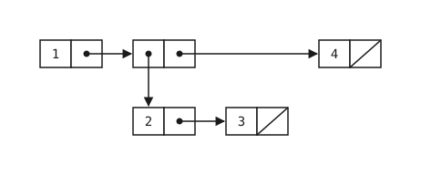

# Getting started

<p class="chapter-goal">Run your first program, pick a chapter, and meet the x-ray tools.</p>

## Install

There is nothing to install. You need Python 3.9 or newer.

```sh
git clone https://github.com/Jay-Jay-Tee/sicpfuf.git
cd sicpfuf
python3 -m sicpfuf -c 'print("hello")'
```

## Pick your chapter

The course language grows in four steps. `-v N` chooses which one sicpfuf enforces (the default is §4).

| Chapter | What it adds | Mental model |
|---|---|---|
| **§1** | names, functions, conditionals, `lambda` | substitution model |
| **§2** | pairs and linked lists: `pair`, `head`, `tail`, `llist`, `map`, `filter`, `reduce` … | substitution model |
| **§3** | reassignment, `while` and `for`, lists `[1, 2, 3]`, `set_head`/`set_tail`, streams | environment model |
| **§4** | `parse` and friends, for writing an evaluator | metacircular evaluator |

```sh
python3 -m sicpfuf program.py -v 2
```

A program can also say so itself, with a first line like `# chapter 2`.

sicpfuf is strict in the same way the course language is. This is real Python, but it is not Python §1:

```python title="§1"
count = 0
count = count + 1
print(count)
```
```text title="Output"
NameReassignmentError at line 2
    count = count + 1
    ^
NameReassignmentError: the name 'count' already has a value
sicpfuf hint: in Python §1 and §2 a name gets its value ONCE and keeps it. That is what lets you replace a name by its value (the substitution model). Pick a new name instead. (A parameter counts as already having a value, and so does a name assigned in the other branch of an if/else.)
```

## The interactive prompt

```sh
python3 -m sicpfuf -v 2
```

Unlike a program file, the prompt shows the value of an expression you type. It also has a few commands: `:env` draws the environment diagram, `:draw EXPR` draws a box-and-pointer diagram, `:ast CODE` shows the syntax tree, `:help` lists the rest.

## The x-ray tools

### The substitution model: `--subst`

For Python §1 and §2. Every line is one step of the model; deferred operations pile up to the right of a recursive process.

```python title="§1 · --subst"
def sum_to(n):
    return 0 if n == 0 else n + sum_to(n - 1)

sum_to(3)
```
```text title="Output"
sum_to(3)
-> 0 if 3 == 0 else 3 + sum_to(3 - 1)
-> 0 if False else 3 + sum_to(3 - 1)
-> 3 + sum_to(3 - 1)
-> 3 + sum_to(2)
-> 3 + (0 if 2 == 0 else 2 + sum_to(2 - 1))
-> 3 + (0 if False else 2 + sum_to(2 - 1))
-> 3 + (2 + sum_to(2 - 1))
-> 3 + (2 + sum_to(1))
-> 3 + (2 + (0 if 1 == 0 else 1 + sum_to(1 - 1)))
-> 3 + (2 + (0 if False else 1 + sum_to(1 - 1)))
-> 3 + (2 + (1 + sum_to(1 - 1)))
-> 3 + (2 + (1 + sum_to(0)))
-> 3 + (2 + (1 + (0 if 0 == 0 else 0 + sum_to(0 - 1))))
-> 3 + (2 + (1 + (0 if True else 0 + sum_to(0 - 1))))
-> 3 + (2 + (1 + 0))
-> 3 + (2 + 1)
-> 3 + 3
-> 6
```

### Call trees: `trace` and `measure`

`trace(f, args...)` calls `f` and draws every call it makes. `→` is a call that the caller waits for; `↻` is a **tail call**, which *replaces* the caller. `measure` reports time (calls and steps) and space (how many calls were waiting at once).

```python title="§1"
def sum_to(n):
    return 0 if n == 0 else n + sum_to(n - 1)

def sum_iter(n, total):
    return total if n == 0 else sum_iter(n - 1, total + n)

print(trace(sum_to, 3))
print(trace(sum_iter, 3, 0))
measure(sum_to, 500)
measure(sum_iter, 500, 0)
```
```text title="Output"
→ sum_to(3)
│  → sum_to(2)
│  │  → sum_to(1)
│  │  │  → sum_to(0)
│  │  │  ← 0
│  │  ← 1
│  ← 3
← 6
6
→ sum_iter(3, 0)
↻ sum_iter(2, 3)
↻ sum_iter(1, 5)
↻ sum_iter(0, 6)
← 6
6
[measure] sum_to(500): 501 calls, 6,006 steps, at most 501 waiting at once
[measure] sum_iter(500, 0): 501 calls, 6,506 steps, at most 1 waiting at once
```

### Box-and-pointer diagrams: `draw_data`

```python title="§2 · figure start"
draw_data(llist(1, llist(2, 3), 4))
```
```text title="Output"
[1|•]-->[•|•]----------->[4|/]
         |
         v
         [2|•]-->[3|/]
```

With `--out FOLDER`, sicpfuf also saves each diagram as a picture:



### The environment model: `show_env()`, `--env` and `--estep`

`show_env()` draws the environment diagram at that moment (see the [home page](index.md) for one). `--env` draws it when the program ends. `--estep` narrates every step:

```python title="§3 · --estep"
def make_adder(x):
    return lambda y: x + y

add5 = make_adder(5)
print(add5(1))
```
```text title="Output"
Defined make_adder: function object fn#1, created in the global environment
Called make_adder(5): new frame E1, whose enclosing environment is the global environment
Evaluated a lambda expression: function object fn#2, created in environment E1
Returned function object fn#2 from E1
Assigned add5 = function object fn#2 in the global frame
Called (anonymous)(1): new frame E2, whose enclosing environment is environment E1
Looked up x: not in frame E2, found in frame E1: 5
Returned 6 from E2
    output: 6
```

### Everything else

| You type | You get |
|---|---|
| `--trace fib,helper` | the call tree of those functions, for the whole program |
| `--steps` | time and space for the whole program |
| `--tokens`, `--ast` | what the lexer and the parser make of your program |
| `--typed` | the type checker of Python §4 Typed runs first |
| `--out FOLDER` | pictures (SVG) and sounds (WAV) are saved there |
| `--with FILE` | run `FILE` first, then your program (handy with `examples/mce.py`) |

The full manual is in the [x-ray reference](reference/xray.md).

## When something goes wrong

sicpfuf's error messages start with the same first line as the course's own tools, then add a hint in plain words:

```python title="§2"
def total(xs):
    return head(xs) + total(tail(xs))

print(total(llist(4, 8)))
```
```text title="Output"
TypeError at line 2
    return head(xs) + total(tail(xs))
TypeError: head(xs) expects a pair as argument xs, but encountered None
  in total, called from line 2: return head(xs) + total(tail(xs))  (x2)
  in total, called from line 4: print(total(llist(4, 8)))
sicpfuf hint: you took the head or tail of None, the EMPTY linked list. The usual cause is a missing base case: check `is_none(xs)` before `head(xs)` / `tail(xs)`.
```

Every error you can meet is explained in the [error reference](reference/errors.md).
